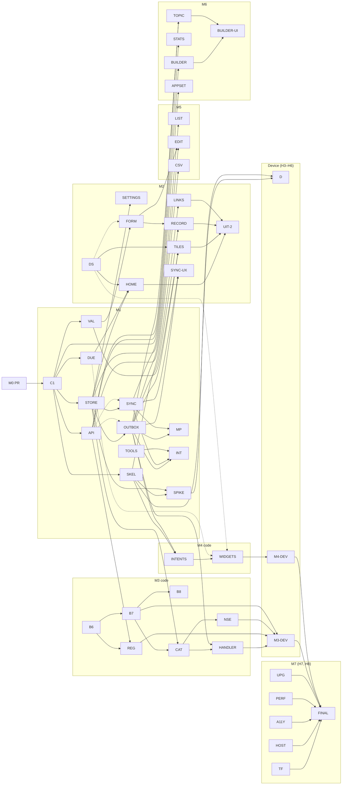

# quickR iOS: execution DAG (M0 PR → M7)

Author: Fable (planning sub-agent), 2026-10-17. Adopted by the orchestrator with one
change: stacked branches via `rebase --onto` instead of merge-commit PRs (see move 3).

Read against `ios/m0-foundations` at 11c1950 (PLAN v3, STATUS 2026-10-17, the
three specs). Where this deviates from PLAN §7 it says so.

**Three structural moves**

1. **Code is never device-gated; only validation is.** M3/M4 iOS code and B6–B8
   are built and simulator-tested dark. Checkpoint D, the M3 sandbox checklist
   and the M4 device checks become three small _validation WPs_ that run
   whenever H3–H6 land. Enrollment latency then costs hours at the end, not days
   in the middle.
2. **Contracts first, fakes everywhere.** One contracts WP (C1) lands model
   types, DTOs, DB schema, protocols (`Transport`, `Clock`, `LeaseClock`,
   `NotificationCenterProtocol`, repositories) and a `QuickrTestSupport` target
   (fixture loader, `FakeTransport`, `FakeClock`, `FakeNotificationCenter`,
   in-memory store) plus the `ProcessHelper` stub. UI, charts, builder and
   notification logic then start before the store is finished.
3. **Pipelined milestones.** Milestone N+1's branch is cut from N's _integrated
   tip_ when N's last WP merges; N's milestone review, PR and CI run while N+1's
   first wave implements. **Orchestrator decision:** the repo allows squash and
   rebase merges only, so milestone PRs are squash-merged into `feat/ios-app` and
   N+1 is moved with `git rebase --onto origin/feat/ios-app <N tip>` (Q5 dropped).

## 1. Critical path

**(a) First useful app on the phone** (home + tiles + record + sync via
`devicectl`):

```
M0 PR → C1 → STORE → OUTBOX ∥ SYNC → INT → HOME ∥ TILES → RECORD ∥ SYNC-UX → device install (H3–H5)
agent:  1h    1.5h     2h           1h     1.5h          1.5h       ≈ 8.5 h agent ≈ 12–14 h wall with reviews
```

Everything else (design system, API client, due port, form engine) runs beside
this chain; it is dependency-bound, not capacity-bound. ≈ 2–3 working days from
the M0 PR.

| Enrollment arrives      | What moves                                                                                                                                                                                                                                                                                      |
| ----------------------- | ----------------------------------------------------------------------------------------------------------------------------------------------------------------------------------------------------------------------------------------------------------------------------------------------- |
| **Early** (W2–W4)       | Run **D** right after SKEL+SPIKE (end of W4) on the M1 skeleton. Its findings (action count, NSE registration timing, budget) land _before_ CAT/NSE/HANDLER/WIDGETS are written (W6+). M3-DEV after W8 (needs H6), M4-DEV after W10. No rework.                                                 |
| **Late** (after W10)    | Nothing on the code path moves. One device wave at the end: D + M3-DEV + M4-DEV + M7 regression (≈ half a day). Risk is a late D no-go, mitigated by designing NSE/handler for the conservative case (2 visible actions, app-side registration primary, handler = enqueue + best-effort flush). |
| **Never in the window** | Simulator parity is still reached at W11; M7 is blocked on H7/H8 anyway.                                                                                                                                                                                                                        |

**(b) Full parity.** The dependency chain is short (M1 → M2 → M5/M6). The
binding constraint is the **simulator cap**: ~22 app-target WPs ≈ 25–30
agent-hours at 2 concurrent ≈ 13–15 h wall plus reviews ≈ 4–5 working days after
M1. Total ≈ 7–8 working days to simulator parity (W1–W11), then the device tail
and M7.

## 2. The DAG

Classes: **host** = `swift test` on macOS (Core/Data); **sim** = xcodebuild +
simulator (heavy, **cap 2 concurrent**; the orchestrator's `check-ios` counts as
one); **be** = backend/docker/pytest; **fe**; **docs**; **device**. Effort: S ≈
15–25 min agent, M ≈ 30–45, L ≈ 45–60, XL ≈ 60–90. Review: R1 one Codex round
expected, R2 two or three. Deps: **H** hard, **S** soft (start against fakes,
need the dep before merge).

### M1: core and data (branch `ios/m1-data`)

| id         | scope                                                                                                                                                                                                                                                                                       | deps                    | owns                                                                                                                | class         | effort                                           | review                 |
| ---------- | ------------------------------------------------------------------------------------------------------------------------------------------------------------------------------------------------------------------------------------------------------------------------------------------- | ----------------------- | ------------------------------------------------------------------------------------------------------------------- | ------------- | ------------------------------------------------ | ---------------------- |
| **C1**     | Model types, `AnswerValue`, `Problem`; DTOs + endpoint table with `operationId`s; store + registry schema SQL (sync §3.1, outbox §2, notif §5.1); protocols; `QuickrTestSupport` + `ProcessHelper` stubs; add GRDB, commit `Package.resolved`; one CI dispatch proving Xcode 26.6 builds it | M0 PR (S)               | `Package.swift`, `Package.resolved`, `project.yml`, `Core/Sources/Models`, `Data/Sources/Contracts`, `TestSupport/` | host          | L                                                | R2, orchestrator-owned |
| **DUE**    | Port of `schedule.py` with fold/gap semantics; 1,831 due vectors, 360 messages, 63 slots; STATUS log findings (merged slots, UTC sort, tiny early window)                                                                                                                                   | C1 H                    | `Core/Sources/Due`                                                                                                  | host          | L                                                | R2                     |
| **VAL**    | Validation + messages from `answerSchema.ts`; quick-log port; 380 vectors                                                                                                                                                                                                                   | C1 H                    | `Core/Sources/Validation`, `Core/Sources/QuickLog`                                                                  | host          | M                                                | R1                     |
| **API**    | Codable client, headers (channel, source, CF, Expect-*), outcome classification, decode tests for all 32 fixtures; **request-golden generator** + pytest validator (B5); G1 coverage test                                                                                                   | C1 H                    | `Data/Sources/API`, `shared/fixtures/requests`, `backend/tests/test_request_goldens.py`                             | host+be       | M                                                | R2                     |
| **STORE**  | GRDB pool in App Group, any-process IMMEDIATE migrator, two-layer view, repositories, `ValueObservation` + Darwin notify, registry file, lease primitives (`mach_continuous_time`, boot id), file protection, per-server partitioning                                                       | C1 H                    | `Data/Sources/Store`                                                                                                | host          | L                                                | R2                     |
| **OUTBOX** | Enqueue, state machine, classification/backoff, flush lock, ordering, coalescing, undo, `stale_revision` recovery, 404/409; ≈40 single-process matrix cases with fakes                                                                                                                      | STORE H, API S          | `Data/Sources/Outbox`                                                                                               | host          | XL (split enqueue/coalesce vs flush if > 90 min) | R2                     |
| **SYNC**   | Coordinator: bootstrap, pages, upsert guards, tombstones, atomic ack, epoch rebuild (stage + swap), reset, identity mismatch, clock skew; S2/S5/S6/S14/S15/S20                                                                                                                              | STORE H, API S          | `Data/Sources/Sync`                                                                                                 | host          | L–XL                                             | R2                     |
| **TOOLS**  | `make ios-integration` script, second docker stack (S8/49), fault-injecting proxy (case 59), per-worktree sim clone helper                                                                                                                                                                  | none                    | `ios/scripts/integration*`, `backend/tools/faultproxy.py`                                                           | be            | M                                                | R1                     |
| **MP**     | Real-subprocess tests with SIGSTOP/SIGKILL: outbox 8–10, 23–24, 32, 34, 39–40, 45–46, 48; sync S3/S4/S7/S11–S13/S16–S19; N4                                                                                                                                                                 | STORE, OUTBOX, SYNC H   | `TestSupport/ProcessHelper`, `DataTests/MultiProcess`                                                               | host (serial) | L                                                | R2                     |
| **INT**    | Suite vs docker: S1/S8/S9, outbox 12/17/18/32/38/49/51/59 (G4)                                                                                                                                                                                                                              | SYNC, OUTBOX, TOOLS H   | `DataTests/Integration`                                                                                             | be+host       | M                                                | R1                     |
| **SKEL**   | App wiring, store bootstrap, `AppIntentsPackage`; `TopicEntity` + `LogEntryIntent` stub resolving from app **and** widget (tested)                                                                                                                                                          | C1 H, STORE S           | `App/QuickRApp.swift`, `App/Intents`, `Widgets/` entry                                                              | sim           | M                                                | R1                     |
| **SPIKE**  | Local-notification spike: categories from the table, handler with the app killed writes + flushes; findings doc                                                                                                                                                                             | SKEL, STORE H, OUTBOX S | `App/Notifications/Spike`, `docs/ios/demo/m1/`                                                                      | sim           | M                                                | R1                     |

### M2 (M2a + M2b on one branch `ios/m2-ui`; two PRs cut by wave)

| id           | scope                                                                                                                                              | deps                          | owns                             | class            | effort | review |
| ------------ | -------------------------------------------------------------------------------------------------------------------------------------------------- | ----------------------------- | -------------------------------- | ---------------- | ------ | ------ |
| **DS**       | Tokens, fonts + Dynamic Type helper, dot grid, chips, stepper, tiles, toast centre, sync pill, icon, haptics; previews over `TestSupport` fixtures | scaffold only (**starts W1**) | `QuickrUI/Sources`, `Resources/` | sim              | L      | R2     |
| **LINKS**    | Typed `Route`, PWA path parser, `quickr://`, `NavigationStack` shell                                                                               | SKEL H                        | `App/Navigation`                 | sim (build-only) | S      | R1     |
| **SETTINGS** | Onboarding, server URL (store switch), CF token → Keychain, permission explainer                                                                   | STORE H, DS S                 | `App/Settings`                   | sim              | M      | R1     |
| **HOME**     | Due-first list, search/filter/sort, badge; `@Observable` over `ValueObservation`, reconcile on active                                              | STORE, DUE, DS H              | `App/Home`                       | sim              | L      | R2     |
| **TILES**    | Tiles at parity (chips, stepper ✓, last-value dot, 1.6 s confirm, drafts), undo toasts, `sendNow`                                                  | OUTBOX, VAL, DS H             | `App/Home/Tiles`, `App/Undo`     | sim              | M–L    | R2     |
| **FORM**     | Form engine for every question type, `FocusState` rules, inline validation; **built against fakes**                                                | VAL H, DS S                   | `App/Record/Form`                | sim              | L      | R2     |
| **RECORD**   | Same-as-last, details, log another, single-chip autosave, fix mode                                                                                 | FORM, OUTBOX, STORE H         | `App/Record`                     | sim              | M      | R2     |
| **SYNC-UX**  | Sync sheet, pill wiring, flush triggers (`scenePhase`, `NWPathMonitor`, backoff timer, `BGAppRefreshTask`, background task)                        | OUTBOX, SYNC H                | `App/Sync`                       | sim              | M      | R2     |
| **UIT-2**    | UI tests (chip+undo, offline record→sync, deep link, same-as-last), tap-count table, screenshots, GIFs                                             | HOME, TILES, RECORD, LINKS H  | `UITests/`, `docs/ios/demo/m2*`  | sim              | M      | R1     |

### M3 code (dark, lands in whichever milestone is open) + device

| id          | scope                                                                                                                                                                                                                                  | deps                  | owns                                                                                                           | class    | effort | human | review |
| ----------- | -------------------------------------------------------------------------------------------------------------------------------------------------------------------------------------------------------------------------------------- | --------------------- | -------------------------------------------------------------------------------------------------------------- | -------- | ------ | ----- | ------ |
| **B6**      | `apns_devices`, register/delete/test endpoints, `Sender` protocol, httpx h2 + ES256 JWT cache, error map, pruning, concurrent send; `apns_enabled=false`; MockTransport tests; regenerate `openapi.json`, TS client, response fixtures | none (**starts W1**)  | `backend/app/services/apns.py`, `push.py`, migration, `backend/tests/test_apns*`, `shared/fixtures/api/*apns*` | be       | L      | —     | R2     |
| **B7**      | Channel-neutral `Notification`, descriptor (top-4, last_value) from `quicklog.py`, category hash, APNs headers, no badge, ≤ 4 KB test; **`quicklog-vectors.json` gains category-id cases**                                             | B6 H                  | `backend/app/services/notification.py`, `scheduler.py`, `shared/fixtures/quicklog-vectors.json`                | be       | M      | —     | R2     |
| **B8**      | PWA Chromium `actions`, SW enqueue, `ios` badge                                                                                                                                                                                        | B7 H                  | `frontend/src/sw.ts`, `lib/push*`, `components/pwa`                                                            | fe       | M      | —     | R1     |
| **CAT**     | Category table, registration under registry lock, reconciliation, hash = Python (N1), action ids (N3), N5/N6                                                                                                                           | STORE H, B7 H         | `Data/Sources/Notifications`                                                                                   | host     | M      | —     | R2     |
| **REG**     | Token lifecycle, `embedded.mobileprovision` parser (N11), N12/N13, "Test this device"                                                                                                                                                  | API, B6 H, SETTINGS S | `App/Notifications/Registration`                                                                               | host+sim | M      | —     | R2     |
| **NSE**     | NSE flow + badge from the active store; N9                                                                                                                                                                                             | CAT H                 | `NotificationService/`                                                                                         | sim      | M      | —     | R1     |
| **HANDLER** | Validate vs `userInfo`, one-tx write, remove delivered, flush in budget; number input + tap-to-fix; N7/N8/N10/N14/N15                                                                                                                  | CAT, OUTBOX H         | `App/Notifications/Handler`                                                                                    | sim      | M      | —     | R2     |
| **M3-DEV**  | Sandbox checklist (5 items), recording; `.p8` via compose override                                                                                                                                                                     | all above             | `docs/ios/demo/m3`                                                                                             | device   | S      | H3–H6 | —      |

### M4 code + device, and D

| id          | scope                                                                                                                                                                                                                                                                                                                                                                                                                                                                                                                                                                                           | deps                                           | owns                                  | class  | effort        | human | review                       |
| ----------- | ----------------------------------------------------------------------------------------------------------------------------------------------------------------------------------------------------------------------------------------------------------------------------------------------------------------------------------------------------------------------------------------------------------------------------------------------------------------------------------------------------------------------------------------------------------------------------------------------- | ---------------------------------------------- | ------------------------------------- | ------ | ------------- | ----- | ---------------------------- |
| **INTENTS** | **(updated by research/04-siri.md)** Starts with a 1-day spike: repeated `requestValue` on one parameter, the time budget while Siri waits for the user, on-device model latency and rate limits in the background, and new Siri not showing snippets. Then: `TopicEntity` (IndexedEntity) + dependent option entities, `LogEntryIntent`, **`LogTopicIntent`** (multi-turn plus confirmation snippet plus the Foundation Model one-sentence path), `RepeatLastEntryIntent`, `OpenRecordIntent`, **`WhatsDueIntent`**, `UndoableIntent`, `AppShortcutsProvider`, and an AppIntentsTesting target | SKEL, OUTBOX, VAL, FORM (answer/draft model) H | `App/Intents`, `Data/Sources/Intents` | sim    | **L** (was M) | —     | R2                           |
| **WIDGETS** | Per-topic quick-log widget, due list, Lock Screen accessories, `ControlWidgetButton`; durable enqueue + "queued"; reload policy                                                                                                                                                                                                                                                                                                                                                                                                                                                                 | INTENTS, DUE, DS H                             | `Widgets/`                            | sim    | L             | —     | R2                           |
| **M4-DEV**  | Widget offline + app killed, Action button, Siri, MP soak; recording                                                                                                                                                                                                                                                                                                                                                                                                                                                                                                                            | WIDGETS                                        | `docs/ios/demo/m4`                    | device | S             | H3–H5 | —                            |
| **D**       | Probe: devicectl install, NSE timing, action count, budget, pre-unlock, widget buttons, Action button; go/no-go PR                                                                                                                                                                                                                                                                                                                                                                                                                                                                              | SKEL, SPIKE H                                  | `docs/ios/demo/d`                     | device | S             | H3–H5 | waits for user only on no-go |

### M5, M6, M7

| id             | scope                                                                                                                   | deps              | owns                                         | class | effort | human | review         |
| -------------- | ----------------------------------------------------------------------------------------------------------------------- | ----------------- | -------------------------------------------- | ----- | ------ | ----- | -------------- |
| **LIST**       | Entries list, filters, pending/failed pinned, offline                                                                   | STORE, DS H       | `App/Entries/List`                           | sim   | M      | —     | R1             |
| **EDIT**       | Edit vs pinned version (reuses FORM), delete with undo                                                                  | FORM, OUTBOX H    | `App/Entries/Edit`                           | sim   | M      | —     | R2             |
| **CSV**        | Share-sheet export, online-only                                                                                         | API H             | `App/Entries/Export`                         | sim   | S      | —     | R1             |
| **UIT-5**      | UI test edit/delete/undo; INT: web edit reaches phone (17/18 already in INT)                                            | LIST, EDIT H      | `UITests/Entries`                            | sim   | S      | —     | R1             |
| **BUILDER**    | Port of `builder.ts` + `builder.test.ts`, compatibility report; **pure Core, starts early**                             | C1 H              | `Core/Sources/Builder`                       | host  | L      | —     | R2             |
| **STATS**      | Chart models (buckets, tz) from stats/series fixtures, `stats_cache`, stale label, Swift Charts views; **starts early** | API H, DS S       | `QuickrUI/Sources/Charts`, `App/Stats`       | sim   | L      | —     | R2             |
| **TOPIC**      | Create, details, schedule editor, archive with undo, delete with typed confirm, online-only messaging                   | API, OUTBOX, DS H | `App/Topics`                                 | sim   | M–L    | —     | R2             |
| **BUILDER-UI** | Builder screens, publish (live 409), conflicts, versions                                                                | BUILDER, TOPIC H  | `App/Topics/Builder`                         | sim   | L      | —     | R2             |
| **APPSET**     | Sync status, reset (warn on pending), about, licences                                                                   | SYNC, SETTINGS H  | `App/Settings/App`                           | sim   | S      | —     | R1             |
| **UIT-6**      | create → log → publish v2 → log                                                                                         | BUILDER-UI H      | `UITests/Topics`                             | sim   | S      | —     | R1             |
| **A11Y**       | VoiceOver, accessibility sizes, 44 pt targets                                                                           | M2 PR             | all `App/` (schedule when no App WP is open) | sim   | M      | —     | R1             |
| **PERF**       | 10k-entry seed, cold start < 1 s                                                                                        | STORE, HOME H     | `ios/scripts/seed.sh`, `DataTests/Perf`      | sim   | M      | —     | R1             |
| **UPG**        | v1-schema upgrade test                                                                                                  | STORE H           | `DataTests/Upgrade`                          | host  | S      | —     | R1             |
| **TF**         | `make ios-testflight` (archive, ASC API upload)                                                                         | —                 | `ios/scripts/testflight.sh`                  | sim   | M      | H7    | R1             |
| **HOST**       | B9 docs, CF service-token e2e                                                                                           | SETTINGS          | `docs/hosting`                               | docs  | S      | H8    | R1             |
| **FINAL**      | Docs, device regression, PR `feat/ios-app` → `main`                                                                     | everything        | —                                            | —     | M      | H3–H8 | Codex + Claude |



## 3. Wave schedule

Each wave ≈ 1.5–2 h wall clock. Concurrency ≤ 4; **sim ≤ 2** (a third app-target
WP may run _build-only_ until its tests). Wave N's reviews run during wave N+1;
fix rounds go back to the same agent via `SendMessage`. The orchestrator
integrates FIFO as WPs go green, running `check-ios` on iOS 26.0 only; both
runtimes only at the milestone PR.

| wave                     | WPs (class)                                                                                 | sim    | reviews in flight             | integrate / notes                                                                                               |
| ------------------------ | ------------------------------------------------------------------------------------------- | ------ | ----------------------------- | --------------------------------------------------------------------------------------------------------------- |
| **W1** (now, M0 PR open) | **C1** (host) · **DS** (sim) · **B6** (be) · **TOOLS** (be)                                 | 1      | M0 re-check                   | C1 branches from the m0 tip (`rebase --onto` if M0 squashes). B6 lands dark in M1's PR. One CI dispatch for C1. |
| **W2**                   | **STORE** · **API** · **DUE** · **VAL** (host)                                              | 0      | DS, B6, TOOLS                 | Merge C1 first; start STORE first (longest).                                                                    |
| **W3**                   | **OUTBOX** · **SYNC** (host) · **SKEL** (sim) · **B7** (be)                                 | 1      | STORE, API, DUE, VAL          | Merge STORE + API before start.                                                                                 |
| **W4**                   | **MP** (host, serial) · **INT** (be+host) · **SPIKE** (sim) · **FORM** (sim, fakes)         | 2      | OUTBOX, SYNC, SKEL, B7        | FORM lands on `ios/m2-ui`. **If H3–H5 done: run D now.**                                                        |
| **W5**                   | **HOME** · **TILES** (sim) · **LINKS**+**SETTINGS** (build-only) · **B8** (fe)              | 2+1    | MP, INT, SPIKE                | M1 integrated at W4 end; M1 review + PR + CI run _during_ W5. Cut `ios/m2-ui` from the M1 tip.                  |
| **W6**                   | **RECORD** · **SYNC-UX** (sim) · **CAT** · **BUILDER** (host)                               | 2      | HOME, TILES, LINKS, SETTINGS  | M2a PR (DS, home, tiles, settings, chip+undo UI test pulled forward).                                           |
| **W7**                   | **UIT-2** · **LIST** (sim) · **REG** (host, sim-light) · **STATS** (models host, views sim) | 2      | RECORD, SYNC-UX, CAT, BUILDER |                                                                                                                 |
| **W8**                   | **EDIT** · **NSE** (sim) · **HANDLER** (build-only first) · **CSV**                         | 2+1    | UIT-2, LIST, REG, STATS       | M2b PR (record, sync UX, links, UI tests). **If H3–H6: M3-DEV now.**                                            |
| **W9**                   | **INTENTS** · **TOPIC** (sim) · **UIT-5** (short) · **APPSET**                              | 2      | EDIT, NSE, HANDLER            | M3-code + M5 PR.                                                                                                |
| **W10**                  | **WIDGETS** · **BUILDER-UI** (sim) · **PERF** · **UPG** (host)                              | 2      | INTENTS, TOPIC, UIT-5         | **If H3–H5: M4-DEV now.**                                                                                       |
| **W11**                  | **UIT-6** · **A11Y** (sim) · **TF** (H7) · **HOST** (H8)                                    | 2      | WIDGETS, BUILDER-UI, PERF     | M6 + M4-code PR. Simulator parity.                                                                              |
| **W12**                  | **D / M3-DEV / M4-DEV** if not yet run · **FINAL**                                          | device | —                             | Gated on H3–H8.                                                                                                 |

≈ 20–24 h orchestration wall clock ≈ 3–4 long days to simulator parity, plus the
device tail.

## 4. Milestone-boundary optimisations

| Change vs PLAN §7                                                                                                                                            | Why                                                                                                                            | Cost                                             |
| ------------------------------------------------------------------------------------------------------------------------------------------------------------ | ------------------------------------------------------------------------------------------------------------------------------ | ------------------------------------------------ |
| **Split M3/M4 into code (dark) + device-validation WPs**                                                                                                     | Takes enrollment off every code path; D can reshape M3 before its code exists                                                  | Two small extra PRs (findings, recordings)       |
| **DS in W1; FORM/BUILDER/STATS against fixtures and fakes in W4–W7**                                                                                         | Fills idle slots during M1 without touching M1's files                                                                         | Needs C1 + `QuickrTestSupport` first             |
| **M2a + M2b on one branch, two PRs by wave**                                                                                                                 | One cut instead of two; PRs stay ≈ L                                                                                           | None                                             |
| **Batch PRs: M3-code + M5; M4-code + M6**                                                                                                                    | Saves two milestone review cycles (~1–1.5 h each) and two CI runs (~20 macOS min each); WP-level Codex already covers the code | Larger diffs; keep the §11 matrix per PR         |
| **Stacked milestone branches** (squash-merge N, then `rebase --onto` N+1)                                                                                    | Lets N+1 start from N's tip while N is in review                                                                               | One rebase per milestone (orchestrator)          |
| **Gate by class**: Core/Data WPs run `ios-core-test` + lint; only app-target WPs run xcodebuild; `check-ios` on 26.0 at integration, both runtimes at the PR | Halves simulator load and WP turnaround                                                                                        | G3 still proven at every PR and in CI            |
| **Draft PRs**: push fix-ups while draft, mark ready exactly once                                                                                             | `synchronize` on a ready PR re-runs the 15–20 min macOS job; 8 PRs × 3 fix-ups blows the 300 min/month budget                  | Discipline                                       |
| **Pipelined reviews** (wave N reviewed during N+1; same agent fixes)                                                                                         | Removes 30–45 min review latency per WP from the critical path                                                                 | Orchestrator juggles ≤ 4 running + ≤ 4 in review |
| **Orchestrator-only files**: STATUS.md, `Package.swift`, `project.yml`, `Makefile`, `openapi.json`, fixtures (via C1, B6, B7)                                | Removes the only realistic merge conflicts; everything else is disjoint by directory                                           | Contract WPs serialise                           |
| **`QuickrTestSupport` target** (new)                                                                                                                         | One fake set reused by FORM, TILES, STATS, CAT, HANDLER, UI tests                                                              | Small C1 addition                                |

## 5. Risks and mitigations

| Risk                                                                                                                    | Impact                                      | Mitigation                                                                                                                                                                                                                 |
| ----------------------------------------------------------------------------------------------------------------------- | ------------------------------------------- | -------------------------------------------------------------------------------------------------------------------------------------------------------------------------------------------------------------------------- |
| **D no-go** (NSE category not applied before display; 2 actions visible; budget too small; pre-unlock store unreadable) | NSE/HANDLER rework; widget button semantics | Design conservatively now: app-side registration primary, handler = one tx + best-effort flush, layouts valid at 2 actions. SPIKE (W4) catches simulator-visible problems first. A no-go touches only NSE/HANDLER (2 × M). |
| **CI Xcode 26.6 vs local 27.1** (Swift 6.4 locally; strict concurrency, iOS 27 API leaks, `Package.resolved`)           | Red CI at the first real PR                 | C1 does one `workflow_dispatch` right after adding GRDB; `ios-lint` greps for iOS 27 symbols and enforces `@available`; tools-6.2 features only.                                                                           |
| **macOS CI budget** (300 min/month; PR job 15–20 min; `synchronize` re-runs)                                            | CI silently stops gating mid-project        | Draft-PR discipline; 6 PRs not 8; record usage in STATUS at every PR; above 70 % by M4, drop the push job.                                                                                                                 |
| **OUTBOX/SYNC XL, 82 matrix cases, MP flakiness** (SIGSTOP timing, TTL waits)                                           | M1 overruns; this is the critical path      | Injectable `LeaseClock`; MP tests in their own target, serial, with pipe barriers instead of sleeps; split OUTBOX if > 90 min.                                                                                             |
| **One Mac saturated** (2 sims + swift test + 2 docker stacks + Codex)                                                   | WPs 2–3× slower, flaky UI tests             | Enforce the sim cap; UI test plan only in UIT-* WPs; shared SPM cache; orchestrator runs `check-ios` only when ≤ 1 sim WP is active.                                                                                       |
| **Swift 6 + GRDB across three targets**                                                                                 | STORE stalls; patterns diverge later        | C1 compiles a `DatabasePool` + one `Sendable` repository in all targets and documents the pattern.                                                                                                                         |
| **App Intents metadata duplication** across package/app/widget                                                          | Intents silently fail on device             | SKEL proves resolution from both targets in M1; one `AppIntentsPackage` per target, tested.                                                                                                                                |
| **Enrollment late or absent**                                                                                           | Half-day device tail; late D rework         | §1; keep M3-DEV/M4-DEV checklists ready in PR bodies so the device day is mechanical.                                                                                                                                      |
| **Fixture and golden churn** (B6/B7 change DTOs after API lands)                                                        | Repeated regenerations across WPs           | B6 regenerates its fixtures before API starts (W1 → W2); the orchestrator regenerates once per integration, never inside a WP.                                                                                             |
| **Unknown phone** (no Action button below 15 Pro)                                                                       | One M4-DEV row unticked                     | WIDGETS builds Controls regardless; mark the row `[-]` with the reason.                                                                                                                                                    |
