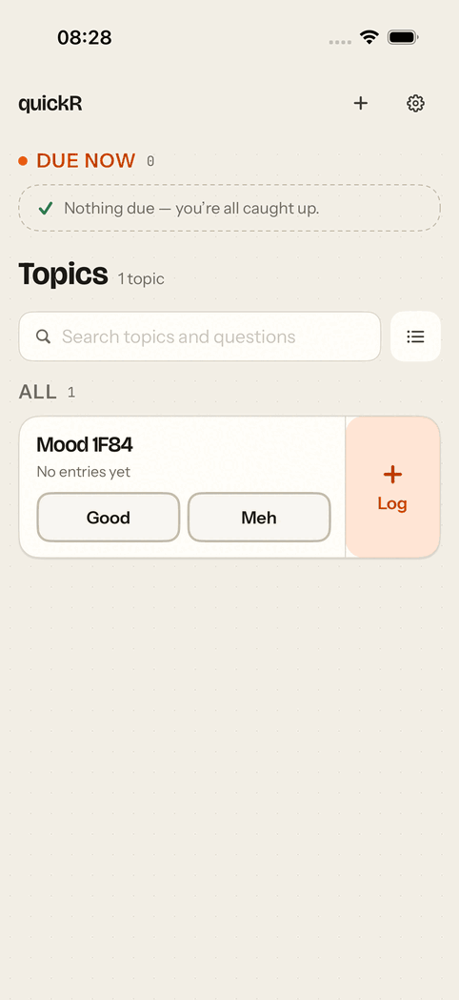
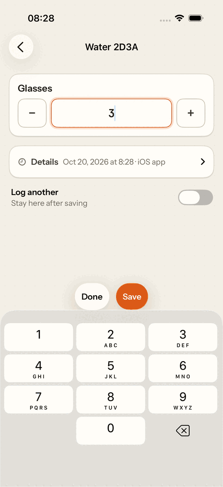
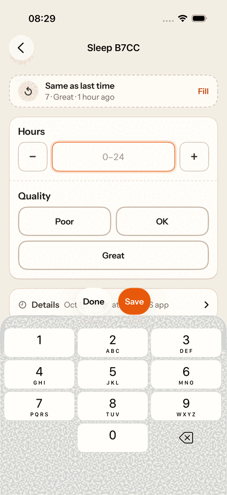
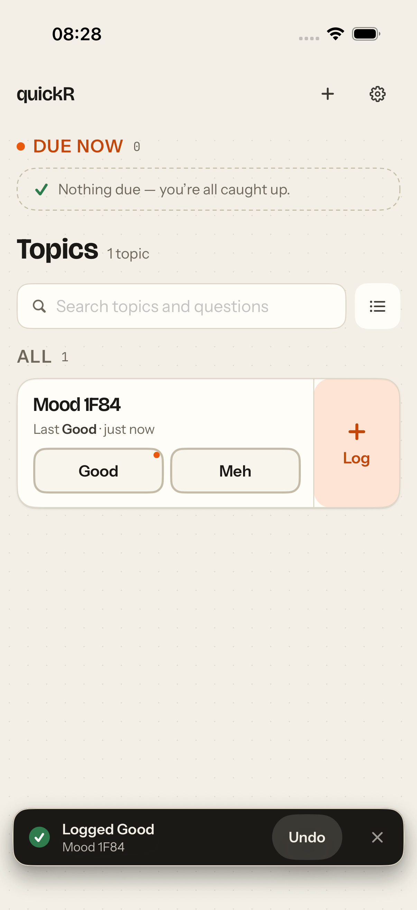
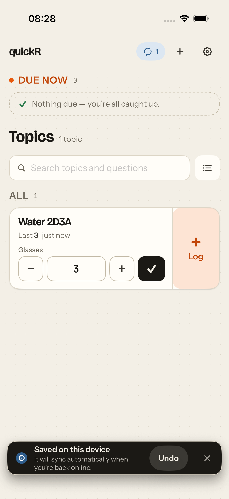
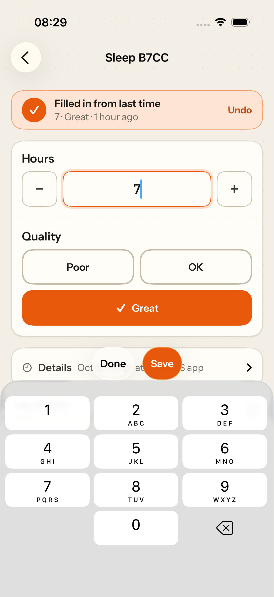
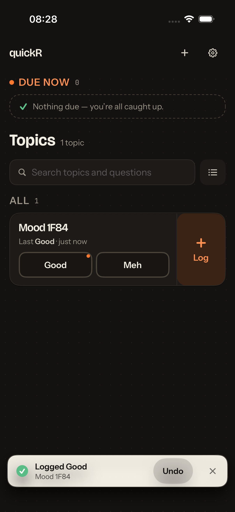
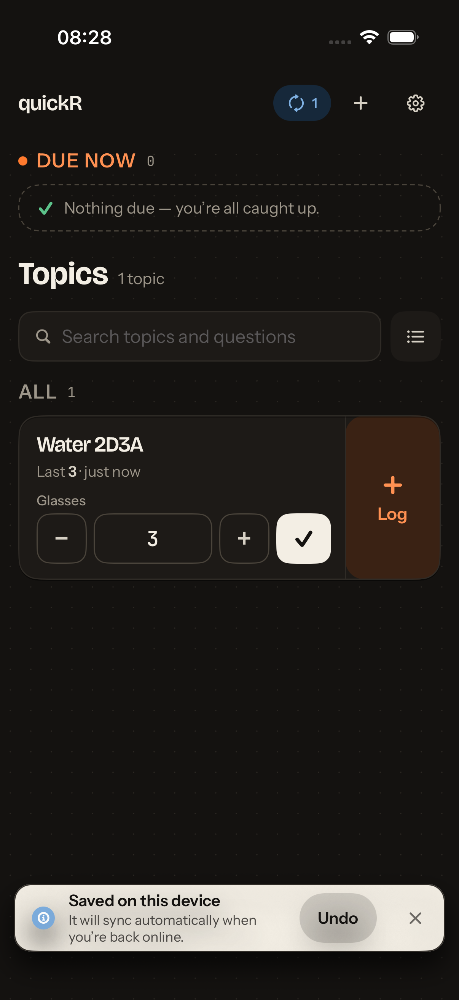
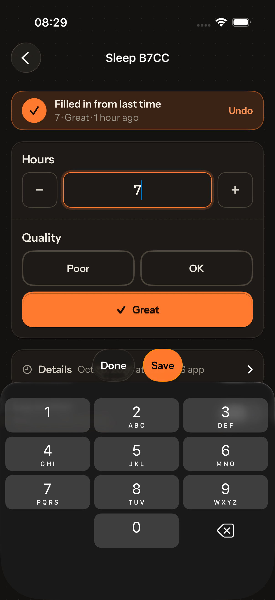

# Tap counts: iOS vs the PWA

The design loop's scenarios
([frontend/docs/design-loop.md](../../../../frontend/docs/design-loop.md))
measured on the native app. `UITests/TapCountUITests` replays each scenario on
the simulator against a real backend (this worktree's integration stack) with
the same topics as the PWA's measurement:

- **Headache:** one required single-select, 4 options.
- **Water:** one required int, in glasses.
- **Workout:** type enum, duration int, distance double (optional), and RPE int.

Every tap goes through one counting helper. Each test asserts its count and
checks that the entry reached the server, so a regression in either fails the
test. Run it with `make ios-uitest-e2e IOS_SIM=<udid>`.

Counting rules match the PWA's. A count starts with the app open on the home
screen, or with the notification tap, and ends when the entry is saved. Typing a
value counts as typing, not as taps.

| Scenario                                     | PWA (final)                     | iOS (M2)                             | Notes                                                                       |
| -------------------------------------------- | ------------------------------- | ------------------------------------ | --------------------------------------------------------------------------- |
| (a) 1-question enum (Headache)               | **1** chip on the tile          | **1** chip on the tile               | Sent at once; the chip turns green with a ✓                                 |
| (b) 1-question number (Water)                | **1** ✓ (last value) · 2 with ± | **1** ✓ (last value) · **2** with ±  | The stepper starts at the last value                                        |
| (c) 4-question mixed (Workout)               | **4** + 2 values                | **4** + 2 values                     | Log → Run (focus moves to Duration) → type → RPE → type → Save              |
| (d) 4-question, same answers as last time    | **3** Log → Same as last → Save | **3** Log → Same as last time → Save | "Same as last time" offers the server's latest entry, even one from the web |
| (e) due topic from a notification (Headache) | **2** notification → chip       | **2** notification → chip            | Measured through the notification's link (`quickr://t/<slug>/record`)       |
| (e) due topic from a notification (Water)    | **2** notification → Save       | **2** notification → Save            | The record screen starts at the last value                                  |
| (f) undo a mistaken quick-log                | **1** Undo in the toast         | **1** Undo in the toast              | The entry is deleted on the server too                                      |
| (g) log while offline (Headache)             | **1** (queued, syncs later)     | **1** (queued, syncs later)          | It syncs when the app comes back to the foreground                          |

iOS matches the PWA's final column in every row.

## Where iOS differs

- **(c), Next vs tap.** Number fields have a keyboard-toolbar **Next**, which
  moves to the next empty typed answer, including the optional Distance.
  Reaching RPE by Next takes two taps, so the count uses a direct tap on RPE, as
  the PWA's does. Skipping optional answers on Next would make Next as fast as
  the direct tap; this is left as a candidate for a later design-loop iteration.
- **(e) before M3.** Real notifications, with their actions, arrive in M3
  (HANDLER). Their inline actions can log in **1** (the notification's chip),
  with no app open. Here the notification is simulated by its link, which is
  what a plain notification tap opens.
- **(g), reconnect.** The PWA's outbox syncs when the connection comes back. The
  test brings the app back to the foreground after reconnecting, because
  foregrounding forces a flush. SYNC-UX adds the other triggers (network path,
  backoff timer, background refresh).

## End-to-end checks

`UITests/EndToEndUITests` runs the main flows against the same stack and checks
the server:

- **Chip → Undo:** the entry reaches the server, and Undo deletes it there.
- **Offline record → reconnect:** saved on the device while every request fails,
  then synced with `source = ios` once the network is back and the app returns
  to the foreground.
- **Links:** by slug and by id; cold (at launch) and warm (while running);
  `quickr://` and the server's own PWA URL. All of them open the same record
  screen.
- **Same as last time:** after an entry logged on the web, the offer fills its
  answers and saves a second identical entry.

## Demo

From the end-to-end run (`make ios-uitest-e2e`), against a real backend:

| Chip → Undo                    | Offline → reconnect               | Same as last time                 |
| ------------------------------ | --------------------------------- | --------------------------------- |
|         |         |         |
|  |  |  |
|  |   |   |

While the keyboard is up, Save sits in the keyboard's toolbar after Next/Done
(`formSaveBar`); iOS 26 centres that group above the keys.

