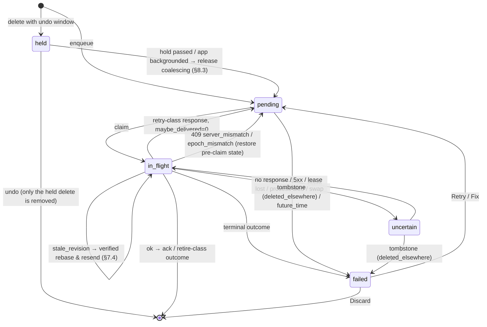

# Spec: outbox (iOS client)

**Status:** M0 draft, revision 2 (after the Codex spec review), 2026-10-17.
**Implements:** PLAN.md §2 ("Outbox" and "Server-side safety"), §6, and §6a
rules 2, 6 and 7. **Companion specs:** [sync-protocol.md](sync-protocol.md)
covers the view, acks, fences, leases and tombstones.
[notifications.md](notifications.md) covers action writes.

## Purpose

The outbox is the only way the iOS client changes server data while offline.
Every process shares it: the app, the widget extension, the notification action
handler and App Intents. It must stay correct when:

- processes run concurrently;
- a process is suspended or killed in the middle of a send;
- a response is lost;
- the user undoes an action while it is in flight;
- other devices delete or edit the same data;
- the server is restored or replaced.

The outbox extends the PWA outbox (`frontend/src/lib/outbox/*`), which has only
`entry.create`. The classification table and the backoff are byte-compatible
with the PWA. Everything else here is new design.

**Normative language.** **MUST**, **MUST NOT**, **SHOULD** and **MAY** follow
RFC 2119. **[server]** marks a backend contract requirement
([sync-protocol.md §1.3](sync-protocol.md#13-contract-requirements)).

## Glossary

| Term                | Meaning                                                                                                                                                                                                                                                                                        |
| ------------------- | ---------------------------------------------------------------------------------------------------------------------------------------------------------------------------------------------------------------------------------------------------------------------------------------------- |
| **Item**            | One queued operation, stored as one row of `outbox_item`.                                                                                                                                                                                                                                      |
| **Entity**          | What an item changes: `entry:{id}` or `topic:{id}`.                                                                                                                                                                                                                                            |
| **seq**             | The local `INTEGER PRIMARY KEY AUTOINCREMENT` of `outbox_item`. It is the total order of user intent across processes.                                                                                                                                                                         |
| **Topic scope**     | All unresolved items with the same `topic_id`, ordered by `seq`.                                                                                                                                                                                                                               |
| **Active**          | An item whose state is `pending`, `in_flight` or `uncertain`.                                                                                                                                                                                                                                  |
| **Unresolved**      | An item that is active, `held` or `failed`; in other words, any item still in the table.                                                                                                                                                                                                       |
| **Never attempted** | `attempts = 0`. No request for the item has ever been built. Only never-attempted items can be coalesced (§8).                                                                                                                                                                                 |
| **Maybe delivered** | `maybe_delivered = 1`. A request for the item might have reached the server.                                                                                                                                                                                                                   |
| **Claim**           | Moving an item to `in_flight` while holding the `flush` lease, with a fresh `claim_token`.                                                                                                                                                                                                     |
| **Sender check**    | The fence that every transaction run by a sender must pass: the `flush` lease is valid and has my token, the item still has my `claim_token`, `layer_gen` and `epoch` equal the claim's, and the store is not retired ([sync-protocol.md §5.5](sync-protocol.md#55-fencing-and-generations)).  |
| **Retire**          | Remove an item without a server effect and without an error, because its goal is moot or already met.                                                                                                                                                                                          |
| **Ack**             | Remove an item after a definitive success ([sync-protocol.md §6](sync-protocol.md#6-atomic-ack-6a-rule-7)).                                                                                                                                                                                    |
| **Base revision**   | The entity `revision` that an update or archive was based on. It is sent as `expected_revision`.                                                                                                                                                                                               |
| **Lease time**      | `(boot_id, ct)`, where `ct` is nanoseconds of `mach_continuous_time`. Every deadline in this spec (leases, holds, backoff) uses lease time. A different `boot_id` means the deadline has passed ([sync-protocol.md §5.3](sync-protocol.md#53-lease-row-semantics-shared-with-the-flush-lock)). |
| **Budget**          | The wall time a process may spend flushing before it must stop.                                                                                                                                                                                                                                |

## 1. Kinds

| Kind              | Entity            | Request                                                                     | Payload (JSON)                                                                                                   |
| ----------------- | ----------------- | --------------------------------------------------------------------------- | ---------------------------------------------------------------------------------------------------------------- |
| `entry.create`    | `entry:{item.id}` | `POST /api/v1/topics/{topic_id}/entries`, body `{...body, id: item.id}`     | `{topic: {id, slug, name}, body: EntryCreate without id}`. `body.version` and `body.captured_at` are always set. |
| `entry.update`    | `entry:{id}`      | `PATCH /api/v1/entries/{id}`, body `{...changed fields, expected_revision}` | `{entry_id, topic_id, patch: EntryUpdate}`, holding only the changed keys                                        |
| `entry.delete`    | `entry:{id}`      | `DELETE /api/v1/entries/{id}`                                               | `{entry_id, topic_id}`                                                                                           |
| `topic.archive`   | `topic:{id}`      | `POST /api/v1/topics/{id}/archive?expected_revision={n}` (query, no body)   | `{topic_id}`                                                                                                     |
| `topic.unarchive` | `topic:{id}`      | `POST /api/v1/topics/{id}/unarchive?expected_revision={n}` (query, no body) | `{topic_id}`                                                                                                     |

- For `entry.create`, the item id **is** the entry id, so creation is idempotent
  (as in the PWA). Every other kind gets a fresh UUID as its item id.
- Requests are built **at send time**. `expected_revision` comes from the item's
  current `base_revision` (§7.3).
- The topic is addressed by **id**, never by slug.

## 2. Item schema

```sql
CREATE TABLE outbox_item (
  seq             INTEGER PRIMARY KEY AUTOINCREMENT,
  id              TEXT NOT NULL UNIQUE,
  kind            TEXT NOT NULL,
  entity_kind     TEXT NOT NULL,                 -- 'entry' | 'topic'
  entity_id       TEXT NOT NULL,
  topic_id        TEXT NOT NULL,
  payload_json    TEXT NOT NULL,
  base_revision   INTEGER,                       -- §7.3; NULL = inherit from predecessor
  state           TEXT NOT NULL CHECK (state IN ('held','pending','in_flight','uncertain','failed')),
  maybe_delivered INTEGER NOT NULL DEFAULT 0,    -- sticky
  attempts        INTEGER NOT NULL DEFAULT 0,
  due_boot_id     TEXT,                          -- backoff deadline in lease time; NULL = due now
  due_ct          INTEGER,
  hold_boot_id    TEXT,                          -- undo hold deadline in lease time (state 'held')
  hold_ct         INTEGER,
  claim_token     TEXT,                          -- set while in_flight
  claim_owner     TEXT,
  claim_layer_gen INTEGER,                       -- sync_state.layer_gen at claim
  claim_epoch     TEXT,                          -- sync_state.epoch at claim
  pre_claim_json  TEXT,                          -- {state, attempts, due_*} before the claim (§5.2 precondition restore)
  failure_reason  TEXT,                          -- rejected | deleted_elsewhere | conflict | topic_archived | topic_missing | future_time
  last_error_json TEXT,                          -- {message, status, body?}, the PWA OutboxError shape
  rebase_count    INTEGER NOT NULL DEFAULT 0,
  cancels_create  INTEGER NOT NULL DEFAULT 0,    -- entry.delete enqueued to cancel an in-flight create (§9.1)
  origin          TEXT NOT NULL,                 -- app | widget | notification | siri
  created_at      REAL NOT NULL,                 -- wall clock, for display and archived_at only
  updated_at      REAL NOT NULL,
  row_version     INTEGER NOT NULL DEFAULT 0     -- CAS for user edits
);
CREATE INDEX ix_outbox_entity ON outbox_item(entity_kind, entity_id, seq);
CREATE INDEX ix_outbox_topic  ON outbox_item(topic_id, seq);
CREATE INDEX ix_outbox_state  ON outbox_item(state);
```

An item is **due** when `due_boot_id IS NULL`, or
`due_boot_id ≠ current_boot_id`, or `now_ct ≥ due_ct`. A hold has **passed**
under the same rule applied to its `hold_*` fields. Changing the wall clock in
either direction never delays or advances an item.

## 3. State machine

| State       | Meaning                                                                                                            | In the view                                  |
| ----------- | ------------------------------------------------------------------------------------------------------------------ | -------------------------------------------- |
| `held`      | Only `entry.delete`, while its undo window is open. The item is never sent and is never coalesced (§9.2).          | Applied: the row is hidden but can be undone |
| `pending`   | Sent automatically when due, or when a flush is forced. `maybe_delivered = 0`.                                     | Applied                                      |
| `in_flight` | Claimed. A request may be on the wire.                                                                             | Applied                                      |
| `uncertain` | Like `pending`, but `maybe_delivered = 1`. The sync sheet shows it as "Sending… (checking)".                       | Applied                                      |
| `failed`    | Terminal. The user can Retry, Fix or Discard it (§11). It is never sent automatically, not even by a forced flush. | Applied for display and flagged              |

Items leave the table through **ack**, **retire**, **discard** (a user action)
or **coalesce** (§8).



The pre-claim state is `pending` or `uncertain`. A `pending` item can also leave
the table without being sent: by coalescing, undo or retirement.

| #   | Rule                                                                                                                                                                                                                                                                                                                                                                                                                                                                              |
| --- | --------------------------------------------------------------------------------------------------------------------------------------------------------------------------------------------------------------------------------------------------------------------------------------------------------------------------------------------------------------------------------------------------------------------------------------------------------------------------------- |
| S1  | A claim happens in one `IMMEDIATE` transaction that renews the `flush` lease and checks the rebuild guard (§6.2). It saves `pre_claim_json`, sets `state = in_flight`, a new `claim_token`, `claim_owner`, `claim_layer_gen` and `claim_epoch`, and does `attempts += 1`.                                                                                                                                                                                                         |
| S2  | **Every** transaction a sender runs after its claim begins with the **sender check**. This includes outcome bookkeeping, acks, rebase upserts, revision updates, and the decision to resend. If the check fails, the sender **discards the outcome entirely and stops**. It writes nothing: no server state, no item state.                                                                                                                                                       |
| S3  | `maybe_delivered` becomes 1 when an attempt ends without a definitive response: a network error after the request started, a timeout, a 5xx, the process dying, the lease being lost, or a rebuild swap. **It is never cleared.**                                                                                                                                                                                                                                                 |
| S4  | A retry-class outcome returns the item to `uncertain` if `maybe_delivered = 1`, and to `pending` otherwise. The backoff deadline becomes `now_ct + backoff(attempts)`.                                                                                                                                                                                                                                                                                                            |
| S5  | An item only enters `failed` with a `failure_reason`. An item that has had a 2xx never fails.                                                                                                                                                                                                                                                                                                                                                                                     |
| S6  | Payloads are edited only by coalescing, which applies to never-attempted `pending` items (§8), or by Fix, which applies to `failed` items with `maybe_delivered = 0` (§11). Both use CAS on `row_version`.                                                                                                                                                                                                                                                                        |
| S7  | Each entity has at most one item `in_flight`, and only the oldest unresolved item in its scope can be claimed (§7.1).                                                                                                                                                                                                                                                                                                                                                             |
| S8  | **Cancelled creates are never sent again.** Whenever an `entry.create` leaves `in_flight` without a 2xx, its entity may have a later `entry.delete` with `cancels_create = 1` (§9.1). The exits are: any non-ok outcome, expiry recovery, a swap, or a budget release. In that case the create is **removed in the same transaction**, along with any updates queued for its entity between the two. The cancellation delete then has no predecessor and is sent next on its own. |

## 4. Request construction

- **Base URL** is the store's `base_url`.
- **Headers on every request:**
  - `Accept: application/json`;
  - `Content-Type: application/json` when there is a body;
  - `X-QuickR-Channel: ios`;
  - the CF Access headers, when configured;
  - `Cache-Control: no-store`;
  - **`X-QuickR-Expect-Server-Id: <store.server_id>`** and
    **`X-QuickR-Expect-Epoch: <claim_epoch>`**. All outbox requests are
    mutations
    ([sync-protocol.md §1.4](sync-protocol.md#14-identity-and-epoch-what-the-client-sends-and-checks)).
- **`source` in `entry.create`** depends on the process that enqueued it:

  | Origin                       | `source`           |
  | ---------------------------- | ------------------ |
  | App                          | `ios`              |
  | Widget                       | `ios.widget`       |
  | Notification action          | `ios.notification` |
  | App Intent (Siri, Shortcuts) | `ios.siri`         |

- **Redirects are never followed**, matching the PWA's `redirect: 'manual'`.
- **Timeout** is 15 s per request, capped by the remaining budget. A timeout
  counts as a network error.
- **Foreground `URLSession` only.** A background `URLSession` could deliver a
  request after Undo.

## 5. Classification

### 5.1 Base table (byte-compatible with PWA `classifyStatus` and `attempt()`)

| Response                                                                                               | Base outcome                         | `maybe_delivered`                        | Message (PWA text)                                      |
| ------------------------------------------------------------------------------------------------------ | ------------------------------------ | ---------------------------------------- | ------------------------------------------------------- |
| No response (offline, DNS, TLS, timeout, cancelled)                                                    | retry, **stop the pass**             | → 1 if the request was started           | "Could not reach the server"                            |
| 2xx whose body decodes as the kind's success type (`EntryOut`, `TopicDetail`; empty for DELETE)        | ok (after the header checks in §5.2) | —                                        | —                                                       |
| 2xx whose body is not JSON, doesn't decode, or lacks required fields (including a captive portal page) | retry                                | **→ 1** (the request may have committed) | "Unexpected response from the server"                   |
| 3xx                                                                                                    | retry                                | unchanged                                | "The server redirected the request (sign-in required?)" |
| 401, 403, 408, 425, 429                                                                                | retry                                | unchanged                                | Problem `detail`, or "Request failed (_status_)"        |
| Any other 4xx                                                                                          | terminal                             | unchanged                                | Problem `detail`, or "Request failed (_status_)"        |
| 5xx                                                                                                    | retry                                | → 1                                      | "Server error (_status_)"                               |

The outcomes match the PWA's. The one difference is that an undecodable 2xx also
sets `maybe_delivered`, which the PWA doesn't track. A committed POST whose
response was garbled is therefore never silently dropped by Undo.

### 5.2 Per-kind overrides

**Step 0: header checks, before interpreting any response.** These run on
every status, including 4xx, 404 and the refetch in §7.4
([sync-protocol.md §1.4](sync-protocol.md#14-identity-and-epoch-what-the-client-sends-and-checks)).
A response that fails them is **never** read as "entity gone", "rejected" or
"conflict".

| Response                                                               | Item                                                                                                                                                                                                                        | Store and process                                                                                                                                                                                          |
| ---------------------------------------------------------------------- | --------------------------------------------------------------------------------------------------------------------------------------------------------------------------------------------------------------------------- | ---------------------------------------------------------------------------------------------------------------------------------------------------------------------------------------------------------- |
| 409 `server_mismatch`, or 409 `epoch_mismatch`                         | **Not executed.** Restore `pre_claim_json` (state, attempts, deadline), and **clear every claim field** (`claim_token`, `claim_owner`, `claim_layer_gen`, `claim_epoch`, `pre_claim_json`). `maybe_delivered` is unchanged. | Set `identity_mismatch` or `epoch_suspect`. Stop the pass. **Release `flush`, then** signal the coordinator ([sync-protocol.md §5.6](sync-protocol.md#56-mismatch-signalling-never-a-reverse-lock-order)). |
| Any other status whose server or epoch header is present and different | `uncertain` (S3). The request was not rejected by its precondition, so it may have executed. Claim fields are cleared.                                                                                                      | The same as above                                                                                                                                                                                          |
| 2xx without the headers                                                | `uncertain`, with claim fields cleared                                                                                                                                                                                      | Identity mismatch, as above                                                                                                                                                                                |
| Non-2xx without the headers                                            | §5.1 base classification for 3xx, 401, 403, 408, 425, 429 and 5xx. **Any other status is a retry** ("Unexpected response from the server"), never terminal.                                                                 | —                                                                                                                                                                                                          |

**Step 1: per-kind overrides.** These are checked before the base table. The
Problem `code` comes from the JSON body.

| Kind                        | Response                         | Outcome                                                                                                                                                                                                                                                                                                          |
| --------------------------- | -------------------------------- | ---------------------------------------------------------------------------------------------------------------------------------------------------------------------------------------------------------------------------------------------------------------------------------------------------------------- |
| `entry.create`              | 2xx that decodes as `EntryOut`   | **Ack.** Any other 2xx follows §5.1: the item becomes `uncertain`, so Undo takes the standalone-DELETE path (§9.1).                                                                                                                                                                                              |
| `entry.create`              | 409 `entry_deleted`              | **Never materialise** (§6a rule 2). In one transaction: insert a local tombstone and remove the item and its overlay. If a later `entry.delete` exists for the entity, it is acked silently. Otherwise the item becomes `failed/deleted_elsewhere`, which has no row in the view and is shown in the sync sheet. |
| `entry.create`              | 404 (topic missing)              | `failed/topic_missing`, and a pull is triggered. The topic's tombstone then turns it into `deleted_elsewhere`.                                                                                                                                                                                                   |
| `entry.create`              | 409 `topic_archived`             | `failed/topic_archived`: "Topic is archived. Unarchive it to sync this entry."                                                                                                                                                                                                                                   |
| `entry.create`              | 409 `conflict`, or 422           | `failed/rejected`. A 422 offers Fix with the field errors.                                                                                                                                                                                                                                                       |
| `entry.update`              | 2xx                              | Ack                                                                                                                                                                                                                                                                                                              |
| `entry.update`              | 404, or 409 `entry_deleted`      | **Entity gone.** Insert a local tombstone, remove the row, and apply [sync-protocol.md §4.3](sync-protocol.md#43-tombstones). This item becomes `failed/deleted_elsewhere`, unless a later `entry.delete` exists, in which case it is retired.                                                                   |
| `entry.update`              | 409 `stale_revision`             | **Rebase** (§7.4)                                                                                                                                                                                                                                                                                                |
| `entry.update`              | 422                              | `failed/rejected` (Fix)                                                                                                                                                                                                                                                                                          |
| `entry.delete`              | 2xx, 404, or 409 `entry_deleted` | **Ack (done).** Insert a local tombstone and remove the row.                                                                                                                                                                                                                                                     |
| `topic.archive`             | 2xx                              | Ack (`TopicDetail`)                                                                                                                                                                                                                                                                                              |
| `topic.archive`             | 404                              | Retire, and trigger a pull                                                                                                                                                                                                                                                                                       |
| `topic.unarchive`           | 404                              | `failed/deleted_elsewhere`, and trigger a pull                                                                                                                                                                                                                                                                   |
| `topic.archive`/`unarchive` | 409 `stale_revision`             | Rebase (§7.4)                                                                                                                                                                                                                                                                                                    |
| All                         | Anything else                    | §5.1                                                                                                                                                                                                                                                                                                             |

Every outcome above is applied only after the **sender check** passes (S2).

### 5.3 Backoff (byte-compatible with the PWA)

`backoff(n) = min(5 min, 2 s · 2^(n−1)) × U(0.8, 1.2)`, where `n` is the number
of attempts made (n ≥ 1). The deadline is stored in lease time. A forced flush
ignores deadlines. Flushes are forced on app activation, when the network
becomes available, and on Retry.

## 6. The flush lock

### 6.1 The lease

The flush lock is the `flush` row of the store's `lease` table. It uses the
semantics in
[sync-protocol.md §5.3](sync-protocol.md#53-lease-row-semantics-shared-with-the-flush-lock):
lease time, a boot id and a fencing token, with **TTL = 30 s**. The lease is
renewed in every claim transaction. A request takes at most 15 s, so a live
holder never loses the lease; only a suspended or dead one does.

Lock order: `sync` → `flush`. A flusher never waits for `sync`. **No SQLite
transaction is open while a request is in flight.**

### 6.2 Claims and the rebuild guard

A claim transaction reads `sync_state`. It claims nothing if any of these is set:
`rebuilding`, `retired`, `identity_mismatch` or `epoch_suspect`
([sync-protocol.md §5.6](sync-protocol.md#56-mismatch-signalling-never-a-reverse-lock-order)).
Enqueueing is never blocked by these flags.

### 6.3 Expiry recovery

When a process acquires a `flush` lease whose previous holder has expired, it
runs this in the same transaction:

- every `in_flight` item moves to `uncertain`, with `maybe_delivered = 1`;
- its claim fields and `pre_claim_json` are cleared, so the old holder's sender
  check now fails;
- its backoff deadline is cleared, so it is due now.

`attempts` is unchanged.

### 6.4 Late completion and superseded senders

| Late event                                                    | Why it is harmless                                                                                                                                                                 |
| ------------------------------------------------------------- | ---------------------------------------------------------------------------------------------------------------------------------------------------------------------------------- |
| A late POST lands after the entry was deleted or undone       | The id was reserved, so the server returns 409 `entry_deleted` and nothing is created (§6a rule 2).                                                                                |
| A late POST lands twice                                       | The POST is idempotent, so the replay returns the existing entry.                                                                                                                  |
| A late PATCH or archive lands after newer operations          | Its `expected_revision` is stale, so the server returns 409 `stale_revision` (§6a rule 6). The **superseded sender's sender check fails, so it does not rebase or resend** (§7.4). |
| A late request lands after a restore or on a different server | F10 preconditions mean 409 `epoch_mismatch` or `server_mismatch`, and nothing executes.                                                                                            |
| The late response arrives                                     | The sender check fails, and the response is discarded. **Not even guarded server state is written.** The next pull brings the server state instead.                                |

## 7. Ordering, revisions and conflicts

### 7.1 Ordering scopes

Item X can be claimed only if no unresolved item Y with a lower `seq` exists in
its scope:

| X kind    | X waits for every earlier unresolved Y where…                                     |
| --------- | --------------------------------------------------------------------------------- |
| `entry.*` | Y has the same `entity_id`, **or** Y is a `topic.*` item with the same `topic_id` |
| `topic.*` | Y has the same `topic_id` (any kind)                                              |

`held` items count as unresolved.

### 7.2 Blocking

If the earliest unresolved item in X's scope is `failed`, X is **blocked**. It
stays `pending` and is shown as "Waiting for _failed item_". Discarding a failed
`entry.create` also discards every later item for that entity, in the same
transaction.

**A cancellation delete (§9) is never blocked by its create.** Undo removes the
create from the queue instead of waiting for it (S8).

### 7.3 Revision chaining

| Moment                                                                | Rule                                                                                                                                                                                |
| --------------------------------------------------------------------- | ----------------------------------------------------------------------------------------------------------------------------------------------------------------------------------- |
| Enqueue, with no earlier unresolved item for the entity               | `base_revision` = the server-layer revision under the view that the user edited                                                                                                     |
| Enqueue, with an earlier unresolved item for the entity               | `base_revision = NULL`, meaning inherit                                                                                                                                             |
| An item for the entity is removed (ack, pull-ack, retire, or discard) | In the same transaction, which must pass the sender check when it is an ack: the next unresolved item with `base_revision IS NULL` gets the entity's current server-layer revision. |
| Claim, with `base_revision` still NULL                                | This cannot happen, because of the ordering in §7.1. If it is observed, use the current server-layer revision and log it.                                                           |

### 7.4 `stale_revision` recovery (§6a rule 6), verified at every step

When the sender receives 409 `stale_revision` for item X:

1. **Verify** in a transaction: run the sender check and renew the `flush`
   lease. If this fails, **stop**. The sender has been superseded and writes
   nothing.
2. `GET` the entity: `GET /entries/{id}` or `GET /topics/{id}`. No transaction
   is open during the request.
   - **First, the step 0 header checks (§5.2).** If the identity or epoch
     doesn't match the claim, nothing in the response is interpreted. X
     **restores its pre-claim state**, because the PATCH was rejected by
     `stale_revision` and nothing executed. Then the store follows the mismatch
     path. A 404 from another epoch never means "gone".
   - With matching headers, a 404 means the entity is gone. Apply the §5.2
     "entity gone" rule, inside a transaction that passes the sender check.
   - A network error means X becomes `uncertain` and the pass stops. That
     transaction must pass the sender check too.
3. **Verify and rebase** in one transaction: run the sender check, renew the
   lease, upsert the fetched row under the guards, then set
   `X.base_revision = fetched.revision` and `rebase_count += 1`. If the check
   fails, **stop** and write nothing.
4. If `rebase_count ≤ 3`, resend X under the same claim. The resend counts as a
   new send, so its outcome goes through §5 and S2 again. If `rebase_count > 3`,
   X becomes `failed/conflict` with "Changed on another device — review and
   retry". This transition also requires the sender check.

The merge semantics are **last writer wins, per field**, after the client has
seen the remote state. The guard stops _stale processes_; it does not raise user
conflicts. Fix resets `rebase_count` to 0.

## 8. Coalescing

### 8.1 The adjacency rule

When a new item N is enqueued, let **P** be the unresolved item with the highest
`seq` in N's **topic scope**. That is the latest queued item for the same topic,
for any entity. N may coalesce with P **only if all of these hold**:

- P is for the **same entity** as N;
- P is `pending`;
- P is **never attempted** (`attempts = 0`).

Under these conditions no request for P has been built, and no other operation
in the topic sits between P and N. Every other case **appends** N. There are no
other coalescing rules.

### 8.2 Enqueue-time rules

| #   | N (new)                              | P (adjacent, never attempted) | Result                                                                                                                                                     |
| --- | ------------------------------------ | ----------------------------- | ---------------------------------------------------------------------------------------------------------------------------------------------------------- |
| K1  | `entry.update`                       | `entry.create`                | Merge the patch into the create's body. `answers` merges by key, and null removes a key. Other fields are replaced.                                        |
| K2  | `entry.update`                       | `entry.update`                | Merge into P. Later values win per field. P keeps its `seq` and `base_revision`.                                                                           |
| K3  | `topic.archive` or `topic.unarchive` | The opposite topic kind       | Drop P and enqueue nothing. The two cancel out.                                                                                                            |
| K4  | `entry.delete`, **not held**         | Any                           | Delete coalescing (§8.3) runs immediately.                                                                                                                 |
| K5  | `entry.delete`, **held**             | Any                           | **No coalescing at enqueue.** The held delete is appended, and everything before it is kept, so Undo is exact (§9.2). §8.3 runs when the hold is released. |

### 8.3 Delete coalescing (at enqueue for immediate deletes, at hold release for held deletes)

Let D be the delete. Walk backwards from D through the topic scope while the
immediately preceding item is for D's entity, `pending` and never attempted.
Collect that **contiguous run R**.

- If R contains the entity's `entry.create`, drop R and D in one transaction.
  Nothing is ever sent, because the server never saw the entity.
- Otherwise R contains only updates. Drop R and keep D.
- If the run is empty, keep D unchanged.

**Validation (C0, not coalescing).** Enqueueing an `entry.update` or
`entry.delete` for an entity the view hides (because it has an unresolved delete
or a tombstone) is **rejected** with "This entry was deleted". The UI can't
reach this state; App Intents surface the error.

## 9. Undo

### 9.1 Undo a log (the toast after quick-log, a notification action, a widget or Siri)

Undo of a log **cancels** the create. Cancelling is not coalescing (§8). It
removes E's own queued items (the create and its updates), and never moves or
changes another entity's item, so topic barriers are unaffected. **The POST is
never resent after Undo.**

`cancelCreate(E)` runs in one `IMMEDIATE` transaction:

| State of create E when Undo is tapped                                               | Effect                                                                                                                                                                                                                                                                      | Requests                         |
| ----------------------------------------------------------------------------------- | --------------------------------------------------------------------------------------------------------------------------------------------------------------------------------------------------------------------------------------------------------------------------- | -------------------------------- |
| Queued, `maybe_delivered = 0` (`pending` or `failed`, attempted or not)             | Remove E's create and its updates. The server never received it.                                                                                                                                                                                                            | none                             |
| Queued, `maybe_delivered = 1` (`uncertain`, or `failed` after an uncertain attempt) | Remove E's create and its updates, and enqueue a **standalone** `entry.delete` E. It has no predecessor for E, so it is never blocked. The DELETE reserves the id even if the entry doesn't exist (§6a rule 2), so a POST that is still wandering gets 409 `entry_deleted`. | DELETE only                      |
| `in_flight`                                                                         | Append `entry.delete` E with `cancels_create = 1`. If the POST returns 2xx, it is acked and the DELETE follows. On any other exit, S8 removes the create, and the DELETE is sent on its own.                                                                                | POST (already in flight), DELETE |
| Acked (no item)                                                                     | Enqueue `entry.delete` E.                                                                                                                                                                                                                                                   | DELETE                           |
| Already tombstoned, or retired by `entry_deleted`                                   | Nothing to do.                                                                                                                                                                                                                                                              | none                             |

- The view hides E immediately, and the toast says "Undone". Undone means the
  id is either reserved on the server or was never sent.
- If the standalone DELETE fails, that shows in the sync sheet.
- The iOS client never sends a DELETE outside the outbox.
- A create that would now fail, for example with `topic_archived` or 422, can't
  stall the Undo, because the create is not sent again. The DELETE of an
  absent id returns 204.

### 9.2 Delete with undo

This applies to deletes from the entries list and the entry screen.

1. The user deletes entry E. The client enqueues `entry.delete` E as `held`,
   with `hold = now_ct + 6 s`. **Nothing before it is coalesced or dropped
   (K5).** An unsent create, or edits queued for E, stay exactly as they are.
   The view hides E.
2. **Undo while held** removes **only the held delete**. The view shows E
   exactly as before: the server row plus the overlay of its preceding items.
   Nothing is sent.
3. **Release.** The hold is released when it passes, or immediately when the app
   goes to the background (matching the PWA's `flushUndoables` on hide). In one
   transaction: `held → pending`, then delete coalescing (§8.3). If E's create is still queued, `cancelCreate(E)` applies as in §9.1, and the released delete takes the role that §9.1 gives the DELETE:
   - the create was never delivered: the delete is dropped;
   - the create may have been delivered: the delete is sent standalone;
   - the create is in flight: the delete gets `cancels_create = 1`. A flush
     follows. Any flushing process releases holds that have passed at the start of
     its flush.
4. After release, Undo is no longer offered, and the toast is dismissed.

Archiving follows the same pattern without a hold. Undoing an archive enqueues
`topic.unarchive`, and K3 cancels the pair when the archive is still adjacent
and never attempted.

## 10. Flush triggers

| Process                                                 | Trigger                                                                                              | Force? | Budget                                          | Lease busy                     |
| ------------------------------------------------------- | ---------------------------------------------------------------------------------------------------- | ------ | ----------------------------------------------- | ------------------------------ |
| **App**                                                 | Enqueue. `sendNow` waits 2.5 s for a quick-log and 8 s for the record screen, then reports "queued". | No     | Until the queue drains or a network error       | Poll for up to the wait time   |
| App                                                     | `scenePhase → active`; `NWPathMonitor` satisfied; Retry                                              | Yes    | Same                                            | Poll for up to 30 s            |
| App                                                     | Foreground timer for the earliest due time or hold, capped at 60 s                                   | No     | Same                                            | Skip                           |
| App                                                     | After a pull                                                                                         | No     | Same                                            | Skip                           |
| App (background)                                        | `scenePhase → background`: release holds, then flush inside `beginBackgroundTask`                    | Yes    | Until the expiration handler                    | Poll for up to 5 s             |
| App (background)                                        | `BGAppRefreshTask`: the coordinator pulls, then flushes                                              | Yes    | Until the task expires                          | Poll for up to 5 s             |
| **Notification action** (app process)                   | After the atomic write ([notifications.md §7](notifications.md#7-action-handler))                    | Yes    | **5 s**                                         | Poll within the budget         |
| **Widget intent** (`perform()` in the widget extension) | After the durable enqueue                                                                            | Yes    | **4 s** in total; `perform()` returns within it | Give up; the item stays queued |
| **App Intent** (Siri, Shortcuts, Action button)         | As for the widget, or with the app's budget if it runs in the foreground app                         | Yes    | 4 s                                             | Give up                        |
| **NSE**                                                 | **Never flushes.** It only prepares the notification.                                                | —      | —                                               | —                              |

When a budget expires, the process cancels its request and releases the lease.
On release, items it holds `in_flight` move to `uncertain`, provided they still
have its claim token. If the process is killed first, expiry recovery (§6.3)
handles them. Every committed outbox change posts
`com.bahumia.quickr.db-changed`.

**What a budget bounds.** A budget bounds the network work and every new piece
of work: lease polling (no acquire attempt once requests must stop), claims,
requests, refetches and post-send verify or rebase steps. Requests stop early
enough to keep the shutdown grace (at most 1 s, and at most 20 % of the budget)
and the release inside the budget. An expiration-handler cancellation releases
at once. Two transactions always run, because they make the item state correct:
the outcome of an answer already received, and the release. Under write
contention from another process, each can wait up to SQLite's busy timeout
(5 s). Callers therefore choose a budget with headroom below their real limit:
extensions use 4–5 s of a ~30 s window.

## 11. User actions on items (sync sheet)

| Action      | Allowed in                                                                                             | Effect                                                                                                                                                                                                                                                                                    |
| ----------- | ------------------------------------------------------------------------------------------------------ | ----------------------------------------------------------------------------------------------------------------------------------------------------------------------------------------------------------------------------------------------------------------------------------------- |
| **Retry**   | `failed` (except `deleted_elsewhere`), `pending`, `uncertain`                                          | `state = uncertain` if maybe delivered, otherwise `pending`. Clear the deadline, set `rebase_count = 0`, then force a flush.                                                                                                                                                              |
| **Fix**     | `failed` create or update, `maybe_delivered = 0`, reason `rejected`, `topic_archived` or `future_time` | Open the form prefilled from the payload. Saving does a CAS on `row_version`, replaces the payload, and sets the item to `pending`.                                                                                                                                                       |
| **Discard** | Any state except `in_flight`                                                                           | Never-delivered items are removed. A queued create is cancelled with `cancelCreate` (§9.1), which enqueues a standalone DELETE when the create may have been delivered. Any other maybe-delivered item is removed, and the next pull shows the server state. A discarded create cascades. |
| **Dismiss** | `failed/deleted_elsewhere`                                                                             | Remove the item                                                                                                                                                                                                                                                                           |

**Fixing a refused update with later edits queued behind it.** Later updates of
the same entry wait behind the failed one (§7.2), so the form opens on the entry
as it stood before the refused item, with that item's changes on top. Later
queued edits don't leak into the correction. The fields the user corrects are
their latest word. In the fix's transaction, every later queued (never
in-flight) `entry.update` of the entity drops those fields, and one left with
nothing is removed. The revision chain is then re-chained as for any removal
(§7.3). On a CAS miss the form reloads the item and keeps the user's corrections
on top of its new payload, for the user to check before saving again.

## 12. Flush algorithm (pseudocode)

```
flush(force, budget):
  deadline = now + budget
  if !acquire("flush", pollUntil: policy): return .busy          // runs expiry recovery if needed
  defer release("flush")                                          // in_flight-with-my-token → uncertain
  TX { release passed holds; run §8.3 for each released delete }
  loop while now < deadline:
    X = TX IMMEDIATE {
      renew("flush") or return .leaseLost
      if retired || identity_mismatch || epoch_suspect || rebuilding: return .paused
      next eligible item (pending|uncertain; due or force; §7.1 scope clear) → claim (S1) or return .drained
    }
    loop:                                                        // one claim, possibly several sends (§7.4)
      res = send(build(X), timeout: min(15 s, deadline − now))   // Expect-Server-Id / Expect-Epoch (§4)
      outcome = classify(X.kind, res)                            // §5
      if outcome == .staleRevision: outcome = verifiedRebase(X)  // §7.4; may stop or ask for resend
      if outcome == .resend: continue
      TX IMMEDIATE { senderCheck() or abort-and-stop; apply(outcome) }   // S2; ack per sync §6
      break
    post Darwin db-changed
    if outcome stops the pass (network error, mismatch): break
  return .budgetExhausted
```

## 13. Test matrix

All cases run against a file-backed store. **MP** marks multi-process cases
using `ProcessHelper`, and **INT** marks cases that use `make ios-integration`.
Unmarked cases use a fake transport and fake clocks: lease time and wall time
are faked independently.

| #   | Given                                                                                                                                                                               | When                                                                                      | Then                                                                                                                                                                                                                                                                                                    | Proves                                             |
| --- | ----------------------------------------------------------------------------------------------------------------------------------------------------------------------------------- | ----------------------------------------------------------------------------------------- | ------------------------------------------------------------------------------------------------------------------------------------------------------------------------------------------------------------------------------------------------------------------------------------------------------- | -------------------------------------------------- |
| 1   | An empty outbox                                                                                                                                                                     | Enqueue `entry.create`; a fresh pool reads it                                             | The item is persisted: `pending`, `attempts = 0`, `id` equals the entry id, ordered by `seq`.                                                                                                                                                                                                           | §2, PWA parity                                     |
| 2   | Statuses 200, 201, 204, null, 0, 500, 502, 503, 408, 429, 401, 400, 404, 409, 422                                                                                                   | Classify                                                                                  | Identical to `classifyStatus` in `outbox.test.ts`                                                                                                                                                                                                                                                       | §5.1                                               |
| 3   | Random values 0.5, 0 and 0.999999                                                                                                                                                   | `backoff(1, 2, 3, 30)`                                                                    | 2 s, 4 s, 8 s, capped at 5 min; ±20 % at the extremes                                                                                                                                                                                                                                                   | §5.3                                               |
| 4   | Two pending creates; the first send gets a network error                                                                                                                            | Flush                                                                                     | Only the first is attempted. It becomes `uncertain` with a 2 s deadline. The second still has `attempts = 0`.                                                                                                                                                                                           | §5.1, S3                                           |
| 5   | A 200 HTML response, then a 302                                                                                                                                                     | Forced flushes                                                                            | The item stays queued with the PWA messages. The 200 HTML sets `maybe_delivered = 1` (the item becomes `uncertain`); the 302 leaves it unchanged.                                                                                                                                                       | §5.1                                               |
| 6   | A 422 with a Problem body                                                                                                                                                           | Flush, then a forced flush                                                                | `failed/rejected` with the `detail` message. The forced flush does not resend it.                                                                                                                                                                                                                       | §5.1, S5                                           |
| 7   | A 503 response                                                                                                                                                                      | Flush                                                                                     | `uncertain`, `maybe_delivered = 1`                                                                                                                                                                                                                                                                      | S3                                                 |
| 8   | A create in flight in process A (MP)                                                                                                                                                | A is SIGSTOPped past 30 s of lease time; B flushes                                        | B acquires the lease; the item goes through recovery to `uncertain`; B resends it. The server has one entry.                                                                                                                                                                                            | §6.3, **lock expiry**                              |
| 9   | Case 8, then A is SIGCONTed and receives its 201                                                                                                                                    | A tries to finish                                                                         | A's sender check fails. **A writes nothing**: no item change and no server row. A claims nothing more.                                                                                                                                                                                                  | S2, §6.4 **late completion**                       |
| 10  | A is SIGKILLed while holding the lease (MP)                                                                                                                                         | B flushes after the TTL                                                                   | Recovery, then resend, then ack.                                                                                                                                                                                                                                                                        | §6.3                                               |
| 11  | A create's POST commits but its response is lost, so the create is `uncertain`                                                                                                      | Undo                                                                                      | `cancelCreate`: the create is removed and a standalone delete is enqueued. The flush sends **only DELETE**, which returns 204. The entry is gone from the server and from the view.                                                                                                                     | §9.1, **lost response then undo**                  |
| 12  | Like 11, but the original POST is delayed in the network (INT)                                                                                                                      | The DELETE commits, then the delayed POST arrives                                         | The delayed POST gets 409 `entry_deleted`. The server has no entry.                                                                                                                                                                                                                                     | §6a rule 2, **late POST after DELETE**             |
| 13  | A create `in_flight`                                                                                                                                                                | Undo                                                                                      | The delete is appended after it. The POST returns 201 and is acked, then the DELETE is sent. The entry is hidden throughout.                                                                                                                                                                            | §9.1                                               |
| 14  | A create, never attempted and adjacent                                                                                                                                              | Undo                                                                                      | §8.3 drops the create and the delete. **No requests.**                                                                                                                                                                                                                                                  | §8.3                                               |
| 15  | Creates E then F for the same topic, both never attempted                                                                                                                           | Undo E                                                                                    | `cancelCreate` removes E, and F is untouched. The flush sends **only POST F**. Cancelling isn't coalescing, so adjacency doesn't matter.                                                                                                                                                                | §9.1                                               |
| 16  | The app is suspended mid-send (background expiration)                                                                                                                               | The handler runs                                                                          | The request is cancelled and the lease is released. The item becomes `uncertain`.                                                                                                                                                                                                                       | §10, **suspension mid-send**                       |
| 17  | Update E is pending; E is deleted on the web (INT)                                                                                                                                  | Flush                                                                                     | A 404 tombstones E. The update becomes `failed/deleted_elsewhere` (Dismiss only).                                                                                                                                                                                                                       | §5.2, **PATCH 404 after remote delete**            |
| 18  | Same as 17                                                                                                                                                                          | Pull first                                                                                | The tombstone fails the update without sending a request. No zombie row remains.                                                                                                                                                                                                                        | sync §4.3                                          |
| 19  | Creates and an update for topic T, plus a pending `topic.archive` T                                                                                                                 | A tombstone for T arrives                                                                 | The creates and the update become `failed/deleted_elsewhere`. The archive is retired. Drafts and widget state are cleared.                                                                                                                                                                              | sync §4.3, **topic tombstone with pending items**  |
| 20  | A pending `entry.delete` E                                                                                                                                                          | E's tombstone arrives                                                                     | The delete is retired silently.                                                                                                                                                                                                                                                                         | sync §4.3                                          |
| 21  | Create E is never attempted and adjacent                                                                                                                                            | Update E                                                                                  | K1 merges the update into the create. One item, and no PATCH is ever sent.                                                                                                                                                                                                                              | K1, **coalescing**                                 |
| 22  | Create E is `uncertain`                                                                                                                                                             | Update E                                                                                  | Appended with `base_revision = NULL`. After the ack (revision 1), it becomes 1.                                                                                                                                                                                                                         | §8.1, §7.3                                         |
| 23  | Create E is `in_flight` in another process (MP)                                                                                                                                     | Update E                                                                                  | Appended. The create's payload bytes are unchanged.                                                                                                                                                                                                                                                     | §8.1, S6                                           |
| 24  | Topic T is archived on the server. Queue: `topic.unarchive` T, then create E for T (MP: two processes interleave)                                                                   | Enqueue `topic.archive` T                                                                 | **P is create E, so there is no K3 cancellation.** The flush sends unarchive, POST E, archive. All succeed, with no 409 `topic_archived`.                                                                                                                                                               | §8.1, **coalescing across a topic barrier**        |
| 25  | Update U1 of E, never attempted; then `topic.archive` T; then update U2 of E                                                                                                        | Enqueue U2                                                                                | P is the archive, so U2 is **appended, not merged** into U1. The flush sends U1, then archive, then U2, in user order.                                                                                                                                                                                  | §8.1                                               |
| 26  | Two updates to E, adjacent and never attempted                                                                                                                                      | Enqueue a third                                                                           | K2 merges it into the latest.                                                                                                                                                                                                                                                                           | K2                                                 |
| 27  | `topic.archive` T, never attempted and adjacent                                                                                                                                     | Enqueue `topic.unarchive` T                                                               | K3 drops both. No requests.                                                                                                                                                                                                                                                                             | K3                                                 |
| 28  | `topic.archive` T is `in_flight`                                                                                                                                                    | Enqueue `topic.unarchive` T                                                               | Appended. It is sent after the archive, with the archive's resulting revision.                                                                                                                                                                                                                          | §7.3                                               |
| 29  | Create E is never attempted, then update E (merged by K1)                                                                                                                           | Delete E with undo (held), then **Undo** at 3 s                                           | Only the held delete is removed. The view shows E with the merged update, and the create item is byte-identical to its state before the delete.                                                                                                                                                         | §9.2, **reversible deletion of queued overlays**   |
| 30  | Server row E (revision 3) plus a pending update U to E                                                                                                                              | Delete E with undo, then Undo                                                             | U is still queued, and the view shows E with U applied.                                                                                                                                                                                                                                                 | K5, §9.2                                           |
| 31  | Same as 29                                                                                                                                                                          | The hold passes without Undo                                                              | At release, §8.3 drops the create, the update and the delete. No requests.                                                                                                                                                                                                                              | §8.3 at release                                    |
| 32  | E is at revision 3. U1 (base 3) is in flight in process A. A is SIGSTOPped past the TTL. B recovers U1, sends it (revision 4), then sends U2 (expected 4, revision 5). (MP and INT) | A is SIGCONTed. Its original PATCH reaches the server late and gets 409 `stale_revision`. | **A's verify step (§7.4 step 1) fails, so A does not GET, does not rebase and does not resend.** The server stays at revision 5 with U2's content, and A writes nothing locally. The test asserts the server's request log has exactly 3 PATCHes, and no fourth PATCH carrying `expected_revision = 5`. | S2, §7.4, **stale rebasing**                       |
| 33  | E is at revision 3 locally; another device moves it to 4; our update has base 3                                                                                                     | Flush                                                                                     | 409, then verify, then GET (revision 4), then verify and rebase, then resend, then 200 (revision 5). The next own update chains to 5.                                                                                                                                                                   | §7.4 **refetch then replay**                       |
| 34  | Like 33, but B takes over the lease while A is between the GET and the rebase (MP)                                                                                                  | A reaches step 3                                                                          | Step 3 fails its sender check. A stops and writes nothing; B's state stands.                                                                                                                                                                                                                            | §7.4 step 3                                        |
| 35  | `stale_revision` four times in a row                                                                                                                                                | Flush                                                                                     | `failed/conflict` after 3 rebases                                                                                                                                                                                                                                                                       | §7.4                                               |
| 36  | A page with an older revision of E is applied after E's ack                                                                                                                         | Apply                                                                                     | The revision guard drops it. The view shows the operation exactly once.                                                                                                                                                                                                                                 | rule 7                                             |
| 37  | The POST response was lost (`uncertain`)                                                                                                                                            | A pull delivers E                                                                         | Pull-ack removes the item in the page transaction. There is no duplicate overlay.                                                                                                                                                                                                                       | sync §4.4                                          |
| 38  | Pending, uncertain and `failed/rejected` items; the server epoch rotates (INT)                                                                                                      | Flush                                                                                     | 409 `epoch_mismatch` restores the pre-claim state, and the rebuild runs. After the swap the items are unchanged; pending and uncertain items are resent with the new Expect-Epoch, and the failed item stays failed.                                                                                    | §5.2, sync §7, **epoch reset with pending/failed** |
| 39  | App and widget enqueue an update and a delete for E in the same instant (MP)                                                                                                        | Both commit                                                                               | The transactions serialise. If the update commits first, it stays queued while the delete is held, and §8.3 drops it when the hold is released (it is adjacent). If the delete commits first, the update is rejected by C0. Exactly one delete remains, and no SQLITE_BUSY surfaces.                    | §8, **two processes, same entity**                 |
| 40  | The widget logs while the app holds the lease with a slow request (MP)                                                                                                              | Widget `perform()`                                                                        | The enqueue commits, the widget gives up within 4 s, and the app picks the item up.                                                                                                                                                                                                                     | §10                                                |
| 41  | `captured_at` is 30 h ahead of server time                                                                                                                                          | Flush                                                                                     | No request is sent. The item becomes `failed/future_time` with Fix offered.                                                                                                                                                                                                                             | sync §10                                           |
| 42  | `rebuilding` is set                                                                                                                                                                 | A widget flush runs                                                                       | It claims nothing and returns `.paused`. The enqueue still works.                                                                                                                                                                                                                                       | §6.2                                               |
| 43  | Create for topic T, which has been deleted on the server; no pull yet                                                                                                               | Flush                                                                                     | 404 gives `failed/topic_missing`, a pull follows, and the item becomes `deleted_elsewhere`.                                                                                                                                                                                                             | §5.2                                               |
| 44  | Uncertain create; E was deleted on another device after the POST landed                                                                                                             | Retry gets 409 `entry_deleted`                                                            | `failed/deleted_elsewhere`, which is visible to the user                                                                                                                                                                                                                                                | §5.2                                               |
| 45  | The lease is held; the wall clock is set **back** 3 h (MP)                                                                                                                          | The holder dies; B tries to flush after 30 s of lease time                                | B acquires the lease after 30 s, not 3 h + 30 s.                                                                                                                                                                                                                                                        | §6.1, **clock rollback**                           |
| 46  | The lease is held and the holder is alive; the wall clock is set **forward** 3 h (MP)                                                                                               | B tries to acquire it                                                                     | B is refused, with no early takeover. The holder keeps renewing.                                                                                                                                                                                                                                        | §6.1                                               |
| 47  | Backoff deadline is +8 s; the wall clock is set back 1 day                                                                                                                          | 8 s of lease time pass                                                                    | The item is due.                                                                                                                                                                                                                                                                                        | §2 deadlines                                       |
| 48  | An item queued and a lease row written before a reboot                                                                                                                              | The first flush after boot                                                                | The lease is acquired immediately, and the item and holds are due (the boot id has changed).                                                                                                                                                                                                            | §2, sync §5.3                                      |
| 49  | A queued create; the URL now reaches a different server (INT, two stacks)                                                                                                           | Flush                                                                                     | 409 `server_mismatch`. The pre-claim state is restored with `maybe_delivered = 0`, the store is in identity mismatch, and the other server has no new entry.                                                                                                                                            | §5.2, F10                                          |
| 50  | A 2xx that is missing `X-QuickR-Server-Id` (fake proxy)                                                                                                                             | Flush                                                                                     | The outcome is discarded, the item becomes `uncertain`, and the store enters identity mismatch.                                                                                                                                                                                                         | §5.2                                               |
| 51  | Uncertain create E (the POST is delayed in the network) (INT)                                                                                                                       | Undo, then flush, then the delayed POST arrives                                           | Only DELETE E is sent and returns 204, even though E doesn't exist yet. The delayed POST then gets 409 `entry_deleted`. Server: no entry. "Undone" held.                                                                                                                                                | §9.1, §6a rule 2                                   |
| 52  | Create E is in flight and topic T has just been archived on the server                                                                                                              | Undo (`cancels_create` delete appended); the POST returns 409 `topic_archived`            | S8 removes the create in the outcome transaction instead of failing it. The DELETE is sent standalone and returns 204. No failed item blocks it, and no failed create is left in the sync sheet.                                                                                                        | S8, §9.1                                           |
| 53  | Same as 52, but the POST returns 422                                                                                                                                                | Same                                                                                      | The same as 52.                                                                                                                                                                                                                                                                                         | S8                                                 |
| 54  | Uncertain create E; meanwhile the topic was archived on the server                                                                                                                  | Undo                                                                                      | DELETE only, which returns 204. The create is never resent, so it can't fail with `topic_archived`.                                                                                                                                                                                                     | §9.1                                               |
| 55  | An update to E gets 409 `stale_revision`; the server is restored (epoch E2) before the refetch                                                                                      | The refetch `GET /entries/E` returns 404 with `X-QuickR-Epoch: E2`                        | The 404 is **not** interpreted. There is no tombstone and no `deleted_elsewhere`. The update returns to its pre-claim state with its claim fields cleared. `epoch_suspect` is set, `flush` is released, then the coordinator is signalled. After the rebuild, the update is sent with Expect-Epoch E2.  | §5.2 step 0, §7.4 step 2                           |
| 56  | A PATCH returns 404 whose `X-QuickR-Epoch` differs from the claim epoch                                                                                                             | Classify                                                                                  | Not "entity gone". The item becomes `uncertain`, and the mismatch path runs.                                                                                                                                                                                                                            | §5.2 step 0                                        |
| 57  | A 404 without any quickR headers (an odd proxy)                                                                                                                                     | Classify                                                                                  | Retry ("Unexpected response from the server"). It is never terminal and never treated as "entity gone".                                                                                                                                                                                                 | §5.2 step 0                                        |
| 58  | Precondition 409 `epoch_mismatch` for a claimed item                                                                                                                                | Restore                                                                                   | State, attempts and deadline are as before the claim. `claim_token`, `claim_owner`, `claim_layer_gen`, `claim_epoch` and `pre_claim_json` are all null. `maybe_delivered` is unchanged.                                                                                                                 | §5.2 step 0                                        |
| 59  | POST E commits, but the 201 body is garbled (truncated JSON, or `EntryOut` missing `revision`) (INT, fault-injecting proxy)                                                         | Then Undo, then flush                                                                     | The garbled 2xx makes the create `uncertain` (`maybe_delivered = 1`). `cancelCreate` removes it and enqueues a standalone DELETE, which is sent and returns 204. The entry is gone from the server. It is never silently dropped while it still exists there.                                           | §5.1, §9.1                                         |
| 60  | Create E is never attempted, then create F is queued for the same topic                                                                                                             | Delete E with undo (held), and let the hold pass                                          | At release `cancelCreate(E)` removes E and its updates, and the released delete is dropped. F is untouched. The flush sends **only POST F**.                                                                                                                                                            | §9.2 release, non-adjacent create                  |
| 61  | Create E is `uncertain`                                                                                                                                                             | Delete E with undo (held), and let the hold pass                                          | While held, E's create and updates are kept unchanged. At release `cancelCreate(E)` removes them, and the released delete is sent standalone (DELETE only, 204). The POST is never resent.                                                                                                              | §9.2 release, uncertain create                     |

## Open questions

1. **Undo after the toast for notification and widget logs.** Should a "Logged ✓
   · Undo" confirmation exist? See notifications.md open question 4. The outbox
   rules are the same either way.

## Traceability

| Source                                                                         | Where it is addressed                               |
| ------------------------------------------------------------------------------ | --------------------------------------------------- |
| PLAN §2 Outbox and server-side safety                                          | §1–§8                                               |
| §6a rule 2 (reserved ids, `entry_deleted`)                                     | §5.2, §9.1, cases 11, 12, 44                        |
| §6a rule 6 (`expected_revision`)                                               | §7.3, §7.4, cases 32–35                             |
| §6a rule 7 (atomic ack)                                                        | S2, sync §6, cases 36, 37                           |
| Codex round 2: cross-epoch error interpretation; undo stalls behind its create | §5.2 step 0, §7.4 step 2, S8, §9.1, cases 11, 51–58 |
| PLAN rule 15 (amendments from the M0 specs review)                             | §8, §9.2                                            |
| Codex spec review B1 (delete-with-undo destroys undo state)                    | K5, §8.3 at release, §9.2, cases 29–31              |
| Codex spec review B2 (a stale sender rebases over newer intent)                | S2, §6.4, §7.4 (verified steps), cases 9, 32, 34    |
| Codex spec review B3/M4 (preconditions and generations)                        | §4 headers, §5.2 mismatch rows, cases 38, 49, 50    |
| Codex spec review M6 (coalescing crosses topic barriers)                       | §8.1 adjacency rule, cases 15, 24, 25               |
| Codex spec review M7 (lease clock)                                             | Glossary (lease time), §2, §6.1, cases 45–48        |
| Codex spec review simplification: no NSE flush                                 | §10                                                 |
| Codex v1 B2, M4, M9; v2 #1, #6; Fable B3, simplification 5                     | §3, §6, §9, §10, §13                                |
