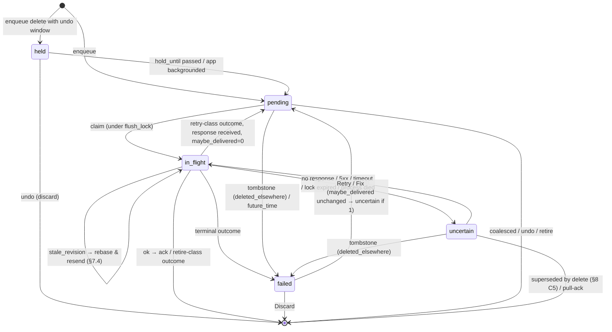

# Spec: outbox (iOS client)

**Status:** M0 draft, 2026-10-17. **Implements:** PLAN.md §2 ("Outbox" and
"Server-side safety"), §6, and §6a rules 2, 6 and 7. **Companion specs:**
[sync-protocol.md](sync-protocol.md) covers the view, acks and tombstones, and
[notifications.md](notifications.md) covers action writes.

## Purpose

The outbox is the only way the iOS client mutates server data while offline. It
is shared by every process (the app, the widget extension, the notification
action handler, the App Intents and the NSE), so it must stay correct when:

- processes run concurrently;
- a process is suspended or killed mid-send;
- a response is lost;
- the user undoes an action while it is in flight;
- other devices delete or edit the same data.

It extends the PWA outbox (`frontend/src/lib/outbox/*`), which has a single
kind, `entry.create`. The classification table and the backoff stay
byte-compatible with the PWA. Everything else here is new design: the extra
kinds, the states, the lock, the ordering, coalescing and undo.

**Normative language.** **MUST**, **MUST NOT**, **SHOULD** and **MAY** are used
as in RFC 2119. **[server]** marks a contract requirement on the backend (see
[sync-protocol.md §1.2](sync-protocol.md#12-response)).

## Glossary

| Term                | Meaning                                                                                                                                                                                       |
| ------------------- | --------------------------------------------------------------------------------------------------------------------------------------------------------------------------------------------- |
| **Item**            | One queued operation (one row of `outbox_item`).                                                                                                                                              |
| **Entity**          | What an item mutates: `entry:{id}` or `topic:{id}`.                                                                                                                                           |
| **seq**             | The local, monotonically increasing `INTEGER PRIMARY KEY AUTOINCREMENT` of `outbox_item`. It is the total order of user intent across processes. Wall-clock `created_at` is for display only. |
| **Active**          | An item whose state is `pending`, `in_flight` or `uncertain`.                                                                                                                                 |
| **Unresolved**      | An item that is active, `held` or `failed`. In other words, still in the table.                                                                                                               |
| **Never delivered** | An item with `maybe_delivered = 0`: no request for it can have reached the server.                                                                                                            |
| **Claim**           | Moving an item to `in_flight` under the flush lock, with a fresh `claim_token`.                                                                                                               |
| **CAS**             | Compare-and-set on `claim_token` (for send bookkeeping) or on `row_version` (for user edits).                                                                                                 |
| **Retire**          | Remove an item without a server effect and without an error. The goal is moot or already met.                                                                                                 |
| **Ack**             | Remove an item after a definitive success ([sync-protocol.md §6](sync-protocol.md#6-atomic-ack-6a-rule-7)).                                                                                   |
| **Base revision**   | The entity `revision` an update or archive was based on. It is sent as `expected_revision`.                                                                                                   |
| **Budget**          | The wall-clock time a process may spend flushing before it must stop.                                                                                                                         |

## 1. Kinds

| Kind              | Entity            | Request                                                                         | Payload (JSON)                                                                                                                                      |
| ----------------- | ----------------- | ------------------------------------------------------------------------------- | --------------------------------------------------------------------------------------------------------------------------------------------------- |
| `entry.create`    | `entry:{item.id}` | `POST /api/v1/topics/{topic_id}/entries` with body `{...body, id: item.id}`     | `{topic: {id, slug, name}, body: EntryCreate without id}`. `body.version` is always set (the pinned version), and `body.captured_at` is always set. |
| `entry.update`    | `entry:{id}`      | `PATCH /api/v1/entries/{id}` with body `{...changed fields, expected_revision}` | `{entry_id, topic_id, patch: EntryUpdate}`. Only the changed keys are included.                                                                     |
| `entry.delete`    | `entry:{id}`      | `DELETE /api/v1/entries/{id}`                                                   | `{entry_id, topic_id}`                                                                                                                              |
| `topic.archive`   | `topic:{id}`      | `POST /api/v1/topics/{id}/archive` with body `{expected_revision}`              | `{topic_id}`                                                                                                                                        |
| `topic.unarchive` | `topic:{id}`      | `POST /api/v1/topics/{id}/unarchive` with body `{expected_revision}`            | `{topic_id}`                                                                                                                                        |

Notes:

- The item id **is** the entry id for `entry.create`, so creation is idempotent
  (PWA parity). For other kinds, the item id is a fresh UUID.
- Requests are built **at send time** from the payload, and `expected_revision`
  is taken from the item's current `base_revision` (§7.3). This is PWA parity:
  `toRequest` runs at send time.
- The topic is addressed by **id**, never by slug, because a slug can be renamed
  while the item waits.
- `expected_revision` is omitted when `base_revision` is null. This only happens
  for items that were enqueued before the server supported revisions.
  **[server]** `expected_revision` is optional, which keeps the PWA unchanged.

## 2. Item schema

```sql
CREATE TABLE outbox_item (
  seq             INTEGER PRIMARY KEY AUTOINCREMENT,
  id              TEXT NOT NULL UNIQUE,          -- uuid
  kind            TEXT NOT NULL,                 -- §1
  entity_kind     TEXT NOT NULL,                 -- 'entry' | 'topic'
  entity_id       TEXT NOT NULL,
  topic_id        TEXT NOT NULL,
  payload_json    TEXT NOT NULL,
  base_revision   INTEGER,                       -- §7.3; NULL = "inherit from predecessor"
  state           TEXT NOT NULL CHECK (state IN ('held','pending','in_flight','uncertain','failed')),
  maybe_delivered INTEGER NOT NULL DEFAULT 0,    -- sticky: a request may have reached the server
  hold_until      REAL,                          -- epoch seconds; only for state 'held'
  attempts        INTEGER NOT NULL DEFAULT 0,
  next_attempt_at REAL NOT NULL,                 -- epoch seconds (backoff)
  claim_token     TEXT,                          -- set while in_flight
  claim_owner     TEXT,                          -- process instance id
  claim_epoch     TEXT,                          -- store epoch at claim time
  claimed_at      REAL,
  failure_reason  TEXT,                          -- §5: rejected | deleted_elsewhere | conflict | topic_archived | topic_missing | future_time
  last_error_json TEXT,                          -- {message, status, body?} (PWA OutboxError shape)
  rebase_count    INTEGER NOT NULL DEFAULT 0,    -- §7.4
  origin          TEXT NOT NULL,                 -- app | widget | notification | siri | nse
  created_at      REAL NOT NULL,
  updated_at      REAL NOT NULL,
  row_version     INTEGER NOT NULL DEFAULT 0     -- bumped on every write; CAS for user edits
);
CREATE INDEX ix_outbox_entity ON outbox_item(entity_kind, entity_id, seq);
CREATE INDEX ix_outbox_topic  ON outbox_item(topic_id, seq);
CREATE INDEX ix_outbox_due    ON outbox_item(state, next_attempt_at);
```

`last_error_json` uses the same shape as the PWA's `OutboxError`. A sync sheet
can then use one formatter, `errorMessageFor` ported from `classify.ts`.

## 3. State machine

| State       | Meaning                                                                                                                                                                         | In the view ([sync-protocol.md §3.2](sync-protocol.md#32-how-the-view-is-computed)) |
| ----------- | ------------------------------------------------------------------------------------------------------------------------------------------------------------------------------- | ----------------------------------------------------------------------------------- |
| `held`      | Enqueued, but waiting for an undo window to close (`hold_until`). It is never sent. Only `entry.delete` uses this state.                                                        | Applied (the row is hidden, and undoable)                                           |
| `pending`   | Will be sent automatically when `next_attempt_at ≤ now` (or when a flush is forced). `maybe_delivered = 0`.                                                                     | Applied                                                                             |
| `in_flight` | Claimed by a flush. A request may be on the wire.                                                                                                                               | Applied                                                                             |
| `uncertain` | Like `pending`, but `maybe_delivered = 1`: an earlier attempt may have reached the server. Its "delivery uncertain" status is shown in the sync sheet as "Sending… (checking)". | Applied                                                                             |
| `failed`    | Terminal. Needs the user to Retry, Fix or Discard (§11). It is never sent automatically, even by a forced flush (PWA parity).                                                   | Applied for display, flagged failed                                                 |

Items leave the table by **ack**, **retire**, **discard** (a user action), or
**supersede** (coalescing, §8).



The transition rules are binding:

| #   | Rule                                                                                                                                                                                                                                                                                                                                                                                                                          |
| --- | ----------------------------------------------------------------------------------------------------------------------------------------------------------------------------------------------------------------------------------------------------------------------------------------------------------------------------------------------------------------------------------------------------------------------------- |
| S1  | A claim sets `state = in_flight`, a new `claim_token`, `claim_owner`, `claim_epoch` and `claimed_at`, and does `attempts += 1`. It happens in an `IMMEDIATE` transaction that also verifies flush-lock ownership (§6).                                                                                                                                                                                                        |
| S2  | All bookkeeping after a send is CAS on `claim_token`. If the token no longer matches, the outcome is ignored, except that guarded server state is still applied ([sync-protocol.md §6](sync-protocol.md#6-atomic-ack-6a-rule-7) step 1).                                                                                                                                                                                      |
| S3  | `maybe_delivered` is set to 1 when an attempt ends **without a definitive response**: a network error after the request started, a timeout, a 5xx, the process dying, or the lock expiring. It is **never cleared**.                                                                                                                                                                                                          |
| S4  | A non-terminal, non-ok outcome returns the item to `uncertain` if `maybe_delivered = 1`, and to `pending` otherwise. Either way, `next_attempt_at = now + backoff(attempts)`.                                                                                                                                                                                                                                                 |
| S5  | `failed` is only entered with a `failure_reason`. It never applies to an item that has had a 2xx.                                                                                                                                                                                                                                                                                                                             |
| S6  | Payloads are only edited in `pending`, `held` or `failed` (§8, §11), under CAS on `row_version`. An item that is `in_flight` or `maybe_delivered = 1` is never edited. It can only be superseded by a delete (§8 C5), or discarded (§11).                                                                                                                                                                                     |
| S7  | Within one entity, at most one item is `in_flight`, and only the oldest unresolved item of its ordering scope can be claimed (§7.1).                                                                                                                                                                                                                                                                                          |
| S8  | **A create is never resent once a delete for its entity is queued.** If the next eligible item is an `entry.create` that is not `in_flight` and a later unresolved `entry.delete` exists for the same entity, the claim transaction removes the create (it is superseded) and claims the delete instead. This covers the C6 case where the in-flight create resolves as `uncertain`. The DELETE reserves the id (§6a rule 2). |

## 4. Request construction

- Base URL: the store's `base_url`
  ([sync-protocol.md §8](sync-protocol.md#8-server-identity-and-store-partitioning-6a-rule-8)),
  after the identity check in sync-protocol.md §8.3.
- Headers on every request:
  - `Accept: application/json`;
  - `Content-Type: application/json` when there is a body;
  - `X-QuickR-Channel: ios`;
  - `CF-Access-Client-Id` and `CF-Access-Client-Secret` when they are
    configured;
  - `Cache-Control: no-store`.
- `source` in `entry.create`'s body is set at enqueue from the origin:
  - `ios` from the app;
  - `ios.widget` from a widget;
  - `ios.notification` from a notification action;
  - `ios.siri` from an App Intent run by Siri or Shortcuts.
- **Redirects are never followed.** `URLSessionTaskDelegate` returns `nil` for
  the redirect. A 3xx is classified as described below (PWA `redirect: 'manual'`
  parity).
- **Timeout: 15 s per request** (PWA `DEFAULT_TIMEOUT_MS`), and it is also
  capped by the remaining budget. A timeout is a network error.
- Requests use a foreground `URLSession`. **Background `URLSession` is not
  used** (research 02 §3): a background upload could be delivered after an Undo.

## 5. Classification

### 5.1 Base table (byte-compatible with the PWA `classifyStatus` plus `attempt()`)

| Response                                            | Base outcome             | `maybe_delivered`              | Error message (PWA text)                                       |
| --------------------------------------------------- | ------------------------ | ------------------------------ | -------------------------------------------------------------- |
| No response (offline, DNS, TLS, timeout, cancelled) | retry, **stop the pass** | → 1 if the request was started | "Could not reach the server"                                   |
| 2xx with a JSON body or an empty body               | ok                       | —                              | —                                                              |
| 2xx with a non-JSON body (captive portal)           | retry                    | unchanged                      | "Unexpected response from the server"                          |
| 3xx                                                 | retry                    | unchanged                      | "The server redirected the request (sign-in required?)"        |
| 401, 403, 408, 425, 429                             | retry                    | unchanged                      | Problem `detail`, or "Request failed (_status_)"               |
| Any other 4xx (400, 404, 409, 422 …)                | terminal                 | unchanged                      | Problem `detail` (capitalised), or "Request failed (_status_)" |
| 5xx                                                 | retry                    | → 1                            | "Server error (_status_)"                                      |

Notes:

- "Stop the pass" follows the PWA: after a network error, no further items are
  tried in this flush, so their attempts aren't burned while offline.
- 5xx and timeouts set `maybe_delivered`, because the server may have committed
  before failing. 3xx and the retryable 4xx statuses don't: they come from an
  auth proxy or a rate limiter before the request reaches the app server. This
  is the only addition to the PWA's behaviour, and it doesn't change any
  outcome.

### 5.2 Per-kind overrides

The kind's override is checked first. The Problem `code` comes from the parsed
JSON body. If the body is unparseable, no code-specific row matches.

| Kind                        | Response                                  | Outcome                                                                                                                                                                                                                                                                                                                                                                                                                                                        |
| --------------------------- | ----------------------------------------- | -------------------------------------------------------------------------------------------------------------------------------------------------------------------------------------------------------------------------------------------------------------------------------------------------------------------------------------------------------------------------------------------------------------------------------------------------------------- |
| `entry.create`              | 2xx                                       | **Ack.** The upserted row is the response (`EntryOut`).                                                                                                                                                                                                                                                                                                                                                                                                        |
| `entry.create`              | 409 `entry_deleted`                       | **Retire**, never materialise (§6a rule 2). In one transaction: insert a local tombstone for the id, remove the item, and remove the entity's overlay so no row is shown. A later `entry.delete` for the entity, if one exists, is acked silently. If no later `entry.delete` exists, the deletion came from elsewhere: the item becomes `failed/deleted_elsewhere` instead. It still has no view row, but it shows in the sync sheet, so the loss is visible. |
| `entry.create`              | 404 (`not_found`, the topic is missing)   | `failed`, `topic_missing`: "This topic no longer exists". A pull is triggered; the topic tombstone then turns it into `deleted_elsewhere`.                                                                                                                                                                                                                                                                                                                     |
| `entry.create`              | 409 `topic_archived`                      | `failed`, `topic_archived`: "Topic is archived — unarchive it to sync this entry". Retry is offered once the view shows the topic active.                                                                                                                                                                                                                                                                                                                      |
| `entry.create`              | 409 `conflict` (id used by another topic) | `failed`, `rejected`                                                                                                                                                                                                                                                                                                                                                                                                                                           |
| `entry.create`              | 422                                       | `failed`, `rejected`. The Fix flow opens the record screen with the field errors (PWA parity).                                                                                                                                                                                                                                                                                                                                                                 |
| `entry.update`              | 2xx                                       | Ack                                                                                                                                                                                                                                                                                                                                                                                                                                                            |
| `entry.update`              | 404, or 409 `entry_deleted`               | **The entity is gone.** Insert a local tombstone and remove the server row, then apply [sync-protocol.md §5.3](sync-protocol.md#53-tombstones) to this item and its dependants. This item becomes `failed/deleted_elsewhere` unless a later `entry.delete` exists, in which case it is retired.                                                                                                                                                                |
| `entry.update`              | 409 `stale_revision`                      | **Rebase** (§7.4)                                                                                                                                                                                                                                                                                                                                                                                                                                              |
| `entry.update`              | 422                                       | `failed`, `rejected` (Fix)                                                                                                                                                                                                                                                                                                                                                                                                                                     |
| `entry.delete`              | 2xx (204), **404**, 409 `entry_deleted`   | **Ack (done).** Insert a local tombstone and remove the server row. The 404 case covers old servers and ids that are already gone. With §6a rule 2, the server returns 204 for absent ids.                                                                                                                                                                                                                                                                     |
| `topic.archive`             | 2xx                                       | Ack (the response is `TopicDetail`)                                                                                                                                                                                                                                                                                                                                                                                                                            |
| `topic.archive`             | 404                                       | Retire (the topic is gone). A pull is triggered.                                                                                                                                                                                                                                                                                                                                                                                                               |
| `topic.unarchive`           | 404                                       | `failed/deleted_elsewhere`. A pull is triggered.                                                                                                                                                                                                                                                                                                                                                                                                               |
| `topic.archive`/`unarchive` | 409 `stale_revision`                      | Rebase (§7.4)                                                                                                                                                                                                                                                                                                                                                                                                                                                  |
| All kinds                   | Any other response                        | The base table (§5.1)                                                                                                                                                                                                                                                                                                                                                                                                                                          |

**[server]** The client depends on these behaviours:

- 409 Problem codes `entry_deleted` and `stale_revision`;
- PATCH on a deleted id returns 404 `not_found`;
- DELETE returns 204 for an id that is absent or already reserved;
- a POST replay of a live id returns the existing entry with 201, even if the
  topic is now archived. This is today's `_existing` check, which runs before
  the archived check.

### 5.3 Backoff (byte-compatible with the PWA `backoffMs`)

`backoff(n) = min(5 min, 2 s · 2^(n−1)) × U(0.8, 1.2)`, where `n` is the number
of attempts made so far (≥ 1). A **forced** flush ignores `next_attempt_at`. A
forced flush happens on app activation, when the network becomes available, and
when the user taps Retry.

## 6. The flush lock

### 6.1 Schema and identity

```sql
CREATE TABLE flush_lock (
  id          INTEGER PRIMARY KEY CHECK (id = 1),
  owner       TEXT,      -- process instance id: "<bundle-suffix>:<launch uuid>", e.g. "app:6F1…", "widgets:A2…"
  token       TEXT,      -- fencing token, new on every acquisition
  acquired_at REAL,
  expires_at  REAL       -- epoch seconds, wall clock
);
```

There is **one lock per store**. The lock is a row, not a SQLite lock. **No
SQLite transaction is held while a request is on the wire.**

### 6.2 Acquire, renew and release

| Operation   | Transaction       | Rule                                                                                                                                                                                                                                                                                                                                                           |
| ----------- | ----------------- | -------------------------------------------------------------------------------------------------------------------------------------------------------------------------------------------------------------------------------------------------------------------------------------------------------------------------------------------------------------- |
| **Acquire** | `BEGIN IMMEDIATE` | Succeeds if `owner IS NULL` or `expires_at < now`. It sets `owner = me`, a new `token`, and `expires_at = now + TTL`. If it took over an expired lock, it first runs **expiry recovery** (§6.3) in the same transaction. If the lock is held and live, the caller either gives up (when its trigger is opportunistic) or polls every 250 ms within its budget. |
| **Renew**   | `BEGIN IMMEDIATE` | Runs before every claim, together with the claim. It requires `owner = me AND token = myToken AND expires_at ≥ now`, and sets `expires_at = now + TTL`. If the check fails, the holder has **lost the lock**: it MUST stop claiming and MUST NOT write bookkeeping except through CAS.                                                                         |
| **Release** | `BEGIN IMMEDIATE` | `owner = NULL` if `token = myToken`. It runs at the end of the pass, on budget expiry, in the `beginBackgroundTask` expiration handler, and when the NSE's `serviceExtensionTimeWillExpire` fires.                                                                                                                                                             |

**TTL = 30 s.** A request is capped at 15 s, and the lock is renewed before
every claim, so a live holder never loses it. Only a holder that is suspended or
dead does.

Wall-clock time is used because monotonic clocks aren't shared between
processes. If the user changes the device clock, the worst case is an early
takeover, which the server-side safety (§6.4) makes harmless.

**Rebuild guard.** The claim transaction also reads `sync_state.rebuilding`. If
it is set, nothing is claimed
([sync-protocol.md §7](sync-protocol.md#7-epoch-reset-rebuild-in-place)).

### 6.3 Expiry recovery

When a process acquires a lock whose previous owner expired, it runs these steps
in the acquiring transaction:

- Every `in_flight` item claimed under the previous owner moves to `uncertain`:
  `maybe_delivered = 1`, the claim fields are cleared, and
  `next_attempt_at = now`.
- `attempts` is unchanged. It was already incremented at claim time.

An item left `in_flight` by a process that crashed is recovered the same way.
Its lock expires within 30 s.

### 6.4 Late completion

A suspended holder that wakes after it lost the lock may still receive a
response, and its request may still reach the server late. This is how each case
is handled:

| Late event                                                | Why it is harmless                                                                                                                                         |
| --------------------------------------------------------- | ---------------------------------------------------------------------------------------------------------------------------------------------------------- |
| A late POST lands after the entry was deleted (or undone) | The server reserved the id on DELETE. The POST gets 409 `entry_deleted` and nothing is created (§6a rule 2).                                               |
| A late POST lands twice                                   | The client id is idempotent, so the replay returns the existing entry.                                                                                     |
| A late PATCH or archive lands after newer operations      | Its `expected_revision` is stale, so it gets 409 `stale_revision` and changes nothing (§6a rule 6).                                                        |
| A late DELETE lands                                       | Deletes are idempotent.                                                                                                                                    |
| The late response's bookkeeping                           | The CAS on `claim_token` fails, so it is ignored. Guarded server state is still applied, unless `claim_epoch ≠` the current epoch (sync-protocol.md §5.2). |

## 7. Ordering, revisions and conflicts

### 7.1 Ordering scopes

An item X is **eligible** to be claimed only if no earlier (lower `seq`)
unresolved item Y exists in its scope:

| X kind    | Scope: X waits for every earlier unresolved Y such that…                          |
| --------- | --------------------------------------------------------------------------------- |
| `entry.*` | Y has the same `entity_id`, **or** Y is a `topic.*` item with the same `topic_id` |
| `topic.*` | Y has the same `topic_id` (any kind)                                              |

This is why the scopes are shaped this way:

- An offline unarchive followed by a log must reach the server in that order, or
  the log gets 409 `topic_archived`.
- A log followed by an archive must also stay in order.
- Unrelated entries stay independent, so one failed entry never blocks the
  others.

`held` items count as unresolved for ordering. A later item for the same entity
waits until the hold releases or the item is discarded. In practice, nothing
else is enqueued for an entity whose deletion is held, because it is hidden.

### 7.2 Blocking

If the earliest unresolved item in X's scope is `failed`, X is **blocked**. It
stays `pending` and is shown as "Waiting for _failed item_". It is unblocked
when the failed item is retried successfully, fixed, discarded or retired.

There is one exception. Discarding a failed **`entry.create`** discards every
later item for that entity in the same transaction, because they depend on the
create.

### 7.3 Revision chaining

This sets the `base_revision` that `entry.update`, `topic.archive` and
`topic.unarchive` send as `expected_revision`.

| Moment                                                                  | Rule                                                                                                                                                                                                                                                                                               |
| ----------------------------------------------------------------------- | -------------------------------------------------------------------------------------------------------------------------------------------------------------------------------------------------------------------------------------------------------------------------------------------------- |
| Enqueue, with no earlier unresolved item for the entity                 | `base_revision` = the entity's **server-layer** revision that the user saw. That is the revision under the view the edit was made from.                                                                                                                                                            |
| Enqueue, with an earlier unresolved item for the entity                 | `base_revision = NULL`, meaning "inherit"                                                                                                                                                                                                                                                          |
| An item for the entity is removed (by ack, pull-ack, retire or discard) | In the same transaction, the next unresolved item for the entity with `base_revision IS NULL` gets `base_revision` = the entity's current server-layer revision (after this transaction's upsert). If the entity has no server row (a discarded create), the dependants were discarded too (§7.2). |
| Claim, while `base_revision` is still NULL                              | This cannot happen, because ordering guarantees the predecessor resolved first. If it is observed anyway, use the current server-layer revision and log it.                                                                                                                                        |

The result is that a chain of local edits sends
`expected_revision = r, r+1, r+2, …`, and a stale sender's request can never
overwrite a newer one.

### 7.4 `stale_revision` recovery (§6a rule 6)

When an item gets 409 `stale_revision`:

1. While still holding the lock, `GET` the entity: `GET /entries/{id}`, or
   `GET /topics/{id}`.
   - A 404 means the entity is gone. Apply the §5.2 "entity gone" rule.
   - A network error ends this attempt as a network error: the item becomes
     `uncertain`, and the pass stops.
2. One transaction:
   - upsert the fetched row under the guards;
   - set `X.base_revision = fetched.revision` and do `rebase_count += 1`;
   - leave `X` claimed.
3. If `rebase_count ≤ 3`, resend X immediately. That is the same claim. Later
   own items for the entity follow in order, chained through §7.3. If
   `rebase_count > 3`, X becomes `failed/conflict`: "Changed on another device —
   review and retry".

**The merge semantics are last-writer-wins per field, after the client has seen
the remote state.** PATCH sends only the changed keys, so edits to different
fields from two devices both survive. When both devices change the same field,
the local change wins. This matches today's behaviour, and the guard exists to
stop _stale processes_, not to surface user conflicts.

`rebase_count` is reset to 0 when the user edits the item (Fix).

## 8. Coalescing

Coalescing happens **at enqueue**, inside the enqueue's `IMMEDIATE` transaction.
That transaction is what makes coalescing safe across processes: it sees every
claim.

Let `T` be the latest unresolved item for the entity (highest `seq`).

| #   | Enqueue                       | Condition                                                                                                         | Result                                                                                                                                                                                                                   |
| --- | ----------------------------- | ----------------------------------------------------------------------------------------------------------------- | ------------------------------------------------------------------------------------------------------------------------------------------------------------------------------------------------------------------------ |
| C0  | `entry.update`                | The entity is hidden in the view: it has an unresolved `entry.delete` (held or active), or a local tombstone      | **Rejected at enqueue** with "This entry was deleted". The UI can't reach this state; App Intents surface the error.                                                                                                     |
| C1  | `entry.update`                | `T` is an `entry.create` that is **never delivered** and not `in_flight` (`pending`, or `failed` with `rejected`) | Merge the patch into the create's body. `answers` merges by key, and a null value removes the key. Other fields are replaced. If T was `failed`, it becomes `pending` (this is the Fix flow). No new item is created.    |
| C2  | `entry.update`                | `T` is an `entry.update` that is never delivered and `pending` or `failed`                                        | Merge into T. Later values win per field. T keeps its `seq` and `base_revision`. If T was `failed`, it becomes `pending` and `rebase_count = 0`.                                                                         |
| C3  | `entry.delete`                | The entity's `entry.create` is **never delivered** and not `in_flight`                                            | **Drop the create and every other item for the entity. Enqueue nothing.** The server never saw the entity.                                                                                                               |
| C4  | `entry.delete`                | Unresolved `entry.update` items exist for the entity that are not `in_flight`                                     | Drop them (superseded). Then enqueue the delete.                                                                                                                                                                         |
| C5  | `entry.delete`                | The entity's `entry.create` is `uncertain`, or `failed` with `maybe_delivered = 1`                                | Drop the create, and enqueue the delete. The DELETE reserves the id, so a late POST is harmless (§6a rule 2).                                                                                                            |
| C6  | `entry.delete`                | The entity's create or update is `in_flight`                                                                      | Don't touch the in-flight item. Enqueue the delete after it. The ordering scopes (§7.1) send it after the in-flight item resolves. If the create resolves as `uncertain`, S8 supersedes it, and only the delete is sent. |
| C7  | `entry.delete`                | An unresolved `entry.delete` already exists for the entity                                                        | No-op. The existing item stands. If it is `held`, the new request releases the hold.                                                                                                                                     |
| C8  | `topic.archive` / `unarchive` | `T` is the **opposite** kind, never delivered and `pending`                                                       | Drop T and enqueue nothing. The two cancel out.                                                                                                                                                                          |
| C9  | `topic.archive` / `unarchive` | `T` is the **same** kind and unresolved                                                                           | No-op                                                                                                                                                                                                                    |
| C10 | Any                           | Otherwise                                                                                                         | Append a new item. `base_revision` follows §7.3.                                                                                                                                                                         |

**Never** merge a payload into an item that is `in_flight` or has
`maybe_delivered = 1` (S6). A payload that may already have landed must stay
exactly as sent, because sync's pull-ack relies on it
([sync-protocol.md §5.4](sync-protocol.md#54-pull-ack-of-creates)).

## 9. Undo

There are two undo flows. They are separate.

### 9.1 Undo a log (the toast after quick-log, a notification action, a widget or Siri)

This is undo of an `entry.create` with id E. It is implemented as "enqueue
`entry.delete` E", and the result depends on the create's state through
coalescing:

| State of create E when Undo is tapped              | Effect                                             | Requests sent                 |
| -------------------------------------------------- | -------------------------------------------------- | ----------------------------- |
| `pending`, never delivered                         | C3: both are dropped                               | none                          |
| `failed` (`rejected`, never delivered)             | C3: both are dropped                               | none                          |
| `in_flight`                                        | C6: the delete is queued after the create          | POST (in flight), then DELETE |
| `uncertain` (lost response, process died, or 5xx)  | C5: the create is dropped and the delete is queued | DELETE only                   |
| **Sent** (acked; there is no item)                 | C10: the delete is queued                          | DELETE                        |
| Retired via `entry_deleted`, or already tombstoned | Nothing to do. The toast says "Undone".            | none                          |

Unlike the PWA, the iOS client never sends a DELETE outside the outbox (compare
`useUndoLog`, which fires a side DELETE).

The view hides the entry immediately in every case. The toast says "Undone"
immediately. If the delete later fails, it shows up in the sync sheet.

Undo is available for 6 s (`UNDO_WINDOW_MS`, PWA parity), and for notification
and widget logs until the next app activation. It can be offered as a button in
the "Logged" confirmation notification
([notifications.md §7](notifications.md#7-action-handler)).

### 9.2 Delete with undo (entries list, entry screen)

1. The user deletes entry E. The client enqueues `entry.delete` E with
   `state = held` and `hold_until = now + 6 s`. The coalescing rules C3–C7 apply
   at this moment. The row is hidden.
2. **Undo** while `held`: discard the item, which is never sent. The row
   reappears.
3. The hold is released (to `pending`) when `hold_until` passes, or immediately
   when the app moves to the background. This matches the PWA's `flushUndoables`
   on hide. A flush is then triggered. A process that finds `held` items with
   `hold_until < now` releases them at the start of its flush.
4. Once the hold is released, Undo is no longer offered, and the toast is
   dismissed along with it.

Archiving uses the same pattern. Undoing an archive enqueues `topic.unarchive`,
and C8 cancels both if the archive has not been sent yet.

## 10. Flush triggers

| Process                                                           | Trigger                                                                                                                       | Force? | Budget                                                                                | Lock if busy                                               |
| ----------------------------------------------------------------- | ----------------------------------------------------------------------------------------------------------------------------- | ------ | ------------------------------------------------------------------------------------- | ---------------------------------------------------------- |
| **App**                                                           | Enqueue (`sendNow` waits 2.5 s for a quick-log, 8 s for the record screen, then reports "queued", like PWA `recordEntry`)     | No     | Until the outbox is empty, or a network error                                         | Poll for up to the wait time                               |
| App                                                               | `scenePhase → active`; `NWPathMonitor` becomes satisfied; the user taps Retry                                                 | Yes    | Same                                                                                  | Poll for up to 30 s                                        |
| App                                                               | A foreground timer at the earliest `next_attempt_at` (or `hold_until`), capped at 60 s (PWA `MAX_POLL_MS`)                    | No     | Same                                                                                  | Skip                                                       |
| App                                                               | After a pull ([sync-protocol.md §11](sync-protocol.md#11-pull-triggers))                                                      | No     | Same                                                                                  | Skip                                                       |
| App (background)                                                  | `scenePhase → background`: release holds, then flush inside `beginBackgroundTask`                                             | Yes    | Until the expiration handler (it cancels and releases)                                | Poll for up to 5 s                                         |
| App (background)                                                  | `BGAppRefreshTask`: pull, then flush                                                                                          | Yes    | Until the task expires                                                                | Poll for up to 5 s                                         |
| **Notification action** (app process, launched in the background) | After the atomic write ([notifications.md §7](notifications.md#7-action-handler))                                             | Yes    | **5 s**, then call `completionHandler`                                                | Poll within the budget                                     |
| **Widget intent** (`perform()` in the widget extension)           | After the durable enqueue commits                                                                                             | Yes    | **4 s** total, including the enqueue. `perform()` MUST return before the budget ends. | Give up (the item stays queued; the widget shows "queued") |
| **App Intent** (Siri, Shortcuts, Action button)                   | Same as the widget. If the intent runs in the app process and the app is in the foreground, the app's budget applies instead. | Yes    | 4 s                                                                                   | Give up                                                    |
| **NSE**                                                           | Optional. In parallel with preparing the content, after the store is opened.                                                  | No     | **2 s**, and it never delays `contentHandler` beyond that                             | Give up                                                    |

Every flush **releases expired holds first**, then claims in `seq` order among
the eligible items. Every process posts the Darwin notification
`com.bahumia.quickr.db-changed` after each commit that changed the outbox. The
app re-runs its observations when it receives one, and on activation, because
Darwin notifications are not durable.

When a widget or NSE budget runs out mid-request, the process cancels the
request. The item stays `in_flight` until this process's release step marks it
`uncertain` (owner = me, token matches). If the process is killed before it
releases, the item waits for the lock to expire (§6.3).

## 11. User actions on items (the sync sheet)

| Action      | Allowed in                                                                             | Effect                                                                                                                                                                                                                                                                                                 |
| ----------- | -------------------------------------------------------------------------------------- | ------------------------------------------------------------------------------------------------------------------------------------------------------------------------------------------------------------------------------------------------------------------------------------------------------ |
| **Retry**   | `failed` (except `deleted_elsewhere`), and `pending`/`uncertain` (to skip the backoff) | `state = uncertain if maybe_delivered else pending`, `next_attempt_at = now`, then a forced flush. `rebase_count = 0`.                                                                                                                                                                                 |
| **Fix**     | A `failed` create or update with reason `rejected`, `topic_archived` or `future_time`  | Opens the form prefilled from the payload. Saving does CAS on `row_version`, replaces the payload (S6), and resets the item to `pending`. Fix is **not offered** when `maybe_delivered = 1`; Discard plus re-entry is offered instead.                                                                 |
| **Discard** | Any state except `in_flight`                                                           | A `pending`, `held` or `failed` item that was never delivered is removed. An `uncertain` create is converted into an undo (§9.1, C5), because it may exist on the server. Any other item that may have been delivered is removed (the next pull shows the truth). Discarding a create cascades (§7.2). |
| **Dismiss** | `failed/deleted_elsewhere`                                                             | Removes the item. This is the only action offered for it.                                                                                                                                                                                                                                              |

The sync pill counts are: "_N_ waiting to sync" (`pending` + `uncertain` +
`in_flight`

- `held`), and "_k_ failed".

## 12. Flush algorithm (pseudocode)

```
flush(force, budget):
  deadline = now + budget
  if !acquire(flush_lock, pollUntil: triggerPolicy): return .busy
  defer release()
  if !identityConfirmed(store): if !probeIdentity(): return .identityMismatch   // sync-protocol §8.3
  TX { release holds where hold_until < now }
  loop while now < deadline:
    item = TX IMMEDIATE {
      renew(flush_lock) or return .lockLost
      if sync_state.rebuilding: return .paused
      X = first eligible (state in pending|uncertain; force || next_attempt_at ≤ now; §7.1 scope clear)
      X == nil ? return .drained : claim(X)                                    // S1
    }
    //    (inside the claim TX: S8 supersedes a create that has a later delete)
    req = build(item)                                                          // §1, §4
    res = send(req, timeout: min(15 s, deadline − now))
    outcome = classify(item.kind, res)                                         // §5
    if outcome == .rebase: outcome = rebase(item)                              // §7.4 (may resend)
    TX IMMEDIATE { applyOutcome(item, outcome) with CAS(claim_token) }         // S2, ack per sync §6
    post Darwin db-changed
    if outcome.isNetworkError: break                                           // stop the pass (PWA)
  return .budgetExhausted
```

## 13. Test matrix

All the cases run against a file-backed store. Cases marked **MP** use the macOS
multi-process `ProcessHelper` (PLAN M1). Cases marked **INT** also run in
`make ios-integration` against the docker stack. The others use a fake transport
and a fake clock.

| #   | Given                                                                                                                                   | When                                                      | Then                                                                                                                                                                                                                                                                      | Proves                                            |
| --- | --------------------------------------------------------------------------------------------------------------------------------------- | --------------------------------------------------------- | ------------------------------------------------------------------------------------------------------------------------------------------------------------------------------------------------------------------------------------------------------------------------- | ------------------------------------------------- |
| 1   | An empty outbox                                                                                                                         | Enqueue `entry.create`, then a fresh pool reads the table | The item is persisted as `pending`, `attempts = 0`, with `id` = entry id, ordered by `seq`                                                                                                                                                                                | §2, PWA parity                                    |
| 2   | Statuses 200, 201, 204, null, 0, 500, 502, 503, 408, 429, 401, 400, 404, 409, 422                                                       | Classify with the base table                              | Results identical to `outbox.test.ts` `classifyStatus`                                                                                                                                                                                                                    | §5.1                                              |
| 3   | Fixed random 0.5, 0 and 0.999999                                                                                                        | `backoff(1, 2, 3, 30)`                                    | 2 s, 4 s, 8 s, a 5 min cap; ±20 % at the extremes                                                                                                                                                                                                                         | §5.3                                              |
| 4   | Two pending creates; the transport returns a network error                                                                              | Flush                                                     | Only the first is attempted: `attempts = 1`, `uncertain`, `next_attempt_at = now + 2 s`. The second has `attempts = 0`.                                                                                                                                                   | §5.1 stop the pass, S3                            |
| 5   | A pending create; the transport returns a 200 HTML body, then a 302                                                                     | Flush twice (forced)                                      | It stays queued, with "Unexpected response from the server", then status 302. `maybe_delivered` is still 0.                                                                                                                                                               | §5.1                                              |
| 6   | A pending create; the transport returns 422 with a Problem body                                                                         | Flush, then a forced flush                                | `failed/rejected`, with the message taken from `detail`. Not resent by the forced flush.                                                                                                                                                                                  | §5.1, S5                                          |
| 7   | A pending create                                                                                                                        | The transport returns 503                                 | `uncertain`, `maybe_delivered = 1`                                                                                                                                                                                                                                        | S3                                                |
| 8   | A create in flight in process A (MP)                                                                                                    | A is SIGSTOPped past the TTL, and process B flushes       | B takes the lock; the create becomes `uncertain`, and B resends it. Server: one entry (idempotent replay).                                                                                                                                                                | §6.3, **lock expiry**                             |
| 9   | Case 8, continued                                                                                                                       | A is SIGCONTed and receives its 201                       | A's CAS fails, and its bookkeeping is skipped. A's renew fails, so it claims nothing more. The server row is upserted once (the revision guard holds). No duplicate.                                                                                                      | §6.4 **late completion**                          |
| 10  | A holds the lock, then is SIGKILLed mid-request (MP)                                                                                    | B flushes after 30 s                                      | B acquires. The item becomes `uncertain`, then is resent, then acked.                                                                                                                                                                                                     | §6.3                                              |
| 11  | A create's POST commits on the server, but the response is lost (the transport drops it)                                                | Flush, then the user taps Undo                            | The create is `uncertain`, and Undo applies C5: the create is dropped and the delete is queued. The flush sends **only** DELETE, which returns 204. Server: the entry is gone.                                                                                            | §9.1, **lost response then undo**                 |
| 12  | Case 11, but the POST was delayed rather than committed (INT)                                                                           | The DELETE commits first, then the delayed POST arrives   | The POST gets 409 `entry_deleted`. Server: no entry. Client: nothing resurrects.                                                                                                                                                                                          | §6a rule 2, **late POST after DELETE**            |
| 13  | A create is `in_flight`                                                                                                                 | The user taps Undo                                        | C6: the delete is queued after it, and the create isn't touched. When the POST returns 201, it is acked, then the DELETE is sent. The view hides the entry throughout.                                                                                                    | C6, §9.1                                          |
| 14  | A create is pending and never delivered                                                                                                 | Undo                                                      | C3: both are dropped. The transport receives **zero** requests.                                                                                                                                                                                                           | C3                                                |
| 15  | The create was acked (sent)                                                                                                             | Undo                                                      | The delete is queued and sent. 204 acks it, and a local tombstone is inserted.                                                                                                                                                                                            | §9.1                                              |
| 16  | The app is suspended mid-send (the `beginBackgroundTask` expiration fires)                                                              | The expiration handler runs                               | The request is cancelled. The item becomes `uncertain` (`maybe_delivered = 1`) and the lock is released. The next activation resends it.                                                                                                                                  | §10, **suspension mid-send**                      |
| 17  | An `entry.update` is pending for E, and E is deleted on the web (INT)                                                                   | Flush (before any pull)                                   | PATCH returns 404. A local tombstone is inserted and the row removed. The item becomes `failed/deleted_elsewhere`, shown with "Dismiss" only.                                                                                                                             | §5.2, **PATCH 404 after remote delete**           |
| 18  | Same as 17, but a pull runs first                                                                                                       | Pull                                                      | The tombstone applies. The update becomes `failed/deleted_elsewhere` without any request. No zombie row.                                                                                                                                                                  | sync §5.3                                         |
| 19  | Pending creates and an update for topic T, plus a pending `topic.archive` for T                                                         | A pull brings T's tombstone                               | The creates and the update become `failed/deleted_elsewhere`. The archive is retired. The drafts, widget state and categories for T are cleared.                                                                                                                          | sync §5.3, **topic tombstone with pending items** |
| 20  | A pending `entry.delete` E                                                                                                              | A pull brings E's tombstone                               | The delete is retired silently.                                                                                                                                                                                                                                           | sync §5.3                                         |
| 21  | Create E is pending and never delivered                                                                                                 | Enqueue an update to E                                    | C1: the create's body is merged. One item; no PATCH is ever sent.                                                                                                                                                                                                         | C1, **coalescing**                                |
| 22  | Create E is `uncertain`                                                                                                                 | Enqueue an update to E                                    | C1 is refused. A separate update with `base_revision = NULL` is appended. After the create is acked (rev 1), the update's `base_revision` is 1.                                                                                                                           | S6, §7.3                                          |
| 23  | Create E is `in_flight` in another process (MP)                                                                                         | Enqueue an update to E from the app                       | The update is appended; the create's payload is unchanged (verified by comparing bytes).                                                                                                                                                                                  | C1 condition, S6                                  |
| 24  | Two pending updates to E, never delivered                                                                                               | Enqueue a third update                                    | C2: merged into the latest. Its `base_revision` and `seq` are unchanged.                                                                                                                                                                                                  | C2                                                |
| 25  | An update to E is `failed/rejected`                                                                                                     | Enqueue an update to E (Fix)                              | C2 merges it. The item becomes `pending`, with `rebase_count = 0`.                                                                                                                                                                                                        | C2, §11                                           |
| 26  | Pending updates to E (not in flight)                                                                                                    | Enqueue a delete of E                                     | C4: the updates are dropped, and only the delete is queued.                                                                                                                                                                                                               | C4                                                |
| 27  | A pending `topic.archive` T, never delivered                                                                                            | Enqueue `topic.unarchive` T                               | C8: both are dropped, and zero requests are sent.                                                                                                                                                                                                                         | C8                                                |
| 28  | `topic.archive` T is `in_flight`                                                                                                        | Enqueue `topic.unarchive` T                               | Appended. It is sent after the archive resolves, with `expected_revision` = the archive's resulting revision.                                                                                                                                                             | C10, §7.3                                         |
| 29  | `topic.unarchive` T is pending, then `entry.create` for T is enqueued                                                                   | Flush                                                     | The unarchive is sent first; the create waits (scope). Both succeed. No 409 `topic_archived`.                                                                                                                                                                             | §7.1                                              |
| 30  | Creates E1 (`failed/rejected`) and E2 (pending) for the same topic                                                                      | Flush                                                     | E2 is sent. E1 doesn't block other entities.                                                                                                                                                                                                                              | §7.1                                              |
| 31  | Create E is `failed`, and an update to E is pending (blocked)                                                                           | Discard the create                                        | The update is discarded in the same transaction (cascade).                                                                                                                                                                                                                | §7.2                                              |
| 32  | Update U1 to E (base rev 3) is in flight in A; A is stopped; B takes over and sends U1 → rev 4, then U2 (expected 4) → rev 5 (MP + INT) | A's original PATCH reaches the server late                | The server returns 409 `stale_revision` and the entry stays at rev 5. A's CAS fails. No overwrite.                                                                                                                                                                        | §6a rule 6, §6.4                                  |
| 33  | E is at rev 3 locally; another device edits it to rev 4; our update has base 3                                                          | Flush                                                     | 409 `stale_revision`, then GET (rev 4), upsert, rebase to 4, resend, then 200 with rev 5. The later own update is sent with expected 5.                                                                                                                                   | §7.4 **refetch then replay**                      |
| 34  | The server answers `stale_revision` 4 times in a row                                                                                    | Flush                                                     | After 3 rebases the item becomes `failed/conflict`.                                                                                                                                                                                                                       | §7.4                                              |
| 35  | The ack transaction runs while a page with an older revision of E is applied                                                            | The page applies after the ack                            | The revision guard drops the older row, and the view shows the acked state. The view never shows the edit twice or not at all.                                                                                                                                            | sync §5.2, §6a rule 7                             |
| 36  | The POST response is lost, so the create is `uncertain`                                                                                 | A pull delivers E                                         | Pull-ack: the item is removed in the page transaction, and E shows once (no duplicate overlay).                                                                                                                                                                           | sync §5.4, rule 7                                 |
| 37  | Pending, uncertain and `failed/rejected` items exist; the server epoch rotates (INT: `make rotate-epoch`)                               | Pull                                                      | Rebuild via staging. Claims are refused during it. After the swap, the outbox is unchanged (same ids and states), and the pending/uncertain items are sent. The failed item is still failed.                                                                              | sync §7, **epoch reset with pending/failed**      |
| 38  | The server DB is restored to a backup taken before create E was acked (INT)                                                             | Pull (`cursor > head`), then rebuild                      | E is absent in the new layer. A later pending update to E gets 404 → `failed/deleted_elsewhere`. If E's create is still queued, it is resent and E exists again.                                                                                                          | sync §1.3, §7.4                                   |
| 39  | App and widget processes enqueue an update and a delete for E at the same instant (MP)                                                  | Both commit                                               | The two `IMMEDIATE` transactions serialise. If the update commits first, the delete applies C4 and drops it. If the delete commits first, the update is rejected by C0. Either way, exactly one delete is queued, no item is lost, and no SQLITE_BUSY reaches the caller. | §8, **two processes, same entity**                |
| 40  | The widget logs (MP) while the app holds the flush lock with a slow request                                                             | The widget's `perform()` runs                             | The enqueue commits, the lock is busy, and the widget gives up within 4 s with the item `pending`. The app's next claim picks it up.                                                                                                                                      | §10                                               |
| 41  | A delete is held (6 s)                                                                                                                  | Undo at 3 s                                               | The item is discarded, zero requests are sent, and the row reappears.                                                                                                                                                                                                     | §9.2                                              |
| 42  | A delete is held                                                                                                                        | The app moves to the background at 2 s                    | The hold is released, the delete is flushed inside the background task, and Undo is no longer offered.                                                                                                                                                                    | §9.2                                              |
| 43  | `captured_at` = device now; the device clock is 30 h ahead (skew −30 h)                                                                 | Flush                                                     | No request is sent, and the item becomes `failed/future_time` with the fix flow offered.                                                                                                                                                                                  | sync §9                                           |
| 44  | `sync_state.rebuilding` is set                                                                                                          | A widget flush runs                                       | It claims nothing and returns `.paused`. The enqueue still succeeded.                                                                                                                                                                                                     | §6.2 rebuild guard                                |
| 45  | Create for topic T (never delivered); T was deleted on the server, but no pull has run yet                                              | Flush                                                     | 404, so the item becomes `failed/topic_missing` and a pull is triggered. After the pull, it is `failed/deleted_elsewhere`.                                                                                                                                                | §5.2                                              |
| 46  | A create was undone elsewhere (another device deleted E after our POST landed; no local delete)                                         | A retry of the uncertain create gets 409 `entry_deleted`  | `failed/deleted_elsewhere`, visible. Not silently retired.                                                                                                                                                                                                                | §5.2 entry_deleted                                |

## Open questions

1. **Undo after the toast for notification and widget logs.** §9.1 offers Undo
   until the next app activation, through a "Logged" confirmation. Whether that
   confirmation exists depends on the outcome of notifications.md open
   question 1. This doesn't change the outbox rules, only where the Undo button
   is surfaced.

## Traceability

| Source                                                                             | Where it is addressed                    |
| ---------------------------------------------------------------------------------- | ---------------------------------------- |
| PLAN §2 Outbox: kinds, classification, flush lock, ordering, coalescing, uncertain | §1, §5, §6, §7.1, §8, §3                 |
| PLAN §2 Server-side safety (409, PATCH 404, DELETE 404)                            | §5.2, §6.4                               |
| PLAN §6 test-matrix list                                                           | §13, cases 8–12, 16                      |
| §6a rule 2, DELETE reserves the id; `entry_deleted` retires a create               | §5.2, §8 C5, §9.1, cases 11, 12, 46      |
| §6a rule 6, `expected_revision` and `stale_revision`                               | §7.3, §7.4, cases 32–34                  |
| §6a rule 7, atomic ack                                                             | §3 S2, sync-protocol §6, cases 35 and 36 |
| Codex v1 B2, leases versus undo; delivery uncertain                                | §3 S3, §6.3, §6.4, §9.1, cases 8–13      |
| Codex v1 M4 and Fable M4, failure, discard and convergence                         | §5.2, §7.2, §11, cases 17–20, 31         |
| Codex v2 #1, DELETE before create; retire without materialising                    | §5.2, §9.1, cases 11, 12                 |
| Codex v2 #6, expired senders overwrite newer PATCH/archive                         | §6.4, §7.3, case 32                      |
| Fable B3, the outbox is not a port; spec and matrix                                | This document                            |
| Fable simplification 5, a single `flush_lock` row                                  | §6                                       |
| Codex v1 M9, widget delivery contract                                              | §10, case 40                             |
