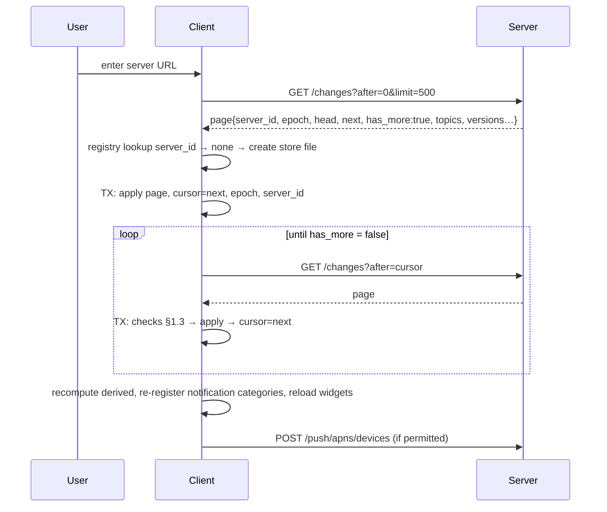

# Spec: sync protocol (iOS client)

**Status:** M0 draft, 2026-10-17. **Implements:** PLAN.md §2 (store model,
change feed, tombstones, epoch, server identity, online-only), §6 and §6a rules
1–8 and 12. **Companion specs:** [outbox.md](outbox.md) covers the write path
and [notifications.md](notifications.md) covers reminders and actions.

## Purpose

This spec defines how the iOS app keeps a full offline mirror of one quickR
server and how it reads that server's changes. It covers:

- the client's view of the server change feed;
- how the local store is split into a **server layer** and an **outbox
  overlay**;
- the merge rules;
- epoch resets;
- store partitioning per server;
- local reset;
- clock skew;
- the operations that need a connection.

The outbox's internal state machine is defined in [outbox.md](outbox.md). This
spec defines only how the outbox's items show up in the UI view and what sync
does to them.

**Normative language.** **MUST**, **MUST NOT**, **SHOULD** and **MAY** are used
as in RFC 2119. Contract requirements on the server are marked **[server]**. The
server side of the feed is being built in parallel (work package M0-feed). If
the final server contract differs from a **[server]** item, update this spec in
the same PR.

## Glossary

| Term                 | Meaning                                                                                                                                                                           |
| -------------------- | --------------------------------------------------------------------------------------------------------------------------------------------------------------------------------- |
| **Server**           | One quickR backend instance, identified by `server_id`. It is not identified by its URL.                                                                                          |
| **`server_id`**      | A stable random id the server generates once and stores in `app_settings`. A database restore keeps it. A fresh install gets a new one.                                           |
| **Epoch**            | `app_settings.feed_epoch`, a random id. It is rotated whenever the server database is restored or reset (`make rotate-epoch`). A seq is only meaningful within one epoch.         |
| **seq**              | A position in the server's `change_log`. Allocated under the feed advisory lock, so seq order equals commit order (§6a rule 1).                                                   |
| **Cursor**           | The highest seq the client has fully applied, stored per store. `0` means nothing has been applied yet.                                                                           |
| **Head**             | The server's highest seq at the time it answered.                                                                                                                                 |
| **Page**             | One `/changes` response.                                                                                                                                                          |
| **Store**            | One SQLite file holding everything for one `server_id`: the server layer, the outbox, local tombstones, drafts and caches.                                                        |
| **Server layer**     | The tables `topic`, `topic_version` and `entry`. They hold server state exactly as the server last reported it. Only sync, acknowledgements and online-only responses write them. |
| **Outbox / overlay** | The queued local writes ([outbox.md](outbox.md)). The UI sees them applied on top of the server layer.                                                                            |
| **View**             | What the UI, widgets, intents and the NSE read: the server layer with the overlay applied, plus locally computed derived fields.                                                  |
| **Local tombstone**  | A row in `tombstone(kind, id, topic_id, seq)` recording that an id was deleted on the server in this epoch.                                                                       |
| **Ack**              | Acknowledgement. The transaction that turns a successful outbox send into server-layer state (§6a rule 7).                                                                        |
| **Active store**     | The store for the server the user has currently selected.                                                                                                                         |
| **Skew**             | `server_time − device_time`, estimated from feed responses.                                                                                                                       |

## 1. Feed contract (client view)

### 1.1 Request

```
GET /api/v1/changes?after=<cursor:int ≥ 0>&limit=<1..500>
```

- The client MUST send `limit=500`. **[server]** The server caps `limit` at 500
  (§6a rule 4).
- The client MUST send its normal headers (`X-QuickR-Channel: ios`, plus the
  Access headers when they are configured). It MUST NOT follow redirects. The
  rules for redirects and non-JSON 200s are the same as in the outbox
  ([outbox.md §5](outbox.md#5-classification)).
- The request timeout is 30 s. Feed pages are larger than outbox requests.

### 1.2 Response

```
ChangePage {
  server_id:   string        // [server] in every page
  epoch:       string        // [server]
  head:        int           // [server] highest seq on the server when the page was built
  next:        int           // highest seq covered by this page (= after when the page is empty)
  has_more:    bool
  server_time: datetime      // [server] RFC 3339, for skew (§9)
  topics:      TopicDetail[]           // incl. revision; derived fields ignored (§4)
  versions:    TopicVersionOut+{topic_id}[]   // immutable
  entries:     EntryOut[]              // incl. revision
  deleted:     { kind: "entry" | "topic" | "version", id, topic_id }[]
}
```

The server MUST meet these contract requirements:

| #   | Requirement **[server]**                                                                                                                                                                                                                                               | Why the client needs it                                                      |
| --- | ---------------------------------------------------------------------------------------------------------------------------------------------------------------------------------------------------------------------------------------------------------------------- | ---------------------------------------------------------------------------- |
| F1  | A page is materialised in **one REPEATABLE READ snapshot**. It covers the change_log rows with `after < seq ≤ next`. For each entity in those rows it returns that entity's **latest state in the snapshot**, which may be newer than the seq that put it on the page. | The client may apply a page as an idempotent, monotone upsert set.           |
| F2  | An entity in the page's rows that no longer exists in the snapshot is emitted in `deleted` **only if its id is in `deleted_ids`**. Otherwise it is skipped, because its own delete row comes later (§6a rule 4).                                                       | The client never sees a "vanished" entity without a tombstone.               |
| F3  | Every deleted entity of every kind (entry, topic and version) is in `deleted_ids` permanently. A topic delete puts its child entries and versions into `deleted_ids` **before** the FK cascade (§6a rule 3).                                                           | Tombstones are complete, and ids are never reused.                           |
| F4  | `entry` and `topic` rows carry `revision` (an integer). It starts at 1 and increases strictly with every change to that entity within an epoch. POST, PATCH, archive and unarchive responses carry it too.                                                             | It is the regression guard (§5.2).                                           |
| F5  | Entry mutations do not log topic rows. Topic rows are logged only when the topic's own fields change (§6a rule 3).                                                                                                                                                     | The client recomputes derived fields itself (§4).                            |
| F6  | The backfill migration writes seqs in the order topics, then versions, then entries.                                                                                                                                                                                   | The first bootstrap pages can render the home screen.                        |
| F7  | `server_id` survives restore. A restore or reset rotates `epoch`.                                                                                                                                                                                                      | §7 and §8.                                                                   |
| F8  | `next ≥ after`. `has_more = false` implies `next = head` as of the snapshot.                                                                                                                                                                                           | Termination of the pull loop.                                                |
| F9  | SHOULD: every `/api/v1` response carries an `X-QuickR-Server-Id` header.                                                                                                                                                                                               | A cheap identity check before a flush (§8.3). Without it, the client probes. |

### 1.3 What the client checks on every page

These checks run in order. The first one that fails decides what happens.

| Check                          | On failure                                                                                                                                                               |
| ------------------------------ | ------------------------------------------------------------------------------------------------------------------------------------------------------------------------ |
| `server_id == store.server_id` | **Identity mismatch.** Stop syncing this store and stop flushing it. Show "This address now points to a different quickR server" (§8.4). Never apply the page.           |
| `epoch == store.epoch`         | **Epoch mismatch.** Start a rebuild (§7). Discard the page.                                                                                                              |
| `store.cursor ≤ head`          | **Restore detected** (§6a rule 5). Treat it as an epoch mismatch, even though the epoch is the same (someone forgot to rotate it).                                       |
| `next ≥ store.cursor`          | Protocol error. Log it, back off, and don't apply the page.                                                                                                              |
| Every row decodes              | Protocol error. Don't apply the page and don't advance the cursor. Log the failing row id. Retry with backoff. A persistent failure shows "Sync error" in the sync pill. |

A bootstrap (`cursor = 0`, no epoch yet) accepts whatever `epoch` and
`server_id` the first page reports (§2).

## 2. Bootstrap

1. The user enters a server URL during onboarding or in Settings.
2. The client fetches `GET /changes?after=0&limit=500` and keeps the page **in
   memory**.
3. The client reads `server_id`:
   - If a store for that `server_id` already exists (the user is returning to a
     known server), it activates that store and continues as a steady-state pull
     from that store's cursor. The in-memory page is discarded.
   - Otherwise it creates a new store file. It records `server_id`, `epoch` and
     `base_url`, sets `cursor = 0`, and applies the page as in §5.
4. It keeps pulling until `has_more = false`. **Each page is applied in its own
   transaction, together with its cursor advance.** An interrupted bootstrap
   resumes from the last committed cursor.
5. While `cursor < head_at_start`, the UI shows "Loading history" with progress
   `cursor / head`. Logging is available as soon as the first page that contains
   topics and versions has been applied (F6).



## 3. The two-layer store

### 3.1 Tables, and who writes them

| Table                                                                                 | Layer           | Written by                                                                             |
| ------------------------------------------------------------------------------------- | --------------- | -------------------------------------------------------------------------------------- |
| `topic`, `topic_version`, `entry`                                                     | Server          | Applying a page (§5), an ack (§6), an online-only response (§10), a rebuild swap (§7)  |
| `tombstone(kind, id, topic_id, seq)`                                                  | Server          | Applying a page, a 404/`entry_deleted` outcome ([outbox.md](outbox.md)), a refetch 404 |
| `sync_state` (single row)                                                             | Server metadata | Sync only                                                                              |
| `stage_topic`, `stage_topic_version`, `stage_entry`, `stage_tombstone`, `stage_state` | Rebuild staging | Rebuild only (§7)                                                                      |
| `outbox_item`, `flush_lock`                                                           | Overlay         | The outbox ([outbox.md](outbox.md)), plus sync's tombstone handling (§5.3)             |
| `ui_draft`, `stats_cache`, `widget_state`                                             | Local           | The UI, widgets and stats fetches                                                      |

`sync_state` holds `server_id`, `base_url`, `epoch`, `cursor`, `head_seen`,
`last_pull_at`, `skew_ms`, `skew_measured_at`, `rebuilding` (null, or the target
epoch), `identity_ok_at`, and `bootstrap_complete`.

The server layer MUST NOT enforce foreign keys between `entry`, `topic` and
`topic_version`. A page may contain an entry whose topic arrives on a later
page. The view uses inner joins, so an orphan entry stays invisible until its
topic arrives.

### 3.2 How the view is computed

The view is a pure function of (the server layer, the outbox items, the local
tombstones, `now`). Implementations MAY materialise it, but every write that
changes an input MUST update the materialisation **in the same transaction**.

**Entries.** For each entity id, take the server row (if there is one) and then
apply that entity's outbox items **in local `seq` order**:

| Item kind and state                                          | Effect on the view row                                                                                                                                                                                                                                                                                                                     |
| ------------------------------------------------------------ | ------------------------------------------------------------------------------------------------------------------------------------------------------------------------------------------------------------------------------------------------------------------------------------------------------------------------------------------ |
| `entry.create`, active (`pending`, `in_flight`, `uncertain`) | No server row: synthesise the row from the payload, with `sync_state = pending`. With a server row: the server row wins. The create has landed, and sync acks it (§5.4).                                                                                                                                                                   |
| `entry.update`, active or `held`                             | Patch the row. `answers` merges by key, and a `null` value removes that key. `captured_at`, `notes`, `source` and `meta` are replaced when present. `sync_state = pending`.                                                                                                                                                                |
| `entry.delete`, active                                       | The row is hidden.                                                                                                                                                                                                                                                                                                                         |
| `entry.delete`, `held` (undo window)                         | The row is hidden, but stays undoable. The undo toast refers to it.                                                                                                                                                                                                                                                                        |
| Any kind, `failed`                                           | The item's content is still applied for display, so a failed create shows what the user entered. The row is flagged `sync_state = failed` with the item's error. A failed delete shows the row (it is **not** hidden) with "Couldn't delete". A failed item with reason `deleted_elsewhere` has no row; it appears only in the sync sheet. |

Two more rules apply to entries:

- An entity whose `entry.create` is `failed` is listed only in the "Not synced"
  section that is pinned to the top. Its normal list position is not used, and
  it is excluded from derived fields.
- An id in `tombstone` never appears in the view, whatever the overlay holds.
  Sync fails or retires dependent items when the tombstone lands (§5.3).

**Topics.** Take the server row, then apply `topic.archive`
(`status = archived`, `archived_at` = the item's `created_at`) and
`topic.unarchive` (`status = active`, `archived_at = null`) items in `seq`
order. Failed topic items are not applied; the topic is flagged instead.
Versions come from the server layer only, because publishing needs a connection.

**Derived fields** (§6a rule 3). The client MUST compute these from the view and
MUST ignore the server's values:

```
counted(topic)   = view entries of topic, excluding entities whose create is failed,
                   excluding hidden (deleted/held-delete) rows
entry_count      = |counted(topic)|
last_captured_at = max(captured_at over counted(topic)), or null
due              = compute_due(schedule, now = device_now + skew,
                               last_entry_at = last_captured_at,
                               schedule_since = schedule_updated_at ?? created_at,
                               archived = (view status == archived))
                   // the Swift port of schedule.py, verified by shared/fixtures/due-vectors.json
version.entry_count = |counted entries pinned to that version|
```

Derived fields MUST be recomputed after every page, ack, enqueue, discard and
failure, and once a minute while the app is visible. Due state changes with time
alone.

The **badge** equals the number of view topics with `status = active` and
`due.is_due`. This matches the PWA's `dueCount`. See notifications.md §8.

## 4. Field ownership

| Field                                                                                     | Source of truth in the view                         |
| ----------------------------------------------------------------------------------------- | --------------------------------------------------- |
| Entry content (`answers`, `captured_at`, `notes`, `source`, `meta`)                       | The server row, then the overlay                    |
| Entry `channel`, `created_at`, `updated_at`, `revision`                                   | The server row only (null for an unsynced create)   |
| Topic `name`, `slug`, `description`, `schedule`, `schedule_updated_at`, `current_version` | The server row only. These are online-only edits.   |
| Topic `status`, `archived_at`                                                             | The server row, then the overlay                    |
| `entry_count`, `last_captured_at`, `due`, version `entry_count`                           | Computed locally (§3.2). Server values are ignored. |
| `last_notified_due_since`                                                                 | Not mirrored                                        |

## 5. Merge rules

### 5.1 Applying a page

One GRDB `IMMEDIATE` transaction per page:

1. Run the §1.3 checks. Stop on the first failure.
2. **Upserts.** Apply `topics`, then `versions`, then `entries`, each with the
   §5.2 guards.
3. **Deletions.** Apply `deleted` as in §5.3.
4. **Pull-ack.** For each `entry.create` item whose entity now has a server row,
   apply §5.4.
5. Recompute derived fields for every touched topic.
6. Set `cursor = next`, `head_seen = head` and `last_pull_at = now`. Update the
   skew (§9).
7. Commit, then post the Darwin notification `com.bahumia.quickr.db-changed`.

Pages MUST be applied strictly in order. Two pulls of the same store MUST NOT
run at the same time, even in different processes. A pull runs under the store's
`sync_lock` row, which has the same owner and expiry semantics as `flush_lock`
([outbox.md §6](outbox.md#6-the-flush-lock)) and a 60 s TTL. In v1 only the app
process pulls (§11), so in practice this is a guard rather than a contention
point.

### 5.2 Upsert guards

These guards apply to every server-layer upsert, whatever its path (page, ack,
refetch, online-only response):

| Guard               | Rule                                                                                                                                                             |
| ------------------- | ---------------------------------------------------------------------------------------------------------------------------------------------------------------- |
| **Tombstone**       | If `(kind, id)` is in `tombstone`, drop the upsert. Ids are never reused (F3), so a tombstoned id can only come from a stale response.                           |
| **Revision**        | If a local row exists with `revision > incoming.revision`, drop the upsert. Equal revisions overwrite, which is idempotent.                                      |
| **Versions**        | `topic_version` rows are immutable. Insert if absent, otherwise ignore.                                                                                          |
| **Late completion** | A response whose request was claimed under a different epoch than the store's current one MUST NOT be upserted ([outbox.md §6.4](outbox.md#64-late-completion)). |

**Why the revision guard is needed.** A pull request may be sent before one of
our PATCHes commits on the server and answered after the PATCH's ack has
committed locally. Without the guard, the page would roll the row back to the
older revision, and the cursor has already moved past it. The reverse race is
possible too: an ack can arrive after a newer page.

### 5.3 Tombstones

For each `deleted` item `{kind, id, topic_id}`:

1. Insert into `tombstone`. This is idempotent.
2. Delete the server-layer row. A **topic** tombstone also deletes every
   `topic_version` and `entry` row with that `topic_id`, and inserts tombstones
   for them. The server sends these too (F3), so this step is belt and braces.
3. **Dependent outbox items.** These are the items whose entity is the deleted
   id, or, for a topic tombstone, every item with that `topic_id`. They are
   resolved in the same transaction:

| Dependent item                                                                   | Result                                                                                                                                                                                  |
| -------------------------------------------------------------------------------- | --------------------------------------------------------------------------------------------------------------------------------------------------------------------------------------- |
| `entry.delete` (any state other than `in_flight`)                                | **Retired** silently. The goal is already met.                                                                                                                                          |
| `topic.archive`                                                                  | Retired silently.                                                                                                                                                                       |
| `entry.create` / `entry.update`, with a later `entry.delete` for the same entity | Retired silently. The user wanted it gone anyway.                                                                                                                                       |
| `entry.create`, `entry.update`, `topic.unarchive`, otherwise                     | Moved to **`failed`**, with reason `deleted_elsewhere` and the message "Deleted on another device".                                                                                     |
| Any item that is `in_flight`                                                     | Left alone. Its outcome (404, `entry_deleted`, or a 2xx that the tombstone guard drops) resolves it with the same table when it completes ([outbox.md §5](outbox.md#5-classification)). |

4. A **topic** tombstone also clears local state for that topic:
   - `ui_draft` rows;
   - `stats_cache` rows;
   - its widget configuration state, so widgets render "Topic deleted" and the
     timelines are reloaded;
   - pending local notification requests (fallback), and delivered notifications
     whose `userInfo.quickr.topic_id` matches;
   - its rows in the app-global `notification_category` table, which are marked
     prunable. The next registration drops them unless a delivered notification
     still references them
     ([notifications.md §5](notifications.md#5-category-registration)).

### 5.4 Pull-ack of creates

A server row can appear for an entity that still has an `entry.create` item, for
example when the POST committed but its response was lost (`uncertain`). In the
same transaction as the page:

- If the create item is not `in_flight`, remove it. This is an ack: the server
  row is the result. Then apply [outbox.md §7.3](outbox.md#73-revision-chaining)
  revision chaining to the entity's next item.
- If it is `in_flight`, leave it. When the sender completes, its CAS
  (compare-and-set) either acks it (and the upsert is idempotent) or finds the
  item already gone.

Creates are never coalesced with edits after their first attempt
([outbox.md §8](outbox.md#8-coalescing)). So the payload that may have landed is
exactly what the server holds, and a pull-ack loses nothing.

## 6. Atomic ack (§6a rule 7)

When the outbox gets a definitive success for an item, **one** GRDB `IMMEDIATE`
transaction MUST do all of the following:

1. **Server state, always.** Apply the response's server state under the §5.2
   guards:
   - a POST, PATCH or archive response carries a row, which is upserted;
   - a DELETE (2xx, 404 or `entry_deleted`) removes the server row and inserts a
     local tombstone.

   This step runs even if step 2 fails its CAS. Guarded server state is always
   safe to keep. The one exception is a claim from an older epoch (§5.2).

2. **CAS.** Verify that the item still carries the sender's `claim_token`. If it
   doesn't, stop here. Another process or a user action already resolved the
   item.
3. Delete the outbox item.
4. Apply revision chaining to the entity's next item
   ([outbox.md §7.3](outbox.md#73-revision-chaining)).
5. Recompute derived fields for the topic.

Because the server row and the overlay change in the same transaction, the view
never shows an operation twice (once from the server layer and once from the
overlay) or not at all.

## 7. Epoch reset: rebuild in place

**Trigger:** an epoch mismatch, or `cursor > head` (§1.3).

The store file is kept. The outbox, the drafts, the credentials and the
notification state are untouched. Only the server layer is rebuilt, through
staging tables, so the UI keeps showing the old data until the new data is
complete.

1. Set `sync_state.rebuilding = new_epoch` and clear the `stage_*` tables.
   **From now on, outbox claims are refused** in every process. The claim
   transaction reads `rebuilding`; see
   [outbox.md §6](outbox.md#6-the-flush-lock). Enqueueing still works, so
   logging stays instant.
2. Page from `after=0` into the `stage_*` tables. `stage_state.cursor` advances
   one transaction per page. A rebuild that is interrupted resumes from
   `stage_state.cursor`. If another epoch change appears during the rebuild, the
   client clears the staging tables and restarts with the newest epoch.
3. When a staged page returns `has_more = false`:
   1. Acquire `flush_lock` ([outbox.md §6](outbox.md#6-the-flush-lock)). This
      waits for any in-flight sender to finish or expire, so no ack can
      interleave.
   2. In one `IMMEDIATE` transaction, **swap**:
      - replace `topic`, `topic_version`, `entry` and `tombstone` with the
        staged contents;
      - set `epoch`, `cursor = stage cursor`, and `rebuilding = null`;
      - mark every `in_flight` item `uncertain` (it is only possible after a
        lock expiry);
      - run §5.4 pull-ack over the whole outbox;
      - run the §5.3 dependent-item rules for every outbox entity whose id is in
        the new `tombstone` table;
      - recompute all derived fields.
   3. Release `flush_lock`. Run a normal pull from the new cursor, then a flush.
4. Outbox items whose entity is **missing** from the rebuilt server layer, and
   is not tombstoned, are **kept**. This is the restore-recovery case: data
   created after the backup was taken.
   - An `entry.create` is simply resent, and the server creates the entry again.
   - An `entry.update` gets a 404 and is resolved as `deleted_elsewhere`.
   - A `topic.*` item gets a 404 and is resolved by its kind's rule.

   Items that are already `failed` stay `failed`. Failed items whose entity was
   tombstoned by the rebuild move to `failed/deleted_elsewhere` as in §5.3.

5. Bump `epoch_generation` in the registry (§8.1). Old notification actions keep
   working, because they key on `server_id`, not on the epoch.

```mermaid
sequenceDiagram
  participant C as Client (app)
  participant DB as Store
  participant S as Server
  C->>S: GET /changes?after=812
  S-->>C: page{epoch:"E2", head:40}
  C->>DB: TX: rebuilding=E2, clear stage_* (claims now refused)
  loop until has_more=false
    C->>S: GET /changes?after=stage_cursor
    S-->>C: page (epoch E2)
    C->>DB: TX: apply into stage_*, stage_cursor=next
  end
  C->>DB: acquire flush_lock (waits for in-flight sender)
  C->>DB: TX swap: server layer := stage, epoch=E2, cursor, rebuilding=null,<br/>in_flight→uncertain, pull-ack, tombstone dependents, derived
  C->>DB: release flush_lock
  C->>S: GET /changes?after=cursor (catch up)
  C->>S: flush outbox (kept items resent; restore recovery)
```

## 8. Server identity and store partitioning (§6a rule 8)

### 8.1 Files

```
<AppGroup>/Library/quickr/
  registry.sqlite                      app-global: servers, active server, notification_category,
                                       pending APNs unregistrations
  stores/<server_id>.sqlite            one store per server (WAL; completeUntilFirstUserAuthentication)
```

`registry.server(server_id PK, base_url, display_name, created_at, last_sync_at, epoch_generation)`
and `registry.active(server_id)`.

`notification_category` lives in the **registry**, not in a store.
`setNotificationCategories` replaces the app's whole category set, so the table
must cover every server
([notifications.md §5](notifications.md#5-category-registration)).

Credentials (the Cloudflare Access id and secret) live in the shared Keychain
group, with `kSecAttrAccount = server_id` and `AfterFirstUnlock`.

### 8.2 Invariants

1. Every outbox item belongs to exactly one store file. Items MUST NEVER be
   copied or moved between stores.
2. Only the **active** store pulls and flushes automatically. An inactive store
   is kept with its outbox until the user deletes it.
3. A notification action writes only into the store named by the `server_id` in
   the action identifier. That store may be inactive; it syncs when the user
   switches back. If the store doesn't exist, the action is dropped with a local
   notification ([notifications.md §7](notifications.md#7-action-handler)).
4. Requests from a store go only to that store's `base_url`, and only after the
   identity check in §8.3.

### 8.3 Identity check before sending

Before a flush sends its first request, the client MUST confirm that the server
at `base_url` is still `store.server_id`. Either of these confirms it:

- a response from that host within the last 60 s whose `X-QuickR-Server-Id`
  header matched (F9), or a feed page within the last 60 s whose `server_id`
  matched; or
- a probe, `GET /changes?after=<cursor>&limit=1`. Its `server_id` is checked,
  and the page is otherwise ignored.

On a mismatch, flushing for that store stops (§8.4). When responses carry the
header, every response is checked, and a mismatch stops the flush pass
immediately.

### 8.4 Switching servers

**The user changes the URL in Settings:**

1. The client probes the new URL with `GET /changes?after=0&limit=1` and reads
   its `server_id`.
2. If the current store has outbox items, it warns: "_N_ changes haven't synced
   to _old server_. They stay on this iPhone and sync when you switch back."
   - The options are **Sync now** (flush, then continue), **Switch anyway**, and
     **Cancel**.
3. **Unregister APNs on the old server.** The client calls
   `POST /push/apns/devices/delete {token}` against the old `base_url`. If that
   fails, it records `{server_id, base_url, token}` in
   `registry.pending_unregister` and retries on each launch for up to 30 days.
4. It removes delivered notifications and pending local requests whose
   `userInfo.quickr.server_id` is the old server.
5. It activates the store for the new `server_id`. If that store exists, it
   resumes at the store's cursor; otherwise it bootstraps (§2). Then it
   registers APNs with the new server and re-registers categories.

**The same URL now reports a different `server_id`** (the server was
reinstalled, or DNS changed). The client does **not** switch automatically. It
stops pulling and flushing the active store and shows a banner: "This address
now points to a different quickR server". The banner's actions are:

- **Use the new server**, which is the flow above, with the old store kept;
- **Keep waiting**.

## 9. Clock skew

- For each feed response, the client computes
  `skew = server_time − (t_send + t_recv)/2`, where the times are device
  wall-clock times. It stores an exponentially smoothed value in `skew_ms` (α =
  0.3). It discards samples whose round trip is over 5 s.
- `server_now = device_now + skew_ms` is used for:
  - due computation, the badge and widget timelines;
  - the `captured_at` bound.
- `captured_at` is taken from the **device clock** when the user acts. This
  matches the PWA. It is not corrected by the skew.
  - At enqueue, and again at send, the client checks
    `captured_at ≤ server_now + 24 h` and `captured_at ≥ 2000-01-01`. This
    mirrors `check_captured_at`.
  - A violation at enqueue is a validation error shown in the form. A violation
    at send moves the item to `failed` with the message "The time is too far in
    the future"; its fix flow edits the time. The client does not let the server
    turn this into a 422 that the user can't explain.
- If `|skew| > 5 min`, Settings shows "Your iPhone's clock is off by _X_". The
  sync pill shows nothing.
- With no skew sample yet, `skew = 0`.

## 10. Online-only operations

These operations are never queued:

- topic create;
- question publish (it needs a live `base_version` 409 check);
- topic delete;
- schedule edit;
- topic details edit (name, slug and description);
- CSV export;
- stats and series fetches;
- APNs register, unregister and "Test this device".

| Rule         | Behaviour                                                                                                                                                                                                   |
| ------------ | ----------------------------------------------------------------------------------------------------------------------------------------------------------------------------------------------------------- |
| Offline      | The control is enabled but shows "Needs a connection" when used. Nothing is queued.                                                                                                                         |
| Identity     | The same §8.3 check as a flush.                                                                                                                                                                             |
| Success      | The response's server row is upserted under the §5.2 guards, in one transaction with recomputing derived fields. A pull follows. The pull is what brings `topic_version` rows and versions after a publish. |
| Topic delete | If the topic has outbox items, warn first: "_N_ unsynced changes for this topic will be lost". On a 204, apply a local topic tombstone (§5.3). The feed's tombstone then arrives as a no-op.                |
| Publish      | Allowed while entries are still queued. Queued creates are pinned to the version they were logged against.                                                                                                  |
| Errors       | Shown inline. A 409 on publish uses the existing compatibility and conflict UI.                                                                                                                             |

## 11. Pull triggers

| Process                     | Pulls? | When                                                                                                                                                                                           |
| --------------------------- | ------ | ---------------------------------------------------------------------------------------------------------------------------------------------------------------------------------------------- |
| App (foreground)            | Yes    | `scenePhase → active`; `NWPathMonitor` satisfied; pull-to-refresh; after a flush that acked at least one item (once, debounced by 2 s); every 60 s while visible; after an online-only success |
| App (background)            | Yes    | `BGAppRefreshTask` `com.bahumia.quickr.refresh`, best-effort; an optional `content-available` push                                                                                             |
| Widget extension            | No     | It reads the view only                                                                                                                                                                         |
| NSE                         | No     | Its budget is too small                                                                                                                                                                        |
| Notification action handler | No     | It flushes only ([outbox.md §10](outbox.md#10-flush-triggers))                                                                                                                                 |

Every pull is followed by a flush, and every flush that acks something triggers
a pull. A pull failure (a network error or a 5xx) backs off with `2 s · 2^(n−1)`
±20 %, capped at 5 min. This is the same as the outbox.

## 12. Local reset

Settings ▸ "Reset local data" deletes and re-creates the **active store**. The
other stores, the registry and the credentials are untouched.

1. If `outbox_item` has rows (any state), the client shows a dialog: "_N_
   changes haven't synced (_k_ failed)."
   - **Sync first**: flush now. If the outbox becomes empty, continue. Otherwise
     show the dialog again with the remaining count.
   - **Reset anyway**: needs a second, destructive confirmation. "_N_ changes
     will be lost."
   - **Cancel**.
2. With no outbox items, a single confirmation is enough.
3. The reset:
   1. waits for `flush_lock` and `sync_lock` (up to 35 s, then aborts with "Try
      again");
   2. closes the pool, after posting a suspend notification;
   3. deletes the store file and its `-wal` and `-shm` files;
   4. bootstraps (§2).

   The APNs registration is kept, because the server is the same. Categories are
   re-registered after the bootstrap. Delivered notifications keep their
   categories through the 7-day retention.

Widgets and intents that open the store during a reset see it as missing. They
show "Open quickR" and retry on their next timeline.

## 13. Concurrency summary

| Resource         | Guard                                                                                                                                                                                                                                                       |
| ---------------- | ----------------------------------------------------------------------------------------------------------------------------------------------------------------------------------------------------------------------------------------------------------- |
| SQLite writes    | GRDB `DatabasePool` (WAL), `IMMEDIATE` write transactions, and `busyMode = .timeout(5 s)`. **No SQLite transaction may stay open across network I/O or a suspension point.** This avoids the 0xDEAD10CC kill.                                               |
| Pulls            | The `sync_lock` row (§5.1)                                                                                                                                                                                                                                  |
| Sends            | The `flush_lock` row ([outbox.md §6](outbox.md#6-the-flush-lock))                                                                                                                                                                                           |
| Rebuild swap     | `flush_lock` and `sync_lock`, plus the `rebuilding` flag that blocks claims                                                                                                                                                                                 |
| Cross-process UI | After every commit that changes the view, the writer posts the Darwin notification `com.bahumia.quickr.db-changed`. The app re-runs its observations when it receives one and on every `scenePhase → active`, because Darwin notifications are not durable. |

## Open questions

1. **Inactive stores.** Should an inactive store with pending items flush in the
   background when its server is reachable and passes the identity check? v1
   says no (§8.2). That is simpler, and it keeps "queued data never goes to a
   different server" trivially true. Revisit if multi-server use turns out to be
   real.
2. **The F9 header.** If M0-feed doesn't add `X-QuickR-Server-Id`, every flush
   pays for one probe request (§8.3). This is acceptable at single-user scale,
   but it should be confirmed with M0-feed.

## Traceability

| Source                                                    | Where it is addressed                             |
| --------------------------------------------------------- | ------------------------------------------------- |
| PLAN §2 Store model, two layers                           | §3                                                |
| PLAN §2 Change feed, Tombstones, Epoch                    | §1, §5.3, §7                                      |
| PLAN §2 Server identity                                   | §8                                                |
| PLAN §2 Online-only                                       | §10                                               |
| §6a rule 1, one write order                               | §1.2 F1 (the client relies on seq = commit order) |
| §6a rule 2, deletes reserve the id                        | §5.3, and outbox.md §5 and §9                     |
| §6a rule 3, topic cascade and derived fields              | F3, F5, §3.2 derived fields, §5.3 step 2          |
| §6a rule 4, page materialisation                          | F1, F2, §5.1, §5.2                                |
| §6a rule 5, restore detection (`head`)                    | §1.3, §7                                          |
| §6a rule 6, stale writers and `revision`                  | F4, §5.2, and outbox.md §7                        |
| §6a rule 7, atomic ack                                    | §6                                                |
| §6a rule 8, provenance and store per `server_id`          | §8                                                |
| Codex v1 B1, lossless cursor                              | §1, §5.1                                          |
| Codex v1 B3 and v2 "per URL and epoch strands the outbox" | §7, the rebuild in place with the outbox kept     |
| Codex v1 M4 and Fable M4, zombies and topic tombstones    | §5.3                                              |
| Codex v2 #3, derived topic changes                        | §3.2                                              |
| Codex v2 #4, notification provenance                      | §8.2 invariant 3                                  |
| Codex v2 #6, double overlays and restore without rotation | §6, §1.3 (`cursor > head`)                        |
| Codex v1 "missing": server URL changes and local reset    | §8.4, §12                                         |
| Codex v1 "missing": topic paging                          | The feed replaces it (§1)                         |
| Codex v1 M8, Darwin notifications are not durable         | §13 (re-run on activation)                        |
