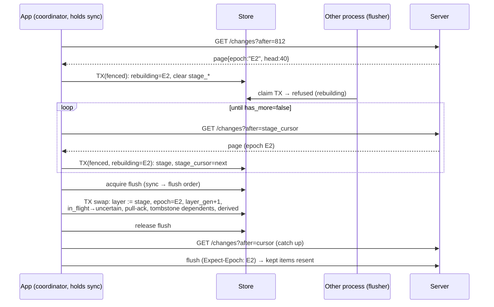

# Spec: sync protocol (iOS client)

**Status:** M0 draft, revision 2 (after the Codex spec review), 2026-10-17.
**Implements:** PLAN.md §2 (the store model, change feed, tombstones, epoch,
server identity and online-only operations), §6, and §6a rules 1–8 and 12.
**Companion specs:** [outbox.md](outbox.md) covers the write path, and
[notifications.md](notifications.md) covers reminders and actions.

## Purpose

This spec defines how the iOS app keeps a full offline mirror of one quickR
server and how it reads that server's changes. It covers:

- the client's view of the server change feed;
- the identity and epoch preconditions;
- how the local store is split into a **server layer** and an **outbox
  overlay**;
- the merge rules;
- generations and fencing;
- the single sync coordinator;
- epoch rebuilds;
- store partitioning per server;
- local reset;
- clock skew;
- the operations that need a connection.

The outbox's internal state machine is defined in [outbox.md](outbox.md). This
spec defines how the outbox's items show up in the view and what sync does to
them.

**Normative language.** **MUST**, **MUST NOT**, **SHOULD** and **MAY** are used
as in RFC 2119. **[server]** marks a contract requirement on the backend. quickR
is not in production, so these requirements may break the existing API; the PWA
and MCP are updated to match. The server side is being built in parallel by work
package M0-feed. The lead reconciles any differences at integration.

## Glossary

| Term                 | Meaning                                                                                                                                                                     |
| -------------------- | --------------------------------------------------------------------------------------------------------------------------------------------------------------------------- |
| **Server**           | One quickR backend instance. It is identified by `server_id`, not by its URL.                                                                                               |
| **`server_id`**      | A stable random id that the server generates once and stores in `app_settings`. A database restore keeps it. A fresh install gets a new one.                                |
| **Epoch**            | `app_settings.feed_epoch`, a random id. It is rotated whenever the server database is restored or reset (`make rotate-epoch`). A seq means something only within one epoch. |
| **seq**              | A position in the server's `change_log`. It is allocated under the feed advisory lock, so seq order equals commit order (§6a rule 1).                                       |
| **Cursor**           | The highest seq the client has fully applied, stored per store. `0` means nothing has been applied yet.                                                                     |
| **Head**             | The server's highest seq at the moment it answered.                                                                                                                         |
| **Page**             | One `/changes` response.                                                                                                                                                    |
| **Store**            | One SQLite file holding everything for one `server_id` and **one store generation**: the server layer, the outbox, local tombstones, drafts and caches.                     |
| **Store generation** | `registry.server.store_gen`. It is part of the store's file name. A local reset creates a new generation, which means a new file (§12).                                     |
| **Layer generation** | `sync_state.layer_gen`. It is incremented by every rebuild swap (§7). It identifies one incarnation of the server layer inside a store file.                                |
| **Request context**  | `(store file, layer_gen, epoch)`, captured when a request is built. An outcome is applied only if its context is still current (§5.5).                                      |
| **Server layer**     | The tables `topic`, `topic_version`, `entry` and `tombstone`: server state exactly as the server last reported it.                                                          |
| **Outbox / overlay** | The queued local writes ([outbox.md](outbox.md)). The UI sees them applied on top of the server layer.                                                                      |
| **View**             | What the UI, widgets, intents and the NSE read: the server layer with the overlay applied, plus locally computed derived fields.                                            |
| **Ack**              | The transaction that turns a successful outbox send into server-layer state (§6a rule 7).                                                                                   |
| **Coordinator**      | The single holder of a store's `sync_lock`. Only the coordinator pulls, stages, swaps and resets (§5.4). In v1 only the app process can be coordinator.                     |
| **Lease time**       | System-wide time measured from boot (`mach_continuous_time`), paired with a boot session id. Wall-clock time is never used for leases (§5.4).                               |
| **Active store**     | The store for the server the user has currently selected, at its current store generation.                                                                                  |
| **Skew**             | `server_time − device_time`, estimated from feed responses.                                                                                                                 |

## 1. Server contract (client view)

### 1.1 Feed request

```
GET /api/v1/changes?after=<cursor:int ≥ 0>&limit=<1..500>
```

- The client sends `limit=500`. **[server]** The server caps `limit` at 500 (§6a
  rule 4).
- The client sends its normal headers: `X-QuickR-Channel: ios`, plus the Access
  headers when they are configured. A feed request is not a mutation, so it
  carries no precondition headers (§1.4).
- The client never follows redirects. Redirects and 200 responses that aren't
  JSON are handled as in [outbox.md §5](outbox.md#5-classification).
- The request timeout is 30 s.

### 1.2 Feed response

```
ChangePage {
  server_id:   string (UUID)  // in every page
  epoch:       string (UUID)
  head:        int            // highest seq on the server when the page was built
  next:        int            // highest seq this page covers (equal to after when the page is empty)
  has_more:    bool
  server_time: datetime       // RFC 3339, for clock skew (§10)
  items: (                    // tagged union on `kind`; each item carries its change_log `seq`
      { kind: "topic",   seq, topic: TopicDetail }                          // incl. revision; derived fields ignored (§3.3)
    | { kind: "version", seq, id, topic_id, version: TopicVersionOut }      // immutable; nested, not flattened
    | { kind: "entry",   seq, entry: EntryOut }                             // incl. revision
  )[]
  deleted: { kind: "entry" | "topic" | "version", seq, id, topic_id, deleted_at }[]   // topic_id never null
}
```

Ordering within a page: `items` are listed topics, then versions, then entries;
`deleted` is listed entries, then versions, then topics. Each kind is in ascending
`seq`. The client applies by kind (§4.1) and doesn't depend on this order. `limit`
counts change_log rows, not items, so a page can hold fewer items than `limit`.

### 1.3 Contract requirements

| #   | Requirement **[server]**                                                                                                                                                                                                                                                                                                                                                                                                                                                                                                                                                | Why the client needs it                                                     |
| --- | ----------------------------------------------------------------------------------------------------------------------------------------------------------------------------------------------------------------------------------------------------------------------------------------------------------------------------------------------------------------------------------------------------------------------------------------------------------------------------------------------------------------------------------------------------------------------- | --------------------------------------------------------------------------- |
| F1  | A page is materialised in **one REPEATABLE READ snapshot**. It covers the change_log rows with `after < seq ≤ next`. For each entity in those rows, it returns the entity's **latest state in that snapshot**, which may be newer than the seq that put it on the page.                                                                                                                                                                                                                                                                                                 | The client can apply a page as an idempotent, monotone set of upserts.      |
| F2  | An entity that no longer exists in the snapshot is emitted in `deleted` **only if its id is in `deleted_ids`**. Otherwise it is skipped, because its own delete row comes later (§6a rule 4).                                                                                                                                                                                                                                                                                                                                                                           | A "vanished" entity always arrives with a tombstone.                        |
| F3  | Every deleted entity of every kind (entry, topic and version) is in `deleted_ids` permanently. A topic delete puts its child entries and versions into `deleted_ids` **before** the foreign-key cascade (§6a rule 3), so their ids stay reserved. **Incremental** pages emit only the topic's own deletion, and the client cascades to the children locally (§4.3 step 2). A **bootstrap** from `after=0` emits every child deletion explicitly.                                                                                                                        | Tombstones are complete, and ids are never reused.                          |
| F4  | `entry` and `topic` rows carry `revision`, an integer. It starts at 1 and increases with every change to that entity within an epoch. POST, PATCH, archive and unarchive responses carry it too.                                                                                                                                                                                                                                                                                                                                                                        | The regression guard (§5.2).                                                |
| F5  | Entry mutations do not log topic rows. Topic rows are logged only when the topic's own fields change (§6a rule 3).                                                                                                                                                                                                                                                                                                                                                                                                                                                      | The client recomputes derived fields itself (§3.3).                         |
| F6  | The backfill migration writes seqs in the order topics, then versions, then entries.                                                                                                                                                                                                                                                                                                                                                                                                                                                                                    | The first bootstrap pages can render the home screen.                       |
| F7  | `server_id` survives a restore. A restore or reset rotates `epoch`.                                                                                                                                                                                                                                                                                                                                                                                                                                                                                                     | §7 and §8.                                                                  |
| F8  | `next ≥ after`. For a valid cursor (`after ≤ head`), `has_more = false` implies `next = head` as of the snapshot. When `after > head` the server returns `next = after`, and the client's restore check (§2.2, `cursor ≤ head`) catches it.                                                                                                                                                                                                                                                                                                                             | The pull loop terminates.                                                   |
| F9  | **Every** `/api/v1` response, including errors and `/health`, carries the response headers `X-QuickR-Server-Id` and `X-QuickR-Epoch`.                                                                                                                                                                                                                                                                                                                                                                                                                                   | Outcome checks (§1.4)                                                       |
| F10 | **Mutation preconditions.** Every mutating request (POST, PUT, PATCH, DELETE under `/api/v1`, **including the push and APNs device endpoints**) accepts the optional request headers `X-QuickR-Expect-Server-Id` and `X-QuickR-Expect-Epoch`. When either one is present and differs from the server's value, the server MUST answer **409** with the Problem code `server_mismatch` or `epoch_mismatch`, **before any mutation effect**: no writes and no side effects. The check may run under the feed advisory lock, and it does. Server identity is checked first. | A write can never execute on the wrong server or in the wrong epoch (§1.4). |
| F11 | The 409 Problem codes `entry_deleted` and `stale_revision`. PATCH or GET of a deleted entry returns 404. DELETE of an absent or reserved id returns 204. POST replay of a live id returns the existing entry with 201.                                                                                                                                                                                                                                                                                                                                                  | [outbox.md §5](outbox.md#5-classification)                                  |

The PWA may omit the F10 headers. They are optional for compatibility, not
because the client is allowed to skip them.

### 1.4 Identity and epoch: what the client sends and checks

| Request                                                                                  | iOS client sends                                                                                          |
| ---------------------------------------------------------------------------------------- | --------------------------------------------------------------------------------------------------------- |
| Every mutation: outbox sends, online-only writes, and APNs register, unregister and test | **Always** both `X-QuickR-Expect-Server-Id: <store.server_id>` and `X-QuickR-Expect-Epoch: <store.epoch>` |
| Feed pages and other GETs (stats, series, CSV, refetches)                                | No precondition headers                                                                                   |

The client checks **every** response, of any status, **before interpreting
it**. Interpreting means acting on a 2xx body, on a Problem code, or on a 404 that
says an entity is gone. The checks run in this order:

| Observation                                                                                                                        | Meaning and handling                                                                                                                                                                                                                                                                                                                                           |
| ---------------------------------------------------------------------------------------------------------------------------------- | -------------------------------------------------------------------------------------------------------------------------------------------------------------------------------------------------------------------------------------------------------------------------------------------------------------------------------------------------------------- |
| `X-QuickR-Server-Id` is present and differs from `store.server_id` (any status), or 409 `server_mismatch`                          | The URL now reaches a different server. **Do not interpret the response.** For a mutation that was rejected by its precondition, nothing executed. The outbox restores the item ([outbox.md §5.2](outbox.md#52-per-kind-overrides)). The store enters **identity mismatch** (§8.3).                                                                            |
| `X-QuickR-Epoch` is present and differs from the request context's epoch (any status), or 409 `epoch_mismatch`                     | **Do not interpret the response.** That includes a 404 or a 4xx, which never mean "gone" or "rejected" across epochs. Discard the outcome (§5.5), then follow the mismatch signalling in §5.6: `epoch_suspect`, release `flush`, and ask the coordinator to run. Item handling is in outbox.md §5.2.                                                           |
| A 2xx without the headers                                                                                                          | Treat it as an identity mismatch, because only a misbehaving proxy or server sends this. **Discard the outcome.**                                                                                                                                                                                                                                              |
| A non-2xx without the headers, such as a 3xx or 403 from the Cloudflare Access proxy, or a 5xx while the server's database is down | It never reached quickR's application logic, so it is **never interpreted as an application error**. 3xx, 401, 403, 408, 425, 429 and 5xx keep their base classification ([outbox.md §5.1](outbox.md#51-base-table-byte-compatible-with-pwa-classifystatus-and-attempt)). Any other status without headers is a retry ("Unexpected response from the server"). |
| Headers present and matching                                                                                                       | Interpret the response normally. A feed page also runs the checks in §2.2.                                                                                                                                                                                                                                                                                     |

**Header provenance [server].** The response headers describe the server
identity and epoch **under which the request was actually handled**:

- The server reads `X-QuickR-Server-Id` and `X-QuickR-Epoch` **after** handling
  the request, inside the same transaction or snapshot that served it. This
  applies to error responses too. It never reads them at request entry.
- `/changes` takes its headers from the page snapshot.
- If the epoch rotates while a request is being handled, the response therefore
  carries the new epoch, and the client sees a mismatch. Example: a refetch read
  under E2 that returns 404 is labelled E2, never E1.

The client's rule ("never interpret a response whose headers don't match") is
only sound with this provenance. M0-feed implements it. The backend tests rotate
the epoch between request entry and the entity lookup, and assert that the
response carries the new epoch.

The previous draft had a 60-second "identity confirmed" window and a health
probe. **Both are removed.** The F10 preconditions make every mutation
self-checking.

## 2. Bootstrap and the page checks

### 2.1 Bootstrap

1. The user enters a server URL during onboarding or in Settings.
2. The client fetches `GET /changes?after=0&limit=500` and keeps the page **in
   memory**.
3. It reads `server_id` from the page:
   - **A known store exists** for that `server_id`: the client activates it at
     its current store generation and continues with a steady-state pull from
     its cursor. The in-memory page is discarded.
   - **No store exists:** in one registry transaction, the client inserts
     `server(server_id, base_url, store_gen = 1)`. It creates
     `stores/<server_id>.g1.sqlite` with `server_id`, `epoch`, `cursor = 0` and
     `layer_gen = 1`, then applies the page as in §4.1.
4. It keeps pulling until `has_more = false`. **Each page is applied in its own
   transaction together with its cursor advance.** An interrupted bootstrap
   resumes from the last committed cursor.
5. While `cursor < head_at_start`, the UI shows "Loading history" with progress
   `cursor / head`. Logging works as soon as a page with topics and versions has
   been applied (F6).

```mermaid
sequenceDiagram
  participant U as User
  participant C as App (coordinator)
  participant S as Server
  U->>C: enter server URL
  C->>S: GET /changes?after=0&limit=500
  S-->>C: page{server_id, epoch, head, next, has_more:true, topics, versions…}
  C->>C: registry TX: insert server(store_gen=1) → create stores/<id>.g1.sqlite
  C->>C: acquire sync_lock (§5.4)
  C->>C: TX (fenced): apply page, cursor=next, epoch, server_id
  loop until has_more = false
    C->>S: GET /changes?after=cursor
    S-->>C: page
    C->>C: TX (fenced): checks §2.2 → apply → cursor=next
  end
  C->>C: release sync_lock; recompute derived; register categories; reload widgets
  C->>S: POST /push/apns/devices (+Expect headers)
```

### 2.2 Checks on every page

These run in order. The first failure decides the outcome.

| Check                                                                                                         | On failure                                                                                                                                                                   |
| ------------------------------------------------------------------------------------------------------------- | ---------------------------------------------------------------------------------------------------------------------------------------------------------------------------- |
| `server_id == store.server_id`                                                                                | **Identity mismatch** (§8.4). Stop syncing and flushing this store. Never apply the page.                                                                                    |
| `epoch == store.epoch`                                                                                        | **Epoch mismatch.** Start a rebuild (§7) and discard the page.                                                                                                               |
| `store.cursor ≤ head`                                                                                         | **Restore detected** (§6a rule 5). Handle it as an epoch mismatch, even though the epoch didn't change (someone forgot to rotate it).                                        |
| `next ≥ store.cursor`                                                                                         | Protocol error. Log it, back off, and don't apply the page.                                                                                                                  |
| Every row decodes                                                                                             | Protocol error. Don't apply the page and don't advance the cursor. Log the failing row id and retry with backoff. If the failure persists, the sync pill shows "Sync error". |
| **Fence** (§5.5): the coordinator still holds `sync_lock`, `layer_gen` is unchanged, the store is not retired | **Discard the page silently.** A newer coordinator owns the store.                                                                                                           |

A bootstrap, with `cursor = 0` and no epoch yet, accepts whatever `epoch` and
`server_id` the first page reports.

## 3. The two-layer store

### 3.1 Tables, and who writes them

| Table                                                                                 | Layer           | Written by                                                                                                        |
| ------------------------------------------------------------------------------------- | --------------- | ----------------------------------------------------------------------------------------------------------------- |
| `topic`, `topic_version`, `entry`, `tombstone(kind, id, topic_id, seq)`               | Server          | The coordinator's pages (§4) and swap (§7); acks (§6); online-only responses (§11). Every write is fenced (§5.5). |
| `sync_state` (one row)                                                                | Server metadata | The coordinator                                                                                                   |
| `stage_topic`, `stage_topic_version`, `stage_entry`, `stage_tombstone`, `stage_state` | Rebuild staging | The coordinator (§7)                                                                                              |
| `outbox_item`                                                                         | Overlay         | The outbox ([outbox.md](outbox.md)), and sync's tombstone handling (§4.3)                                         |
| `lease(name PK, owner, token, boot_id, expires_ct)`: rows `sync`, `flush`             | Coordination    | §5.4 and [outbox.md §6](outbox.md#6-the-flush-lock)                                                               |
| `ui_draft`, `stats_cache`, `widget_state`                                             | Local           | The UI, widgets and stats fetches                                                                                 |

`sync_state` holds these columns:

- `server_id`, `base_url` and `epoch`;
- `cursor` and `head_seen`;
- `layer_gen`;
- `rebuilding`: null, or the target epoch;
- `epoch_suspect`: 0 or 1 (§5.6);
- `retired`: 0 or 1 (§12);
- `identity_mismatch`: 0 or 1;
- `last_pull_at`, `skew_ms` and `skew_measured_at`;
- `bootstrap_complete`.

The server layer MUST NOT enforce foreign keys between `entry`, `topic` and
`topic_version`, because a page may contain an entry whose topic arrives on a
later page. The view uses inner joins, so an orphan entry stays invisible until
its topic arrives.

### 3.2 How the view is computed

The view is a pure function of (the server layer, the outbox items, `now`).
Implementations MAY materialise it, but every write that changes an input MUST
update the materialised view **in the same transaction**.

**Entries.** For each entity id, start from the server row (if there is one),
then apply that entity's outbox items **in local `seq` order**:

| Item kind and state                                          | Effect on the view row                                                                                                                                                                                                                                                                                                           |
| ------------------------------------------------------------ | -------------------------------------------------------------------------------------------------------------------------------------------------------------------------------------------------------------------------------------------------------------------------------------------------------------------------------- |
| `entry.create`, active (`pending`, `in_flight`, `uncertain`) | With no server row, synthesise the row from the payload and set `sync_state = pending`. With a server row, the server row wins: the create has landed, and sync acks it (§4.4).                                                                                                                                                  |
| `entry.update`, active                                       | Patch the row. `answers` merges by key, and a `null` value removes the key. `captured_at`, `notes`, `source` and `meta` are replaced when present. Set `sync_state = pending`.                                                                                                                                                   |
| `entry.delete`, active                                       | The row is hidden.                                                                                                                                                                                                                                                                                                               |
| `entry.delete`, `held` (in the undo window)                  | The row is hidden but undoable. **The items before it stay as they are** ([outbox.md §9.2](outbox.md#92-delete-with-undo)), so Undo brings back exactly the row the user saw.                                                                                                                                                    |
| Any kind, `failed`                                           | The content is still applied for display, so a failed create shows what the user entered, and the row is flagged `sync_state = failed` with the error. A failed delete shows the row (it is **not** hidden) with "Couldn't delete". A failed item with reason `deleted_elsewhere` has no row and appears only in the sync sheet. |

- An entity whose `entry.create` is `failed` is listed only in the pinned "Not
  synced" section, and is excluded from derived fields.
- An id that is in `tombstone` never appears, whatever the overlay holds.

**Topics.** Start from the server row, then apply `topic.archive` items
(`status = archived`, `archived_at` = the item's `created_at`) and
`topic.unarchive` items (`status = active`, `archived_at = null`) in `seq`
order. Failed topic items are not applied; the topic is flagged instead.
Versions come from the server layer only, because publishing needs a connection.

### 3.3 Derived fields (§6a rule 3)

The client MUST compute these fields from the view and MUST ignore the server's
values:

```
counted(topic)   = view entries of topic, excluding entities whose create is failed,
                   excluding hidden rows (deleted or held-delete)
entry_count      = |counted(topic)|
last_captured_at = max(captured_at over counted(topic)), or null
due              = compute_due(schedule, now = device_now + skew,
                               last_entry_at = last_captured_at,
                               schedule_since = schedule_updated_at ?? created_at,
                               archived = (view status == archived))
                   // Swift port of schedule.py, verified by shared/fixtures/due-vectors.json
version.entry_count = |counted entries pinned to that version|
```

Derived fields are recomputed after every page, ack, enqueue, discard and
failure, and once a minute while the app is visible.

The **badge** is the number of view topics in the **active store only** with
`status = active` and `due.is_due` (PWA `dueCount`). See
[notifications.md §8](notifications.md#8-badge).

## 4. Merge rules

### 4.1 Applying a page

Each page is applied in one GRDB `IMMEDIATE` transaction, run by the
coordinator:

1. Check the **fence** (§5.5), then run the §2.2 checks. Stop on the first
   failure.
2. **Upserts.** Apply the `items` of kind `topic`, then `version`, then `entry`,
   each through the §4.2 guards.
3. **Deletions.** Apply `deleted` as in §4.3.
4. **Pull-ack.** Apply §4.4.
5. Recompute derived fields for every touched topic.
6. Set `cursor = next`, `head_seen = head` and `last_pull_at = now`, and update
   the clock skew (§10).
7. Commit, then post the Darwin notification `com.bahumia.quickr.db-changed`.

### 4.2 Upsert guards

These guards apply to every write into the server layer, whatever the path:

| Guard         | Rule                                                                                                                                                                                                                                        |
| ------------- | ------------------------------------------------------------------------------------------------------------------------------------------------------------------------------------------------------------------------------------------- |
| **Fence**     | The request context must still be current (§5.5). Otherwise nothing is written: no rows, **no tombstones, no deletions**.                                                                                                                   |
| **Tombstone** | If `(kind, id)` is in `tombstone`, drop the upsert. Ids are never reused (F3).                                                                                                                                                              |
| **Revision**  | If a local row exists with `revision > incoming.revision`, drop the upsert. Equal revisions overwrite, which is idempotent. Without this guard, a page fetched before one of our PATCHes but applied after its ack would roll the row back. |
| **Versions**  | `topic_version` rows are immutable. Insert if absent, otherwise ignore.                                                                                                                                                                     |

### 4.3 Tombstones

For each item in `deleted` (`{kind, seq, id, topic_id, deleted_at}`):

1. Insert into `tombstone`. This is idempotent.
2. Delete the server-layer row. A **topic** tombstone also deletes every
   `topic_version` and `entry` row with that `topic_id`, and inserts tombstones
   for them. **This local cascade is required:** incremental pages carry only
   the topic's own deletion (F3).
3. **Dependent outbox items.** These are the items for the deleted entity, or,
   for a topic, every item with that `topic_id`. They are resolved in the same
   transaction:

| Dependent item                                                                    | Result                                                                                                                                                                |
| --------------------------------------------------------------------------------- | --------------------------------------------------------------------------------------------------------------------------------------------------------------------- |
| `entry.delete` (any state except `in_flight`, including `held`)                   | **Retired** silently. The goal is already met.                                                                                                                        |
| `topic.archive`                                                                   | Retired silently.                                                                                                                                                     |
| `entry.create` or `entry.update`, with a later `entry.delete` for the same entity | Retired silently.                                                                                                                                                     |
| `entry.create`, `entry.update` or `topic.unarchive`, otherwise                    | **`failed`**, with reason `deleted_elsewhere` ("Deleted on another device").                                                                                          |
| Any item that is `in_flight`                                                      | Left alone. Its outcome (a 404, `entry_deleted`, or a 2xx that the tombstone guard drops) resolves it by the same table ([outbox.md §5](outbox.md#5-classification)). |

4. A **topic** tombstone also clears:
   - that topic's `ui_draft` and `stats_cache` rows;
   - its widget state (widgets render "Topic deleted" and their timelines
     reload);
   - pending local notification requests (in the fallback), and delivered
     notifications whose `userInfo.quickr` names this server and topic.

   Notification categories are **not** touched. The category table is
   append-only in v1
   ([notifications.md §5](notifications.md#5-category-registration)).

### 4.4 Pull-ack of creates

A server row can appear for an entity that still has an `entry.create` item, for
example when the POST committed but its response was lost (`uncertain`). In the
page transaction:

- If the create is not `in_flight`, remove it. That counts as an ack. Then apply
  [outbox.md §7.3](outbox.md#73-revision-chaining) to the entity's next item.
- If it is `in_flight`, leave it. The sender's CAS resolves it.

A create is never coalesced after it has been attempted
([outbox.md §8](outbox.md#8-coalescing)). So the payload that may have landed is
exactly what the server holds, and a pull-ack loses nothing.

## 5. Coordination

### 5.1 Who does what

| Work                                              | Who                                                        | Lease held                |
| ------------------------------------------------- | ---------------------------------------------------------- | ------------------------- |
| Pull pages, rebuild (stage and swap), local reset | **The coordinator only** (app process)                     | `sync`                    |
| Flush the outbox                                  | Any process ([outbox.md §10](outbox.md#10-flush-triggers)) | `flush`                   |
| Enqueue, view reads, category registration        | Any process                                                | None (plain transactions) |

**This is a simplification from the previous draft.** One coordinator owns pulls
and rebuilds, so the two never race each other. Extensions never pull.

### 5.2 Global lock order

There is one order, and it is used everywhere:

```
  lease "sync"   →   lease "flush"
```

1. A process that holds `flush` MUST NOT wait for `sync`. A flusher never needs
   `sync`.
2. Rebuild swap and reset take `sync` first, then `flush`.
3. **SQLite transactions are always leaves.** A process never holds a store or
   registry write transaction while it waits for a lease, makes a network
   request, or runs any `await` or suspension point. Acquiring or renewing a
   lease is itself one short `IMMEDIATE` transaction.
4. A transaction never spans two database files. A registry transaction and a
   store transaction are never open at the same time in one process.

### 5.3 Lease row semantics (shared with the flush lock)

```sql
CREATE TABLE lease (
  name       TEXT PRIMARY KEY,   -- 'sync' | 'flush'
  owner      TEXT,               -- "<process kind>:<launch uuid>"
  token      TEXT,               -- fencing token, new on every acquisition
  boot_id    TEXT,               -- boot session uuid at acquisition
  expires_ct INTEGER             -- mach_continuous_time-based nanoseconds since boot
);
```

| Operation   | Rule (each one is one `BEGIN IMMEDIATE` transaction)                                                                                                                                                                                                      |
| ----------- | --------------------------------------------------------------------------------------------------------------------------------------------------------------------------------------------------------------------------------------------------------- |
| **Valid**   | A lease is valid iff `owner IS NOT NULL AND boot_id = current_boot_id AND now_ct < expires_ct`. **A different `boot_id` means the lease has expired.**                                                                                                    |
| **Acquire** | Succeeds if the lease is not valid. Set `owner`, a new `token`, `boot_id`, and `expires_ct = now_ct + TTL`. Acquiring a `flush` lease that a previous owner left behind also runs flush-expiry recovery ([outbox.md §6.3](outbox.md#63-expiry-recovery)). |
| **Renew**   | Requires `owner = me`, `token = mine` and validity. Sets `expires_ct = now_ct + TTL`. If renewal fails, the lease has been lost, and the holder MUST stop at once.                                                                                        |
| **Release** | `owner = NULL` if `token = mine`.                                                                                                                                                                                                                         |

- `now_ct` comes from `mach_continuous_time()`, converted with
  `mach_timebase_info`. It is system-wide, counts through sleep, and wall-clock
  changes don't affect it.
- `current_boot_id` comes from `sysctl kern.bootsessionuuid`. If that read
  fails, the fallback is `kern.boottime` formatted as a string.
- A wall-clock change in either direction therefore has **no effect** on leases.
- TTLs: `sync` 60 s, renewed before every page transaction; `flush` 30 s
  ([outbox.md §6](outbox.md#6-the-flush-lock)).

### 5.4 The coordinator loop

The loop decides what to do from the persisted state **before** it makes any
request. A coordinator that takes over a half-finished rebuild therefore resumes
staging, and never starts with a live pull.

```
coordinate(store):
  acquire lease "sync" or return                     // another coordinator is running
  loop:
    st = TX read sync_state                          // short read; no request in flight
    if st.retired: reopen from registry (§12); return
    if st.identity_mismatch: return                  // §8.3
    if st.rebuilding != nil:
      if stageStep(st) == .swapped: continue         // §7; context refreshed by re-reading st
      else: return or retry with backoff
    else:
      result = liveStep(st)                          // one live page
      if result == .epochMismatch(E): startRebuild(E); continue
      if result == .drained: break
  release "sync"

liveStep(st):
  ctx = (store file, st.layer_gen, st.epoch, my sync token)
  page = GET /changes?after=st.cursor                // no transaction open
  if page.server_id != st.server_id: TX(fenced) set identity_mismatch; return .stop
  if page.epoch != ctx.epoch or st.cursor > page.head: return .epochMismatch(page.epoch)
  TX IMMEDIATE: fence(ctx) or abort-silently; renew "sync"; checks §2.2; apply §4.1;
                epoch_suspect = 0                    // a page in our epoch clears suspicion (§5.6)
  return page.has_more ? .more : .drained

startRebuild(E):                                     // idempotent for the same target
  TX IMMEDIATE: fence(sync token, layer_gen)
    if rebuilding == E: no-op                         // already staging for E: never re-clear
    else: rebuilding = E; clear stage_*; stage_state.cursor = 0
```

`stageStep` is defined in §7 step 2, and the swap in §7 step 3.

### 5.5 Fencing and generations

Every transaction that applies the result of a network request (a page, a staged
page, the swap, an ack, an outbox outcome, an online-only response, or a
refetch) MUST begin with a **fence check** against the request context it
captured:

| Fence condition                                         | Applies to                                                   |
| ------------------------------------------------------- | ------------------------------------------------------------ |
| `sync_state.retired = 0`                                | Everything. A retired file is never written again (§12).     |
| `sync_state.layer_gen = ctx.layer_gen`                  | Everything that writes the server layer or outbox state      |
| `sync_state.epoch = ctx.epoch` and `rebuilding IS NULL` | Live pages                                                   |
| `sync_state.rebuilding = ctx.target_epoch`              | Staged pages                                                 |
| The `sync` lease is valid and its token is `ctx.token`  | Pages, staged pages, the swap and reset (coordinator work)   |
| The `flush` lease is valid, and `claim_token` matches   | Outbox outcomes ([outbox.md §6](outbox.md#6-the-flush-lock)) |

If the fence fails, the outcome is **discarded entirely**. That means no server
rows, no tombstones, no deletions, no outbox changes and no derived updates. The
process stops the work that produced it. The state that the outcome would have
reported reaches the store through the next pull instead.

### 5.6 Mismatch signalling (never a reverse lock order)

When a flusher, or any non-coordinator, sees an epoch mismatch (a 409
`epoch_mismatch`, or a response whose epoch header doesn't match), it **does not
rebuild**. Instead it:

1. In its outcome transaction, which is fenced as usual, sets
   `sync_state.epoch_suspect = 1` and applies the outcome rule for the item
   ([outbox.md §5.2](outbox.md#52-per-kind-overrides)). While `epoch_suspect` is
   set, claims are refused, so the queue doesn't keep sending into 409s.
2. **Releases `flush`.**
3. Only then requests a coordinator run **asynchronously**: an in-process task
   if this is the app, or the Darwin notification
   `com.bahumia.quickr.sync-requested` from an extension. The app also runs the
   coordinator on every activation.

The coordinator's next live page confirms the epoch and clears `epoch_suspect`, or
detects the mismatch and starts a rebuild, which clears it at the swap. An identity
mismatch follows the same sequence, using `identity_mismatch` (§8.3) instead.

A process holding `flush` therefore never waits for `sync`, and the global lock
order (§5.2) is never reversed.

## 6. Atomic ack (§6a rule 7)

When the outbox receives a definitive success for an item, **one** GRDB
`IMMEDIATE` transaction does all of this:

1. **Fence:** `retired = 0`, `layer_gen` matches the claim, the `flush` lease is
   still mine, and the item still carries my `claim_token`. **If any of these
   fails, the whole outcome is discarded.** A superseded sender writes nothing.
2. Apply the server state under the §4.2 guards:
   - a POST, PATCH or archive response carries a row, which is upserted;
   - a DELETE that succeeds (204, 404 or `entry_deleted`) removes the row and
     inserts a tombstone.
3. Delete the outbox item.
4. Apply revision chaining to the entity's next item
   ([outbox.md §7.3](outbox.md#73-revision-chaining)).
5. Recompute derived fields for the topic.

The view never shows an operation twice or not at all, because the server row
and the overlay change in the same transaction.

## 7. Epoch rebuild in place

**Trigger:** an epoch mismatch on a page, `cursor > head`, a 409
`epoch_mismatch`, or a response whose epoch header differs from the store's
epoch.

The store file is kept. The outbox, drafts, credentials and notification state
are untouched. Only the server layer is rebuilt, through staging tables. The UI
keeps showing the old data until the new data is complete. **Only the
coordinator rebuilds**, while it holds the `sync` lease.

1. **Start.** `startRebuild(E)` (§5.4) is called in one fenced transaction. It
   sets `sync_state.rebuilding = E`, clears the `stage_*` tables and sets
   `stage_state.cursor = 0`, unless `rebuilding` is already `E`, in which case
   it does nothing. **From now on, outbox claims are refused in every process**
   ([outbox.md §6.2](outbox.md#62-claims-and-the-rebuild-guard)). Enqueueing
   still works.
2. **Stage.** `stageStep(st)` uses its **own staging context**:
   `sctx = (store file, st.layer_gen, target_epoch = st.rebuilding, my sync token)`.

   ```
   stageStep(st):
     page = GET /changes?after=stage_state.cursor
     if page.server_id != st.server_id: set identity_mismatch; return .stop
     if page.epoch != sctx.target_epoch: startRebuild(page.epoch); return .restarted   // only a *different* epoch re-clears
     TX IMMEDIATE: fence(sctx) or abort-silently; renew "sync"; decode checks;
                   apply into stage_* (same guards, against stage tables); stage_state.cursor = next
     if !page.has_more: swap(sctx) (step 3); return .swapped
     return .more
   ```

   - The live-layer checks (`cursor ≤ head`, the live epoch) don't apply to
     staged pages. A staged page is only compared with `target_epoch`.
   - If the coordinator loses its lease, its fenced writes fail and it stops.
   - **Takeover.** A new coordinator's loop sees `rebuilding` set before it
     makes any request (§5.4). It continues from `stage_state.cursor`, building
     the staging context from the persisted state. An E2 page seen while staging
     for E2 never clears the staging tables again.
   - After the swap, the loop re-reads `sync_state`, so the next live context
     carries the new `epoch` and `layer_gen`.

3. **Swap.** When a staged page returns `has_more = false`:
   1. Acquire the `flush` lease (lock order `sync` → `flush`). This waits for
      any live sender to finish, or for its lease to expire.
   2. In one `IMMEDIATE` transaction, fenced on both leases:
      - replace `topic`, `topic_version`, `entry` and `tombstone` with the
        staged rows;
      - set `epoch`, `cursor = stage cursor`, `rebuilding = null`,
        `epoch_suspect = 0`, and **`layer_gen += 1`**;
      - set every `in_flight` item to `uncertain` and clear its claim. Its
        sender's fence now fails, because of `layer_gen` and the token;
      - run §4.4 pull-ack over the whole outbox;
      - apply the §4.3 dependent-item rules for every outbox entity whose id is
        in the new `tombstone` table;
      - recompute all derived fields.
   3. Release `flush`. Run a normal pull from the new cursor, then flush.
4. **Restore recovery.** An outbox item whose entity is **missing** from the
   rebuilt layer, and not tombstoned, is **kept**:
   - an `entry.create` is resent, and the server creates the entry again;
   - an `entry.update` gets a 404 and resolves as `deleted_elsewhere`;
   - a `topic.*` item gets a 404 and resolves by its kind's rule.

   Items that are already `failed` stay `failed`.

5. **Responses that arrive after the swap** carry the old `layer_gen` and are
   discarded by the fence. This covers online-only responses too.



## 8. Server identity and store partitioning (§6a rule 8)

### 8.1 Files

```
<AppGroup>/Library/quickr/
  registry.sqlite                       app-global: servers, active server, notification_category,
                                        pending APNs unregistrations
  stores/<server_id>.g<store_gen>.sqlite  one live store per server (WAL; completeUntilFirstUserAuthentication)
```

The registry has these tables:

- `registry.server(server_id PK, base_url, display_name, store_gen, created_at, last_sync_at)`;
- `registry.active(server_id)`;
- `registry.retired_file(path PK, retired_at_wall, retired_boot_id, retired_ct)`
  (§12).

`notification_category` lives in the **registry**, because
`setNotificationCategories` replaces the whole app's set across all servers
([notifications.md §5](notifications.md#5-category-registration)).

Credentials (the Cloudflare Access id and secret) live in the shared Keychain
group, with `kSecAttrAccount = server_id` and `AfterFirstUnlock`.

**Opening a store:** a process reads `registry.server.store_gen` for the
`server_id` and opens that file. It re-reads the registry, and reopens the store
if the generation has changed, at these moments:

- every time the Darwin notification `com.bahumia.quickr.registry-changed`
  arrives;
- every time the app becomes active;
- at the start of every extension invocation;
- whenever a transaction aborts with `retired`.

### 8.2 Invariants

1. Every outbox item belongs to exactly one store file. Items MUST NEVER be
   copied or moved between stores.
2. Only the **active** store pulls and flushes automatically. An inactive store
   is kept with its outbox until the user deletes it.
3. A notification action writes only into the store for the `server_id` in its
   action identifier, at that server's current store generation. That store may
   be inactive. If no such server exists in the registry, the action is dropped
   with a local notification
   ([notifications.md §7](notifications.md#7-action-handler)).
4. Every mutation carries the F10 preconditions for its store (§1.4). A write
   can therefore never execute on a different server or epoch, whatever the URL
   resolves to.

### 8.3 Identity mismatch

The store enters identity mismatch when it sees a 409 `server_mismatch`, a page
whose `server_id` differs, or a 2xx whose server header differs. Then:

- `sync_state.identity_mismatch` is set to 1;
- automatic pulls and flushes stop;
- a banner says "This address now points to a different quickR server". Its
  actions are **Use the new server** (the §8.4 flow, keeping the old store) and
  **Keep waiting**. Keep waiting retries a feed page every 5 minutes, and clears
  the flag when the `server_id` matches again.

### 8.4 Switching servers

1. The client probes the new URL with `GET /changes?after=0&limit=1` and reads
   its `server_id`.
2. If the current store has outbox items, it warns: "_N_ changes haven't synced
   to _old server_. They stay on this iPhone and sync when you switch back."
   - The options are **Sync now** (flush, then continue), **Switch anyway** and
     **Cancel**.
3. It unregisters APNs on the old server with
   `POST /push/apns/devices/delete {token}`, sending the old store's Expect
   headers. If that fails, it records the attempt in
   `registry.pending_unregister` and retries on each launch for up to 30 days
   ([notifications.md §9.2](notifications.md#92-registration-rules)).
4. It removes delivered notifications and pending local requests whose
   `userInfo.quickr.server_id` is the old server.
5. It activates the store for the new `server_id`, bootstrapping it if needed
   (§2.1). Then it registers APNs with the new server and re-registers
   categories.

## 9. Pull triggers

The coordinator pulls in these situations:

- **In the foreground:** on `scenePhase → active`; when `NWPathMonitor` becomes
  satisfied; on pull-to-refresh; after a flush that acked at least one item
  (debounced by 2 s); every 60 s while visible; after an online-only success.
- **In the background:** from `BGAppRefreshTask` `com.bahumia.quickr.refresh`
  (best-effort), or from an optional `content-available` push.

A pull failure backs off with `2 s · 2^(n−1)` ±20 %, capped at 5 min. Widgets,
the NSE and the notification action handler never pull.

## 10. Clock skew

- For each feed response, compute `skew = server_time − (t_send + t_recv)/2`,
  using device wall-clock times. Store an exponentially smoothed value in
  `skew_ms` (α = 0.3). Discard samples whose round trip is over 5 s.
- `server_now = device_now + skew_ms`. It is used for:
  - due computation, the badge and widget timelines;
  - the `captured_at` bound.
- `captured_at` is taken from the **device clock** when the user acts, as in the
  PWA. It is not corrected by the skew.
  - At enqueue and again at send, the client checks
    `captured_at ≤ server_now + 24 h` and `captured_at ≥ 2000-01-01`, mirroring
    `check_captured_at`.
  - Failing the check at enqueue is a form validation error. Failing it at send
    makes the item `failed/future_time`, whose fix flow edits the time.
- If `|skew| > 5 min`, Settings shows "Your iPhone's clock is off by _X_".
- With no sample yet, `skew = 0`.
- Wall-clock time is **never** used for leases, holds or backoff deadlines
  ([outbox.md §6](outbox.md#6-the-flush-lock)).

## 11. Online-only operations

These are never queued:

- topic create;
- question publish (it needs a live `base_version` 409 check);
- topic delete;
- schedule edit;
- topic details edit (name, slug, description);
- CSV export;
- stats and series fetches;
- APNs register, unregister and "Test this device".

| Rule          | Behaviour                                                                                                                                                                                                                                                                                                                                                                                                                |
| ------------- | ------------------------------------------------------------------------------------------------------------------------------------------------------------------------------------------------------------------------------------------------------------------------------------------------------------------------------------------------------------------------------------------------------------------------ |
| Offline       | The control is enabled but shows "Needs a connection" when used. Nothing is queued.                                                                                                                                                                                                                                                                                                                                      |
| Preconditions | Mutations send both Expect headers (§1.4). A 409 `server_mismatch` or `epoch_mismatch` shows "quickR is resyncing, try again in a moment", and starts the matching flow (§8.3 or §7).                                                                                                                                                                                                                                    |
| Context       | Each request captures its request context `(store file, layer_gen, epoch)` before it is sent.                                                                                                                                                                                                                                                                                                                            |
| Success       | **If the fence holds** (§5.5), the response's server row, or for a topic delete the local topic tombstone, is applied under the §4.2 guards in one transaction together with derived fields. Then a pull is triggered. **If the fence fails** (a swap or reset happened in between), the local write is discarded, and the pull brings the result instead. The UI still reports success, because the server executed it. |
| Topic delete  | If the topic has outbox items, warn first: "_N_ unsynced changes for this topic will be lost".                                                                                                                                                                                                                                                                                                                           |
| Publish       | Allowed while entries are queued. Queued creates are pinned to their versions.                                                                                                                                                                                                                                                                                                                                           |
| GET results   | Stats and CSV are cached or shown only if the response's epoch header matches the store's epoch. Otherwise they are discarded and the request is retried after a rebuild.                                                                                                                                                                                                                                                |

## 12. Local reset

Settings ▸ "Reset local data" replaces the **active store** with a **fresh file**
at a new store generation. Other stores, the other registry rows and the
credentials are untouched. The reset is driven by a **persisted intent**, so a
crash at any point can be recovered by repeating steps that are safe to repeat.

Registry columns used: `server.store_gen`, plus the intent columns
`server.pending_gen`, `server.pending_confirmed_count` and
`server.pending_confirmed_max_seq`. All three are null when no reset is in
progress.

### 12.1 Procedure

1. **Warn.** Read `N = count(outbox_item)` and `M = max(outbox_item.seq)` (0 when
   empty).
   - If `N > 0`, show "_N_ changes haven't synced (_k_ failed)." The options are
     **Sync first** (flush; continue if the outbox is empty, otherwise ask
     again), **Reset anyway** (a second, destructive confirmation) and
     **Cancel**.
   - If `N = 0`, a single confirmation is enough.
2. **Persist the intent.** In one registry transaction:
   `pending_gen = store_gen + 1`, `pending_confirmed_count = N` and
   `pending_confirmed_max_seq = M`. Nothing is retired yet. The new file name is
   `stores/<server_id>.g<pending_gen>.sqlite`.
3. **Acquire** `sync`, then `flush`, on the old file (the §5.2 order). Wait up to
   35 s; on timeout, abort, which clears the intent.
4. **Re-check and retire.** In one transaction on the **old** file:
   - Re-check the outbox. If `count > pending_confirmed_count`, or
     `max(seq) > pending_confirmed_max_seq`, writes were committed after the
     user's warning. **Abort:** retire nothing, release the leases, clear the
     intent, and show the warning again with the new count. Fewer items, because
     some synced meanwhile, is fine.
   - Otherwise set `retired = 1`. From now on every transaction on this file, in
     every process, fails its retired check and reopens through the registry.
     Enqueues are retried on the new file.
5. **Release** both leases on the old file.
6. **Advance.** In one registry transaction: `store_gen = pending_gen`, clear the
   intent columns, and insert the old path into `retired_file`.
7. Post the Darwin notification `com.bahumia.quickr.registry-changed`.
8. Create the new file if it doesn't exist yet, and bootstrap it (§2.1). The
   APNs registration is kept, because it is the same server. Categories are
   re-registered.
9. **Lazy deletion.** The app deletes retired files at launch and after each
   sync, once they have been retired for more than 10 minutes of lease time, or
   once the boot id has changed. Extensions never hold a store open longer than
   their own run, which is about 30 s at most. An extension that still has an
   old pool open sees `retired = 1` (or a missing file) and reopens.

### 12.2 Recovery

Recovery runs at app launch, and in any process that opens a store. Every action
in it is safe to repeat.

| Registry state                                                       | Old file        | Action                                                                                                                                                                                                                                          |
| -------------------------------------------------------------------- | --------------- | ----------------------------------------------------------------------------------------------------------------------------------------------------------------------------------------------------------------------------------------------- |
| `pending_gen` set                                                    | **not** retired | Crashed between steps 2 and 4. **Only the app** resumes from step 3. Step 4's re-check uses the persisted confirmed count and max seq. It still aborts (and clears the intent) if writes arrived. Extensions keep using the old file meanwhile. |
| `pending_gen` set                                                    | retired         | Crashed between steps 4 and 6. **Any process** completes step 6. This is a single registry transaction with the condition `WHERE pending_gen IS NOT NULL`, so it is idempotent. Then it opens the new file, creating it empty if needed.        |
| `pending_gen` null, and `store_gen` points to a file that is retired | —               | Inconsistent; this should be unreachable. Repair it with `store_gen += 1` and insert the old file into `retired_file`, in one registry transaction. Then a fresh file is bootstrapped.                                                          |
| `pending_gen` null, and the `store_gen` file is missing              | —               | Create the file. The app bootstraps it.                                                                                                                                                                                                         |

An extension may create and migrate the empty new file, because every process may
run the migrator (PLAN §2). Only the app bootstraps it. Widgets and intents that
open an empty, unbootstrapped store show "Open quickR" and retry on their next
timeline. An enqueue into the empty store is valid: the item carries its topic
`{id, slug, name}`, and the entry becomes visible once the topic arrives.

## 13. Tests and gates

### 13.1 Sync test matrix

These run against a file-backed store. **MP** marks multi-process tests with
`ProcessHelper`, and **INT** marks tests that use `make ios-integration`.

| #   | Given                                                                                                             | When                                                                                       | Then                                                                                                                                                                                                                                                                                                                                                                   | Proves                                  |
| --- | ----------------------------------------------------------------------------------------------------------------- | ------------------------------------------------------------------------------------------ | ---------------------------------------------------------------------------------------------------------------------------------------------------------------------------------------------------------------------------------------------------------------------------------------------------------------------------------------------------------------------- | --------------------------------------- |
| S1  | An empty device (INT)                                                                                             | Bootstrap                                                                                  | Every page is committed together with its cursor. After the process is killed mid-way, it resumes from the last cursor and the final state equals the server's.                                                                                                                                                                                                        | §2.1                                    |
| S2  | A page applied after an ack of a newer revision                                                                   | Apply the page                                                                             | The older row is dropped by the revision guard.                                                                                                                                                                                                                                                                                                                        | §4.2                                    |
| S3  | Coordinator A has fetched page P and is then suspended past the 60 s lease; coordinator B pulls and rebuilds (MP) | A resumes and applies P                                                                    | A's fence fails (token and `layer_gen`), and **nothing is written**.                                                                                                                                                                                                                                                                                                   | §5.5 **staged-page takeover**           |
| S4  | Staging for E2 has reached `stage_state.cursor = 400` of 900, then the coordinator is killed (MP)                 | The app relaunches and its coordinator runs                                                | The loop reads `rebuilding = E2` **before any request** and calls `stageStep`, fetching `after=400` with the staging context. It never makes a live pull, never calls `startRebuild` with a different epoch, and leaves rows 1–400 staged. It finishes at 900 and swaps exactly once, then re-reads `sync_state` (`layer_gen + 1`) and pulls live from the new cursor. | §5.4, §7 step 2 **takeover**            |
| S5  | An online-only publish is in flight; an epoch rebuild swaps first                                                 | The publish response arrives                                                               | The fence fails on `layer_gen`, the response is not applied, and the next pull brings the new version.                                                                                                                                                                                                                                                                 | §11 **online-only after swap**          |
| S6  | An online-only topic delete returns 204 after a swap                                                              | Apply it                                                                                   | Discarded: no tombstone is written from a stale context.                                                                                                                                                                                                                                                                                                               | §5.5 (deletions)                        |
| S7  | Widget and NSE processes have pools open on `g1` (MP)                                                             | Reset                                                                                      | The `g1` file is marked retired. Their next transaction fails the retired check, they reopen `g2`, and a write from the widget lands in `g2`. `g1` is deleted after 10 minutes.                                                                                                                                                                                        | §12 **reset with open extension pools** |
| S8  | A queued item exists; the server URL now reaches a different server (INT, two stacks)                             | Flush                                                                                      | The server answers 409 `server_mismatch` without executing. The item is unchanged and not marked delivered, the store is in identity mismatch, and **nothing reaches the other server's data**.                                                                                                                                                                        | F10, §8.3                               |
| S9  | The server epoch rotates while an item is queued (INT)                                                            | Flush                                                                                      | 409 `epoch_mismatch`, the item is unchanged, then rebuild, then resend with the new epoch.                                                                                                                                                                                                                                                                             | F10, §7                                 |
| S10 | APNs register is attempted against a server whose epoch has rotated                                               | Register                                                                                   | 409 `epoch_mismatch`, then a rebuild for the active store, then the register is retried.                                                                                                                                                                                                                                                                               | §1.4                                    |
| S11 | The wall clock is moved 3 h **back**, then 3 h **forward**, while the `sync` lease is held (MP)                   | Another process tries to acquire it                                                        | The validity of the lease depends only on `mach_continuous_time` and the boot id, so neither change causes an early takeover or a stranded lease.                                                                                                                                                                                                                      | §5.3                                    |
| S12 | A lease row from a previous boot                                                                                  | Acquire                                                                                    | It succeeds immediately (different boot id).                                                                                                                                                                                                                                                                                                                           | §5.3                                    |
| S13 | Rebuild and reset requested together (MP)                                                                         | Both run                                                                                   | Both take `sync` then `flush`. No deadlock, and they run one after the other.                                                                                                                                                                                                                                                                                          | §5.2                                    |
| S14 | A topic tombstone page                                                                                            | Apply                                                                                      | Its versions and entries are removed, the dependents follow the table, drafts and widget state are cleared, and categories are kept.                                                                                                                                                                                                                                   | §4.3                                    |
| S15 | Staging for E2 is in progress                                                                                     | A staged page arrives with epoch E2; separately, a flusher reports `epoch_mismatch` for E2 | `startRebuild(E2)` is a no-op: the staging tables and cursor are untouched. Only a page with a **different** epoch (E3) clears staging and restarts it.                                                                                                                                                                                                                | §5.4 `startRebuild`                     |
| S16 | A flusher holding `flush` receives 409 `epoch_mismatch` (MP)                                                      | Its outcome transaction commits                                                            | It sets `epoch_suspect`, restores the item, **releases `flush`, then** posts `sync-requested`. The coordinator then takes `sync` → `flush` without deadlock, and claims stay refused until the coordinator clears `epoch_suspect`.                                                                                                                                     | §5.6                                    |
| S17 | Reset intent persisted (step 2); the app is killed before step 4 (MP)                                             | Relaunch                                                                                   | Recovery resumes at step 3, re-checks against the persisted count, retires, and advances. The registry never points at a retired file.                                                                                                                                                                                                                                 | §12.2                                   |
| S18 | The old file is retired (step 4); the app is killed before step 6 (MP)                                            | A widget opens the store                                                                   | The widget completes step 6 itself (idempotent), opens the new empty file, and its enqueue lands there. A later app launch bootstraps the file and doesn't repeat step 6.                                                                                                                                                                                              | §12.2                                   |
| S19 | The user confirmed a reset with N=2 queued items; a widget enqueues a third before step 4 (MP)                    | Step 4                                                                                     | The re-check sees 3 > 2, so **the reset aborts**, nothing is retired, the intent is cleared, and the warning is shown again with N=3.                                                                                                                                                                                                                                  | §12.1 step 4                            |
| S20 | Online-only GET of stats under epoch E1 returns with the header `X-QuickR-Epoch: E2`                              | Apply                                                                                      | The result is discarded, `epoch_suspect` is set, and the coordinator runs.                                                                                                                                                                                                                                                                                             | §1.4, §11                               |
| S21 | (backend, M0-feed) The epoch rotates between request entry and the entity lookup of `GET /entries/{id}`           | The request completes                                                                      | The 404 carries the **new** epoch header, so the client takes the mismatch path and never writes a tombstone.                                                                                                                                                                                                                                                          | §1.4 provenance                         |

The outbox cases are in [outbox.md §13](outbox.md#13-test-matrix), and the
notification cases in [notifications.md §12](notifications.md#12-tests).

### 13.2 Mandatory gates (PLAN §6a rule 12)

| Gate                                                                                                                                                                                                                                                                                                                    | Where                                    |
| ----------------------------------------------------------------------------------------------------------------------------------------------------------------------------------------------------------------------------------------------------------------------------------------------------------------------- | ---------------------------------------- |
| **G1. Operation coverage.** A unit test lists every `operationId` that the Swift client calls, from its endpoint table, and asserts that each one has a response fixture in `shared/fixtures/api/` and that every request body it sends has a golden in `shared/fixtures/requests/`. A missing fixture fails the build. | `swift test` (host) and `make check-ios` |
| **G2. Request goldens.** pytest validates every Swift request golden against the Pydantic models, including the F10 headers on mutations.                                                                                                                                                                               | `make check`                             |
| **G3. Minimum iOS.** The CI Unit test plan runs on an **iOS 26.x simulator**, the deployment target. A job that runs only on a newer runtime does not satisfy the gate.                                                                                                                                                 | `ios.yml`                                |
| **G4. Integration.** S1, S8 and S9, plus outbox INT cases, run in `make ios-integration`. They are required for every milestone that touches sync.                                                                                                                                                                      | Local                                    |
| **G5. Multi-process.** All MP cases run with file-backed stores and real subprocesses.                                                                                                                                                                                                                                  | `swift test` (macOS host)                |

## Open questions

1. **Inactive stores.** Should an inactive store with pending items flush in the
   background? v1 says no (§8.2). With the F10 preconditions, doing so would now
   be safe, so this is purely a product choice.

## Traceability

| Source                                                                              | Where it is addressed                                                               |
| ----------------------------------------------------------------------------------- | ----------------------------------------------------------------------------------- |
| PLAN §2: store model, change feed, tombstones, epoch, server identity, online-only  | §1–§4, §7, §8, §11                                                                  |
| §6a rule 1, one write order                                                         | F1                                                                                  |
| §6a rule 2, deletes reserve the id                                                  | F11, §4.3, outbox.md §5                                                             |
| §6a rule 3, cascade and derived fields                                              | F3, F5, §3.3, §4.3                                                                  |
| §6a rule 4, page materialisation                                                    | F1, F2, §4.1, §4.2                                                                  |
| §6a rule 5, restore detection                                                       | §2.2, §7                                                                            |
| §6a rule 6, revisions                                                               | F4, §4.2, outbox.md §7                                                              |
| §6a rule 7, atomic ack                                                              | §6                                                                                  |
| §6a rule 8, provenance and store per server                                         | §8, F10                                                                             |
| §6a rule 12, coverage and minimum iOS                                               | §13.2 G1–G3                                                                         |
| Codex spec review B3, identity is checked only after the data has arrived           | F10, §1.4, §8.2 invariant 4; the 60 s window is removed                             |
| Codex spec review M4, epoch fencing of responses and online-only operations         | F9, F10, §5.5, §7 step 5, §11, S5, S6, S9                                           |
| Codex round-2 findings: rebuild takeover, reset crash window, mismatch sequencing   | §5.4, §5.6, §7 step 2, §12.1, §12.2, S4, S15–S19                                    |
| PLAN rules 13 and 14 (amendments from the M0 specs review, on `ios/m0-foundations`) | §1.3 F9–F10, §1.4, §5, §12                                                          |
| Codex spec review M5, unfenced pages, lock order and reset                          | §5 (single coordinator, lock order, fences), §12 (fresh file name), S3, S4, S7, S13 |
| Codex spec review M7, lease clock                                                   | §5.3, S11, S12                                                                      |
| Codex spec review M9, badge from the active store only                              | §3.3                                                                                |
| Codex spec review M10, coverage gates                                               | §13                                                                                 |
| Codex v1 B1, B3, M4 and v2 #3, #4, #6 (earlier rounds)                              | §1, §4, §6, §7, §8                                                                  |
