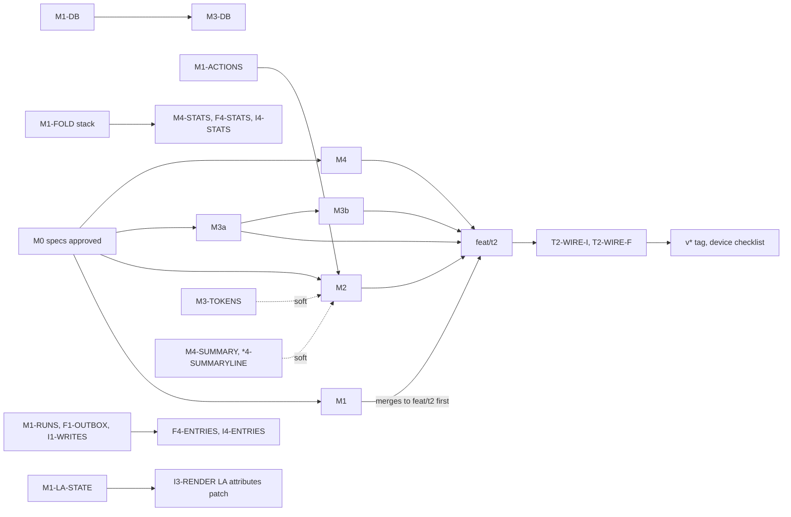

# Plan: programme T2 (timers v2, active surfaces, appearance, content display)

**Status:** draft (revision 2, 2026-11-25, after review round 1). **Specs:**
[timers2.md](timers2.md) (M1), [active-surfaces.md](active-surfaces.md) (M2),
[appearance.md](appearance.md) (M3a and M3b),
[content-display.md](content-display.md) (M4). **Branching** (team rules):
integration branch `feat/t2` from `origin/main`; milestone branches `t2/m<N>`
off `feat/t2`; WP branches `t2/m<N>-<wp>` off the milestone branch; one worktree
per WP at `/Users/richie/code/quickr-worktrees/t2-m<N>-<wp>`. **Release:** one
`v*` tag from `feat/t2` after every milestone has merged. **Compatibility:**
`api_level 1 → 2` in M1's first WP only; M2–M4 are additive at level 2 and bump
nothing.

_Section references are to the companion specs' revision 1 as drafted alongside
this plan; `brief §6` refers to the M0 design brief's cross-milestone DAG, whose
WP names this plan maps in each milestone's brief. Test numbers T18–T33 and
R13–R23 are timers2.md §12's; (section numbers to be aligned) once the companion
specs take in their reviews._

**Milestone plans** (WPs, DAGs, per-WP acceptance and definition of done,
evidence and device-only lists): [M1-plan.md](../t2/M1-plan.md),
[M2-plan.md](../t2/M2-plan.md), [M3a-plan.md](../t2/M3a-plan.md),
[M3b-plan.md](../t2/M3b-plan.md), [M4-plan.md](../t2/M4-plan.md). The device
checklist the user runs on the TestFlight build is
[device-checklist.md](../t2/device-checklist.md). This document is the programme
view; its rules apply to every milestone plan unchanged.

## Scope guard

A milestone is the list of work packages in its section below, and nothing else.

- Anything found during implementation that isn't in a WP's scope (a bug in
  existing code, a refactor, a missing feature, a better design) goes into a
  **GitHub issue** in `Richard-Lynch/quickr`, labelled `t2-followup` (create the
  label if it's missing), and is linked from the WP's PR. It does not grow the
  WP or the milestone. See issue #20 on how earlier milestones ballooned.
- A WP may change code outside its listed areas only when the change is needed
  for its acceptance criteria to pass. The PR description names each such change
  and says why.
- A WP that can't meet its criteria without work that belongs to another WP, to
  another milestone, or to no WP, stops and reports to its lead. The lead
  decides; the WP does not absorb the work. **Requests that cross a milestone
  boundary go from the lead to the orchestrator**, who either schedules a patch
  with the owning milestone (§Seams) or files a `t2-followup` issue.
- A spec change needed during implementation is a separate, small docs commit to
  the milestone's spec, approved by the lead, before the code that relies on it.
  Settled decisions in the brief are not reopened; open questions are answered
  by the user (§Open questions).
- No compatibility work beyond M1-LEVEL. `CONTENT_STATE_VERSION` stays 1.
- Every WP diff gets a Codex review; every milestone gets Codex plus a Claude
  reviewer sub-agent before it merges to `feat/t2`.

**Definition of done and proof** (from the team rules at
`/private/tmp/claude-501/-Users-richie-code-quickr/369efb8d-bdf9-4543-8ae0-5140d9222a76/scratchpad/t2/team-rules.md`,
copied here because that file lives outside the repo; the orchestrator rejects a
milestone without it):

- Before you start: each lead's `docs/t2/M<N>-plan.md` holds the WPs, the DAG,
  owners, and for every WP explicit acceptance criteria plus a definition of
  done (what must be true, which tests prove it, what evidence is captured). The
  orchestrator reviews it before WPs start.
- Per WP, in the PR description: the commands run, with pass/fail counts copied
  from the output; the xcresult path and test count for iOS (a test plan with 0
  tests run is a failure); the Codex review file and how each finding was
  resolved; the CI run link.
- Per milestone, `docs/t2/evidence/M<N>.md`, committed on the milestone branch
  before it merges to `feat/t2`: every acceptance criterion → its proof (test
  names, CI links, commit SHAs from git); screenshots for every UI change (iOS
  light and dark, a large Dynamic Type check, the Live Activity/widget states,
  PWA mobile width) under `docs/t2/evidence/M<N>/`, PNG, kept small; a short
  screen recording (GIF/MP4) for interaction flows where practical; the
  milestone review reports (Codex plus a Claude reviewer) with every finding
  resolved or justified; a list of anything not verifiable on the simulator,
  which goes on `docs/t2/device-checklist.md`.
- Green means all five required checks (backend, frontend, docker, ios gate,
  compat gate) on the milestone PR, plus `make check` locally. No skipped or
  disabled tests to get green. A flaky test is fixed or gets an issue with
  evidence, and is never silently retried.
- Leads report to the orchestrator at milestone boundaries: the plan is ready,
  and then the milestone is ready to merge, with a link to the evidence file.
  Escalate blockers immediately.

**Friction log** (same source, verbatim, applies to every lead and sub-agent):
"Log friction as it happens to
`/Users/richie/code/quickr-worktrees/_friction/<your-agent-name>.jsonl`, one
JSON object per line. The format, categories and examples are in
`_friction/README.md` in the same folder. This covers anything from any source:
skills, tools, MCP, hooks, agents and hand-offs, permissions, CLI, network, CI,
simulators, builds, tests, repo docs or code, the spec, reviews, coordination.
Include the exact error text. Never edit another agent's file." Leads pass this
rule to every sub-agent they spawn, verbatim. The `_friction` folder is not a
worktree: never delete it when cleaning up.

## Out of scope

These are not in T2. Each becomes an issue if the user wants it.

- Timing columns in the CSV export (OQ-12).
- SF Symbol or custom vector icons for topics; only emoji in phase A (OQ-7).
- Free hex colours; only the 12 named colours (OQ-8).
- S3 or any remote object storage for photos; local volume + Pillow (OQ-10).
- Server-scheduled or server-pushed alerts (an alert push, a scheduler job);
  alerts are planned on the device from the timer config.
- Refreshing another device's scheduled alerts by silent push when a lap is
  tapped elsewhere (OQ-11, accepted limitation).
- Critical alerts, custom notification sounds, repeating triggers.
- Removing a **step** boundary on an open run; steps are edited after stop with
  `TimingEdit` (timers2.md §3.4). Removing a lap "into the next segment" as a
  separate action (it is "remove the next lap's boundary").
- Reopening a run whose entry was deleted, or whose run was edited (timers2.md
  §4.1: delete and edit win).
- Global lap numbering across types (OQ-3 default is per-type).
- A bare number as a duration in alert expressions (OQ-5 default: error).
- An Apple Watch app or complications; Mac, CarPlay, StandBy layouts beyond what
  the system derives.
- A second Control kind (a Lap control); one Control = one button, Auto already
  does the primary (active-surfaces.md §5.3).
- A `home-active-vectors.json`; the "Active now" partition is UI-level.
- Multiple photos per topic, cropping or editing photos, photo upload from the
  MCP, photos in notifications.
- Replacing the iOS local `latestEntry` with `TopicSummary.last_entry` (iOS
  keeps the local value, content-display.md §2).
- Auto-advance by time, countdown steps, pruning run rows, several open runs per
  topic, forced-update changes (client-versions.md is unchanged).

## Milestone split and justification

The orchestrator's M1–M4 stand. M3 is run as two plans, **M3a** (appearance
phase A) and **M3b** (photos), in this document and as two milestone branches
(`t2/m3a`, `t2/m3b`).

- **M1 stays one milestone** although it is the largest (21 WPs). Splitting it
  by surface (server+ports vs builder+alerts) would put the `api_level` bump,
  the fold v4 vector stack and the builder vector stack across two milestone
  branches and two reviews, with the second milestone unable to be green until
  the first merged. Instead M1 runs with **two sub-leads** under one lead (brief
  §7 risk 1): sub-lead A owns the server and the port chain (M1-LEVEL …
  I1-WRITES), sub-lead B owns the builder and alerts chain (M1-ACTIONS,
  F1-BUILDER, F1-ALERTS, I1-BUILDER, I1-ALERTS, I1-UI). The WP tables below mark
  the sub-lead.
- **M2 is not folded into M1.** It edits a disjoint file set (layout files,
  §Seams), it can start on day one against today's action set plus the
  M1-ACTIONS stub, and its reviewers look at layout, Dynamic Type and screenshot
  evidence rather than fold semantics.
- **M4 is not folded into M1** although its entry actions need M1's
  reopen/remove: the bulk of M4 (summary line, `last_entry`, list and detail
  layout, activity strip) has no M1 dependency and starts on day one.
- **M3b is separate from M3a** because photos add a storage layer (volume,
  Pillow, nginx body size, an ETag route), the user called them "a later phase",
  their migration follows M3a's in the Alembic chain, and their review surface
  (binary endpoints, caches, service worker) is unlike M3a's.
- Nothing else moved: the brief's ownership table already partitions the files
  by milestone with one owner each, and every cross-milestone need is either a
  fixed interface (`RunAction`, `TopicTheme`, `TopicSummaryLine`), a shared WP
  branch (§Cross-milestone DAG) or a post-merge wiring WP (T2-WIRE).

## Cross-milestone DAG

| Edge                                                   | Kind | Meaning                                                                                                                                                                          |
| ------------------------------------------------------ | ---- | -------------------------------------------------------------------------------------------------------------------------------------------------------------------------------- |
| M0 → M1, M2, M3a, M4                                   | hard | All four start when the specs in this PR are approved. M3b starts when M3a has merged to `feat/t2`.                                                                              |
| M1-ACTIONS → M2 layout WPs                             | hard | The `RunAction` enum stub (first wave of M1) is merged into `t2/m2` as a shared WP branch.                                                                                       |
| M1-LA-STATE → I2-LA                                    | hard | Shared WP branch into `t2/m2` (E5): `RunActivityDisplay` reads `alertAt`, `lapCount`, `lapType` from the content state, so I2-LA starts when M1-LA-STATE is in `t2/m2`.          |
| M1-DB → M3-DB                                          | hard | Alembic chain: `f7a4b0c5d326` has `down_revision = "e6f3a9b4c215"`. M3-DB starts when `t2/m1-db` has merged into `t2/m1` and is then merged into `t2/m3a`.                       |
| M1-FOLD stack → M4-STATS, F4-STATS, I4-STATS           | hard | Lap-type stats consume `timing-stats-vectors.json` v3 and fold v4 `lap_type` (brief §6 "M1-STATS → M4-STATS-LAPS").                                                              |
| M1-RUNS, F1-OUTBOX, I1-WRITES → F4-ENTRIES, I4-ENTRIES | hard | The Remove and Resume buttons send `remove`/`reopen` (brief §6 "M4-ENTRY-ACTIONS"). In practice these WPs start after M1 merged to `feat/t2`.                                    |
| M1-LA-STATE → I3-RENDER (attributes patch)             | hard | M3 adds `attributes.appearance` to `RunActivity.swift` and `live_activity.py` only after M1-LA-STATE has landed, as a patch approved by the M1 lead.                             |
| M1 → `feat/t2` before M2, M3a, M4                      | hard | Every other milestone has taken an M1 WP branch; merging them first would carry partial M1 into `feat/t2`. M1 merges first; the others follow in any order; M3a before M3b.      |
| M3-TOKENS → I2-HOME, I2-LA, F2-HOME                    | soft | M2 renders the default theme until `TopicTheme`/`topicStyle` exist; M3-TOKENS is first wave and small, so M2 is expected to take it as a shared branch. Leftovers go to T2-WIRE. |
| M4-SUMMARY, I4-/F4-SUMMARYLINE → M2 idle tile          | soft | M2 renders the existing `lastLine` until `TopicSummaryLine` exists; T2-WIRE swaps it in.                                                                                         |
| all milestones → T2-WIRE-I, T2-WIRE-F → tag            | hard | Post-merge wiring on `feat/t2` of the theme, tags filter and summary line into M2-owned surfaces; then the release tag and the device checklist.                                 |

**Shared WP branches.** A WP branch may be merged into a second milestone branch
when that milestone needs it: M1-ACTIONS and M1-LA-STATE → `t2/m2`; M1-DB →
`t2/m3a`; the M1-FOLD stack → `t2/m4`; M3-TOKENS → `t2/m2`. Rules: merge the WP
branch, never the milestone branch; never rebase a shared branch; the receiving
milestone runs the generated-file ritual below right after the merge; the
receiving milestone merges to `feat/t2` only after the donor milestone did.
Anything larger (M4's entry actions need I1-WRITES, which drags in most of M1)
waits for the donor to merge to `feat/t2` and then merges `feat/t2` into the
milestone branch.

**Vector stacks.** A WP that changes the shape of an **existing** shared vector
file (`run-fold-vectors.json` v4, `timing-stats-vectors.json` v3,
`builder-ui-vectors.json` timer sections, `builder-vectors.json` `timers[]`,
`stats-chart-vectors.json` new models) cannot be green on its own: the consumers
on the other two platforms fail until their ports land. Such a WP is the **base
of a stack**: its port WPs branch from the base WP's branch (`t2/m1-fold` →
`t2/m1-fold-fe`, `t2/m1-fold-ios`), each gets its own Codex review and merges
into the base branch, and the base merges into the milestone branch once its CI
is green, which is when every port is in. New vector files (`timer-expr`,
`entry-summary`, `appearance`) need no stack: the consumer tests arrive with the
ports. Additive fields in `live-activity-vectors.json` need only the minimal
Swift decoder change in the same WP (timers-plan.md "Every WP"). **One writer
per existing vector file** (review E3): its generator is changed only by the WP
named in §Seams (M1-FOLD for run-fold and timing-stats, M1-LA-STATE for
live-activity, I1-BUILDER for builder, F1-BUILDER for builder-ui, F4-STATS for
stats-chart); generator changes from other WPs are serialised through that WP's
branch; after the final merge of a stack the merger regenerates (`make vectors`)
and runs every consumer (pytest, vitest, `swift test`) before merging to the
milestone branch.

**Merge ritual for generated files.** After every merge into a milestone branch
and into `feat/t2`, and after taking a shared WP branch, the merger runs
`make client vectors` (needs Postgres: `make db` if it's down, never `make up`),
then `make check`, and commits the result as its own commit. Never hand-merge
`openapi.json`, `frontend/src/client/**`, `shared/fixtures/**`,
`backend/app/api_level.json`, `frontend/src/api/apiLevel.json` or
`ios/QuickrKit/Sources/QuickrCore/APILevel.swift`: on a conflict take either
side and regenerate. Request goldens (`shared/fixtures/requests/*.json`) are
regenerated with `QUICKR_UPDATE_VECTORS=1 swift test --filter RequestGolden` in
`ios/QuickrKit` when a conflict touches them. Grep for conflict markers before
committing; never chain `commit -a` after a merge.

**Alembic chain (pre-assigned, do not renumber):**

| Milestone   | File                                        | `revision`     | `down_revision` |
| ----------- | ------------------------------------------- | -------------- | --------------- |
| M1-DB       | `20261126_e6f3a9b4c215_timers_v2.py`        | `e6f3a9b4c215` | `d5e2f8a3c104`  |
| M3-DB       | `20261127_f7a4b0c5d326_topic_appearance.py` | `f7a4b0c5d326` | `e6f3a9b4c215`  |
| M3B-STORAGE | `20261201_a8b5c1d6e437_topic_photo.py`      | `a8b5c1d6e437` | `f7a4b0c5d326`  |
| M4          | none                                        | —              | —               |

Enum additions use `with op.get_context().autocommit_block():` and
`ADD VALUE IF NOT EXISTS` (`20261024_bb9d821fe436_timed_topics.py:36-38`); their
downgrade leaves the enum values in place (one sentence in the migration says
so; review E6). `make test-db-reset` after editing a migration in place.

**iOS store migrations.** `QuickrData/Contracts/StoreSchema.swift` is
append-only. Each milestone registers its migrations in **its own file**
`StoreSchema+T2M1.swift`, `StoreSchema+T2M3.swift`, `StoreSchema+T2M3B.swift`
(M2 and M4 have none) with identifiers `t2m1_*`, `t2m3_*`, `t2m3b_*`, and the
registration line in `StoreSchema.swift` is added **at merge time by whoever
merges** the milestone into `feat/t2` (an integration step of the merge ritual,
review E4), never on a WP branch. Identifiers are independent: no migration
reads another milestone's columns, so either merge order is valid; the first iOS
WP that merges second (I3-STORE if M1 lands first, else I1-SYNC) adds
`StoreMigrationOrderTests`, which upgrades a fresh store with both registration
orders and asserts the same schema.

**Shared files.** `ios/App/AppEnvironment.swift`, `ios/App/RootView.swift`,
`ios/project.yml`, `ios/App/Debug/UITestLaunch.swift` (fake server routes),
`backend/app/schemas/api.py`, `backend/app/schemas/limits.py`,
`backend/app/api/routes.py`, `backend/app/mcp_server.py`,
`frontend/src/api/limits.ts` (`FALLBACK_LIMITS`),
`ios/QuickrKit/Sources/QuickrCore/Models/ServerInfo.swift` (`Limits`): each
milestone adds at most one clearly delimited block per file, opened with a
`// T2-M<N>` (or `# T2-M<N>`) comment and closed with `// end T2-M<N>`; a block
is appended, never interleaved; the later merger resolves conflicts by keeping
both blocks. The first five of these are in the brief; the schema, limits,
routes, MCP and limits mirrors are added here because every server milestone
touches them.

### Release cut

**Default: one release, tag `v0.4.0`, cut from `feat/t2` once M1, M2, M3a and M4
have merged.** M3b ships in the same release if it has merged by then; otherwise
it follows as a point release `v0.4.1` from `feat/t2` (its migration
`a8b5c1d6e437` and endpoints are additive at level 2, so no second bump).

Why not release M3a + M4 first if M1 slips: **not possible.** M1 holds the
`api_level 2` bump that every T2 build and the TestFlight listing depend on;
M4's lap-type stats and entry actions consume M1's fold v4, timing-stats v3 and
the reopen/remove API; M3a's migration chains after M1's; M2's Resume flow needs
M1's write path. A release without M1 would be a level-1 release with half of
M3a/M4 disabled, and the next release would still have to bump. If M1 slips, the
evidence that argues for a different cut is only: M1's server and port WPs
merged but its builder/alerts chain not, in which case the orchestrator may cut
`v0.4.0` with alerts behind the existing timer config (the v2 schema accepts
`alerts: []`) and ship the builder editors in `v0.4.1`. Everything else waits.
The single release is recommended.

**Deploy order** (the user self-hosts the server via compose; the server's
`min_client_level.ios = 2` force-updates every older build the moment it is
deployed): (1) tag `v0.4.0`; (2) CI publishes the TestFlight build and the user
**installs it on the phone**; (3) only then the server deploy = bump
`quickr_build` + both image digests in the IaaC repo
`inventories/host_vars/quickr.yml` (orchestrator-owned, after the user confirms
the TestFlight build is installed). Deploying the server first would lock the
installed `20261028.170408` build out before its replacement exists. The same
order heads `docs/t2/device-checklist.md`.

**Nothing is distributed before T2-RELEASE** (review E1, replacing the "atomic
landing" ask): no server deploy is made from `feat/t2` or any WP branch; CI
builds are never installed; the orchestrator alone creates tags. An intermediate
build that advertises level 2 therefore never meets a server. The one deliberate
exception is **`v0.4.0-rc1`** (review E2, orchestrator conditions):

- **Who tags it:** the orchestrator, from `feat/t2`, only after M1 has merged
  there with all five required checks green.
- **What it does:** CI publishes ghcr images tagged `v0.4.0-rc1` and a
  TestFlight build. Nothing deploys the server: the homelab pins images by build
  and digest in a separate IaaC repo, which this programme never edits.
- **Why:** it is the first real signing proof for the time-sensitive entitlement
  and gives the user the level-2 build the deploy order needs. Against the
  still-deployed level-1 server the rc build shows the non-blocking "server is
  older" note and the T2 features do not work; the device checklist says to
  ignore rc builds unless asked.
- **The bot PR** `compat/testflight-<build>` for the rc build is merged into
  `main` as usual: listing it is harmless, and level-2 builds matter only after
  the server bump.
- **Fallback:** if rc1's signing fails on the Time Sensitive entitlement, flip
  the `.active` constant in a small PR on `feat/t2` and record the Apple portal
  step on the device checklist.

## Seams and ownership

One owner per file; others send patches (a diff plus a one-line reason) to the
owner's lead, who lands it on the owner's branch. iOS paths are under `ios/`
(`App/…`, `Widgets/…`, `UITests/…`) or `ios/QuickrKit/Sources/…`
(`QuickrCore/…`, `QuickrData/…`, `QuickrUI/…`) with tests under
`ios/QuickrKit/Tests/…`; PWA paths are under `frontend/`. New files belong to
the milestone that creates them. Rule of thumb: **model and data = M1; layout of
run and active surfaces = M2; theme = M3; entries, stats and summary = M4.**

| Area                                                                                                                                                                                                                                                                                                                                                                                                                                                                                                                                                                                                                                                                                                                                                                        | Owner                                                            | Others                                                                                                                                         |
| --------------------------------------------------------------------------------------------------------------------------------------------------------------------------------------------------------------------------------------------------------------------------------------------------------------------------------------------------------------------------------------------------------------------------------------------------------------------------------------------------------------------------------------------------------------------------------------------------------------------------------------------------------------------------------------------------------------------------------------------------------------------------- | ---------------------------------------------------------------- | ---------------------------------------------------------------------------------------------------------------------------------------------- |
| backend `services/run_fold.py`, `runs.py`, `timer_expr.py` (new), `timing_stats.py`, `timing.py`, `changes.py`, `push/live_activity.py` content state and attributes, run schemas, `schemas/questions.py` `Timer`, run and timer limits, MCP run tools, `tests/test_run_fold_vectors.py`, `test_timing_stats_vectors.py`, `test_live_activity_vectors.py`, `test_builder_vectors.py`, new `test_timer_expr_vectors.py`                                                                                                                                                                                                                                                                                                                                                      | M1                                                               | M4 consumes `lap_types` through vectors only; M3 patches `attributes()` (one field, one vector case)                                           |
| backend `services/topics.py` appearance columns and validation, `Topic*` schemas `appearance`, `tests/test_appearance_vectors.py` (new), reminder title prefix (`push/apns.py`, `services/notification.py`), MCP topic tools' appearance params, `services/media.py` (new, M3b), photo routes                                                                                                                                                                                                                                                                                                                                                                                                                                                                               | M3a / M3b                                                        | —                                                                                                                                              |
| backend `services/topics.py` `_base_select` `last_entry`, `services/summary.py` (new), `stats.py` additions, `tests/test_entry_summary_vectors.py` (new)                                                                                                                                                                                                                                                                                                                                                                                                                                                                                                                                                                                                                    | M4                                                               | —                                                                                                                                              |
| `openapi.json`, `frontend/src/client/**`, `shared/fixtures/api/*.json`, `shared/fixtures/api/getLimits.json`                                                                                                                                                                                                                                                                                                                                                                                                                                                                                                                                                                                                                                                                | generated                                                        | regenerate at each merge (`make client vectors`); never hand-merge                                                                             |
| `shared/fixtures/*-vectors.json` and their generators                                                                                                                                                                                                                                                                                                                                                                                                                                                                                                                                                                                                                                                                                                                       | the milestone that owns the reference implementation             | regenerate on merge; shape changes form a vector stack                                                                                         |
| Alembic `backend/alembic/versions/`                                                                                                                                                                                                                                                                                                                                                                                                                                                                                                                                                                                                                                                                                                                                         | each                                                             | pre-assigned ids above; M1 merges to `feat/t2` before M3a; M4 has none                                                                         |
| iOS `QuickrCore/Runs/*` (`RunModels`, `RunFold`, `RunPresentation`, `TimingStats`, `TimingEdit`, `RunActivity`, new `TimerExpr`), `QuickrCore/Models/Topic.swift` (`TopicTimer`), `QuickrData/Session/RunWrites.swift`, `RunActions.swift`, `QuickrData/Store/RunOverlay.swift`, `QuickrData/Contracts/RunDTO.swift`, `QuickrData/Notifications/RunAlerts*.swift` (new), `QuickrData/Contracts/NotificationCenterProtocol.swift`, `QuickrData/Notifications/SystemNotificationCenter.swift`, `QuickrTestSupport/Fakes.swift`, builder (`QuickrCore/Builder/*`, `QuickrUI/Topics/Builder/*`, `App/Topics/Builder/*` timer editors), `App/Debug/UITestRuns.swift`, `QuickrData/Contracts/StoreSchema+T2M1.swift`                                                              | M1                                                               | M2 reads `RunPresentation`; M3 patches `RunActivity.swift` attributes; M2/M4 send fake-server patches for `UITestRuns.swift`                   |
| iOS `App/Runs/RunScreen.swift`, `RunViews.swift`, `RunDetailsScreen.swift`, new `RunControls.swift`, new `QuickrCore/Surfaces/RunControlsLayout.swift`, `App/Home/HomeView.swift`, `Tiles/TopicTile.swift`, new `Tiles/ActiveTopicCard.swift`, `QuickrData/Home/HomeModel.swift`, `QuickrCore/Home/TopicListing.swift`, `QuickrUI/Components/TileView.swift`, `Widgets/*`, `QuickrUI/Widgets/WidgetViews.swift`, `QuickrCore/Widgets/WidgetTopic.swift`, `QuickrCore/Runs/RunActivityDisplay.swift`, `QuickrData/LiveActivity/*`, `App/LiveActivity/*`, `QuickrData/Intents/*`, `App/Intents/*`, `App/Debug/WidgetGalleryView.swift`, `UITests/RunUITests.swift`, `HomeTests.swift`, `TileUITests.swift`, `WidgetViewsUITests.swift`                                        | M2                                                               | consumes `TopicTheme` and `TopicSummaryLine` (T2-WIRE if not yet available)                                                                    |
| iOS `QuickrUI/Tokens/TopicTheme.swift` (new), `QuickrUI/Icons/TopicGlyph.swift` (new), `QuickrUI/Resources/TopicColors.xcassets` (new), `QuickrCore/Models/TopicAppearance.swift` (new; not `Topic.swift`), `QuickrDesignTests/TopicThemeTests.swift`, `QuickrData/Contracts/TopicDTO.swift`, `TopicRequestDTO.swift`, `QuickrData/Topics/TopicWrites.swift`, `QuickrUI/Topics/TopicSettingsModel.swift`, `NewTopicModel.swift`, `TopicWriter.swift`, `App/Topics/TopicSettingsView.swift` `detailsSection`, `NewTopicScreen.swift` `topicSection`, new `App/Topics/Builder/AppearanceEditorView.swift`, `App/Entries/TopicTabsView.swift` header, `QuickrData/Contracts/StoreSchema+T2M3.swift`, M3b: `StoreSchema+T2M3B.swift`, `QuickrData/Media/PhotoCache.swift` (new) | M3a / M3b                                                        | M1's builder WPs edit `TimerEditorView.swift` only and **MUST NOT** edit `topicSection`/`detailsSection`; M3 **MUST NOT** edit `TimerSections` |
| iOS `App/Entries/**` (except the `TopicTabsView` header), `App/Stats/**`, `QuickrData/Entries/*`, `QuickrData/Stats/*`, `QuickrCore/Entries/EntrySummary.swift` (new), `QuickrUI/Components/TopicSummaryLine.swift` (new), `QuickrCore/Charts/ChartModels.swift` additions, `UITests/EntriesTests.swift`, `StatsUITests.swift`, `TimingUITests.swift` (R10 half)                                                                                                                                                                                                                                                                                                                                                                                                            | M4                                                               | `TimingStats.swift` and `TimingEdit.swift` ports are M1's                                                                                      |
| PWA `src/lib/runs/*` (incl. new `timerExpr.ts`, `alerts.ts`), `src/lib/outbox/kinds.ts`, `src/api/runs.ts`, `src/lib/builder.ts`, `src/components/builder/TimerEditor.tsx` (+ new `LapTypesEditor.tsx`, `VariablesEditor.tsx`, `AlertsEditor.tsx`), `src/components/runs/model.ts`, `timingEdit.ts`, `RunAlerts.tsx` (new), `src/test/fakeRunServer.ts`, `src/pages/topic/EditQuestionsPage.tsx`, `src/pages/AppSettingsPage.tsx` mute toggle, `src/lib/builderUi.vectors.test.ts`                                                                                                                                                                                                                                                                                          | M1                                                               | M2 reads `model.ts`                                                                                                                            |
| PWA `src/components/runs/RunPanel.tsx`, new `RunControls.tsx`, new `controlsLayout.ts`, `RunTile.tsx`, `RunningBar.tsx`, `useRunActions.ts`, `src/pages/TopicsPage.tsx`, `src/components/topics/TopicTile.tsx`, new `ActiveTopicCard.tsx`, `src/pages/topic/RecordPage.tsx` timed branch, `src/components/AppShell.tsx` (M1 patches the `RunAlerts` mount)                                                                                                                                                                                                                                                                                                                                                                                                                  | M2                                                               | consumes `topicStyle`/`TopicGlyph` and `TopicSummaryLine` (T2-WIRE if not yet available)                                                       |
| PWA `src/lib/appearance.ts` (new), `src/index.css` topic utilities, `src/components/ui/TopicGlyph.tsx` (new), `src/components/builder/TopicMetaFields.tsx`, `src/pages/topic/SettingsPage.tsx` `MetaForm`, `src/pages/topic/TopicLayout.tsx` header, `src/api/mutations.ts`/`cache.ts` appearance patch, `src/lib/serverErrors.ts`, M3b: `src/sw.ts` photo cache route                                                                                                                                                                                                                                                                                                                                                                                                      | M3a / M3b                                                        | —                                                                                                                                              |
| PWA `src/pages/topic/EntriesPage.tsx`, `EntryEditPage.tsx`, `OverviewPage.tsx`, `src/components/runs/TimingSection.tsx`, `TimingEditor.tsx`, `TimingOverview.tsx`, `src/components/charts/*`, `src/lib/entrySummary.ts` (new), `src/components/topics/TopicSummaryLine.tsx` (new)                                                                                                                                                                                                                                                                                                                                                                                                                                                                                           | M4                                                               | —                                                                                                                                              |
| iOS `QuickrData/Sync/ServerLayer.swift`                                                                                                                                                                                                                                                                                                                                                                                                                                                                                                                                                                                                                                                                                                                                     | M1                                                               | M3b's topic-cascade change (photo-cache eviction) is a patch to M1's owner                                                                     |
| PWA `frontend/src/lib/builder.ts`, `src/lib/serverErrors.ts`                                                                                                                                                                                                                                                                                                                                                                                                                                                                                                                                                                                                                                                                                                                | M1                                                               | M3a edits only the meta-schema block, delimited `// T2-M3` (shared-file rule)                                                                  |
| backend `services/topics.py` `_summaries` / `_base_select`                                                                                                                                                                                                                                                                                                                                                                                                                                                                                                                                                                                                                                                                                                                  | shared                                                           | M3a (appearance columns) and M4 (`last_entry`) each add one delimited block                                                                    |
| iOS `QuickrData/Contracts/StoreSchema+T2M3B.swift`                                                                                                                                                                                                                                                                                                                                                                                                                                                                                                                                                                                                                                                                                                                          | M3b                                                              | separate from M3a's `StoreSchema+T2M3.swift`                                                                                                   |
| `docs/specs/*`                                                                                                                                                                                                                                                                                                                                                                                                                                                                                                                                                                                                                                                                                                                                                              | M0, then each milestone lead for its own doc (docs commits only) | —                                                                                                                                              |
| `docs/t2/M<N>-plan.md`, `docs/t2/evidence/M<N>.md`, `docs/t2/device-checklist.md`                                                                                                                                                                                                                                                                                                                                                                                                                                                                                                                                                                                                                                                                                           | each lead                                                        | `device-checklist.md` is append-only per milestone                                                                                             |

## Simulator budget

The cap is 2 booted `quickR` devices machine-wide, shared with every other team
on the Mac. Rules (team rules, `area-C-isolation.md`): `make ios-gen` and
build-for-testing **before** queueing; own clone via
`ios/scripts/sim-clone.sh --wait` and its UDID passed as
`IOS_SIM`/`IOS_SIM_MIN`; `xcrun simctl shutdown <udid>` at the end of every run;
unique result paths; `-only-testing` with the trailing `()`; never the base
devices.

- **Each milestone runs at most one sim WP at a time, and its sim WPs are its
  last wave.** If three milestones want a slot at once, priority is M1 > M2 >
  M4 > M3a > M3b (critical path first).
- A local `make check-ios` boots **two** runtimes (`IOS_SIM_MIN` +
  `IOS_SIM_CUR`) and therefore takes both slots; run it once per milestone,
  right before the milestone PR, queued with `--wait`, or let CI run it.
- Sim WPs and why: **I1-UI** (builder v2 publish and the lap-label/resurrection
  flows need the app, `UITestRuns` fake server and the Unit plan's `AppTests`);
  **I2-UITEST** and **M2-RESUME** (run screen, home section, widget gallery
  screenshots, `AppTests` for Controls and intents); **M3-UITEST** (appearance
  editor and header, light/dark screenshots); **M3B-UITEST** (photo thumb from
  the fake server); **M4-UITEST** (entries rows, Remove/Resume from the detail,
  stats cards); **T2-WIRE-I** (one screenshot pass). Everything else is `be`
  (pytest), `fe` (vitest) or `host` (`swift test` in `ios/QuickrKit`, including
  `QuickrDesignTests` for QuickrUI models and the fake notification and activity
  centres).
- Device-only checks (locked-phone time-sensitive alerts, Live Activity
  rendering and tint, push-to-start after a reopen, Controls on the Lock Screen,
  the BGTask) go on `docs/t2/device-checklist.md`, which the user runs on the
  TestFlight build from the release tag.

## Effort legend and WP rules

Effort: S ≈ 15–25 min of agent time, M ≈ 30–45, L ≈ 45–60. Class: **be**
(backend, pytest), **fe** (PWA, vitest), **host** (`swift test`), **sim**
(xcodebuild and a simulator clone), **device**, **docs**. Sub-lead in M1: A or
B.

Every WP:

- keeps `make check` green, and `make check-ios` when it touches `ios/`;
- regenerates fixtures with `make vectors` when it changes their generators, and
  commits the result; regenerates `openapi.json` and the TS client
  (`make client`) when it changes the API;
- **keeps the iOS gate green when it changes something Swift reads**: a WP that
  changes `openapi.json` or a fixture under `shared/fixtures/` makes the minimal
  Swift change (endpoint-table rows for new operations, decoders that accept new
  optional fields) and runs `swift test` in `ios/QuickrKit`; shape changes to an
  existing vector file form a vector stack instead;
- puts the commands run, pass counts, xcresult path and test count, the Codex
  review file and the CI link in its PR description;
- writes a `t2-followup` issue for anything it finds outside its scope.

---

## Milestone plans

Each milestone's work packages, DAG, critical path, first wave, per-WP
acceptance and definition of done, and its evidence and device-only lists live
in `docs/t2/`. The rules in this document apply to all of them unchanged.

| Milestone                         | Plan                             | Spec                                     | WPs | Sim WPs              | Starts                                                      |
| --------------------------------- | -------------------------------- | ---------------------------------------- | --- | -------------------- | ----------------------------------------------------------- |
| M1 · timers v2                    | [M1-plan.md](../t2/M1-plan.md)   | [timers2.md](timers2.md)                 | 21  | I1-UI                | after M0                                                    |
| M2 · active surfaces              | [M2-plan.md](../t2/M2-plan.md)   | [active-surfaces.md](active-surfaces.md) | 12  | I2-UITEST, M2-RESUME | after M0 (layout WPs once M1-ACTIONS is in `t2/m2`)         |
| M3a · appearance phase A          | [M3a-plan.md](../t2/M3a-plan.md) | [appearance.md](appearance.md)           | 9   | M3-UITEST            | after M0 (M3-DB once `t2/m1-db` is in)                      |
| M3b · photos (appearance phase B) | [M3b-plan.md](../t2/M3b-plan.md) | [appearance.md](appearance.md)           | 7   | M3B-UITEST           | after M3a merged to `feat/t2`                               |
| M4 · content display              | [M4-plan.md](../t2/M4-plan.md)   | [content-display.md](content-display.md) | 11  | M4-UITEST            | after M0 (entry actions and lap-type stats after M1 merged) |

---

## After the milestones: wiring, release

### T2-WIRE-I · iOS wiring of theme, tags filter, summary line · host + sim · M

- **Scope (on `t2/wire` from `feat/t2`, M2 lead), exactly four items:** (1)
  `TileView` accent bar and glyph from `TopicTheme`; (2) the idle tile's
  summary-line slot renders `TopicSummaryLine` instead of `lastLine`; (3)
  `ActiveTopicCard` tint (and the same `TopicTheme` on the `RunScreen` header,
  `RunActivityWidget` and `WidgetViews`, which read `attributes.appearance` /
  `WidgetTopic`); (4) the home tag filter: a chip row in `HomeView`'s filter
  panel backed by `TopicListing.filter(tags:)`. One screenshot pass
  (`TileUITests`, `WidgetViewsUITests` incl. the themed gallery case) on a
  clone, which also proves the simulator-only rendering of the widget gallery.
- **Depends on:** M2, M3a, M4 merged to `feat/t2`. **Preferred route:** M2
  merges the M3-TOKENS shared branch into `t2/m2` early and wires items 1 and 3
  itself; whatever M2 already wired is skipped here, and when M2 took both
  M3-TOKENS and I4-SUMMARYLINE this WP shrinks to item 4.
- **Acceptance:** `HomeModelTests` tag filter; existing UI tests green; the
  evidence file `docs/t2/evidence/WIRE.md` carries the screenshots.

### T2-WIRE-F · PWA wiring · fe · S

- **Scope, the same four items:** (1) `TopicTile.tsx` `style={topicStyle(...)}`
  accent bar and `TopicGlyph`; (2) the idle tile's summary slot renders
  `TopicSummaryLine` from `TopicSummary.last_entry` and the per-tile
  `listEntries`/`listTopicVersions` queries are removed; (3) `ActiveTopicCard`,
  `RunningBar` and `RunPanel` header tint; (4) `TopicsPage.tsx` tag filter chips
  driving the `?tag=` query param.
- **Depends on:** M2, M3a, M4 merged. Same preferred route as T2-WIRE-I.
- **Acceptance:** `TopicTile.test.tsx` asserts no per-tile entry query;
  `TopicsPage.test.tsx` tag filter.

### T2-RELEASE · release PR, tag, TestFlight, deploy, device checklist · docs + device · M

- **Scope (orchestrator):** on `feat/t2`, bump `MARKETING_VERSION` in
  `ios/project.yml` from `"0.1.0"` to `"0.4.0"` (`make ios-gen`, commit; the
  `v0.4.0-rc1` tag after M1 already carried `0.4.0`); raise the PR "Release
  v0.4.0" from `feat/t2` to `main` with the five required checks green and the
  milestone evidence files linked; merge; tag `v0.4.0` on `main`. Then the
  **deploy order** of §Release cut: CI publishes both images and the TestFlight
  build; the TestFlight bot PR lists the new build in
  `compat/supported-clients.json` (the usual `testflight.yml` path); the user
  installs it; only then the server deploy = bump `quickr_build` + both image
  digests in the IaaC repo `inventories/host_vars/quickr.yml`
  (orchestrator-owned, after the user confirms the TestFlight build is
  installed). No work is planned in the IaaC repo. The user runs
  `docs/t2/device-checklist.md` on the installed build; findings become
  `t2-followup` issues. No `openapi-break-approvals.txt` lines are needed (with
  `clients: []` and the bump the gate passes; review E6). If M3b is not in, the
  same steps repeat as `v0.4.1` once it merges.
- **Depends on:** T2-WIRE-I, T2-WIRE-F; M3b if it made the cut.
- **Acceptance:** `main` carries the tag; the TestFlight build shows
  `0.4.0 (<build>)`; the installed build talks to the deployed server with no
  "Update required" screen; the checklist is run with each item ticked or turned
  into an issue.
- **DoD:** the release PR links the five milestone evidence files and the
  checklist run; the orchestrator's friction log and the issues list are in the
  PR; `compat/client_fixtures.py check` is green after the bot PR.

---

## Review log

- **Revision 2 (2026-11-25, after review round 1).** Reviews `codex-r1.md` and
  `claude-r1.md`, adjudicated in `adjudication-r1.md` (scratchpad
  `t2/m0/reviews/`). Applied to the plans: E1 no distribution before T2-RELEASE
  (atomic landing rejected) and the `v0.4.0-rc1` tag; E2 I1-SIGNING acceptance
  (static proof, rc1 as the real proof, `.active` fallback as one constant); E3
  ownership rows for `ServerLayer.swift`, `builder.ts`, `serverErrors.ts`,
  `topics.py` blocks, `StoreSchema+T2M3B.swift`, and one writer per vector file;
  E4 store-migration registration at merge time plus `StoreMigrationOrderTests`;
  E5 M1-LA-STATE as a shared branch, I2-LA hard dependency; E6 names and scope
  fixes (vector list by reference, 21 WPs, downgrade wording, approvals lines
  dropped, checklist item dropped). Carried into WP scopes: A7 ids in `Timing`,
  nullable reopen `target`, "Resuming…" projection (M1-RUNS, F1-OUTBOX,
  I1-WRITES, M2 tiles); A8 K6-not-on-revert tests; A9 one primary rule
  (M1-ACTIONS copies timers2 §10); B2 iOS `run_closed` markers (I1-SYNC); C1/C2
  scheduler replace + triggers (I1-ALERTS); C3 no `terminal_id` in the content
  state; D1 photo GC tick and D2 idempotent delete (M3B-STORAGE); D3 cursor
  reset (I3-STORE); D4 `last_entry` staleness bound (F4-SUMMARYLINE); D5 strip
  calendar cells; D6 grapheme truncation (M4-SUMMARY); D7 emoji predicates
  (M3-DB, I3-EDIT, F3-EDIT); D8 `run.menu`, Remove disabled on a `next`-opened
  lap row.
- **Revision 1 (2026-11-25).** First draft; split into milestone plans;
  orchestrator decisions on OQ-1..14 folded in.

## Open questions index

**All fourteen defaults are decided 2026-11-25 (orchestrator).** The table keeps
the alternative for the record ("If reopened" says what would change); nothing
in it is open. OQ-9 was unnumbered in the design brief and is assigned to tags
in phase A. Riders that came with the decisions:

- **OQ-1:** `resumable` depends only on `run.edited == false` (a timing edit);
  edits to answers or notes never block Resume. I1-WRITES, `model.ts` and
  timers2.md follow this.
- **OQ-6:** M1 gains a first-wave `I1-SIGNING` task (M1-plan.md): verify the
  Time Sensitive Notifications capability is on the App ID and in the
  provisioning profile that `testflight.yml` /
  `.github/actions/testflight-setup` uses (automatic provisioning with the API
  key vs manual profiles). If it can't be added without the user's Apple portal
  access, fall back to `.active`, add the portal step to
  `docs/t2/device-checklist.md`, and tell the orchestrator immediately.
- **OQ-7, OQ-8:** M3-REVIEW files the `t2-followup` issues "free hex topic
  colours" and "SF Symbol topic icons".
- **OQ-10:** M3B-STORAGE updates `docs/hosting/backend.md` backup/restore for
  the `media` volume.

| OQ    | Question                                                 | Owner doc           | Decided default (2026-11-25, orchestrator)                                           | If reopened                                                                                                                                                        |
| ----- | -------------------------------------------------------- | ------------------- | ------------------------------------------------------------------------------------ | ------------------------------------------------------------------------------------------------------------------------------------------------------------------ |
| OQ-1  | Resume window on tiles and toasts                        | active-surfaces.md  | 15 min after the latest stop (always from the entry detail within 7 d of start)      | A constant in `RunPresentation.resumable`/`model.ts` (I1-WRITES, M2-RESUME tests); longer windows need no server change                                            |
| OQ-2  | `discard` on a reopened run                              | timers2.md          | revert: the reopen becomes void `reverted`, the stop is the terminal again           | "discard the whole run instead": M1-FOLD pass 1 and M1-RUNS `_apply_folded` revert branch change; vectors `reopen-then-discard` regenerate; UI copy in M2          |
| OQ-3  | Lap numbering with types                                 | timers2.md          | per type (`Run 1, Rest 1, Run 2`)                                                    | global (`Run 1, Rest 2, Run 3`): `lap_label` in M1-FOLD and both ports; run-fold and live-activity vectors regenerate; summary vectors in M4-SUMMARY               |
| OQ-4  | Alerts on steps too                                      | timers2.md          | yes, same schema and editor                                                          | laps only: `Step.alerts` dropped in M1-DB, editors in F1-BUILDER/I1-BUILDER lose one section, planners ignore steps                                                |
| OQ-5  | A bare number as a duration                              | timers2.md          | error ("add a unit"); numbers are scalars                                            | seconds by default: M1-EXPR's `factor` rule and vectors; both ports                                                                                                |
| OQ-6  | Time-sensitive interruption level                        | timers2.md          | yes, with the entitlement in `project.yml`                                           | `.active`: I1-ALERTS drops the entitlement; alerts don't break through Focus; device checklist entry removed                                                       |
| OQ-7  | Icon kinds in phase A                                    | appearance.md       | emoji only                                                                           | SF Symbols too: `icon.kind = "symbol"`, a PWA mapping table, M3-DB validation, `TopicGlyph` on both clients; sized as a follow-up milestone, not a WP change       |
| OQ-8  | Colour model                                             | appearance.md       | 12 named colours, no free hex                                                        | free hex: `topics.color` validation, derived `tintSoft`/`onTint` computed instead of pinned; `appearance-vectors.json` becomes a derivation test; M3-TOKENS, M3-DB |
| OQ-9  | Tags in phase A, with a home filter                      | appearance.md       | yes: `tags` (≤ 10) on the topic, chips on tile and header, `?tag=` and a home filter | no tags in phase A: M3-DB drops the column and `?tag=`, I3-EDIT/F3-EDIT lose the tags input, item 4 of T2-WIRE-I/F is removed; tags become a follow-up             |
| OQ-10 | Photo storage                                            | appearance.md (M3b) | local volume `media` + Pillow; S3 deferred                                           | S3 now: M3B-STORAGE gains a storage backend interface and signed URLs; I3B-CACHE unchanged; one more WP (M3B-S3)                                                   |
| OQ-11 | Stale alerts on a locked phone after another device taps | timers2.md          | accepted limitation                                                                  | fix it: a silent push after each applied event to devices with pending alerts; new server WP and an iOS background handler; out of T2 unless the user insists      |
| OQ-12 | CSV timing columns                                       | content-display.md  | out of scope, follow-up issue                                                        | in scope: a small M4 WP (`entries.py` CSV writer, fixture) added to M4 after M1 merges                                                                             |
| OQ-13 | PWA alert sound                                          | timers2.md          | a short synthesised Web Audio tone, unlocked on Start/Lap                            | no sound: F1-ALERTS drops the `AudioContext`; vibration and toast stay                                                                                             |
| OQ-14 | The entry of a reopened run                              | timers2.md          | hidden while its run is locally open or finishing; the run represents it             | shown with a "Running" badge: `localView.ts`/`RunOverlay.optimisticEntries` and the entry lists in F4-ENTRIES/I4-ENTRIES change; server unchanged                  |

## Before starting

- The user approves the four specs, this plan and the five milestone plans (this
  PR). The open questions are decided (§Open questions); a reopened one is a
  spec change under the scope guard.
- The orchestrator creates `feat/t2` from `origin/main`, then `t2/m1`, `t2/m2`,
  `t2/m3a`, `t2/m4` from it (`t2/m3b` when M3a merges), and confirms the two
  rules this plan adds to the team rules: shared WP branches and vector stacks,
  and the extra shared files under the delimited-block rule.
- Each lead reviews their `docs/t2/M<N>-plan.md`, fills in owners per WP, and
  gets the orchestrator's review before the first WP branch is cut. M1's lead
  names the two sub-leads.
- Every agent reads `team-rules.md`, `area-B-feed-invariants.md` (any server
  write), `area-frontend-contract.md` §4 and `area-C-isolation.md` before its
  first WP, and logs friction as the rules require.
