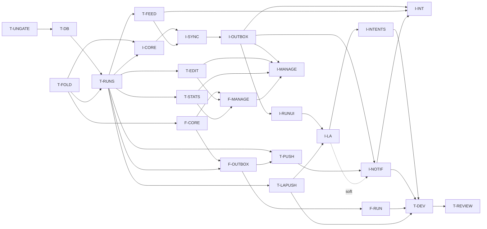

# Plan: timed topics (milestone T)

**Status:** draft, revision 5, 2026-10-23 (server-time offset, timers.md §5.1). **Spec:** [timers.md](timers.md).
**Branch:** `feat/timers`; each WP is on its own branch cut from it and merged
back into it. The milestone merges to `main` as one PR and is released with one
`v*` tag. The server, the PWA and the iOS app are updated together; there is
**no compatibility with older builds** (timers.md §12).

**Next:** milestone CV, forced updates ([client-versions.md](client-versions.md)
§8), runs **after** this milestone. Nothing here depends on it.

**Defaults taken, pending the user's final word:** a lap closes the current
segment and opens an unnamed one (timers.md OPEN 1); best and median count
complete runs only (OPEN 2).

## Scope guard

This milestone is the list of work packages below, and nothing else.

- Anything found during implementation that isn't in a WP's scope (a bug in
  existing code, a refactor that would be nice, a missing feature, a better
  design) goes into a **GitHub issue** in `Richard-Lynch/quickr`, labelled
  `timers-followup`, and is linked from the WP's PR. It does **not** go into the
  milestone, and it does not grow a WP. See issue #20 on how earlier milestones
  ballooned.
- A WP may change code outside its listed areas only when the change is needed
  for its acceptance criteria to pass. The PR description names each such change
  and says why.
- If a WP can't meet its criteria without work that belongs to another WP or to
  no WP, it stops and reports to the lead. The lead decides; the WP does not
  absorb the work.
- A spec change needed during implementation is a separate, small docs commit to
  `timers.md`, approved by the lead, before the code that relies on it.
- **No compatibility work** beyond T-UNGATE. A WP that breaks the API records
  the break as T-UNGATE says, and does nothing else for older builds.
- Every WP diff gets a Codex review, as does the milestone at the end.

## Out of scope

These are not in milestone T. Each becomes an issue if the user wants it.

- Cut for one user (rev 4 review): PWA keyboard shortcuts; step-change lines in
  `checkTopicVersion`; MCP `get_run` and `timing_stats`; a "how long has it
  been running" Siri phrase; a cap on finishing runs per topic.

- Any behaviour for builds from before this milestone, and the forced-update
  mechanism (milestone CV, next).
- An Apple Watch app or complications (the system's Smart Stack mirroring of the
  Live Activity is fine, with no work).
- Target durations, countdowns, or alerts when a step runs long.
- Auto-advance by time; steps that start themselves.
- Undoing a Stop, or reopening a stopped run (edit its times instead).
- Editing an open run's times, or back-dating a start from the UI (the API and
  MCP accept a past `at`).
- Turning untimed entries into timed ones, or the reverse.
- Timing columns in the CSV export.
- Per-step questions, nested steps, or branching routines.
- Several open runs of the same topic.
- Pruning old server-side run rows and events.
- The local-notification fallback for reminders (still deferred,
  notifications.md §11).
- A server job that stops or discards abandoned runs.
- Live Activity layouts for Mac, CarPlay or StandBy beyond what the system
  derives.

## Work packages

Effort: S ≈ 15–25 min of agent time, M ≈ 30–45, L ≈ 45–60. Class: **be**
(backend, pytest), **fe** (PWA, vitest), **host** (`swift test`), **sim**
(xcodebuild and simulator; at most 2 at once), **device**. Spec references are
to [timers.md](timers.md).

Every WP:

- keeps `make check` green, and `make check-ios` when it touches `ios/`;
- regenerates fixtures with `make vectors` when it changes their generators, and
  commits the result;
- regenerates `openapi.json` and the TS client when it changes the API;
- **keeps the iOS gate green when it changes something Swift reads.** A WP that
  changes `openapi.json` or a fixture under `shared/fixtures/` also makes the
  minimal Swift change and runs `swift test` in `ios/QuickrKit`. That means
  endpoint-table rows for new operations (`FixtureCoverageTests`
  `endpointTableMatchesOpenAPI`), and decoders that accept new shapes. The
  feature work stays in the iOS WPs; the backend WP lists the exact Swift change
  it made.

### T-UNGATE · stop the compat gate blocking this milestone · be · S · first

- **Scope:**
  - `compat/supported-clients.json`: `"clients": []`, the gate's "no old clients
    supported" state. `old clients` and `old requests` then check nothing, and
    `openapi breaking` compares only with the newest `v*` tag. `compat.yml`
    loops over the listed shas, so an empty list is expected to work; if a
    script still assumes one client, make it accept none (the only code change
    allowed here).
  - `compat/openapi-break-approvals.txt`: a header comment for this milestone.
    Each T WP that breaks the API against the tag adds its own oasdiff lines
    under it, each commented "timers milestone, no old builds supported
    (T-UNGATE)". They are removed after the release tag, as compatibility.md §2
    already says.
  - `docs/ios/specs/compatibility.md`: a dated note under §1: the timers
    milestone supports no earlier build; the list stays empty until a timers
    build is added by the usual TestFlight PR (§5); forced updates come with
    milestone CV.
- **Areas:** `compat/`, `.github/workflows/compat.yml` (only if needed),
  `docs/ios/specs/compatibility.md`.
- **Depends on:** nothing.
- **Acceptance:** the compat workflow is green on the PR with the empty list;
  `compat/client_fixtures.py shas` prints nothing; the note is in place.
- **Tests:** the workflow run on the PR.

### T-DB · migration, models, versioned steps · be · M

- **Scope:** the migration and models of §2 (`topic_versions.timer`,
  `entries.timing`, `runs`, `run_events` with `pause_id`, `run_aliases`, the
  `run` feed kind) and `live_activity_tokens` (§10.3); `Timer` and `Step`
  schemas; `TopicVersionOut.timer`; `timer` **required** on
  `publishTopicVersion` and optional on `createTopic` (§2.1). Callers that
  publish send `timer: <current>`, so nothing breaks: the PWA builder, the iOS
  builder's publish request, and the MCP `publish_topic_version` tool (`timer`
  becomes a required parameter).
- **Areas:** `backend/alembic/versions/`, `backend/app/models.py`,
  `backend/app/schemas/`, `services/topics.py`, `backend/app/mcp_server.py`,
  `frontend/src/lib/builder.ts`, the iOS builder's publish request,
  `compat/openapi-break-approvals.txt`.
- **Depends on:** T-UNGATE (the required field breaks the API).
- **Acceptance:** the migration applies and downgrades on a seeded database;
  spec T11; step validation answers 422 with field paths; `builder-vectors.json`
  regenerates with timed cases and `BuilderVectorTests` passes.
- **Tests:** migration round trip; T11; validation; the MCP publish tool.

### T-FOLD · the fold, timing projection, stats math · be · M

- **Scope:** `services/run_fold.py` (§4, no database), the `Timing` projection
  with T1–T5 and millisecond instants (§2.3), `fmt_duration`,
  `services/timing_stats.py` (§9.1, complete runs only for best and median).
  Generators for `run-fold-vectors.json`, `timing-stats-vectors.json` and
  `duration-format-vectors.json`, with every case in §13.1; README rows.
- **Areas:** `backend/app/services/`, `backend/tests/`, `shared/fixtures/`.
- **Depends on:** nothing.
- **Acceptance:** every §13.1 case for these files is present and named; a
  property test: for random event sets, every arrival order with the same first
  terminal gives the same state, and segment sums equal the totals exactly.
- **Tests:** a unit test per rule in §4.2 and §4.4; the property test; drift
  checks.

### T-RUNS · run events and runs · be · L

- **Scope:** `recordRunEvent`, `getRun`, `listRuns` (§3.1–§3.7, §4.4, §4.5, §5,
  §6): millisecond truncation, idempotency, start and merge, stop (including
  `before_start` and a second stop with answers), finish in both states, discard
  of a finishing run, late merges, the edited-run rule; entry creation and
  `EntryOut.timing`; `id_conflict` in both directions (§3.9); the `X-QuickR-Server-Time`
  header on every `/api/v1` response (§5.1, beside the identity headers in
  `backend/app/api/identity.py`); topic delete and archive; the change-log writes and their order (§2.4); API fixtures.
- **Areas:** `backend/app/services/runs.py` (new), `services/entries.py`,
  `services/topics.py`, `services/feed.py`, `api/routes.py`, `schemas/api.py`,
  `errors.py`, `api/identity.py`, `shared/fixtures/api/`, `openapi.json`, `frontend/src/api`
  (regenerated client only), the iOS endpoint table and `EntryDTO.timing`
  (minimal, per the rule above).
- **Depends on:** T-DB, T-FOLD.
- **Acceptance:** spec T1–T6, T9, T13, T15, T16 and T17.
- **Tests:** as listed; T2 and T3 with two tasks against one database.

### T-FEED · runs in the change feed · be · M

- **Scope:** the `run` item and deletion kinds in `listChanges`, the bootstrap
  rule and the run emission rule (§7.1); fixtures. The minimal Swift change: the
  feed decoder skips `run` items and deletions until I-SYNC handles them, so the
  decoding tests stay green.
- **Areas:** `backend/app/services/changes.py`, `schemas/api.py`,
  `shared/fixtures/api/`, `openapi.json`,
  `ios/QuickrKit/Sources/QuickrData/Contracts/ChangesDTO.swift` (the skip).
- **Depends on:** T-RUNS.
- **Acceptance:** spec T7 and T8 (page contents, not log order).
- **Tests:** T7, T8.

### T-EDIT · editing a run's times, and the MCP tools · be · M

- **Scope:** `updateEntry` with `timing` and the `captured_at` refusal (§3.8);
  the four MCP tools of §11.6.
- **Areas:** `backend/app/services/entries.py`, `services/runs.py`,
  `schemas/api.py`, `backend/app/mcp_server.py`, `shared/fixtures/api/`,
  `openapi.json`.
- **Depends on:** T-RUNS.
- **Acceptance:** spec T10; an edit sets `edited` and later events are void
  without a refold (T16, last clause); each MCP tool round-trips, and
  `run_action` fills `seg`, `step` and `pause_id` from the current state.
- **Tests:** edit validation per invariant T2–T5; one test per tool.

### T-STATS · the timing stats endpoint · be · S

- **Scope:** `getTopicTiming` (§9.2) over `services/timing_stats.py`; fixtures.
- **Areas:** `backend/app/services/` (a `timing.py`), `api/routes.py`,
  `schemas/api.py`, `shared/fixtures/api/`, `openapi.json`.
- **Depends on:** T-RUNS.
- **Acceptance:** results equal `timing-stats-vectors.json` for the same
  entries; `from`/`to` filter on `captured_at`; an untimed topic answers zeros.
- **Tests:** endpoint tests seeded from the vectors.

### T-PUSH · reminders with a Start action, server and service worker · be + fe · M

- **Scope:** the `timed` descriptor, the `start` action and its category hash,
  the scheduler skip without marking (§10.1); new cases in
  `notification-vectors.json` and `apns-payload-vectors.json`; the PWA push
  payload type and the service worker's `log|t|` action with the derived run id
  and the Web Lock (§10.2). The minimal Swift change: the descriptor decoder
  accepts `type: "timed"` and renders the `start` action, so
  `NotificationVectorTests` (which `fatalError`s on a decode failure) passes.
- **Areas:** `backend/app/services/quicklog.py`, `services/notification.py`,
  `services/scheduler.py`, `services/push/`, `shared/fixtures/`,
  `frontend/src/lib/pushPayload.ts`, `frontend/src/lib/pushActions.ts`,
  `frontend/src/sw.ts`, the Swift descriptor decoder.
- **Depends on:** T-RUNS, F-OUTBOX (the service worker enqueues `run.event`).
- **Acceptance:** T12; timed vector cases; two racing clicks enqueue one start
  whose id equals the action entry id vector.
- **Tests:** scheduler skip, descriptor, payload size, vector drift; vitest in
  the style of `pushActions.test.ts`.

### T-LAPUSH · Live Activity pushes · be · M

- **Scope:** `registerLiveActivity` and `deleteLiveActivity` for both token
  kinds; the sender, as a post-response background task with per-topic
  serialisation, latest-state content, originating-device exclusion, run-keyed
  token drops, and failures that touch only the token row (§6, §10.3);
  `live-activity-vectors.json` with every `aps` key checked against Apple's
  documentation (§10.4).
- **Areas:** `backend/app/services/push/` (a `live_activity.py`, not through
  `deliver()`), `services/runs.py` (the post-response hook only),
  `api/routes.py`, `schemas/api.py`, `shared/fixtures/`, `openapi.json`.
- **Depends on:** T-RUNS.
- **Acceptance:** T14; every payload ≤ 4 KB.
- **Tests:** T14 with a mock transport; vector drift.

### F-CORE · PWA fold port, format and models · fe · M

- **Scope:** `lib/runs/fold.ts` (integer-millisecond instants, no `Date`
  arithmetic), `lib/runs/format.ts`, the timing chart models, and the shared
  `dueCount` in `lib/home.ts` with the open-run rule (§11.1); the pure
  server-time offset and clamp helpers (§5.1).
- **Areas:** `frontend/src/lib/runs/` (new), `frontend/src/lib/home.ts`, the
  `badge.ts` caller.
- **Depends on:** T-FOLD.
- **Acceptance:** fold, stats-model and format vectors pass; the badge and the
  home screen use the one `dueCount`.
- **Tests:** vitest vector suites; `dueCount`; offset and clamp (as R12).

### F-OUTBOX · PWA `run.event` kind, local view, run data · fe · M

- **Scope:** the `run.event` kind in the IndexedDB outbox with the one ordering
  rule "wait for this run's start", K6 and the classification (§8.1, §8.2); the
  local run view, including "never enqueue a second start" (§4.5, §8.3); the
  open-runs hook with the polling rules (§7.3); the API client records offset
  samples from `X-QuickR-Server-Time`, and every enqueued event is stamped and
  clamped (§5.1).
- **Areas:** `frontend/src/lib/outbox/`, `frontend/src/lib/runs/`,
  `frontend/src/lib/hooks.ts`.
- **Depends on:** F-CORE, T-RUNS.
- **Acceptance:** outbox tests: start ordering, a failed Next doesn't block
  Stop, K6, classification; the `classifyStatus` parity test is unchanged;
  `entry.create` behaves exactly as before.
- **Tests:** vitest as listed.

### F-RUN · PWA run UI · fe · M

- **Scope:** the home tile states, the running bar, the run panel with every
  control, Stop then the answers form sending `finish`, Discard, the §11.4
  notices (§11.5).
- **Areas:** `frontend/src/components/topics/`, `components/runs/` (new),
  `pages/topic/RecordPage.tsx`, `components/AppShell.tsx`.
- **Depends on:** F-OUTBOX.
- **Acceptance:** a scripted component test drives start → Next → Skip → Pause →
  Resume → Stop → answers → Save and checks the requests; a void reply shows the
  right notice.
- **Tests:** component tests per tile state and control.

### F-MANAGE · PWA builder, timing edit and stats · fe · M

- **Scope:** the Timed switch and steps editor; the entry timing section, the
  Edit times form, and `captured_at` hidden for timed entries; the Timing
  section of the Overview (§11.1, §11.5).
- **Areas:** `frontend/src/components/builder/`, `lib/builder.ts`,
  `pages/topic/EntryEditPage.tsx`, `OverviewPage.tsx`, `components/charts/`,
  `components/runs/`.
- **Depends on:** F-CORE, T-EDIT, T-STATS.
- **Acceptance:** publish sends the edited `timer`, with keys stable on rename;
  `builder-ui-vectors.json` gains timed cases; an edit that breaks T2–T5 is
  refused in the form with the server's messages; the Overview renders best,
  median and per-step bars from a fixture.
- **Tests:** vitest for the editor, the form and the chart models.

### I-CORE · Swift ports and DTOs · host · M

- **Scope:** QuickrCore `RunFold` (wire strings parsed to integer epoch
  milliseconds, never `Date`), `Timing`, `fmtDuration`, timing-stats models, and
  `dueCount(view)` with the open-run rule; the pure server-time offset and
  clamp helpers (§5.1); DTOs for the new operations.
- **Areas:** `ios/QuickrKit/Sources/QuickrCore/Runs/` (new), `QuickrCore/Home/`,
  `QuickrData/Contracts/`.
- **Depends on:** T-FOLD, T-RUNS.
- **Acceptance:** R1 and the helper half of R12; every new `api/*.json`
  fixture decodes; G1 coverage passes.
- **Tests:** vector suites; decoding tests.

### I-SYNC · store and feed · host · M

- **Scope:** the `run` and `run_alias` tables; applying `run` items and
  deletions in live and staged pages, replacing T-FEED's skip (§7.2); run
  tombstones, their dependent-item rule, and the topic cascade.
- **Areas:** `QuickrData/Store/`, `QuickrData/Sync/`,
  `QuickrCore/Models/ChangeFeed.swift`, `QuickrData/Contracts/ChangesDTO.swift`.
- **Depends on:** I-CORE, T-FEED.
- **Acceptance:** R2; every existing sync test passes.
- **Tests:** R2; an epoch rebuild with an open run in the staged pages.

### I-OUTBOX · the `run.event` kind and the local view · host · M

- **Scope:** the outbox kind with start-only ordering, K6 and classification
  (§8.1); the local run view with optimistic entries and "never enqueue a second
  start" (§4.5, §8.3); the write façade every surface uses (start, next, lap,
  skip, pause, resume, stop, finish, discard, auto), stamping `device` and the
  offset-corrected, clamped `at` on every event; the API client stores offset
  samples in `sync_state.server_offset_ms` (§5.1); request goldens.
- **Areas:** `QuickrData/Outbox/`, `QuickrData/Store/Overlay.swift`,
  `QuickrData/Session/`, `shared/fixtures/requests/`.
- **Depends on:** I-SYNC.
- **Acceptance:** R3–R5 and R12; the goldens validate in pytest (G2).
- **Tests:** R3–R5.

### I-RUNUI · tile, run screen, Stop flow · sim · L

- **Scope:** the home tile states, the run screen, Stop and the answers sheet
  sending `finish`, Discard, notices, the "Running" and "Add details" home
  states, and the `quickr://t/{topic_id}/run` link (§11.1, §11.2, §11.4). The
  app badge, the NSE badge and the widgets switch to `dueCount` (R11). The
  widgets' due filter (`WidgetViews.swift`) and Siri's due list
  (`TopicIntents.swift`) route through `TopicListing.countsAsDue` once open runs
  are wired.
- **Areas:** `ios/App/Home/`, `ios/App/Runs/` (new), `ios/App/Navigation/`,
  `QuickrUI/`, `ios/NotificationService/` (the badge call only), `ios/Widgets/`
  (the due count only).
- **Depends on:** I-OUTBOX.
- **Acceptance:** R9 and R11.
- **Tests:** R9; R11; unit tests of the tile's state mapping.

### I-MANAGE · iOS builder, timing edit and stats · sim · M

- **Scope:** the Timed switch and steps editor; the entry timing section, Edit
  times, and `captured_at` hidden for timed entries; the Timing section of the
  Overview (§11.1, §11.2).
- **Areas:** `ios/App/Topics/Builder/`, `QuickrCore/Builder/`,
  `ios/App/Entries/`, `ios/App/Stats/`.
- **Depends on:** I-OUTBOX, T-EDIT, T-STATS, F-MANAGE (the shared builder
  vectors).
- **Acceptance:** `BuilderVectorTests` pass with the timed cases; R10.
- **Tests:** vector tests; R10; one UI test that publishes a timed topic.

### I-LA · the Live Activity · sim · L

- **Scope:** `RunActivityAttributes` and its content state; Lock Screen and
  Dynamic Island views; the `LiveActivityIntent` buttons; local start, update,
  end and `staleDate`; reconciliation; token registration; the Settings switch
  (§10.3); `LiveActivityVectorTests`.
- **Areas:** `ios/Widgets/` (activity views), `ios/App/LiveActivity/` (new),
  `QuickrData/Intents/`, `ios/App/Settings/`, `ios/project.yml`
  (`NSSupportsLiveActivities`, `NSSupportsLiveActivitiesFrequentUpdates`).
- **Depends on:** I-RUNUI, T-LAPUSH.
- **Acceptance:** R8; the vector suite passes; unit tests of the view model that
  maps a content state to the displayed strings and the button set, for running,
  paused, last step, no steps, finishing and ended.
- **Tests:** R8; the vector suite; the view-model tests.

### I-INTENTS · widgets, Control, Action button, Siri · sim · M

- **Scope:** the timed widget states and buttons, the Control,
  `AdvanceRunIntent` with Auto, and the one `RunActionIntent` App Shortcut with
  its spoken results (§11.3). Every one is a `LiveActivityIntent`.
- **Areas:** `ios/Widgets/`, `ios/App/Intents/`, `QuickrData/Intents/`.
- **Depends on:** I-LA.
- **Acceptance:** intent tests for each action's outcome (idle, running, last
  step, several open runs, finishing); the app has at most 10 App Shortcuts.
- **Tests:** as listed, in `IntentsTests`.

### I-NOTIF · the notification Start action · sim · M

- **Scope:** the `start` kind in category rendering and hashing (beyond T-PUSH's
  decoder), the handler path with the derived run id, and the NSE (§10.2).
- **Areas:** `QuickrData/Notifications/`, `ios/App/Notifications/Handler/`,
  `ios/NotificationService/`.
- **Depends on:** I-OUTBOX, T-PUSH; I-LA (soft: the local activity request).
- **Acceptance:** timed notification vectors pass (N1); a second Start on the
  same reminder writes nothing.
- **Tests:** in the style of N3, N7 and N16.

### I-INT · integration and multi-process · host + be · M

- **Scope:** R5 under real subprocesses; R6 and R7 against the docker stack
  (`make ios-integration`).
- **Areas:** `ios/QuickrKit/Tests/QuickrDataTests/Integration/`,
  `MultiProcess/`.
- **Depends on:** I-OUTBOX, T-FEED, I-NOTIF (R7), T-PUSH (the PWA half of R7).
- **Acceptance:** R5–R7 pass locally; the run is recorded in the PR.
- **Tests:** as listed.

### T-DEV · device validation · device · S

- **Scope:** the checks of §13.5 on a device, with a recording of each in
  `docs/ios/demo/timers/`.
- **Depends on:** I-INTENTS, I-NOTIF, F-RUN, T-LAPUSH.
- **Acceptance:** each check passes, or has an issue filed with what was seen.

### T-REVIEW · milestone review · docs · S

- **Scope:** Codex review of the milestone diff against the spec; fixes for
  findings inside a WP's scope; issues for the rest.
- **Depends on:** every other WP.
- **Acceptance:** no open finding inside scope; every other finding has an
  issue.

## DAG

| WP        | Depends on                          | Class     | Effort |
| --------- | ----------------------------------- | --------- | ------ |
| T-UNGATE  | —                                   | be        | S      |
| T-DB      | T-UNGATE                            | be        | M      |
| T-FOLD    | —                                   | be        | M      |
| T-RUNS    | T-DB, T-FOLD                        | be        | L      |
| T-FEED    | T-RUNS                              | be        | M      |
| T-EDIT    | T-RUNS                              | be        | M      |
| T-STATS   | T-RUNS                              | be        | S      |
| T-PUSH    | T-RUNS, F-OUTBOX                    | be + fe   | M      |
| T-LAPUSH  | T-RUNS                              | be        | M      |
| F-CORE    | T-FOLD                              | fe        | M      |
| F-OUTBOX  | F-CORE, T-RUNS                      | fe        | M      |
| F-RUN     | F-OUTBOX                            | fe        | M      |
| F-MANAGE  | F-CORE, T-EDIT, T-STATS             | fe        | M      |
| I-CORE    | T-FOLD, T-RUNS                      | host      | M      |
| I-SYNC    | I-CORE, T-FEED                      | host      | M      |
| I-OUTBOX  | I-SYNC                              | host      | M      |
| I-RUNUI   | I-OUTBOX                            | sim       | L      |
| I-MANAGE  | I-OUTBOX, T-EDIT, T-STATS, F-MANAGE | sim       | M      |
| I-LA      | I-RUNUI, T-LAPUSH                   | sim       | L      |
| I-INTENTS | I-LA                                | sim       | M      |
| I-NOTIF   | I-OUTBOX, T-PUSH (I-LA soft)        | sim       | M      |
| I-INT     | I-OUTBOX, T-FEED, I-NOTIF           | host + be | M      |
| T-DEV     | I-INTENTS, I-NOTIF, F-RUN, T-LAPUSH | device    | S      |
| T-REVIEW  | all                                 | docs      | S      |

**Critical path:** T-UNGATE → T-DB → T-RUNS (with T-FOLD beside it) → T-FEED →
I-SYNC → I-OUTBOX → I-RUNUI → I-LA → I-INTENTS → T-DEV → T-REVIEW. Backend and
PWA work runs beside it. The sim WPs (I-RUNUI, I-MANAGE, I-LA, I-INTENTS,
I-NOTIF) share the two simulator slots.

**First wave:** T-UNGATE and T-FOLD (then F-CORE, which needs only T-FOLD).

## Before starting

- The user confirms, or overrides, the two defaults above. Only T-FOLD and
  T-STATS depend on them.
- The spec gets a Codex review before T-API starts; findings go into the spec,
  not into WPs.
