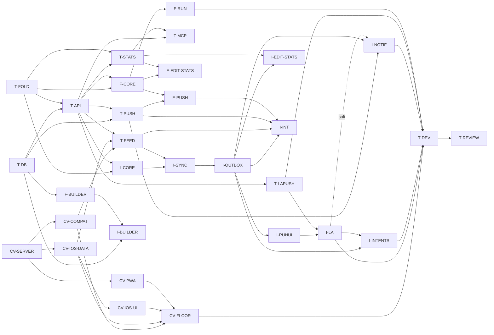

# Plan: timed topics (milestone T)

**Status:** draft, revision 2, 2026-10-23. **Specs:** [timers.md](timers.md)
and its prerequisite [client-versions.md](client-versions.md).

Two milestones, in order:

1. **CV, client versions and forced updates.** On `feat/client-versions`, cut
   from `main`, merged to `main` and released on its own. Then the user installs
   the floor build, and CV-FLOOR raises the iOS minimum.
2. **T, timed topics.** On `feat/timers`, rebased onto `main` after CV merges.
   Each WP is on its own branch cut from it and merged back into it. The
   milestone merges to `main` as one PR and is released with one `v*` tag.

Non-breaking T WPs can start before CV is released. **T-FEED, the only breaking
WP, needs CV merged; the T release needs CV-FLOOR done.**

## Scope guard

This milestone is the list of work packages below, and nothing else.

- Anything found during implementation that isn't in a WP's scope (a bug in
  existing code, a refactor that would be nice, a missing feature, a better
  design) goes into a **GitHub issue** in `Richard-Lynch/quickr`, labelled
  `timers-followup`, and is linked from the WP's PR. It does **not** go into the
  milestone, and it does not grow a WP. See issue #20 on how earlier milestones
  ballooned.
- A WP may change code outside its listed areas only when the change is needed
  for its acceptance criteria to pass. The PR description names each such change
  and says why.
- If a WP can't meet its criteria without work that belongs to another WP or to
  no WP, it stops and reports to the lead. The lead decides; the WP does not
  absorb the work.
- A spec change needed during implementation is a separate, small docs commit to
  `timers.md` or `client-versions.md`, approved by the lead, before the code
  that relies on it.
- **Only T-FEED may break the API.** Any other WP that finds it must break
  something stops and reports to the lead.
- Every WP diff gets a Codex review, as does the milestone at the end.

## Out of scope

These are not in milestones CV or T. Each becomes an issue if the user wants it.

- An Apple Watch app or complications (the system's Smart Stack mirroring of the
  Live Activity is fine, with no work).
- Target durations, countdowns, or alerts when a step runs long.
- Auto-advance by time; steps that start themselves.
- Undoing a Stop, or reopening a stopped run (edit its times instead).
- Editing an open run's times, or back-dating a start from the UI (the API and
  MCP accept a past `at`).
- Turning untimed entries into timed ones, or the reverse.
- Timing columns in the CSV export.
- Per-step questions, nested steps, or branching routines.
- Several open runs of the same topic.
- Pruning old server-side run rows and events.
- The local-notification fallback for reminders (still deferred,
  notifications.md §11).
- A server job that stops or discards abandoned runs.
- Live Activity layouts for Mac, CarPlay or StandBy beyond what the system
  derives.
- Anything that keeps builds below the minimum working (they are forced to
  update: client-versions.md).
- An in-app updater, App Store distribution, or update prompts for platforms
  other than iOS (TestFlight) and the PWA.
- Per-endpoint or per-feature minimum levels: there is one level per platform.

## Work packages

Effort: S ≈ 15–25 min of agent time, M ≈ 30–45, L ≈ 45–60. Class: **be**
(backend, pytest), **fe** (PWA, vitest), **host** (`swift test`), **sim**
(xcodebuild and simulator; at most 2 at once), **device**.

Every WP:

- keeps `make check` green, and `make check-ios` when it touches `ios/`;
- regenerates fixtures with `make vectors` when it changes their generators, and
  commits the result;
- regenerates `openapi.json` and the TS client when it changes the API;
- leaves `compat/openapi-break-approvals.txt` without new lines.

### Milestone CV: client versions (do first)

#### CV-SERVER · API level, headers and enforcement · be · M

- **Scope:** `shared/api-level.json` at `{api_level: 1, min_client_level:
{ios: 0, web: 0}}`; `backend/app/client_versions.py`; the response headers
  and the enforcing middleware (client-versions.md §3.2–§3.3), including the
  426 `client_outdated` Problem; `getClientVersions`; the env overrides and
  `QUICKR_IOS_UPDATE_URL`; the client level stored by `registerApnsDevice` and
  display-only reminders below the iOS minimum (§3.4); request goldens gain
  `X-QuickR-Client`.
- **Areas:** `shared/api-level.json`, `backend/app/client_versions.py` (new),
  `backend/app/api/identity.py` (or a sibling middleware module),
  `backend/app/config.py`, `backend/app/services/push/`, `services/scheduler.py`,
  `backend/alembic/versions/` (the APNs level column), `shared/fixtures/`,
  `openapi.json`, `frontend/src/api` (regenerated client only).
- **Depends on:** nothing.
- **Acceptance:** client-versions.md V1–V5; every existing test passes (they
  send no client headers, so they aren't checked).
- **Tests:** V1–V5.

#### CV-COMPAT · the gate under the new policy · be · S

- **Scope:** client-versions.md §7: `api_level` on each listed client (0 for
  both current builds); `client_fixtures.py` checks only clients at or above
  the minimum; the `openapi breaking` tag rule (a break needs a bump); the new
  `api level` check; compatibility.md updated to match.
- **Areas:** `compat/`, `.github/workflows/compat.yml`,
  `docs/ios/specs/compatibility.md`.
- **Depends on:** CV-SERVER.
- **Acceptance:** client-versions.md V11 and V12; with today's values the gate
  checks both listed builds exactly as before.
- **Tests:** V11 against fixture repos; the workflow runs green on the PR.

#### CV-IOS-DATA · client header, outdated state, held queue · host · M

- **Scope:** `X-QuickR-Client` from every process (the `Info.plist` key from
  `shared/api-level.json`, written by a build phase); `client_outdated_min` in
  `sync_state`; the coordinator and claim guards; 426 handling in the outbox
  (restore, never fail); the store migration that revives 426-failed items
  (§4.2); tolerant feed decoding (§4.4); result texts for widgets, intents and
  notification actions (§4.1). The one-paragraph amendments to
  sync-protocol.md §2.2 and outbox.md §5.2 and §6.2.
- **Areas:** `ios/QuickrKit/Sources/QuickrData/API/`, `Store/`, `Sync/`,
  `Outbox/`, `Intents/`, `Notifications/`, `ios/project.yml`,
  `docs/ios/specs/`.
- **Depends on:** CV-SERVER.
- **Acceptance:** client-versions.md V6–V8; an unknown feed kind is skipped,
  not a page failure; every existing outbox and sync test passes.
- **Tests:** V6–V8; a decode test with an unknown item and deletion kind.

#### CV-IOS-UI · the "Update required" screen · sim · S

- **Scope:** the blocking view, Open TestFlight, Check again, the server-switch
  escape, the widget line and the "server needs updating" note (§4.1, §3.3).
- **Areas:** `ios/App/` (root view, Settings), `ios/Widgets/`, `QuickrUI/`.
- **Depends on:** CV-IOS-DATA.
- **Acceptance:** client-versions.md V9.
- **Tests:** V9 as a UI test against a fake transport.

#### CV-PWA · header, detection and forced reload · fe · S

- **Scope:** `X-QuickR-Client` on every request; detection; the update path of
  §5.2 with the blocking overlay; the outbox hold (§5.3). The same PR sets
  `min_client_level.web` to 1: the PWA ships with the server.
- **Areas:** `frontend/src/api/`, `frontend/src/components/pwa/`,
  `frontend/src/lib/outbox/`, `frontend/vite.config.ts`, `shared/api-level.json`.
- **Depends on:** CV-SERVER.
- **Acceptance:** client-versions.md V10; the outbox parity tests pass.
- **Tests:** V10.

#### CV-FLOOR · raise the iOS floor · release · S

- **Scope:** after CV is on `main`, released, and its TestFlight build is
  installed on the user's phone (the lead confirms with the user): list that
  build in `compat/supported-clients.json` with `api_level: 1`, and raise
  `min_client_level.ios` to 1. The level-0 builds may leave the list in the same
  PR.
- **Depends on:** CV-SERVER, CV-COMPAT, CV-IOS-DATA, CV-IOS-UI, CV-PWA, and the
  release.
- **Acceptance:** the compat gate passes; a level-0 request answers 426 on the
  deployed server; the installed build syncs.
- **Tests:** none beyond the gate (V2 already covers the 426).

### Milestone T: backend

#### T-DB · migration and models · be · M

- **Scope:** the migration and models of spec §2: `topic_versions.timer`,
  `entries.timing`, `runs`, `run_events`, `run_aliases`, the `run` feed kind,
  `apns_devices.live_activity_start_token`, `live_activity_tokens`. Pydantic
  `Timer` and `Step`; `TopicVersionOut.timer`; `timer` on `publishTopicVersion`
  and `createTopic` with "absent inherits" (§2.1); step-change lines in
  `checkTopicVersion`'s report. No run endpoints.
- **Areas:** `backend/alembic/versions/`, `backend/app/models.py`,
  `backend/app/schemas/`, `backend/app/services/topics.py`,
  `services/compat.py`.
- **Depends on:** nothing.
- **Acceptance:** the migration applies and downgrades on a copy of a seeded
  database; publishing without `timer` inherits it and with `null` clears it
  (spec T11, first two clauses); step validation (count, key regex, unique keys,
  label length) answers 422 with field paths; `builder-vectors.json` regenerates
  with timed cases.
- **Tests:** migration round-trip; publish inherit/clear/validate;
  `checkTopicVersion` step lines; api fixtures for a timed `getTopic` and
  `publishTopicVersion`.

#### T-FOLD · the pure fold, timing projection and stats math · be · M

- **Scope:** `services/run_fold.py` (spec §4.1–§4.4, without database access),
  the `Timing` projection with invariants T1–T5 (§2.3), `fmt_duration`, and
  `services/timing_stats.py` (§9.1). Generators for `run-fold-vectors.json`,
  `timing-stats-vectors.json` and `duration-format-vectors.json`, with every
  case listed in spec §13.1. The README rows for the three files.
- **Areas:** `backend/app/services/run_fold.py`, `services/timing_stats.py`,
  `backend/tests/test_run_fold*.py`, `test_timing_stats*.py`,
  `test_duration_vectors.py`, `shared/fixtures/`.
- **Depends on:** nothing (it can start with T-DB).
- **Acceptance:** each spec §13.1 case for these three files is present and
  named; the fold is a pure function of `(steps, events in arrival order)`;
  property test: for random event sets, every arrival permutation that keeps the
  same first terminal gives the same state.
- **Tests:** unit tests per rule in §4.2 and §4.4; the property test; drift
  checks.

#### T-API · run events, runs, entries · be · L

- **Scope:** `recordRunEvent`, `getRun`, `listRuns` (§3.1–§3.7, §4.5, §5, §6);
  entry creation at stop and finish; late merges; the entry `timing` field and
  `EntryOut.timing`; `updateEntry` with `timing` and the `captured_at` shift
  (§3.8); id-space reservation (§1.1); topic delete and archive rules; the
  change-log writes and ordering of §2.4; Problem codes (§3.9). API fixtures and
  request-golden validation for these operations.
- **Areas:** `backend/app/services/runs.py` (new), `services/entries.py`,
  `services/topics.py`, `services/feed.py` (write side only), `api/routes.py`,
  `schemas/api.py`, `errors.py`, `shared/fixtures/api/`, `openapi.json`,
  `frontend/src/api` (regenerated client only).
- **Depends on:** T-DB, T-FOLD.
- **Acceptance:** spec tests T1–T6, T9, T10, T11 (third clause) and T13 pass;
  `old requests` passes unchanged.
- **Tests:** as listed, plus the concurrency tests T2 and T3 with two tasks
  against one database.

#### T-FEED · runs in the change feed (the breaking change) · be · M

- **Scope:** the `run` item and deletion kinds in `listChanges`, and the
  bootstrap rules (timers.md §7.1); fixtures. **The bump:**
  `shared/api-level.json` to `api_level: 2`, `min_client_level: {ios: 2, web: 2}`;
  the two level-0 builds leave `compat/supported-clients.json` (timers.md
  §13.3).
- **Areas:** `backend/app/services/changes.py`, `api/routes.py`,
  `schemas/api.py`, `shared/fixtures/api/`, `shared/api-level.json`,
  `compat/supported-clients.json`.
- **Depends on:** T-API, CV-COMPAT, CV-IOS-DATA (the tree's iOS client must
  already skip unknown kinds, so `make check-ios` stays green until I-SYNC).
- **Acceptance:** spec T7, T8 and T14; the compat gate passes with no new
  approval lines and no fallbacks.
- **Tests:** T7, T8; a bootstrap with open, finishing and closed runs.

#### T-STATS · `getTopicTiming` · be · S

- **Scope:** the endpoint of §9.2 over `services/timing_stats.py`; fixtures.
- **Areas:** `backend/app/services/stats.py` or a new `services/timing.py`,
  `api/routes.py`, `schemas/api.py`, `shared/fixtures/api/`.
- **Depends on:** T-API (timed entries exist), T-FOLD.
- **Acceptance:** results equal the `timing-stats-vectors.json` expectations for
  the same entries; `from`/`to` filter on `captured_at`; an untimed topic
  answers zeros.
- **Tests:** endpoint tests seeded from the vectors.

#### T-PUSH · reminders for timed topics · be · M

- **Scope:** the `timed` descriptor, the `start` action and its category hash,
  the Web Push action, and the scheduler skip (§10.1). New cases in
  `notification-vectors.json` and `apns-payload-vectors.json`.
- **Areas:** `backend/app/services/quicklog.py`, `services/notification.py`,
  `services/scheduler.py`, `services/push/`, `shared/fixtures/`.
- **Depends on:** T-DB; T-API for the open-run check.
- **Acceptance:** spec T12; the vectors include timed cases.
- **Tests:** scheduler skip, descriptor, payload size, vector drift.

#### T-LAPUSH · Live Activity pushes · be · M

- **Scope:** token registration (`registerLiveActivity`, `deleteLiveActivity`,
  `live_activity_start_token` on `registerApnsDevice`); the sender for start,
  update and end after each committed run change (§10.3); token pruning;
  `live-activity-vectors.json`.
- **Areas:** `backend/app/services/push/` (a `live_activity.py`),
  `services/runs.py` (the post-commit hook only), `api/routes.py`,
  `schemas/api.py`, `shared/fixtures/`.
- **Depends on:** T-API.
- **Acceptance:** spec T15; every payload in the vectors is ≤ 4 KB; APNs is
  never called inside the writer transaction.
- **Tests:** T15 with the existing MockTransport sender; vector drift.

#### T-MCP · MCP tools · be · S

- **Scope:** the tools of §11.6, and `timer` on `publish_topic_version` and
  `create_topic`.
- **Areas:** `backend/app/mcp_server.py`, its tests.
- **Depends on:** T-API, T-STATS.
- **Acceptance:** each tool round-trips against the test database; `run_action`
  reads `seg` from the current state.
- **Tests:** one test per tool.

### Milestone T: PWA

#### F-CORE · fold port, format, outbox kind, data hooks · fe · M

- **Scope:** `lib/runs/fold.ts` and `lib/runs/format.ts` (vector-checked),
  timing-stats chart models, the `run.event` outbox kind with ordering, K6 and
  classification (§8.1–§8.2), the local run view (§8.3), and the open-runs query
  hook with the polling rules (§7.3).
- **Areas:** `frontend/src/lib/runs/` (new), `frontend/src/lib/outbox/`,
  `frontend/src/lib/hooks.ts`.
- **Depends on:** T-FOLD (vectors), T-API (client).
- **Acceptance:** fold, stats-model and format vectors pass in vitest; outbox
  tests for the new kind pass; the existing `classifyStatus` parity test is
  unchanged.
- **Tests:** vitest as listed.

#### F-RUN · run UI · fe · M

- **Scope:** the home tile states, the running bar, the run panel with every
  control and the keyboard keys, Stop with the answers form and `finish` or
  `entry.update`, Discard, the notices of §11.4 (§11.5).
- **Areas:** `frontend/src/components/topics/`, `components/runs/` (new),
  `pages/topic/RecordPage.tsx`, `components/AppShell.tsx`.
- **Depends on:** F-CORE.
- **Acceptance:** a scripted component test drives start → Next → Skip → Pause →
  Resume → Stop → answers → Save and checks the requests; a void reply shows the
  right notice.
- **Tests:** component tests per tile state and per control.

#### F-BUILDER · timed switch and steps editor · fe · S

- **Scope:** the Timed switch and steps editor in the builder (§11.5).
- **Areas:** `frontend/src/components/builder/`, `lib/builder.ts`.
- **Depends on:** T-DB.
- **Acceptance:** publish sends `timer`; keys derive from labels and stay stable
  on rename; `builder-ui-vectors.json` gains timed cases.
- **Tests:** vitest for the editor and the vectors.

#### F-EDIT-STATS · timing view, edit and stats · fe · M

- **Scope:** the entry timing section and Edit times form, and the Timing
  section on the Overview page (§11.5).
- **Areas:** `frontend/src/pages/topic/EntryEditPage.tsx`, `OverviewPage.tsx`,
  `components/charts/`, `components/runs/`.
- **Depends on:** F-CORE, T-STATS.
- **Acceptance:** an edit that breaks T2–T5 is refused in the form with the same
  messages as the server's 422; the Overview shows best, median and per-step
  bars from a fixture.
- **Tests:** component tests; chart model vectors.

#### F-PUSH · Start action in the service worker · fe · S

- **Scope:** the `run|start` action in `sw.ts` with the derived run id, the Web
  Lock and the feedback table of notifications.md §10 (§10.2).
- **Areas:** `frontend/src/sw.ts`, `lib/pushActions.ts`.
- **Depends on:** T-PUSH, F-CORE.
- **Acceptance:** two racing clicks enqueue one start; the run id equals the
  action entry id vector for the slot.
- **Tests:** vitest in the style of `pushActions.test.ts`.

### Milestone T: iOS

#### I-CORE · fold, format and stats ports · host · M

- **Scope:** Swift ports in QuickrCore: `RunFold`, `Timing`, `fmtDuration`,
  timing-stats models; DTOs for `RunOut`, `RunEventIn`, `RunEventResult`,
  `Timing`, `TopicTiming`; the endpoint table entries.
- **Areas:** `ios/QuickrKit/Sources/QuickrCore/Runs/` (new),
  `QuickrData/Contracts/`, their tests.
- **Depends on:** T-FOLD; T-API for the DTO fixtures.
- **Acceptance:** spec R1; every new `api/*.json` fixture decodes; G1 coverage
  passes for the operations the client will call.
- **Tests:** vector suites; decoding tests.

#### I-SYNC · store and feed · host · M

- **Scope:** the `run` and `run_alias` tables; applying `run` items and
  deletions (timers.md §7.2), including staged pages; run tombstones and their
  dependent-item rule.
- **Areas:** `QuickrData/Store/`, `QuickrData/Sync/`,
  `QuickrCore/Models/ChangeFeed.swift`, `QuickrData/Contracts/ChangesDTO.swift`.
- **Depends on:** I-CORE, T-FEED.
- **Acceptance:** spec R2; every existing sync test passes unchanged.
- **Tests:** R2; an epoch rebuild with an open run in the staged pages.

#### I-OUTBOX · the `run.event` kind and the local view · host · M

- **Scope:** the outbox kind with ordering, K6 and classification (§8.1); the
  local run view (§8.3); the write façade for every surface (start, next, lap,
  skip, pause, resume, stop, finish, discard, auto).
- **Areas:** `QuickrData/Outbox/`, `QuickrData/Store/Overlay.swift`,
  `QuickrData/Session/` (the façade), `shared/fixtures/requests/` (goldens).
- **Depends on:** I-SYNC.
- **Acceptance:** spec R4, R5 and R6; request goldens validate in pytest (G2).
- **Tests:** R4–R6.

#### I-RUNUI · tile, run screen and Stop flow · sim · L

- **Scope:** the home tile states, the run screen, Stop and the answers sheet,
  Discard, notices, the "Running" and "Add details" home states and the badge
  rule (§11.1, §11.2, §11.4), the `quickr://t/{topic_id}/run` link.
- **Areas:** `ios/App/Home/`, `ios/App/Runs/` (new), `ios/App/Navigation/`,
  `QuickrUI/`.
- **Depends on:** I-OUTBOX.
- **Acceptance:** spec R10; the badge excludes a topic with an open run.
- **Tests:** R10; unit tests of the tile's state mapping.

#### I-BUILDER · timed switch and steps editor · sim · S

- **Scope:** the Timed switch and steps editor in the iOS builder (§11.2).
- **Areas:** `ios/App/Topics/Builder/`, `QuickrCore/Builder/`.
- **Depends on:** T-DB, F-BUILDER (for the shared builder vectors).
- **Acceptance:** `BuilderVectorTests` pass with the timed cases; publish sends
  `timer`.
- **Tests:** vector tests; one UI test that publishes a timed topic.

#### I-EDIT-STATS · timing view, edit and stats · sim · M

- **Scope:** the entry timing section, Edit times, and the Timing section of the
  Overview (§11.2).
- **Areas:** `ios/App/Entries/`, `ios/App/Stats/`.
- **Depends on:** I-OUTBOX, T-STATS.
- **Acceptance:** spec R11.
- **Tests:** R11; chart model vectors.

#### I-LA · the Live Activity · sim · L

- **Scope:** `RunActivityAttributes` and the content state; Lock Screen and
  Dynamic Island views; the `LiveActivityIntent` buttons; local start, update
  and end; reconciliation (§10.3); token registration; the Settings switch;
  `LiveActivityVectorTests`.
- **Areas:** `ios/Widgets/` (the activity views), `ios/App/LiveActivity/` (new),
  `QuickrData/Intents/`, `ios/App/Settings/`, `ios/project.yml`
  (`NSSupportsLiveActivities`, `NSSupportsLiveActivitiesFrequentUpdates`).
- **Depends on:** I-RUNUI, T-LAPUSH.
- **Acceptance:** spec R9; the vector suite passes; views render in previews for
  running, paused, last step, no steps, finishing and ended.
- **Tests:** R9; vector suite; snapshot or preview tests per state.

#### I-INTENTS · widgets, Control, Action button and Siri · sim · M

- **Scope:** the timed widget states and buttons, the Control,
  `AdvanceRunIntent` with Auto, and the App Shortcuts and spoken results
  (§11.3).
- **Areas:** `ios/Widgets/`, `ios/App/Intents/`, `QuickrData/Intents/`.
- **Depends on:** I-OUTBOX; I-LA for the shared `LiveActivityIntent` plumbing.
- **Acceptance:** intent tests in `IntentsTests` for each phrase's outcome
  (idle, running, last step, several open runs, finishing).
- **Tests:** as listed.

#### I-NOTIF · the Start action · sim · M

- **Scope:** the `start` kind in category rendering and hashing, the handler
  path with the derived run id, and the NSE (§10.2).
- **Areas:** `QuickrData/Notifications/`, `ios/App/Notifications/Handler/`,
  `ios/NotificationService/`.
- **Depends on:** T-PUSH, I-OUTBOX; I-LA (soft: the local activity request).
- **Acceptance:** notification vectors for timed cases pass (N1); a second Start
  on the same reminder writes nothing.
- **Tests:** handler tests in the style of N3, N7 and N16.

#### I-INT · integration and multi-process · host + be · M

- **Scope:** spec R6 under real subprocesses, and R7 and R8 against the docker
  stack (`make ios-integration`).
- **Areas:** `ios/QuickrKit/Tests/QuickrDataTests/Integration/`,
  `MultiProcess/`.
- **Depends on:** I-OUTBOX, T-FEED, T-PUSH, F-PUSH (for R8).
- **Acceptance:** R6–R8 pass locally; the run is recorded in the PR.
- **Tests:** as listed.

### Milestone T: validation and close

#### T-DEV · device validation · device · S

- **Scope:** the six checks of spec §13.6, plus the forced update itself: the
  CV build shows "Update required" against the T server, its queued taps
  survive, and the T build sends them on a device with a TestFlight or
  development build, with a recording of each in `docs/ios/demo/timers/`.
- **Depends on:** I-LA, I-INTENTS, I-NOTIF, T-LAPUSH, F-RUN, and CV-FLOOR (so
  the update prompt is checked too: the device starts on the CV build and must
  be told to update when the T build's server is deployed).
- **Acceptance:** each check passes or has an issue filed with what was seen.
- **Tests:** none (manual).

#### T-REVIEW · milestone review · docs · S

- **Scope:** Codex review of the whole milestone diff against the spec; fixes
  for its findings that are inside a WP's scope; issues for the rest.
- **Depends on:** every other WP.
- **Acceptance:** no open review finding inside scope; every other finding has
  an issue.

## DAG

| WP           | Depends on (hard)                                   | Class     | Effort |
| ------------ | --------------------------------------------------- | --------- | ------ |
| CV-SERVER    | —                                                   | be        | M      |
| CV-COMPAT    | CV-SERVER                                           | be        | S      |
| CV-IOS-DATA  | CV-SERVER                                           | host      | M      |
| CV-IOS-UI    | CV-IOS-DATA                                         | sim       | S      |
| CV-PWA       | CV-SERVER                                           | fe        | S      |
| CV-FLOOR     | all CV WPs, the CV release, the build installed     | release   | S      |
| T-DB         | —                                                   | be        | M      |
| T-FOLD       | —                                                   | be        | M      |
| T-API        | T-DB, T-FOLD                                        | be        | L      |
| T-FEED       | T-API, CV-COMPAT, CV-IOS-DATA                       | be        | M      |
| T-STATS      | T-API, T-FOLD                                       | be        | S      |
| T-PUSH       | T-DB, T-API                                         | be        | M      |
| T-LAPUSH     | T-API                                               | be        | M      |
| T-MCP        | T-API, T-STATS                                      | be        | S      |
| F-CORE       | T-FOLD, T-API                                       | fe        | M      |
| F-RUN        | F-CORE                                              | fe        | M      |
| F-BUILDER    | T-DB                                                | fe        | S      |
| F-EDIT-STATS | F-CORE, T-STATS                                     | fe        | M      |
| F-PUSH       | T-PUSH, F-CORE                                      | fe        | S      |
| I-CORE       | T-FOLD, T-API                                       | host      | M      |
| I-SYNC       | I-CORE, T-FEED                                      | host      | M      |
| I-OUTBOX     | I-SYNC                                              | host      | M      |
| I-RUNUI      | I-OUTBOX                                            | sim       | L      |
| I-BUILDER    | T-DB, F-BUILDER                                     | sim       | S      |
| I-EDIT-STATS | I-OUTBOX, T-STATS                                   | sim       | M      |
| I-LA         | I-RUNUI, T-LAPUSH                                   | sim       | L      |
| I-INTENTS    | I-OUTBOX, I-LA                                      | sim       | M      |
| I-NOTIF      | T-PUSH, I-OUTBOX (I-LA soft)                        | sim       | M      |
| I-INT        | I-OUTBOX, T-FEED, T-PUSH, F-PUSH                    | host + be | M      |
| T-DEV        | I-LA, I-INTENTS, I-NOTIF, T-LAPUSH, F-RUN, CV-FLOOR | device    | S      |
| T-REVIEW     | all                                                 | docs      | S      |

**Critical path:** CV-SERVER → CV-IOS-DATA → (T-FEED, with T-DB ∥ T-FOLD →
T-API beside it) → I-SYNC → I-OUTBOX → I-RUNUI → I-LA → I-INTENTS → T-DEV →
T-REVIEW. CV-FLOOR sits off the path but gates T-DEV and the T release: it needs
the CV release installed on the phone, which is the user's step. Backend and
PWA work runs beside the path. The sim WPs (CV-IOS-UI, I-RUNUI, I-BUILDER,
I-EDIT-STATS, I-LA, I-INTENTS, I-NOTIF) share the two simulator slots.

**First wave** (no dependencies): CV-SERVER, T-DB, T-FOLD. The T WPs merge on
`feat/timers`, which is never released before CV-FLOOR.

## Before starting

- The two OPEN questions in the spec need the user's answer, or an explicit "go
  with the recommendation". Only T-FOLD (OPEN 1) and T-STATS (OPEN 2) depend on
  them.
- Both specs get a Codex review before CV-SERVER and T-API start; findings go
  into the specs, not into WPs.
- The user installs the CV TestFlight build before CV-FLOOR merges.
