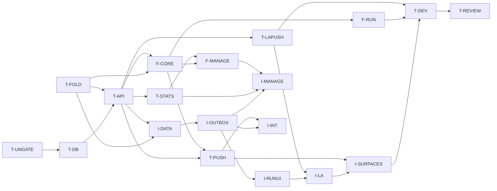

# Plan: timed topics (milestone T)

**Status:** draft, revision 3, 2026-10-23. **Spec:** [timers.md](timers.md).
**Branch:** `feat/timers`; each WP is on its own branch cut from it and merged
back into it. The milestone merges to `main` as one PR and is released with one
`v*` tag. The server, the PWA and the iOS app are updated together; there is
**no compatibility with older builds** (timers.md §12).

**Next:** milestone CV, forced updates ([client-versions.md](client-versions.md)
§8), runs **after** this milestone. Nothing here depends on it.

**Defaults taken, pending the user's final word:** a lap closes the current
segment and opens an unnamed one (timers.md OPEN 1); best and median count
complete runs only (OPEN 2).

## Scope guard

This milestone is the list of work packages below, and nothing else.

- Anything found during implementation that isn't in a WP's scope (a bug in
  existing code, a refactor that would be nice, a missing feature, a better
  design) goes into a **GitHub issue** in `Richard-Lynch/quickr`, labelled
  `timers-followup`, and is linked from the WP's PR. It does **not** go into the
  milestone, and it does not grow a WP. See issue #20 on how earlier milestones
  ballooned.
- A WP may change code outside its listed areas only when the change is needed
  for its acceptance criteria to pass. The PR description names each such change
  and says why.
- If a WP can't meet its criteria without work that belongs to another WP or to
  no WP, it stops and reports to the lead. The lead decides; the WP does not
  absorb the work.
- A spec change needed during implementation is a separate, small docs commit to
  `timers.md`, approved by the lead, before the code that relies on it.
- **No compatibility work** beyond T-UNGATE. A WP that breaks the API records
  the break as T-UNGATE says, and does nothing else for older builds.
- Every WP diff gets a Codex review, as does the milestone at the end.

## Out of scope

These are not in milestone T. Each becomes an issue if the user wants it.

- Any behaviour for builds from before this milestone, and the forced-update
  mechanism (milestone CV, next).
- An Apple Watch app or complications (the system's Smart Stack mirroring of the
  Live Activity is fine, with no work).
- Target durations, countdowns, or alerts when a step runs long.
- Auto-advance by time; steps that start themselves.
- Undoing a Stop, or reopening a stopped run (edit its times instead).
- Editing an open run's times, or back-dating a start from the UI (the API and
  MCP accept a past `at`).
- Turning untimed entries into timed ones, or the reverse.
- Timing columns in the CSV export.
- Per-step questions, nested steps, or branching routines.
- Several open runs of the same topic.
- Pruning old server-side run rows and events.
- The local-notification fallback for reminders (still deferred,
  notifications.md §11).
- A server job that stops or discards abandoned runs.
- Live Activity layouts for Mac, CarPlay or StandBy beyond what the system
  derives.

## Work packages

Effort: S ≈ 15–25 min of agent time, M ≈ 30–45, L ≈ 45–60. Class: **be**
(backend, pytest), **fe** (PWA, vitest), **host** (`swift test`), **sim**
(xcodebuild and simulator; at most 2 at once), **device**. Spec references are
to [timers.md](timers.md).

Every WP:

- keeps `make check` green, and `make check-ios` when it touches `ios/`;
- regenerates fixtures with `make vectors` when it changes their generators, and
  commits the result;
- regenerates `openapi.json` and the TS client when it changes the API.

### T-UNGATE · stop the compat gate blocking this milestone · be · S · first

- **Scope:**
  - `compat/supported-clients.json`: `"clients": []`, the gate's "no old clients
    supported" state. `old clients` and `old requests` then check nothing, and
    `openapi breaking` compares only with the newest `v*` tag. If a script or
    `compat.yml` assumes at least one client, make it accept an empty list (the
    only code change allowed here).
  - `compat/openapi-break-approvals.txt`: a header comment for this milestone.
    Each T WP that breaks the API against the tag adds its own oasdiff lines
    under it, each commented "timers milestone, no old builds supported
    (T-UNGATE)". They are removed after the release tag, as compatibility.md §2
    already says.
  - `docs/ios/specs/compatibility.md`: a dated note under §1: the timers
    milestone supports no earlier build; the list stays empty until a timers
    build is added by the usual TestFlight PR (§5); forced updates come with
    milestone CV.
- **Areas:** `compat/`, `.github/workflows/compat.yml` (only if needed),
  `docs/ios/specs/compatibility.md`.
- **Depends on:** nothing.
- **Acceptance:** the compat workflow is green on the PR with the empty list;
  `compat/client_fixtures.py shas` prints nothing; the note is in place.
- **Tests:** the workflow run on the PR.

### T-DB · migration, models, versioned steps · be · M

- **Scope:** the migration and models of §2: `topic_versions.timer`,
  `entries.timing`, `runs`, `run_events`, `run_aliases`, the `run` feed kind,
  `apns_devices.live_activity_start_token`, `live_activity_tokens`. `Timer` and
  `Step` schemas; `TopicVersionOut.timer`; `timer` **required** on
  `publishTopicVersion` and optional on `createTopic` (§2.1); step-change lines
  in `checkTopicVersion`'s report; the PWA's and iOS's publish requests send
  `timer: <current>` (a small change each, so the tree stays green).
- **Areas:** `backend/alembic/versions/`, `backend/app/models.py`,
  `backend/app/schemas/`, `services/topics.py`, `services/compat.py`,
  `frontend/src/lib/builder.ts`, the iOS builder's publish request.
- **Depends on:** T-UNGATE (the required field breaks the API).
- **Acceptance:** the migration applies and downgrades on a seeded database;
  spec T11; step validation answers 422 with field paths; `builder-vectors.json`
  regenerates with timed cases.
- **Tests:** migration round trip; T11; validation; `checkTopicVersion`.

### T-FOLD · the fold, timing projection, stats math · be · M

- **Scope:** `services/run_fold.py` (§4, no database), the `Timing` projection
  with T1–T5 (§2.3), `fmt_duration`, `services/timing_stats.py` (§9.1, complete
  runs only for best and median). Generators for `run-fold-vectors.json`,
  `timing-stats-vectors.json` and `duration-format-vectors.json`, with every
  case in §13.1; README rows.
- **Areas:** `backend/app/services/`, `backend/tests/`, `shared/fixtures/`.
- **Depends on:** nothing.
- **Acceptance:** every §13.1 case for these files is present and named; a
  property test: for random event sets, every arrival order with the same first
  terminal gives the same state.
- **Tests:** a unit test per rule in §4.2 and §4.4; the property test; drift
  checks.

### T-API · run events, runs, entries, feed · be · L

- **Scope:** `recordRunEvent`, `getRun`, `listRuns` (§3.1–§3.7, §4.5, §5, §6);
  entry creation at stop and finish; late merges; `EntryOut.timing` and
  `updateEntry` with `timing` (§3.8); id reservation (§1.1); topic delete and
  archive rules; the change-log writes and their order (§2.4); the `run` kinds
  in `listChanges` (§7.1); Problem codes (§3.9); API fixtures.
- **Areas:** `backend/app/services/runs.py` (new), `services/entries.py`,
  `services/topics.py`, `services/feed.py`, `services/changes.py`,
  `api/routes.py`, `schemas/api.py`, `errors.py`, `shared/fixtures/api/`,
  `openapi.json`, `frontend/src/api` (regenerated client only).
- **Depends on:** T-DB, T-FOLD.
- **Acceptance:** spec T1–T10 and T13 pass. If the diff is too big to review as
  one, the lead may land the feed change as a second PR of this WP.
- **Tests:** as listed; T2 and T3 with two tasks against one database.

### T-STATS · timing stats endpoint and MCP tools · be · M

- **Scope:** `getTopicTiming` (§9.2) and the MCP tools of §11.6.
- **Areas:** `backend/app/services/` (a `timing.py`), `api/routes.py`,
  `schemas/api.py`, `backend/app/mcp_server.py`, `shared/fixtures/api/`.
- **Depends on:** T-API.
- **Acceptance:** results equal `timing-stats-vectors.json` for the same
  entries; `from`/`to` filter on `captured_at`; each MCP tool round-trips;
  `run_action` reads `seg` from the current state.
- **Tests:** endpoint tests seeded from the vectors; one test per tool.

### T-PUSH · reminders with a Start action, server and service worker · be + fe · M

- **Scope:** the `timed` descriptor, the `start` action and its category hash,
  the scheduler skip (§10.1); new cases in `notification-vectors.json` and
  `apns-payload-vectors.json`; the PWA service worker's `run|start` action with
  the derived run id and the Web Lock (§10.2).
- **Areas:** `backend/app/services/quicklog.py`, `services/notification.py`,
  `services/scheduler.py`, `services/push/`, `shared/fixtures/`,
  `frontend/src/sw.ts`, `frontend/src/lib/pushActions.ts`.
- **Depends on:** T-API, F-CORE (the service worker enqueues the `run.event`
  kind).
- **Acceptance:** T12; timed vector cases; two racing clicks enqueue one start
  whose id equals the action entry id vector.
- **Tests:** scheduler skip, descriptor, payload size, vector drift; vitest in
  the style of `pushActions.test.ts`.

### T-LAPUSH · Live Activity pushes · be · M

- **Scope:** token registration (`registerLiveActivity`, `deleteLiveActivity`,
  `live_activity_start_token` on `registerApnsDevice`); the sender for start,
  update and end after each committed run change (§10.3); token pruning;
  `live-activity-vectors.json`.
- **Areas:** `backend/app/services/push/`, `services/runs.py` (the post-commit
  hook only), `api/routes.py`, `schemas/api.py`, `shared/fixtures/`.
- **Depends on:** T-API.
- **Acceptance:** T15; every payload ≤ 4 KB; APNs is never called inside the
  writer transaction.
- **Tests:** T15 with the MockTransport sender; vector drift.

### F-CORE · PWA fold port, format, outbox kind, run data · fe · M

- **Scope:** `lib/runs/fold.ts`, `lib/runs/format.ts`, the timing chart models,
  the `run.event` outbox kind (§8.1–§8.2), the local run view (§8.3), and the
  open-runs hook with the polling rules (§7.3).
- **Areas:** `frontend/src/lib/runs/` (new), `lib/outbox/`, `lib/hooks.ts`.
- **Depends on:** T-FOLD, T-API.
- **Acceptance:** fold, stats-model and format vectors pass; outbox tests for
  the kind pass; the `classifyStatus` parity test is unchanged.
- **Tests:** vitest as listed.

### F-RUN · PWA run UI · fe · M

- **Scope:** the home tile states, the running bar, the run panel with every
  control and key, Stop then the answers form (`finish` or `entry.update`),
  Discard, the §11.4 notices (§11.5).
- **Areas:** `frontend/src/components/topics/`, `components/runs/` (new),
  `pages/topic/RecordPage.tsx`, `components/AppShell.tsx`.
- **Depends on:** F-CORE.
- **Acceptance:** a scripted component test drives start → Next → Skip → Pause →
  Resume → Stop → answers → Save and checks the requests; a void reply shows the
  right notice.
- **Tests:** component tests per tile state and control.

### F-MANAGE · PWA builder, timing edit and stats · fe · M

- **Scope:** the Timed switch and steps editor; the entry timing section and
  Edit times form; the Timing section of the Overview (§11.5).
- **Areas:** `frontend/src/components/builder/`, `lib/builder.ts`,
  `pages/topic/EntryEditPage.tsx`, `OverviewPage.tsx`, `components/charts/`,
  `components/runs/`.
- **Depends on:** F-CORE, T-STATS.
- **Acceptance:** publish sends the edited `timer`, with keys stable on rename;
  `builder-ui-vectors.json` gains timed cases; an edit that breaks T2–T5 is
  refused in the form with the server's messages; the Overview renders best,
  median and per-step bars from a fixture.
- **Tests:** vitest for the editor, the form and the chart models.

### I-DATA · Swift ports, DTOs, store and feed · host · L

- **Scope:** QuickrCore `RunFold`, `Timing`, `fmtDuration`, timing-stats models;
  DTOs and endpoint-table entries for the new operations; the `run` and
  `run_alias` tables; applying `run` items and deletions in live and staged
  pages (§7.2); run tombstones and their dependent-item rule.
- **Areas:** `ios/QuickrKit/Sources/QuickrCore/Runs/` (new),
  `QuickrData/Contracts/`, `QuickrData/Store/`, `QuickrData/Sync/`,
  `QuickrCore/Models/ChangeFeed.swift`.
- **Depends on:** T-FOLD, T-API.
- **Acceptance:** R1 and R2; every new `api/*.json` fixture decodes; G1 coverage
  passes; every existing sync test passes.
- **Tests:** vector suites; decoding tests; an epoch rebuild with an open run in
  the staged pages.

### I-OUTBOX · the `run.event` kind and the local view · host · M

- **Scope:** the outbox kind with ordering, K6 and classification (§8.1); the
  local run view (§8.3); the write façade every surface uses (start, next, lap,
  skip, pause, resume, stop, finish, discard, auto); request goldens.
- **Areas:** `QuickrData/Outbox/`, `QuickrData/Store/Overlay.swift`,
  `QuickrData/Session/`, `shared/fixtures/requests/`.
- **Depends on:** I-DATA.
- **Acceptance:** R4–R6; the goldens validate in pytest (G2).
- **Tests:** R4–R6.

### I-RUNUI · tile, run screen, Stop flow · sim · L

- **Scope:** the home tile states, the run screen, Stop and the answers sheet,
  Discard, notices, the "Running" and "Add details" home states, the badge rule
  (§11.1, §11.2, §11.4), and the `quickr://t/{topic_id}/run` link.
- **Areas:** `ios/App/Home/`, `ios/App/Runs/` (new), `ios/App/Navigation/`,
  `QuickrUI/`.
- **Depends on:** I-OUTBOX.
- **Acceptance:** R10; the badge excludes a topic with an open run.
- **Tests:** R10; unit tests of the tile's state mapping.

### I-MANAGE · iOS builder, timing edit and stats · sim · M

- **Scope:** the Timed switch and steps editor; the entry timing section and
  Edit times; the Timing section of the Overview (§11.2).
- **Areas:** `ios/App/Topics/Builder/`, `QuickrCore/Builder/`,
  `ios/App/Entries/`, `ios/App/Stats/`.
- **Depends on:** I-OUTBOX, T-STATS, F-MANAGE (the shared builder vectors).
- **Acceptance:** `BuilderVectorTests` pass with the timed cases; R11.
- **Tests:** vector tests; R11; one UI test that publishes a timed topic.

### I-LA · the Live Activity · sim · L

- **Scope:** `RunActivityAttributes` and its content state; Lock Screen and
  Dynamic Island views; the `LiveActivityIntent` buttons; local start, update
  and end; reconciliation; token registration; the Settings switch (§10.3);
  `LiveActivityVectorTests`.
- **Areas:** `ios/Widgets/` (activity views), `ios/App/LiveActivity/` (new),
  `QuickrData/Intents/`, `ios/App/Settings/`, `ios/project.yml`
  (`NSSupportsLiveActivities`, `NSSupportsLiveActivitiesFrequentUpdates`).
- **Depends on:** I-RUNUI, T-LAPUSH.
- **Acceptance:** R9; the vector suite passes; previews for running, paused,
  last step, no steps, finishing and ended.
- **Tests:** R9; the vector suite; a preview or snapshot test per state.

### I-SURFACES · widgets, Control, Action button, Siri, notification Start · sim · L

- **Scope:** the timed widget states and buttons, the Control,
  `AdvanceRunIntent` with Auto, the App Shortcuts and spoken results (§11.3);
  the `start` kind in category rendering and hashing, the handler path with the
  derived run id, and the NSE (§10.2).
- **Areas:** `ios/Widgets/`, `ios/App/Intents/`, `QuickrData/Intents/`,
  `QuickrData/Notifications/`, `ios/App/Notifications/Handler/`,
  `ios/NotificationService/`.
- **Depends on:** I-LA, T-PUSH.
- **Acceptance:** intent tests for each phrase's outcome (idle, running, last
  step, several open runs, finishing); timed notification vectors pass (N1); a
  second Start on the same reminder writes nothing.
- **Tests:** as listed, in `IntentsTests` and in the style of N3, N7 and N16.

### I-INT · integration and multi-process · host + be · M

- **Scope:** R6 under real subprocesses; R7 and R8 against the docker stack
  (`make ios-integration`).
- **Areas:** `ios/QuickrKit/Tests/QuickrDataTests/Integration/`,
  `MultiProcess/`.
- **Depends on:** I-OUTBOX, T-PUSH.
- **Acceptance:** R6–R8 pass locally; the run is recorded in the PR.
- **Tests:** as listed.

### T-DEV · device validation · device · S

- **Scope:** the checks of §13.5 on a device, with a recording of each in
  `docs/ios/demo/timers/`.
- **Depends on:** I-SURFACES, F-RUN, T-LAPUSH.
- **Acceptance:** each check passes, or has an issue filed with what was seen.

### T-REVIEW · milestone review · docs · S

- **Scope:** Codex review of the milestone diff against the spec; fixes for
  findings inside a WP's scope; issues for the rest.
- **Depends on:** every other WP.
- **Acceptance:** no open finding inside scope; every other finding has an
  issue.

## DAG

| WP         | Depends on                  | Class     | Effort |
| ---------- | --------------------------- | --------- | ------ |
| T-UNGATE   | —                           | be        | S      |
| T-DB       | T-UNGATE                    | be        | M      |
| T-FOLD     | —                           | be        | M      |
| T-API      | T-DB, T-FOLD                | be        | L      |
| T-STATS    | T-API                       | be        | M      |
| T-PUSH     | T-API, F-CORE               | be + fe   | M      |
| T-LAPUSH   | T-API                       | be        | M      |
| F-CORE     | T-FOLD, T-API               | fe        | M      |
| F-RUN      | F-CORE                      | fe        | M      |
| F-MANAGE   | F-CORE, T-STATS             | fe        | M      |
| I-DATA     | T-FOLD, T-API               | host      | L      |
| I-OUTBOX   | I-DATA                      | host      | M      |
| I-RUNUI    | I-OUTBOX                    | sim       | L      |
| I-MANAGE   | I-OUTBOX, T-STATS, F-MANAGE | sim       | M      |
| I-LA       | I-RUNUI, T-LAPUSH           | sim       | L      |
| I-SURFACES | I-LA, T-PUSH                | sim       | L      |
| I-INT      | I-OUTBOX, T-PUSH            | host + be | M      |
| T-DEV      | I-SURFACES, F-RUN, T-LAPUSH | device    | S      |
| T-REVIEW   | all                         | docs      | S      |

**Critical path:** T-UNGATE → T-DB → T-API (with T-FOLD beside it) → I-DATA →
I-OUTBOX → I-RUNUI → I-LA → I-SURFACES → T-DEV → T-REVIEW. Backend and PWA work
runs beside it. The sim WPs (I-RUNUI, I-MANAGE, I-LA, I-SURFACES) share the two
simulator slots.

**First wave:** T-UNGATE and T-FOLD.

## Before starting

- The user confirms, or overrides, the two defaults above. Only T-FOLD and
  T-STATS depend on them.
- The spec gets a Codex review before T-API starts; findings go into the spec,
  not into WPs.
