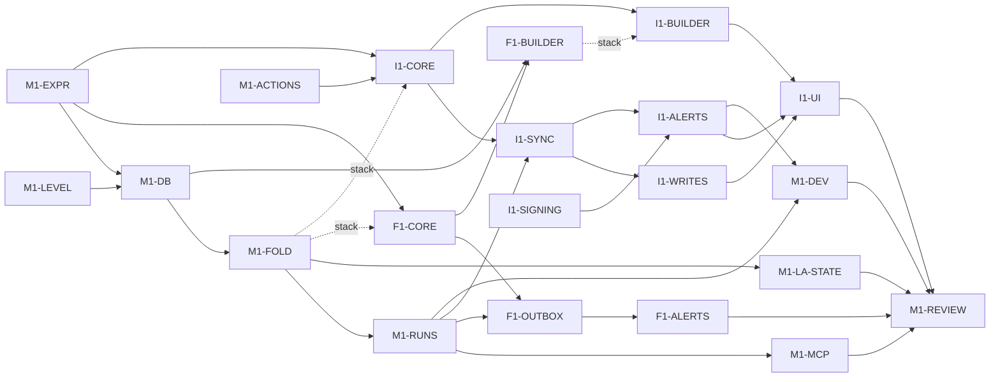

# Plan: M1 · timers v2

**Status:** draft (revision 1, 2026-11-25). **Spec:**
[timers2.md](../specs/timers2.md). **Programme plan:**
[t2-plan.md](../specs/t2-plan.md); its scope guard, out-of-scope list, merge
ritual, seams and ownership table, simulator budget, effort legend and open
questions apply here unchanged. **Branch:** `t2/m1` off `feat/t2`; WP branches
`t2/m1-<wp>`, one worktree each under `/Users/richie/code/quickr-worktrees/`.
**Lead:** M1 lead with sub-leads A (server + ports) and B (builder + alerts).
**Evidence:** `docs/t2/evidence/M1.md` and `docs/t2/evidence/M1/` (below).

## Definition of done (every WP)

A WP is done when its **Acceptance** holds, the tests its **DoD** names pass,
and the evidence is in the PR description (team rules, "Definition of done and
proof"):

- the commands run, with pass/fail counts copied from the output;
- for iOS, the xcresult path and the test count (a plan with 0 tests run is a
  failure); for host runs, the `swift test` summary line;
- the Codex review file (`codex -o` output committed under the WP's worktree and
  attached to the PR) and how each finding was resolved;
- the CI run link; `make check` (and `make check-ios` when `ios/` changed)
  green, no skipped or disabled tests;
- for UI WPs, screenshots under `docs/t2/evidence/M1/` (iOS light and dark, a
  large Dynamic Type check, the Live Activity/widget states where relevant, PWA
  mobile width) and a short GIF/MP4 for interaction flows;
- anything found outside scope filed as a `t2-followup` issue and linked.

Friction is logged as it happens to
`/Users/richie/code/quickr-worktrees/_friction/<agent-name>.jsonl` (format in
`_friction/README.md`); never edit another agent's file.

**Brief.** Timer config v2 (lap types, variables, alerts with an expression
grammar), fold v4, the `reopen` and `remove` events, run resurrection in the
feed without tombstones, timing stats v3, Live Activity state additions, alert
scheduling on iOS (local notifications) and in the PWA (while open), builder and
outbox ports on both clients, and the one `api_level` bump. Brief §1 throughout;
the M1↔M2 seam is active-surfaces.md §1.

### M1-LEVEL · api_level 2, supported clients, suites · be · S · A · first

- **Scope:** `shared/api-level.json` → `api_level 2`,
  `min_client_level.ios = .web = 2`; `make api-level`;
  `compat/supported-clients.json`: `"clients": []` (both listed builds are below
  the minimum) and `LiveActivityVectorTests` appended to `suites` (issue #111);
  `compat/openapi-break-approvals.txt`: a header comment for T2 (M1 WPs add
  their oasdiff lines under it, each commented "T2 M1, api_level 2");
  `docs/ios/specs/compatibility.md` dated note under §1; `make vectors` (the
  `getClientVersions` fixture).
- **Areas:** `shared/api-level.json`, `compat/`, generated level files,
  `docs/ios/specs/compatibility.md`,
  `shared/fixtures/api/getClientVersions.json`.
- **Depends on:** nothing.
- **Acceptance:** `python3 compat/api_level.py bumped v0.3.1` succeeds;
  `python3 compat/client_fixtures.py shas` prints nothing; the `api level`,
  `old clients` and `openapi breaking` jobs are green on the PR;
  `compat/api_level.py check HEAD^1` passes (exactly +1).
- **Tests:** the compat workflow on the PR; existing `test_client_versions`
  reads the new levels.
- **DoD:** the Acceptance above holds, proven by the compat workflow on the PR;
  existing `test_client_versions` reads the new levels. Evidence in the PR:
  `cd backend && uv run pytest -q <the files above>` pass counts; when
  generators or fixtures change, the `make vectors` diff is in the PR; migration
  WPs paste the `alembic upgrade head` and `downgrade` output; the Codex review
  file with each finding resolved or justified; the CI run link.

### M1-EXPR · expression grammar and vectors · be · M · A · first

- **Scope:** `backend/app/services/timer_expr.py`: tokenizer, recursive-descent
  parser for timers2.md §2, typed evaluation (duration/number), error codes
  `syntax`, `unknown_variable`, `type`, `negative`, `too_long`, `div_zero` with
  `pos`; truncation to whole ms; limits 7 d and 64 chars. Generator
  `backend/tests/test_timer_expr_vectors.py` →
  `shared/fixtures/timer-expr-vectors.json`
  (`{expr, variables, expected: {ms} | {error, pos}}`, ≥ 25 cases: `t*0.5`,
  `t/2`, `t+30s`, `(t/2)+30s`, `1.5m`, `90s`, precedence `t+30s*2`, unary minus
  `-(t-90s)` negative error, case-insensitivity `T/2`, each type error,
  `number op number` scalar then times a duration, overflow past 7 d, division
  by zero, a bare number (OQ-5 error), whitespace, unknown identifier, 65-char
  expression). `shared/fixtures/README.md` row.
- **Areas:** `backend/app/services/`, `backend/tests/`, `shared/fixtures/`.
- **Depends on:** nothing.
- **Acceptance:** timers2.md T29: every §2.5 case evaluates as listed; the
  vector file is generated and drift-checked; the error `pos` points at the
  offending token.
- **Tests:** unit tests per grammar rule and per error code; a property test
  (random well-typed expressions evaluate to the same ms as a direct
  computation); vector drift.
- **DoD:** the Acceptance above holds, proven by unit tests per grammar rule and
  per error code; a property test (random well-typed expressions evaluate to the
  same ms as a direct computation); vector drift. Evidence in the PR:
  `cd backend && uv run pytest -q <the files above>` pass counts; when
  generators or fixtures change, the `make vectors` diff is in the PR; migration
  WPs paste the `alembic upgrade head` and `downgrade` output; the Codex review
  file with each finding resolved or justified; the CI run link.

### M1-DB · migration, models, Timer v2 schemas, limits · be · M · A

- **Scope:** `backend/alembic/versions/20261126_e6f3a9b4c215_timers_v2.py`:
  `run_event_type` gains `reopen`, `remove` (autocommit block);
  `run_events.target_id UUID NULL`; data migration
  `DELETE FROM deleted_ids WHERE kind='run' AND id IN (SELECT id FROM runs WHERE status='stopped')`
  (timers2.md §4.3). `models.py` (`RunEvent.target_id`, enum).
  `schemas/questions.py`: `Timer {steps, laps, variables}`, `Step.alerts`,
  `LapType`, `Variable`, `Alert` with `at_ms` output-only; shared key namespace
  for steps and lap types; variable names lowercased; `at` validated through
  `timer_expr` against the timer's variables; normalised output (`[]` defaults,
  `at_ms` filled); v1 `{steps}` parses in stored context. Limits in `limits.py`
  and `Limits`: `max_steps 30`, `max_lap_types 8`, `max_variables 16`,
  `max_alerts 8`, `max_expr_length 64`, `max_var_name_length 16`,
  `max_short_label_length` (timers2.md §1.2); `GET /limits`; mirrors
  `frontend/src/api/limits.ts` `FALLBACK_LIMITS`,
  `QuickrCore/Models/ServerInfo.swift` `Limits.serverDefaults`,
  `shared/fixtures/api/getLimits.json`. `openapi.json`, `make client`.
- **Areas:** `backend/alembic/versions/`, `backend/app/models.py`,
  `backend/app/schemas/{questions,limits,api}.py`, the three limits mirrors,
  `compat/openapi-break-approvals.txt`.
- **Depends on:** M1-LEVEL, M1-EXPR.
- **Acceptance:** `tests/test_migrations.py` applies and downgrades on a seeded
  database (the enum rebuild on downgrade is tested); after upgrade no
  `deleted_ids` row remains for a stopped run; a v1 topic version's `timer`
  reads back as v2 with `laps: []`, `variables: []`, `alerts: []`; 422 paths
  such as `laps.1.alerts.0.at`, `laps.2.key` (duplicate of a step key),
  `variables.0.name`; `GET /limits` carries the new rows and the three mirrors
  equal it (timers2.md T26, T28).
- **Tests:** migration round trip; `tests/test_timer_schema.py` (new) for every
  validation rule and the normalisation; limits fixture drift. The
  `builder-vectors.json` `timers[]` v2 cases are generated in I1-BUILDER (same
  milestone), which lands the Swift validation port in the same PR, so the iOS
  gate never sees cases it can't check.
- **DoD:** the Acceptance above holds, proven by migration round trip;
  `tests/test_timer_schema.py` (new) for every validation rule and the
  normalisation; limits fixture drift. The `builder-vectors.json` `timers[]` v2
  cases are generated in I1-BUILDER (same milestone), which lands the Swift
  validation port in the same PR, so the iOS gate never sees cases it can't
  check. Evidence in the PR: `cd backend && uv run pytest -q <the files above>`
  pass counts; when generators or fixtures change, the `make vectors` diff is in
  the PR; migration WPs paste the `alembic upgrade head` and `downgrade` output;
  the Codex review file with each finding resolved or justified; the CI run
  link.

### M1-FOLD · fold v4, run-fold vectors v4, timing stats v3 · be · L · A · stack base

- **Scope:** `services/run_fold.py`: input `timer` (steps + laps) instead of
  `steps`; lap typing and labels (timers2.md §3.2, OQ-3 per-type numbering);
  `Segment`/`OpenSegment.lap_type`; `RunState.terminal_id`, `next_lap_type`,
  `lap_count`; pass 1 and pass 2 rules for `reopen` and `remove` (timers2.md
  §3.4), including the `seg` guard with removed laps, the gap pause, the revert
  on discard (OQ-2), the void reasons `reverted`, `not_stopped`, `deleted`,
  `no_target`; `TimingSegment.lap_type`. `services/timing_stats.py`:
  `lap_types[]` (`key, label, laps, best_ms, median_ms, mean_ms`) and
  `SeriesPoint.lap_types`. Generators: `test_run_fold_vectors.py`
  `GENERATOR_VERSION 4`, `step_sets` → `timer_sets` (`none`, `two`, `three`,
  `renamed`, `tiktok`, `three_types`), new cases for the seven worked examples
  of timers2.md §6 plus `reopen-not-stopped`, `reopen-stale`,
  `reopen-after-discard`, `remove-twice`, `remove-step-no-target`,
  `remove-gap-pause`, `remove-lap-flips-types`, `seg-guard-after-removed-lap`,
  `reopen-waits-for-start`; `test_timing_stats_vectors.py` `GENERATOR_VERSION 3`
  with `versions: {"1": timer}` and typed cases (`tiktok-three-runs`,
  `renamed-laps`, `mixed-untyped`). (This WP is the brief's "M1-STATS".)
- **Areas:** `backend/app/services/run_fold.py`, `timing_stats.py`,
  `backend/tests/`, `shared/fixtures/run-fold-vectors.json`,
  `timing-stats-vectors.json`, `shared/fixtures/README.md`.
- **Depends on:** M1-DB (the `Timer` schema). Stack: F1-CORE and I1-CORE branch
  from `t2/m1-fold` and merge into it; `t2/m1-fold` merges into `t2/m1` when all
  three are green.
- **Acceptance:** every timers2.md §6 worked example is a named vector with the
  event table in the case's `doc`; the property test from milestone T still
  holds (any arrival order with the same first terminal gives the same state;
  segment sums equal totals) extended with `reopen`/`remove` in the event set;
  the `seg` guard counts a removed lap the tapping device saw; a removed lap
  renumbers and retypes later laps.
- **Tests:** a unit test per new rule; the property test; vector drift and the
  coverage test (`test_run_fold_vectors.py:458` style) listing every case name
  the spec requires.
- **DoD:** the Acceptance above holds, proven by a unit test per new rule; the
  property test; vector drift and the coverage test
  (`test_run_fold_vectors.py:458` style) listing every case name the spec
  requires. Evidence in the PR:
  `cd backend && uv run pytest -q <the files above>` pass counts; when
  generators or fixtures change, the `make vectors` diff is in the PR; migration
  WPs paste the `alembic upgrade head` and `downgrade` output; the Codex review
  file with each finding resolved or justified; the CI run link.

### M1-RUNS · reopen and remove write path, feed, fixtures · be · L · A

- **Scope:** `RunEventIn.type` gains `reopen`, `remove`; `RunEventIn.target`;
  `_REQUIRED_FOR` (`target` for both); `RunEventOut.target`; `_decide`
  precedence unchanged with the new terminal rules; `_apply_folded` branches
  **reopen** (status follows the fold, `ended_at = NULL`, `revision += 1`,
  `log_change(run, upsert)`, entry stays; `ux_runs_one_open` → 409 `conflict`),
  **re-stop** (entry timing replaced, `captured_at = ended_at`, answers merged
  as a `finish`, entry revision += 1, `(entry, upsert)`, then `(run, delete)`,
  never `finishing`), **revert** (entry logged only if its timing changed);
  `remove` as a late merge on a stopped unedited run (`_merge_into_entry`,
  `edited` stays false); `reopen`/`remove` exempt from `after_stop` and
  `_check_stop_at`; `_close` on a stop logs `(run, delete)` only and writes no
  tombstone; `deleted_ids(kind=run)` only on discard and topic delete;
  `changes.py` doc comment and `_LIVE` handling of a run that came back;
  `after_run_event` treats an applied reopen as a start for Live Activity
  pushes. API fixtures per timers2.md §12.1: `recordRunEvent.reopen`,
  `recordRunEvent.restop`, `recordRunEvent.remove`, `recordRunEvent.remove_late`
  and the void cases; `openapi.json`, `make client`; the minimal Swift change:
  `RunDTO` decodes `target` and the two new types (`FixtureCoverageTests`). The
  request goldens list for I1-SYNC: `recordRunEvent.reopen`,
  `recordRunEvent.remove`; I1-BUILDER adds `publishTopicVersion.timer_v2`.
- **Areas:** `backend/app/services/runs.py`, `changes.py`, `entries.py`
  (`is_run_id`, `_existing` replay), `schemas/api.py`, `errors.py`,
  `backend/tests/test_runs*.py`, `test_feed_runs.py`, `shared/fixtures/api/`,
  `QuickrData/Contracts/RunDTO.swift` (decode only).
- **Depends on:** M1-DB, M1-FOLD.
- **Acceptance:** timers2.md **T18–T27**, in detail: T1 extended (every v4
  vector through the endpoint gives the fold's state and effects, T18); T6 (a
  late Next after stop still bumps the entry only); **T7/T8 rewritten** (T27): a
  stop produces `(entry upsert, run delete)` without a tombstone, a reopen
  produces a later `(run upsert)` for the same id, bootstrap still omits closed
  runs, the page-cut rule holds across stop → reopen → re-stop; T13
  (`createEntry` with a reopened run's id replays the entry); T15 (discard on a
  reopened run reverts: status `stopped`, `ended_at` restored, `(run, delete)`
  logged); reopen on a topic with another open run answers 409 `conflict` and
  stores nothing; `remove` of a pause on a stopped run bumps the entry revision
  and leaves `edited` false; a reopened run's device gets no push, other
  devices' start tokens get a `start` (timers.md T14 extended).
- **Tests:** as listed, in `test_runs_reopen.py` (new) and the updated
  `test_feed_runs.py`; T2/T3-style concurrency for two reopens of one stop (one
  applied, one `not_stopped`).
- **DoD:** the Acceptance above holds, proven by as listed, in
  `test_runs_reopen.py` (new) and the updated `test_feed_runs.py`; T2/T3-style
  concurrency for two reopens of one stop (one applied, one `not_stopped`).
  Evidence in the PR: `cd backend && uv run pytest -q <the files above>` pass
  counts; when generators or fixtures change, the `make vectors` diff is in the
  PR; migration WPs paste the `alembic upgrade head` and `downgrade` output; the
  Codex review file with each finding resolved or justified; the CI run link.

### M1-LA-STATE · Live Activity content state additions · be + host · M · A

- **Scope:** `push/live_activity.py` `content_state` gains `lap_type`,
  `next_label` for laps, `lap_count`, `alert_at` (seconds, server clock, from
  active time; null while paused or when none remain), `alert_label`,
  `terminal_id`; `CONTENT_STATE_VERSION` stays 1. Generator
  `test_live_activity_vectors.py` `GENERATOR_VERSION 3`, `step_sets` →
  `timer_sets`, new cases `update_tiktok_lap`, `update_alert_pending`,
  `update_alert_paused`, `start_renamed_laps`, `update_reopened`. Minimal Swift:
  the optional fields on `RunActivityState` in
  `QuickrCore/Runs/RunActivity.swift` so `LiveActivityVectorTests` round-trips;
  `RunActivityContent.state(...)` fills them from the local fold.
- **Areas:** `backend/app/services/push/live_activity.py`,
  `backend/tests/test_live_activity_vectors.py`,
  `shared/fixtures/live-activity-vectors.json`,
  `QuickrCore/Runs/RunActivity.swift`,
  `QuickrCoreTests/Runs/LiveActivityVectorTests.swift`.
- **Depends on:** M1-FOLD (merged); M1-RUNS for the reopen push rule only
  (tested there).
- **Acceptance:** timers2.md T30: every payload ≤ 4 KB including the longest
  labels; `alert_at` is null while paused and advances by the pause length on
  resume; the Swift suite decodes every case and re-encodes byte-equal content
  state.
- **Tests:** generator cases; `LiveActivityVectorTests`; a unit test for
  `alert_at` with paused overlap.
- **DoD:** the Acceptance above holds, proven by generator cases;
  `LiveActivityVectorTests`; a unit test for `alert_at` with paused overlap.
  Evidence in the PR: `cd backend && uv run pytest -q <the files above>` pass
  counts; when generators or fixtures change, the `make vectors` diff is in the
  PR; migration WPs paste the `alembic upgrade head` and `downgrade` output;
  `cd ios/QuickrKit && swift test --filter <the suites above>` summary lines
  with counts (plus `make ios-core-test` once); the Codex review file with each
  finding resolved or justified; the CI run link.

### M1-MCP · MCP tools and `getTopicTiming` lap types · be · M · A

- **Scope:** `mcp_server.py`: `run_action` gains `reopen` (target defaults to
  `state.terminal_id`) and `remove` (new `target` param); new `get_run`
  (timers2.md §7.3);
  `create_topic`/`publish_topic_version`/`check_topic_version` accept the v2
  `Timer`; `check_topic_version` gains `timer`; `INSTRUCTIONS` prose.
  `timing.py` / `TopicTiming` schema: `lap_types[]` and `SeriesPoint.lap_types`
  from `timing_stats` v3; API fixture `getTopicTiming` regenerated with a typed
  topic; `openapi.json`, `make client`; minimal Swift: `TimingStats.swift` port
  lands in I1-CORE (stack), so this WP merges after the M1-FOLD stack.
- **Areas:** `backend/app/mcp_server.py`, `services/timing.py`,
  `schemas/api.py`, `shared/fixtures/api/getTopicTiming.json`.
- **Depends on:** M1-RUNS, M1-FOLD stack merged.
- **Acceptance:** timers2.md T31–T33: each new tool path round-trips against a
  test DB; `run_action reopen` on a running run answers `InvalidRequest` with
  the reason; `getTopicTiming` equals `timing-stats-vectors.json` v3 for seeded
  entries; an untyped topic answers `lap_types: []`; `test_identity.py`
  `_mutations` gains no operation.
- **Tests:** one test per tool action; endpoint tests seeded from the vectors.
- **DoD:** the Acceptance above holds, proven by one test per tool action;
  endpoint tests seeded from the vectors. Evidence in the PR:
  `cd backend && uv run pytest -q <the files above>` pass counts; when
  generators or fixtures change, the `make vectors` diff is in the PR; migration
  WPs paste the `alembic upgrade head` and `downgrade` output; the Codex review
  file with each finding resolved or justified; the CI run link.

### M1-ACTIONS · the `RunAction` enum stub · host + fe · S · B · first (shared with M2)

- **Scope:** iOS `QuickrCore/Runs/RunPresentation.swift`: `enum RunAction.Kind`
  (`start, next(label), lap(nextTypeLabel?), skip(label), pause, resume, stop, addDetails, reopen, revert, discard`),
  `RunAction {kind, role: primary|secondary|destructive|overflow, enabled}`,
  `actions(run:timer:now:) -> [RunAction]` producing **today's** actions with
  the primary rule of active-surfaces.md §1.2 (Lap primary when the open segment
  is a lap or steps are exhausted; else Next; Stop secondary; Pause/Resume
  secondary; Skip and Discard overflow), `headline(run)`,
  `alertLine(run:now:) -> String?` (nil until I1-CORE),
  `resumable(entry:now:) -> Bool` (false until I1-WRITES). **The Auto/primary
  rule is M1-ACTIONS's:** primary = Lap (labelled with the next lap type) when
  `timer.laps` is non-empty, else the v1 rule; `RunWrites.auto` (Controls, Siri,
  Action button) and the PWA auto path follow `actions(...).primary`, so M2
  never patches `RunWrites.swift`. PWA `src/components/runs/model.ts`: the same
  `RunAction` type and `actions(view, timer, now)`. The `reopen`/`revert` kinds
  exist in the enum from day one so M2's role-based rendering needs no later
  layout edit.
- **Areas:** `QuickrCore/Runs/RunPresentation.swift`,
  `QuickrCoreTests/Runs/RunPresentationTests.swift`,
  `frontend/src/components/runs/model.ts`, `model.test.ts`.
- **Depends on:** nothing. Cut from `feat/t2`; merged into `t2/m1` and `t2/m2`.
- **Acceptance:** timers2.md R18 (stub half): the action list for idle, running
  on a step, running on a lap, last step, no steps, paused, finishing matches a
  table in active-surfaces.md; the existing `Primary`/`useRunPrimary` callers
  are left in place (M2 removes them).
- **Tests:** a table-driven test per platform over the seven states.
- **DoD:** the Acceptance above holds, proven by a table-driven test per
  platform over the seven states. Evidence in the PR:
  `pnpm exec vitest run <the tests above>` pass counts and a green
  `make check-frontend`;
  `cd ios/QuickrKit && swift test --filter <the suites above>` summary lines
  with counts (plus `make ios-core-test` once); the Codex review file with each
  finding resolved or justified; the CI run link.

### I1-SIGNING · time-sensitive entitlement in the signing path · host · S · B · first

- **Scope:** verify that the Time Sensitive Notifications capability is enabled
  on the App ID and present in the provisioning profile that
  `.github/workflows/testflight.yml` / `.github/actions/testflight-setup` use
  (automatic provisioning with the App Store Connect API key vs a manual
  profile); add `com.apple.developer.usernotifications.time-sensitive` to the
  entitlements block of `ios/project.yml` (`// T2-M1` block) and build an
  archive the way the workflow does (`make ios-gen`, `xcodebuild archive` with
  the workflow's signing settings, or a CI run of `testflight.yml` on the WP
  branch if the orchestrator allows). If the capability cannot be added without
  the user's Apple Developer portal access: set the fallback
  `interruptionLevel = .active` in `RunAlerts` (I1-ALERTS reads a single
  constant), add the portal step to `docs/t2/device-checklist.md`, and tell the
  orchestrator immediately (OQ-6 rider).
- **Areas:** `ios/project.yml`, `.github/workflows/testflight.yml` (read only
  unless the profile must change), `docs/t2/device-checklist.md`.
- **Depends on:** nothing.
- **Acceptance:** a TestFlight-style archive signs with the entitlement
  (`codesign -d --entitlements :- <app>` shows it), or the `.active` fallback is
  in place with the portal step documented and the orchestrator informed.
- **Tests:** the archive/signing log in the PR; `make check-ios` still green
  (the entitlement changes no test).
- **DoD:** the Acceptance above holds, proven by the signing log and the
  `codesign` output pasted in the PR. Evidence in the PR: the archive command
  and its result; the Codex review file; the CI run link; when the fallback is
  taken, the checklist diff and the message to the orchestrator.

### F1-CORE · PWA fold, expression, types and stats ports · fe · L · A · stacked on M1-FOLD

- **Scope:** `src/lib/runs/types.ts` (Timer v2, `lap_type`, `terminal_id`,
  `next_lap_type`, `lap_count`, new event types and void reasons, `target`),
  `fold.ts` v4 (lap typing, reopen, remove, `seg` guard), new `timerExpr.ts`,
  `stats.ts` v3; vector suites `runFold.vectors.test.ts`,
  `timingStats.vectors.test.ts`, new `timerExpr.vectors.test.ts`.
- **Areas:** `frontend/src/lib/runs/`.
- **Depends on:** M1-FOLD (stack), M1-EXPR.
- **Acceptance:** all three vector files pass; no `Date` arithmetic in the fold.
- **Tests:** vector suites; `timerExpr.test.ts` for the error positions.
- **DoD:** the Acceptance above holds, proven by vector suites;
  `timerExpr.test.ts` for the error positions. Evidence in the PR:
  `pnpm exec vitest run <the tests above>` pass counts and a green
  `make check-frontend`; the Codex review file with each finding resolved or
  justified; the CI run link.

### F1-OUTBOX · PWA actions, local view, kinds, notices, runs cache · fe · M · A

- **Scope:** `actions.ts` (`TapType` `reopen`/`remove`, `targetOf` from
  `terminal_id` or the chosen event id, `makesEntry` for re-stop),
  `localView.ts` (`overlay` lap labelling from the version's timer, `statusOf`
  for a reopened run, optimistic entry hidden while its run is open: OQ-14),
  `kinds.ts` (`waitsFor`: reopen/remove wait for the start; no new rules),
  `notices.ts` (`reverted`, `deleted`, `not_stopped`, `no_target`),
  `src/api/runs.ts` revision-aware closed-run tombstones (a listed run with a
  higher revision than the one that closed wins), `useRuns.ts`,
  `src/test/fakeRunServer.ts` (reopen/remove, another device's reopen).
- **Areas:** `frontend/src/lib/runs/`, `src/lib/outbox/kinds.ts`,
  `src/api/runs.ts`, `src/test/fakeRunServer.ts`.
- **Depends on:** F1-CORE, M1-RUNS.
- **Acceptance:** a queued reopen shows the run open at once and waits in the
  outbox for the run's start **and** for the queued item whose id equals its
  `target` (timers2.md §5.5): a reopen enqueued behind a retrying stop is sent
  only after the stop acks; the same for `remove`; a run deletion followed by an
  upsert re-lists the run; a void `not_stopped` reply shows the right notice;
  `classifyStatus` parity test unchanged.
- **Tests:** `actions.test.ts`, `localView.test.ts`, `runEvent.test.ts`,
  `notices.test.ts`, `runs.test.ts` (cache) with the new cases.
- **DoD:** the Acceptance above holds, proven by `actions.test.ts`,
  `localView.test.ts`, `runEvent.test.ts`, `notices.test.ts`, `runs.test.ts`
  (cache) with the new cases. Evidence in the PR:
  `pnpm exec vitest run <the tests above>` pass counts and a green
  `make check-frontend`; the Codex review file with each finding resolved or
  justified; the CI run link.

### F1-BUILDER · PWA builder for Timer v2 · fe · L · B · stack base

- **Scope:** `src/lib/builder.ts` (draft lap types, variables, alerts per step
  and lap type; zod schemas taking `limits`; key derivation shares the step
  namespace; `timer_output` v2; `timer_changes` text), `TimerEditor.tsx` + new
  `LapTypesEditor.tsx`, `VariablesEditor.tsx`, `AlertsEditor.tsx` (live
  evaluation with `timerExpr.ts`, server 422 paths mapped by `serverErrors.ts`),
  `EditQuestionsPage.tsx` review section; `builderUi.vectors.test.ts` new
  sections `new_lap_type`, `lap_type_label`, `variable`, `alert_expr`, and
  `timer_output`/`timer_changes` v2 → `shared/fixtures/builder-ui-vectors.json`.
- **Areas:** `frontend/src/lib/builder.ts`, `src/components/builder/`,
  `src/pages/topic/EditQuestionsPage.tsx`, `src/lib/builderUi.vectors.test.ts`.
- **Depends on:** M1-DB (schema, client, limits), F1-CORE (`timerExpr.ts`).
  Stack: I1-BUILDER branches from `t2/m1-builder-fe` and merges into it.
- **Acceptance:** publish sends a normalised v2 `timer`; keys stay stable on
  rename; an invalid expression shows the server's message at the right field
  before and after submit; the new vector sections exist and the Swift consumer
  (I1-BUILDER) passes them.
- **Tests:** `builder.test.ts`, `TimerEditor.test.tsx` (new),
  `EditQuestionsPage.test.tsx`, vector generation.
- **DoD:** the Acceptance above holds, proven by `builder.test.ts`,
  `TimerEditor.test.tsx` (new), `EditQuestionsPage.test.tsx`, vector generation.
  Evidence in the PR: `pnpm exec vitest run <the tests above>` pass counts and a
  green `make check-frontend`; the Codex review file with each finding resolved
  or justified; the CI run link. UI WP: PWA mobile-width screenshots of the lap
  types, variables and alerts editors (light/dark) under `docs/t2/evidence/M1/`.

### F1-ALERTS · PWA alerts while open · fe · M · B

- **Scope:** `src/lib/runs/alerts.ts` (pure planner: next alert instant for the
  open segment from `LocalRun` + timer + server clock; none while paused),
  `src/components/runs/RunAlerts.tsx` (one `setTimeout` to the next alert,
  recompute on LocalRun change and `visibilitychange`; fires toast,
  `navigator.vibrate([200,100,200])`, a short Web Audio tone (OQ-13) from an
  `AudioContext` unlocked in `useRunActions.ts` on Start/Lap,
  `registration.showNotification` when granted), mounted in `AppShell.tsx`
  (patch to M2's file, one line), a global mute in `AppSettingsPage.tsx`
  (localStorage).
- **Areas:** `frontend/src/lib/runs/alerts.ts`,
  `src/components/runs/RunAlerts.tsx`, `src/components/runs/useRunActions.ts`,
  `src/pages/AppSettingsPage.tsx`, `src/components/AppShell.tsx` (mount only).
- **Depends on:** F1-CORE, F1-OUTBOX.
- **Acceptance:** with fake timers, a 60 s rest lap with alerts at `t/2` and `t`
  fires at 30 s and 60 s of active time, shifts by a 10 s pause, cancels on
  stop; mute suppresses sound and vibration but not the toast; nothing fires
  when the page is hidden and the tab resumes with the next pending alert.
- **Tests:** `alerts.test.ts`, `RunAlerts.test.tsx`.
- **DoD:** the Acceptance above holds, proven by `alerts.test.ts`,
  `RunAlerts.test.tsx`. Evidence in the PR:
  `pnpm exec vitest run <the tests above>` pass counts and a green
  `make check-frontend`; the Codex review file with each finding resolved or
  justified; the CI run link. UI WP: a short recording of the alert toast firing
  at mobile width.

### I1-CORE · Swift ports and DTOs · host · L · A · stacked on M1-FOLD

- **Scope:** `QuickrCore/Models/Topic.swift` `TopicTimer` v2 Codable (defaults
  for v1 JSON, encodes `laps`/`variables` always); `RunModels.swift` (new event
  types, void reasons, `lapType`, `terminalId`, `nextLapType`, `lapCount`,
  `RunEvent.target`); `RunFold.swift` v4 incl. `overlay` labelling; new
  `TimerExpr.swift`; `TimingStats.swift` v3; `TimingEdit.swift` lap types;
  `RunPresentation` `actions` full set (reopen in overflow for a stopped-shown
  run, revert), `headline`, `alertLine`; `Contracts/RunDTO.swift` full mapping;
  `Limits+ServerDefaults`.
- **Areas:** `QuickrCore/Runs/`, `QuickrCore/Models/Topic.swift`,
  `QuickrData/Contracts/RunDTO.swift`, `QuickrCoreTests/Runs/`.
- **Depends on:** M1-FOLD (stack), M1-EXPR, M1-ACTIONS.
- **Acceptance:** timers2.md R13 (timers.md R1 with v4/v3 vectors); new
  `TimerExprVectorTests` passes every case with the same `pos`; every
  `api/*.json` fixture decodes (`FixtureCoverageTests`); `RunPresentationTests`
  cover the full action table.
- **Tests:** `RunFoldVectorTests`, `TimingStatsVectorTests`,
  `TimerExprVectorTests` (new), `RunPresentationTests`, `TimingEditTests`,
  `RunOverlayFoldTests`.
- **DoD:** the Acceptance above holds, proven by `RunFoldVectorTests`,
  `TimingStatsVectorTests`, `TimerExprVectorTests` (new),
  `RunPresentationTests`, `TimingEditTests`, `RunOverlayFoldTests`. Evidence in
  the PR: `cd ios/QuickrKit && swift test --filter <the suites above>` summary
  lines with counts (plus `make ios-core-test` once); the Codex review file with
  each finding resolved or justified; the CI run link.

### I1-SYNC · store migration, tombstone rule, overlay, request goldens · host · M · A

- **Scope:** `QuickrData/Contracts/StoreSchema+T2M1.swift` with
  `t2m1_run_tombstones` (`DELETE FROM tombstone WHERE kind='run'`), registered
  in `StoreSchema.swift` (one line); `ServerLayer` applies a `run` deletion by
  deleting the row without a tombstone, re-inserts on a later upsert, revision
  guard when a row exists; topic cascade still tombstones runs; dependent-items
  rule unchanged; `RunOverlay.swift` `LocalRun` for a reopened run and lap
  labelling from the stored v2 timer; request goldens `recordRunEvent.reopen`,
  `recordRunEvent.remove` (`RequestGoldenTests`, backend
  `test_request_goldens.py`).
- **Areas:** `QuickrData/Contracts/`, `QuickrData/Sync/`, `QuickrData/Store/`,
  `shared/fixtures/requests/`.
- **Depends on:** I1-CORE, M1-RUNS.
- **Acceptance:** timers2.md R14 (timers.md R2 extended): a staged epoch rebuild
  containing stop → reopen → re-stop for one run ends with the run absent and
  the entry present; a live page with a `run` deletion followed by an upsert
  ends with the run present; a topic tombstone still clears its runs; the
  migration drops only run tombstones; the goldens validate in pytest (G2).
- **Tests:** `RunSyncTests` (new cases), a `StoreSchema` migration test,
  `RunOverlayFoldTests`, `RequestGoldenTests`.
- **DoD:** the Acceptance above holds, proven by `RunSyncTests` (new cases), a
  `StoreSchema` migration test, `RunOverlayFoldTests`, `RequestGoldenTests`.
  Evidence in the PR:
  `cd ios/QuickrKit && swift test --filter <the suites above>` summary lines
  with counts (plus `make ios-core-test` once); the Codex review file with each
  finding resolved or justified; the CI run link.

### I1-WRITES · reopen/remove writes, actions, fake server · host · M · A

- **Scope:** `RunWrites.swift` taps `.reopen(target:)`, `.remove(target:)`
  (`RunTapType`, `RunTapExpect`, `target(_:_:)`, `moved`), `RunActions.swift`
  `reopen`/`remove`/`revert` with the cooldown, `RunPresentation.resumable`
  wired to the entry and the 15-min window (OQ-1), `RunNoticeText` new reasons,
  `App/Debug/UITestRuns.swift` `FakeRunBook` folds v4 and accepts
  `reopen`/`remove` (+ a scripted "other device" reopen/remove),
  `UITestLaunch.swift` `// T2-M1` block for `target`.
- **Areas:** `QuickrData/Session/`, `QuickrData/Store/RunNotices.swift`,
  `QuickrCore/Runs/RunNoticeText.swift`, `App/Debug/`.
- **Depends on:** I1-SYNC.
- **Acceptance:** timers2.md R15–R16: R3 extended (a reopen or remove waits for
  the run's start **and** for the queued item whose id equals its `target`,
  timers2.md §5.5: a reopen enqueued behind a retrying stop is sent only after
  the stop acks; a failed remove doesn't block stop); R4 extended (a queued
  reopen projects an open run; a queued remove of a lap projects the merged
  segment; the optimistic entry is hidden while the run is open, OQ-14);
  `resumable` is true for a timed entry of the latest stop whose run has
  `edited == false` (OQ-1 rider: answer or note edits never block) within 15 min
  and false after.
- **Tests:** `RunActionsTests`, `RunLocalViewTests`, `RunOutboxTests`,
  `RunNoticeTextTests`.
- **DoD:** the Acceptance above holds, proven by `RunActionsTests`,
  `RunLocalViewTests`, `RunOutboxTests`, `RunNoticeTextTests`. Evidence in the
  PR: `cd ios/QuickrKit && swift test --filter <the suites above>` summary lines
  with counts (plus `make ios-core-test` once); the Codex review file with each
  finding resolved or justified; the CI run link.

### I1-BUILDER · iOS builder for Timer v2 · host · L · B · stacked on F1-BUILDER

- **Scope:**
  `QuickrCore/Builder/{Drafts,DraftSteps,DraftValidation,BuilderText,CompatibilityCheck}.swift`
  (+ new `DraftLapTypes.swift`, `DraftVariables.swift`, `DraftAlerts.swift`),
  `QuickrUI/Topics/Builder/{BuilderEditing,BuilderBindings,EditQuestionsModel}.swift`,
  `App/Topics/Builder/TimerEditorView.swift` (`TimerSections` gains the lap
  types, variables and alerts rows) + new `LapTypesEditorView.swift`,
  `VariablesEditorView.swift`, `AlertsEditorView.swift` (ids
  `<id>.lapType<i>.label|.key|.menu`, `<id>.variable<i>.name|.ms`,
  `<id>.alert<i>.label|.at`, `<id>.addLapType`, `<id>.addVariable`,
  `<id>.addAlert`); `test_builder_vectors.py` `timers[]` v2 cases
  (`GENERATOR_VERSION 4`) and `BuilderVectorTests`/`BuilderUIVectorTests`
  reading the new sections. Must not touch `topicSection`/`detailsSection`.
- **Areas:** `QuickrCore/Builder/`, `QuickrUI/Topics/Builder/`,
  `App/Topics/Builder/`, `backend/tests/test_builder_vectors.py`,
  `shared/fixtures/builder-vectors.json`, `QuickrCoreTests/Builder/`.
- **Depends on:** F1-BUILDER (stack), I1-CORE.
- **Acceptance:** timers2.md R19: `BuilderVectorTests` and
  `BuilderUIVectorTests` pass with the v2 cases;
  `EditQuestionsModel.Review.timerChanges` lists a renamed lap type, an added
  variable and a changed alert; a draft with a duplicate key across steps and
  lap types is refused client-side with the server's path.
- **Tests:** vector tests; `TopicDraftEditingTests`, `BuilderEditingTests`,
  `EditQuestionsModelTests`, `NewTopicModelTests` (QuickrDesignTests).
- **DoD:** the Acceptance above holds, proven by vector tests;
  `TopicDraftEditingTests`, `BuilderEditingTests`, `EditQuestionsModelTests`,
  `NewTopicModelTests` (QuickrDesignTests). Evidence in the PR:
  `cd ios/QuickrKit && swift test --filter <the suites above>` summary lines
  with counts (plus `make ios-core-test` once); the Codex review file with each
  finding resolved or justified; the CI run link. UI WP: iOS screenshots of the
  three new editors (light/dark + XXXL) are captured in I1-UI's run and
  cross-referenced here.

### I1-ALERTS · alert planner, scheduler, notification centre · host · M · B

- **Scope:** `QuickrData/Notifications/RunAlerts.swift` (pure
  `RunAlertPlan.requests(run:timer:now:)`: fire date = segment start + `at_ms`
  - paused overlap so far; none while paused; next 8 per run; identifier
    `quickr.alert.{run_id}.{seg}.{alert.key}`; thread `topic-{id}`; body
    `"{alert.label} · {segment label}"`, title topic name;
    `quickr.kind = alert`), `RunAlertScheduler.swift` (diff against pending on
    every local run change, on resume from background, after a Live Activity
    push updates the store; cancel all for a run on stop/discard),
    `NotificationCenterProtocol.swift`
    (`LocalNotificationRequest.interruptionLevel`, `fireAt: Date`, backward
    compatible), `SystemNotificationCenter.swift` (interval trigger,
    `.timeSensitive`, OQ-6), `QuickrTestSupport/Fakes.swift`,
    `QuickrHaptic.alert`, `NotificationResponder.swift` foreground presentation
    with sound + haptic, `project.yml` entitlement
    `com.apple.developer.usernotifications.time-sensitive` and
    `AppEnvironment.swift` wiring, each in a `// T2-M1` block.
- **Areas:** `QuickrData/Notifications/`,
  `QuickrData/Contracts/NotificationCenterProtocol.swift`, `QuickrTestSupport/`,
  `QuickrUI/Components/Haptics.swift`,
  `App/Notifications/Handler/NotificationResponder.swift`,
  `App/AppEnvironment.swift`, `ios/project.yml`.
- **Depends on:** I1-CORE, I1-SYNC, I1-SIGNING (the interruption-level
  constant).
- **Acceptance:** timers2.md R17: for a 60 s rest lap with `t/2` and `t`, the
  plan holds two requests at +30 s and +60 s; a 10 s pause shifts both; while
  paused the plan is empty; a lap tap cancels the old segment's requests and
  schedules the new ones; stop/discard cancels all; never more than 8 pending
  per run; the fake centre sees `interruptionLevel = .timeSensitive`.
- **Tests:** `RunAlertPlanTests`, `RunAlertSchedulerTests` (fake centre),
  `NotificationCenterProtocolTests` for the compatible request shape.
- **DoD:** the Acceptance above holds, proven by `RunAlertPlanTests`,
  `RunAlertSchedulerTests` (fake centre), `NotificationCenterProtocolTests` for
  the compatible request shape. Evidence in the PR:
  `cd ios/QuickrKit && swift test --filter <the suites above>` summary lines
  with counts (plus `make ios-core-test` once); the Codex review file with each
  finding resolved or justified; the CI run link. The foreground banner + haptic
  is captured on video in I1-UI's run.

### I1-UI · simulator: builder v2 publish, lap labels, resurrection · sim · M · B · last

- **Scope:** UI tests against the fake server:
  `TimingUITests.testPublishingATimerV2Topic` (steps + two lap types + a
  variable + an alert, publish, versions list shows the change note),
  `RunUITests.testTikTokLapLabels` (start, Lap ×3 on a run/rest topic; the table
  shows `Run 1`, `Rest 1`, `Run 2`),
  `RunUITests.testRunComesBackAfterRemoteReopen` (stop; the fake server records
  another device's reopen; the run screen shows Running again and the entry list
  hides the entry), `RunUITests.testRemoteRemoveRenumbersLaps`. The Unit plan on
  the clone (`AppTests` incl. `SystemNotificationCenterTests` for the
  time-sensitive request, timers2.md R23). This covers timers2.md R22; **R21
  (start, lap, stop, Resume, lap, stop) moves to M2-RESUME**, because the Resume
  control lives in M2-owned files (`RunScreen`/`RunViews` toast, tiles) and M1
  must not edit them; the Remove button is tested in M4-UITEST (entry detail).
  timers2.md §12.3 should be aligned.
- **Areas:** `UITests/TimingUITests.swift`, `UITests/RunUITests.swift`,
  `AppTests/SystemNotificationCenterTests.swift`.
- **Depends on:** I1-WRITES, I1-BUILDER, I1-ALERTS.
- **Acceptance:** the four UI tests pass once (no retype, no retry) on the
  worktree clone; the Unit plan reports a non-zero test count; xcresult paths
  recorded.
- **Tests:** as listed.
- **DoD:** the Acceptance above holds, proven by as listed. Evidence in the PR:
  the xcresult path
  (`ios/build/results/<plan>-<date>-<time>-<rand>/<plan>.xcresult`) and its
  non-zero test count; screenshots iOS light/dark + XXXL (and LA/widget states
  where the scope names them) under `docs/t2/evidence/M1/`; a GIF/MP4 per
  interaction flow; the clone shut down (`xcrun simctl shutdown <udid>`) at the
  end of the run; the Codex review file with each finding resolved or justified;
  the CI run link.

### M1-DEV · device checklist entries · docs · S · B

- **Scope:** append to `docs/t2/device-checklist.md`: a locked-phone alert fires
  with sound at `t/2` on a rest lap; an alert while in Focus (time sensitive); a
  lap tapped on the PWA while the phone is locked leaves the phone's alert stale
  until unlock (OQ-11, expected); reopen from the phone re-creates the Live
  Activity on a second device by push-to-start; a 7-day-old reopened run is
  refused.
- **Depends on:** I1-ALERTS, M1-RUNS.
- **Acceptance:** the entries exist with the expected result spelled out.
- **DoD:** the Acceptance above holds, proven by the tests named in Acceptance
  Evidence in the PR: the named file exists on the milestone branch and is
  linked from the milestone PR; the Codex review file with each finding resolved
  or justified; the CI run link.

### M1-REVIEW · milestone review · docs · S

- **Scope:** Codex review of the milestone diff against timers2.md plus a Claude
  reviewer sub-agent; fixes inside a WP's scope; `t2-followup` issues for the
  rest; `docs/t2/evidence/M1.md` with screenshots (builder v2 light/dark, XXXL,
  the alert banner), the `make check-ios` run, and the five green checks.
- **Depends on:** every other M1 WP.
- **Acceptance:** no open finding inside scope; every other finding has an
  issue; the milestone PR to `feat/t2` is ready.
- **DoD:** the Acceptance above holds, proven by the tests named in Acceptance
  Evidence in the PR: the named file exists on the milestone branch and is
  linked from the milestone PR; the Codex review file with each finding resolved
  or justified; the CI run link.

### M1 DAG

| WP          | Depends on                             | Class     | Effort | Sub-lead |
| ----------- | -------------------------------------- | --------- | ------ | -------- |
| M1-LEVEL    | —                                      | be        | S      | A        |
| M1-EXPR     | —                                      | be        | M      | A        |
| M1-DB       | M1-LEVEL, M1-EXPR                      | be        | M      | A        |
| M1-FOLD     | M1-DB (stack base)                     | be        | L      | A        |
| M1-RUNS     | M1-DB, M1-FOLD                         | be        | L      | A        |
| M1-LA-STATE | M1-FOLD                                | be + host | M      | A        |
| M1-MCP      | M1-RUNS, M1-FOLD stack                 | be        | M      | A        |
| M1-ACTIONS  | — (shared with M2)                     | host + fe | S      | B        |
| I1-SIGNING  | —                                      | host      | S      | B        |
| F1-CORE     | M1-FOLD (stacked), M1-EXPR             | fe        | L      | A        |
| F1-OUTBOX   | F1-CORE, M1-RUNS                       | fe        | M      | A        |
| F1-BUILDER  | M1-DB, F1-CORE (stack base)            | fe        | L      | B        |
| F1-ALERTS   | F1-CORE, F1-OUTBOX                     | fe        | M      | B        |
| I1-CORE     | M1-FOLD (stacked), M1-EXPR, M1-ACTIONS | host      | L      | A        |
| I1-SYNC     | I1-CORE, M1-RUNS                       | host      | M      | A        |
| I1-WRITES   | I1-SYNC                                | host      | M      | A        |
| I1-BUILDER  | F1-BUILDER (stacked), I1-CORE          | host      | L      | B        |
| I1-ALERTS   | I1-CORE, I1-SYNC, I1-SIGNING           | host      | M      | B        |
| I1-UI       | I1-WRITES, I1-BUILDER, I1-ALERTS       | sim       | M      | B        |
| M1-DEV      | I1-ALERTS, M1-RUNS                     | docs      | S      | B        |
| M1-REVIEW   | all                                    | docs      | S      | lead     |

**Critical path:** M1-LEVEL ∥ M1-EXPR → M1-DB → M1-FOLD (with I1-CORE and
F1-CORE stacked on it) → M1-RUNS → I1-SYNC → I1-WRITES → I1-UI → M1-REVIEW. The
builder chain (F1-BUILDER → I1-BUILDER) and the alerts chain (I1-ALERTS,
F1-ALERTS) run beside it under sub-lead B and join at I1-UI.

**First wave:** M1-LEVEL, M1-EXPR, M1-ACTIONS, I1-SIGNING.

## Milestone evidence

`docs/t2/evidence/M1.md`, committed on `t2/m1` before the milestone PR to
`feat/t2`: every acceptance criterion above → its proof (test names, CI links,
commit SHAs copied from `git log`); screenshots under `docs/t2/evidence/M1/`
(builder v2 editors iOS light/dark + XXXL, the in-app alert banner, PWA builder
and alert toast at mobile width); a GIF of a lap alert firing in the foreground;
the Codex and Claude milestone review reports with every finding resolved or
justified; the `make check-ios` run; and the device-only list below copied into
`docs/t2/device-checklist.md`.

### Device-only (the simulator cannot prove)

- A lap alert sounding and vibrating on the locked phone, and under a Focus
  (time-sensitive entitlement in the TestFlight profile).
- An alert firing with the app killed.
- Alerts going stale when another device taps lap while this phone is locked
  (OQ-11), and re-planning on unlock.
- Push-to-start of the Live Activity on a second device after a reopen.
- The Web Audio tone on an installed iOS PWA after a tap gesture; silence while
  backgrounded.
