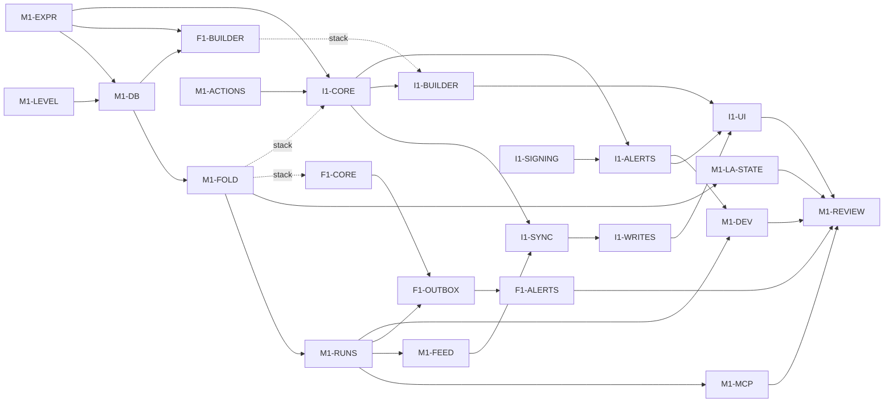

# Plan: M1 · timers v2

**Status:** revision 4 (2026-11-25, the M1 lead's plan check; see "Plan check"
at the end). **Spec:** [timers2.md](../specs/timers2.md). **Programme plan:**
[t2-plan.md](../specs/t2-plan.md); its scope guard, out-of-scope list, merge
ritual, seams and ownership table, simulator budget, effort legend and open
questions apply here unchanged. **Branch:** `t2/m1` off `feat/t2`; WP branches
`t2/m1-<wp>`, one worktree each under `/Users/richie/code/quickr-worktrees/`.
**Lead:** M1 lead with sub-leads A (server + ports) and B (builder + alerts).
**Evidence:** `docs/t2/evidence/M1.md` and `docs/t2/evidence/M1/` (below).

## Definition of done (every WP)

A WP is done when its **Acceptance** holds, the tests its **DoD** names pass,
and the evidence is in the PR description (team rules, "Definition of done and
proof"):

- the commands run, with pass/fail counts copied from the output;
- for iOS, the xcresult path and the test count (a plan with 0 tests run is a
  failure); for host runs, the `swift test` summary line;
- the Codex review file (`codex -o` output committed under the WP's worktree and
  attached to the PR) and how each finding was resolved;
- the CI run link; `make check` (and `make check-ios` when `ios/` changed)
  green, no skipped or disabled tests;
- for UI WPs, screenshots under `docs/t2/evidence/M1/` (iOS light and dark, a
  large Dynamic Type check, the Live Activity/widget states where relevant, PWA
  mobile width) and a short GIF/MP4 for interaction flows;
- anything found outside scope filed as a `t2-followup` issue and linked.

**Tests first.** Every WP commits the tests its DoD names (the R-cases R13–R27,
the T-cases T18–T33, the vector case lists and coverage tests, the worked
examples of timers2.md §6 as unit asserts) **before** the implementation they
pin: the WP branch's first commit is the red tests, and the PR shows them going
green. Generated vectors are the exception (the generator is the reference
implementation); their case list and coverage test still come first.

**CI on WP PRs.** `ci.yml`, `compat.yml` and `ios.yml` trigger on every
`pull_request` whatever its base, so a PR into `t2/m1` runs all five required
checks; no local substitute is needed.

**Owners.** Each WP is implemented by one sub-agent named `t2-m1-<wp>` (lower
case, e.g. `t2-m1-fold`, `t2-m1-i1-sync`), briefed and run by the sub-lead in
the table; the M1 lead merges every WP PR into `t2/m1` and runs the merge
ritual, so one merger owns the generated files.

Friction is logged as it happens to
`/Users/richie/code/quickr-worktrees/_friction/<agent-name>.jsonl` (format in
`_friction/README.md`); never edit another agent's file.

**Brief.** Timer config v2 (lap types, variables, alerts with an expression
grammar), fold v4, the `reopen` and `remove` events, run resurrection in the
feed without tombstones, timing stats v3, Live Activity state additions, alert
scheduling on iOS (local notifications) and in the PWA (while open), builder and
outbox ports on both clients, and the one `api_level` bump. Brief §1 throughout;
the M1↔M2 seam is active-surfaces.md §1.

### M1-LEVEL · api_level 2, supported clients, suites · be · S · A · first

- **Scope:** `shared/api-level.json` → `api_level 2`,
  `min_client_level.ios = .web = 2`; `make api-level`;
  `compat/supported-clients.json`: `"clients": []` (both listed builds are below
  the minimum) and `LiveActivityVectorTests` appended to `suites` (issue #111);
  `docs/ios/specs/compatibility.md` dated note under §1; `make vectors` (the
  `getClientVersions` fixture).
- **Areas:** `shared/api-level.json`, `compat/`, generated level files,
  `docs/ios/specs/compatibility.md`,
  `shared/fixtures/api/getClientVersions.json`.
- **Depends on:** nothing.
- **Distribution constraint (review E1):** this bump is never distributed before
  T2-RELEASE: no TestFlight build and no server deploy from `feat/t2` or any WP
  branch; CI builds are not installed; the orchestrator owns tags (`v0.4.0-rc1`
  when M1 merges is the first). No `compat/openapi-break-approvals.txt` lines:
  with `clients: []` and the bump the gate passes without them (E6).
- **Acceptance:** `python3 compat/api_level.py bumped v0.3.1` succeeds;
  `python3 compat/client_fixtures.py shas` prints nothing; the `api level`,
  `old clients` and `openapi breaking` jobs are green on the PR;
  `compat/api_level.py check HEAD^1` passes (exactly +1).
- **Tests:** the compat workflow on the PR; existing `test_client_versions`
  reads the new levels.
- **Review round 2 (C3):** `compat/client_fixtures.py shas` (and `supported()`)
  skip clients whose `api_level` exceeds the checkout's `api_level`, with a unit
  test in `compat/`, and a docs commit to `docs/specs/client-versions.md` §7
  says so; this is what lets the `v0.4.0-rc1` bot PR merge into `main` without
  failing `main`'s `old clients` job.
- **DoD:** the Acceptance above holds, proven by the compat workflow on the PR;
  existing `test_client_versions` reads the new levels. Evidence in the PR:
  `cd backend && uv run pytest -q <the files above>` pass counts; when
  generators or fixtures change, the `make vectors` diff is in the PR; migration
  WPs paste the `alembic upgrade head` and `downgrade` output; the Codex review
  file with each finding resolved or justified; the CI run link.

### M1-EXPR · expression grammar and vectors · be · M · A · first

- **Scope:** `backend/app/services/timer_expr.py`: tokenizer, recursive-descent
  parser for timers2.md §2, typed evaluation (duration/number), error codes
  `syntax`, `unknown_variable`, `type`, `negative`, `too_long`, `div_zero` with
  `pos`; truncation to whole ms; limits 7 d and 64 chars. Generator
  `backend/tests/test_timer_expr_vectors.py` →
  `shared/fixtures/timer-expr-vectors.json` (shape and case list: timers2.md
  §2.5; the generator's coverage test reads that list).
  `shared/fixtures/README.md` row.
- **Areas:** `backend/app/services/`, `backend/tests/`, `shared/fixtures/`.
- **Depends on:** nothing.
- **Acceptance:** timers2.md T29: every §2.5 case evaluates as listed; the
  vector file is generated and drift-checked; the error `pos` points at the
  offending token.
- **Tests:** unit tests per grammar rule and per error code; a property test
  (random well-typed expressions evaluate to the same ms as a direct
  computation); vector drift.
- **DoD:** the Acceptance above holds, proven by unit tests per grammar rule and
  per error code; a property test (random well-typed expressions evaluate to the
  same ms as a direct computation); vector drift. Evidence in the PR:
  `cd backend && uv run pytest -q <the files above>` pass counts; when
  generators or fixtures change, the `make vectors` diff is in the PR; migration
  WPs paste the `alembic upgrade head` and `downgrade` output; the Codex review
  file with each finding resolved or justified; the CI run link.

### M1-DB · migration, models, Timer v2 schemas, limits · be · M · A

- **Scope:** `backend/alembic/versions/20261126_e6f3a9b4c215_timers_v2.py`:
  `run_event_type` gains `reopen`, `remove` (autocommit block);
  `run_events.target_id UUID NULL`; data migration
  `DELETE FROM deleted_ids WHERE kind='run' AND id IN (SELECT id FROM runs WHERE status='stopped')`
  (timers2.md §4.3). `models.py` (`RunEvent.target_id`, enum).
  `schemas/questions.py`: `Timer {steps, laps, variables}`, `Step.alerts`,
  `LapType`, `Variable`, `Alert` with `at_ms` output-only; shared key namespace
  for steps and lap types; variable names lowercased; `at` validated through
  `timer_expr` against the timer's variables; normalised output (`[]` defaults,
  `at_ms` filled); v1 `{steps}` parses in stored context. Limits in `limits.py`
  and `Limits`: `max_steps 30`, `max_lap_types 8`, `max_variables 16`,
  `max_alerts 8`, `max_expr_length 64`, `max_var_name_length 16`,
  `max_short_label_length` (timers2.md §1.2); `GET /limits`; mirrors
  `frontend/src/api/limits.ts` `FALLBACK_LIMITS`,
  `QuickrCore/Models/ServerInfo.swift` `Limits.serverDefaults`,
  `shared/fixtures/api/getLimits.json`. `openapi.json`, `make client`.
- **Areas:** `backend/alembic/versions/`, `backend/app/models.py`,
  `backend/app/schemas/{questions,limits,api}.py`, the three limits mirrors.
- **Depends on:** M1-LEVEL, M1-EXPR.
- **Acceptance:** `tests/test_migrations.py` applies and downgrades on a seeded
  database (the downgrade leaves the enum values in place and says so in one
  sentence; review E6); after upgrade no `deleted_ids` row remains for a stopped
  run; a v1 topic version's `timer` reads back as v2 with `laps: []`,
  `variables: []`, `alerts: []`; 422 paths such as `laps.1.alerts.0.at`,
  `laps.2.key` (duplicate of a step key), `variables.0.name`; `GET /limits`
  carries the new rows and the three mirrors equal it (timers2.md T26, T28).
- **Tests:** migration round trip; `tests/test_timer_schema.py` (new) for every
  validation rule and the normalisation; limits fixture drift. The
  `builder-vectors.json` `timers[]` v2 cases are generated in I1-BUILDER (same
  milestone), which lands the Swift validation port in the same PR, so the iOS
  gate never sees cases it can't check.
- **DoD:** the Acceptance above holds, proven by migration round trip;
  `tests/test_timer_schema.py` (new) for every validation rule and the
  normalisation; limits fixture drift. The `builder-vectors.json` `timers[]` v2
  cases are generated in I1-BUILDER (same milestone), which lands the Swift
  validation port in the same PR, so the iOS gate never sees cases it can't
  check. Evidence in the PR: `cd backend && uv run pytest -q <the files above>`
  pass counts; when generators or fixtures change, the `make vectors` diff is in
  the PR; migration WPs paste the `alembic upgrade head` and `downgrade` output;
  the Codex review file with each finding resolved or justified; the CI run
  link.

### M1-FOLD · fold v4, run-fold vectors v4, timing stats v3 · be · L · A · stack base

- **Scope:** `services/run_fold.py` v4 per timers2.md §3: input `timer` (steps +
  laps), lap typing and labels (§3.2), the output additions of §3.3, the replay
  rules of §3.4 for `reopen` and `remove` (open-reopen tracking, gap pause and
  gap resume as roles with ids, revert on discard, identity-based remove
  eligibility, effects recomputed from scratch on every fold, no 7-day bound on
  `remove`), the `seg` guard of §3.5 and late merges of §3.6.
  `services/timing_stats.py` v3 per §7.4 (`lap_types[]`,
  `SeriesPoint.lap_types`; lap-type and step buckets keyed separately).
  Generators `test_run_fold_vectors.py` (`GENERATOR_VERSION` 4, `timer_sets`)
  and `test_timing_stats_vectors.py` (3). **The case lists are timers2.md §12.1
  and §7.4**, read by the generators' coverage tests; they are not repeated
  here. (This WP is the brief's "M1-STATS".)
- **Areas:** `backend/app/services/run_fold.py`, `timing_stats.py`,
  `backend/tests/`, `shared/fixtures/run-fold-vectors.json`,
  `timing-stats-vectors.json`, `shared/fixtures/README.md`.
- **Depends on:** M1-DB (the `Timer` schema) **for the generator only**: the WP
  starts in the first wave on `t2/m1-fold` cut from `t2/m1`, writes the case
  lists, coverage tests, the §3.4–§3.6 rule tests and the §6 examples first,
  then the fold against a plain `timer` dict, and merges `t2/m1-db` (or `t2/m1`
  once M1-DB is in) before switching the generator's `timer_sets` to the `Timer`
  schema. Stack: F1-CORE and I1-CORE branch from `t2/m1-fold` and merge into it;
  `t2/m1-fold` merges into `t2/m1` when all three are green.
- **Acceptance:** every case timers2.md §12.1 names for the two files exists and
  the coverage test proves it; the property test generates arrival orders that
  keep the relative order of terminals, discards, reopens and removes with
  respect to their targets and asserts the same state, and that
  `next/lap/skip/pause/resume` commute (§3.4's invariant, stated once); segment
  sums equal totals. `reopen-waits-for-start` is an outbox test (F1-OUTBOX,
  I1-WRITES), not a fold vector.
- **Tests:** a unit test per rule in §3.4–§3.6; the property test; vector drift
  and coverage.
- **DoD:** the Acceptance above holds, proven by the tests named above. Evidence
  in the PR: `cd backend && uv run pytest -q <files>` pass counts; the
  `make vectors` diff when generators or fixtures change; the Codex review file
  with each finding resolved or justified; the CI run link.

### M1-RUNS · reopen and remove write path, API, fixtures · be · L · A

- **Scope:** timers2.md §4 and §7: `RunEventIn.type` gains `reopen`, `remove`;
  `RunEventIn.target` **required for `remove`, nullable for `reopen`** (the
  server resolves a null target to the run's current terminal and stores the
  resolved id in `target_id`, so the fold always sees an explicit target);
  `RunEventOut.target`; `_decide` precedence unchanged; `_apply_folded` branches
  reopen, re-stop and revert (§4.1) with **no extra revision bump** (the
  `record_event` bump is enough, §4.5); `remove` as a late merge on a stopped
  unedited run (`edited` stays false); `reopen`/`remove` exempt from
  `after_stop` and `_check_stop_at`; `ux_runs_one_open` → 409 `conflict`;
  `PATCH /entries/{id}` with `timing` while the run is open or finishing → 409
  `conflict` (A15); `after_run_event` treats an applied reopen as a start for
  Live Activity pushes (§4.6, §8.3). `Timing` gains the ids of §3.3 / A12
  (`terminal_id`, `TimingSegment.event_id`, `TimingPause.id`, `opened_by`), all
  nullable and **null only on pre-v2 stored timings**; `api/getEntry` gains a
  v1-timing fixture. API fixtures per timers2.md §12.1; `openapi.json`,
  `make client`; the minimal Swift change: `RunDTO`/`EntryDTO` decode the new
  optional fields and types (`FixtureCoverageTests`). Request goldens per §12.1
  are generated in I1-SYNC and I1-BUILDER.
- **Areas:** `backend/app/services/runs.py`, `entries.py` (`is_run_id`,
  `_existing` replay, the 409 on timing edits), `schemas/api.py`, `errors.py`,
  `backend/tests/test_runs*.py`, `shared/fixtures/api/`,
  `QuickrData/Contracts/RunDTO.swift`, `EntryDTO.swift` (decode only).
- **Depends on:** M1-DB, M1-FOLD.
- **Acceptance:** timers2.md **T18–T26** (reopen, re-stop, revert, conflict,
  void reasons incl. `not_stopped` for a wrong explicit target, remove on open
  and stopped runs, no `deleted_ids` on stop) and the T23 addition for the 409
  on `timing` edits while open; a null-target reopen resolves and stores the
  terminal id; the v1-timing fixture decodes on every client.
- **Tests:** `test_runs_reopen.py` (new) and the T-numbered cases; T2/T3-style
  concurrency for two reopens of one stop (one applied, one `not_stopped`).
- **DoD:** the Acceptance above holds, proven by the tests named above. Evidence
  in the PR: `cd backend && uv run pytest -q <files>` pass counts; the
  `make vectors` diff when generators or fixtures change; the Codex review file
  with each finding resolved or justified; the CI run link.

### M1-FEED · feed: two kinds of run deletion, `FeedDeletion.revision`, protocol docs · be · M · A

- **Scope:** timers2.md §5.1, §5.4 and A1/A2/A10: `changes.py` emits by
  **current state at read time** (a `(run, delete)` log row is a deletion when
  the run is now closed or missing-and-tombstoned; a delete row for a run that
  is open again emits the item at its current revision; an upsert row for a
  now-closed run emits nothing); `FeedDeletion.revision: int | null` (additive:
  the run's revision at close for `run` deletions, null for topic-cascade
  deletions and for other kinds); bootstrap deletions carry it; `_close` on a
  stop logs `(run, delete)` only and writes no tombstone;
  `deleted_ids(kind=run)` only on discard and topic delete (the data migration
  is M1-DB's). Docs commit to `docs/ios/specs/sync-protocol.md` §1.3 F2/F3: a
  `run` deletion means closed, may be followed by an upsert, and carries
  `revision` (A10). `listChanges` fixtures regenerate; the minimal Swift change:
  `ChangesDTO` decodes `revision` on deletions.
- **Areas:** `backend/app/services/changes.py`, `runs.py` (`_close`),
  `schemas/api.py`, `backend/tests/test_feed_runs.py`, `shared/fixtures/api/`,
  `docs/ios/specs/sync-protocol.md`, `QuickrData/Contracts/ChangesDTO.swift`
  (decode only).
- **Depends on:** M1-RUNS.
- **Acceptance:** timers2.md **T26–T27** as rewritten in round 2: stop → reopen
  → re-stop split every way across pages converges; stop → reopen split with the
  run open at read time emits the item; a stopped run's deletion carries its
  close revision and a cascade deletion carries null; the sync-protocol docs
  commit is reviewed with the PR.
- **Tests:** `test_feed_runs.py` T7/T8 rewritten plus the cuts above; fixture
  drift.
- **DoD:** the Acceptance above holds, proven by the tests named above. Evidence
  in the PR: `cd backend && uv run pytest -q <files>` pass counts; the
  `make vectors` diff when generators or fixtures change; the Codex review file
  with each finding resolved or justified; the CI run link.

### M1-LA-STATE · Live Activity content state additions, byte budget · be + host · M · A · shared with M2

- **Scope:** `push/live_activity.py` `content_state` gains the fields of
  timers2.md §8.1 (no `terminal_id`); `CONTENT_STATE_VERSION` stays 1. **Byte
  budget on the encoded APNs body (A9, §8):** the server encodes and, if the
  body exceeds 4096 bytes, truncates `alert_label`, then `next_label`, then
  `label`, then `topic_name` to 32 characters each in that order, re-encoding
  after each step; M3's appearance attributes count against the same budget.
  Generator `test_live_activity_vectors.py` (`GENERATOR_VERSION` 3,
  `timer_sets`) with the cases §8.2 names, including the budget vector with
  worst-case 4-byte code points and JSON escapes. Minimal Swift: the optional
  fields on `RunActivityState` in `QuickrCore/Runs/RunActivity.swift` so
  `LiveActivityVectorTests` round-trips; `RunActivityContent.state(...)` fills
  them from the local fold. This WP's branch is merged into `t2/m2` as a shared
  WP branch (E5): I2-LA depends on it hard.
- **Areas:** `backend/app/services/push/live_activity.py`,
  `backend/tests/test_live_activity_vectors.py`,
  `shared/fixtures/live-activity-vectors.json`,
  `QuickrCore/Runs/RunActivity.swift`,
  `QuickrCoreTests/Runs/LiveActivityVectorTests.swift`.
- **Depends on:** M1-FOLD (merged); M1-RUNS for the reopen push rule only
  (tested there).
- **Acceptance:** timers2.md T30; every encoded body ≤ 4096 bytes including the
  budget vector; `alert_at` is null while paused and advances by the pause
  length on resume; the Swift suite decodes every case and re-encodes byte-equal
  content state; M3 re-runs the budget vector with `attributes.appearance`
  (appearance.md §15).
- **Tests:** generator cases per §8.2; `LiveActivityVectorTests`; a unit test
  for `alert_at` with paused overlap; a unit test per truncation step.
- **DoD:** the Acceptance above holds, proven by the tests named above. Evidence
  in the PR: `cd backend && uv run pytest -q <files>` pass counts; the
  `make vectors` diff when generators or fixtures change;
  `cd ios/QuickrKit && swift test --filter <suites>` summary lines with counts;
  the Codex review file with each finding resolved or justified; the CI run
  link.

### M1-MCP · MCP tools and `getTopicTiming` lap types · be · M · A

- **Scope:** `mcp_server.py`: `run_action` gains `reopen` (target defaults to
  `state.terminal_id`) and `remove` (new `target` param); new `get_run`
  (timers2.md §7.3);
  `create_topic`/`publish_topic_version`/`check_topic_version` accept the v2
  `Timer`; `check_topic_version` gains `timer`; `INSTRUCTIONS` prose.
  `timing.py` / `TopicTiming` schema: `lap_types[]` and `SeriesPoint.lap_types`
  from `timing_stats` v3; API fixture `getTopicTiming` regenerated with a typed
  topic; `openapi.json`, `make client`; minimal Swift: `TimingStats.swift` port
  lands in I1-CORE (stack), so this WP merges after the M1-FOLD stack.
- **Areas:** `backend/app/mcp_server.py`, `services/timing.py`,
  `schemas/api.py`, `shared/fixtures/api/getTopicTiming.json`.
- **Depends on:** M1-RUNS, M1-FOLD stack merged.
- **Acceptance:** timers2.md T31–T33: each new tool path round-trips against a
  test DB; `run_action reopen` on a running run answers `InvalidRequest` with
  the reason; `getTopicTiming` equals `timing-stats-vectors.json` v3 for seeded
  entries; an untyped topic answers `lap_types: []`; `test_identity.py`
  `_mutations` gains no operation.
- **Tests:** one test per tool action; endpoint tests seeded from the vectors.
- **DoD:** the Acceptance above holds, proven by one test per tool action;
  endpoint tests seeded from the vectors. Evidence in the PR:
  `cd backend && uv run pytest -q <the files above>` pass counts; when
  generators or fixtures change, the `make vectors` diff is in the PR; migration
  WPs paste the `alembic upgrade head` and `downgrade` output; the Codex review
  file with each finding resolved or justified; the CI run link.

### M1-ACTIONS · the `RunAction` model and the on-screen primary · host + fe · S · B · first (shared with M2)

- **Scope:** the model of timers2.md §10, signatures copied verbatim (A13, the
  one block M2 and this plan copy): iOS
  `static func actions(_ state: RunState, status: RunStatus, timer: TopicTimer?, now: Date) -> [RunAction]`,
  `headline(_ state:, status:, timer:) -> Headline`,
  `alertLine(_ state:, timer:, now:) -> String?`,
  `resumable(_ entry: Entry, now: Date) -> Bool`; PWA
  `actions(state: RunState, status: RunStatus, timer: Timer | null, now: number): RunAction[]`,
  `headline(state, status, timer)`, `alertLine(state, timer, now)`,
  `resumable(entry, now)`. `RunAction.Kind` is **complete from day one**
  (including `reopen` and `revert`; `remove` is not a kind, it is an
  entry-detail action). This WP ships the **on-screen primary rule only**
  (timers2.md §10: Lap, labelled with the next lap type when typed, when the
  open segment is a lap or no named step remains; else Next; Stop is never
  primary) over today's states; `alertLine` returns nil and `resumable` false
  until I1-CORE and I1-WRITES fill them. The Auto rule is **I1-WRITES's** (C9).
  Files: `QuickrCore/Runs/RunPresentation.swift`,
  `frontend/src/components/runs/model.ts`.
- **Areas:** the two files and `RunPresentationTests.swift`, `model.test.ts`.
- **Depends on:** nothing. Cut from `feat/t2`; merged into `t2/m1` and `t2/m2`.
- **Acceptance:** timers2.md R18 (stub half): the table-driven test over the
  state → `[RunAction]` table of active-surfaces.md §1.2 (idle variants, step
  open, lap open, last step, no steps, paused, finishing, stopped-resumable)
  passes on both platforms for the kinds that exist today; the existing
  `Primary`/`useRunPrimary` callers are left in place (M2 removes them).
- **Tests:** the table-driven test per platform, fixture = active-surfaces.md
  §1.2.
- **DoD:** the Acceptance above holds, proven by the tests named above. Evidence
  in the PR: `cd ios/QuickrKit && swift test --filter <suites>` summary lines
  with counts; `pnpm exec vitest run <tests>` pass counts and a green
  `make check-frontend`; the Codex review file with each finding resolved or
  justified; the CI run link.

### I1-SIGNING · time-sensitive entitlement in the signing path · host · S · B · first

- **Scope:** verify that the Time Sensitive Notifications capability is enabled
  on the App ID and present in the provisioning profile that
  `.github/workflows/testflight.yml` / `.github/actions/testflight-setup` use
  (automatic provisioning with the App Store Connect API key vs a manual
  profile); add `com.apple.developer.usernotifications.time-sensitive` to the
  entitlements block of `ios/project.yml` (`// T2-M1` block) and build an
  archive the way the workflow does (`make ios-gen`, `xcodebuild archive` with
  the workflow's signing settings, or a CI run of `testflight.yml` on the WP
  branch if the orchestrator allows). If the capability cannot be added without
  the user's Apple Developer portal access: set the fallback
  `interruptionLevel = .active` in `RunAlerts` (I1-ALERTS reads a single
  constant), add the portal step to `docs/t2/device-checklist.md`, and tell the
  orchestrator immediately (OQ-6 rider).
- **Areas:** `ios/project.yml`, `.github/workflows/testflight.yml` (read only
  unless the profile must change), `docs/t2/device-checklist.md`.
- **Depends on:** nothing.
- **Acceptance (reviews E2, C2):** (1) static: the generated
  `ios/App/QuickR.entitlements` (xcodegen output) contains
  `com.apple.developer.usernotifications.time-sensitive` and `make ios-gen` is
  clean (the `testflight.sh dry_run` archive is unsigned, so it proves nothing
  about signing); (2) real proof: a signed archive, either `make ios-testflight`
  with the ASC key on the WP branch if the orchestrator allows, or `v0.4.0-rc1`:
  the orchestrator tags it from `feat/t2` only after M1 has merged there with
  all five checks green; CI publishes ghcr images and a TestFlight build,
  nothing deploys the server; the build installs and a lap alert sounds under a
  Focus on the device (checklist item); against the level-1 server the rc build
  shows the non-blocking "server is older" note and T2 features do not work
  (expected); the bot PR `compat/testflight-<build>` is merged into `main` as
  usual; (3) fallback: if rc1's signing fails on the entitlement, flip the one
  constant (`RunAlerts.interruptionLevel = .active`) in a small PR on `feat/t2`,
  record the Apple portal step on the device checklist, and tell the
  orchestrator.
- **Tests:** the archive/signing log in the PR; `make check-ios` still green
  (the entitlement changes no test).
- **DoD:** the Acceptance above holds, proven by the signing log and the
  `codesign` output pasted in the PR. Evidence in the PR: the archive command
  and its result; the Codex review file; the CI run link; when the fallback is
  taken, the checklist diff and the message to the orchestrator.

### F1-CORE · PWA fold, types and stats ports · fe · L · A · stacked on M1-FOLD

- **Scope:** `src/lib/runs/types.ts` (Timer v2, `lap_type`, `terminal_id`,
  `next_lap_type`, `lap_count`, new event types and void reasons, `target`),
  `fold.ts` v4 (lap typing, reopen, remove, `seg` guard), `stats.ts` v3; vector
  suites `runFold.vectors.test.ts`, `timingStats.vectors.test.ts`. (The
  `timerExpr.ts` port is F1-BUILDER's, revision 4: it is a new vector file with
  no stack, and the builder is its first consumer.)
- **Areas:** `frontend/src/lib/runs/` except `timerExpr*.ts`.
- **Depends on:** M1-FOLD (stack).
- **Acceptance:** both vector files pass; no `Date` arithmetic in the fold.
- **Tests:** vector suites.
- **DoD:** the Acceptance above holds, proven by vector suites. Evidence in the
  PR: `pnpm exec vitest run <the tests above>` pass counts and a green
  `make check-frontend`; the Codex review file with each finding resolved or
  justified; the CI run link.

### F1-OUTBOX · PWA actions, local view, kinds, notices, runs cache · fe · M · A

- **Scope:** `actions.ts` (`TapType` `reopen`/`remove`, `targetOf` from
  `terminal_id` or the chosen event id, `makesEntry` for re-stop),
  `localView.ts` (`overlay` lap labelling from the version's timer, `statusOf`
  for a reopened run, optimistic entry hidden while its run is open: OQ-14),
  `kinds.ts` (`waitsFor` per timers2.md §5.5: reopen/remove wait for the run's
  start and for the queued item whose id equals their `target`; an event
  enqueued after a pending `reopen` of the same run waits for it, A7; K6 MUST
  NOT apply when the run's queued items contain a `reopen`, A8), `notices.ts`
  (`reverted`, `deleted`, `not_stopped`, `no_target`), `src/api/runs.ts`
  revision-aware closed-run tombstones (a listed run with a higher revision than
  the one that closed wins), `useRuns.ts`, `src/test/fakeRunServer.ts`
  (reopen/remove, another device's reopen).
- **Areas:** `frontend/src/lib/runs/`, `src/lib/outbox/kinds.ts`,
  `src/api/runs.ts`, `src/test/fakeRunServer.ts`.
- **Depends on:** F1-CORE, M1-RUNS.
- **Acceptance:** a queued reopen shows the run open at once and waits in the
  outbox for the run's start **and** for the queued item whose id equals its
  `target` (timers2.md §5.5): a reopen enqueued behind a retrying stop is sent
  only after the stop acks; the same for `remove`; a run deletion followed by an
  upsert re-lists the run; a void `not_stopped` reply shows the right notice;
  `classifyStatus` parity test unchanged.
- **Tests:** `actions.test.ts`, `localView.test.ts`, `runEvent.test.ts`,
  `notices.test.ts`, `runs.test.ts` (cache) with the new cases.
- **Review rounds 1–2:** `localView.ts` projects a run in state "resuming" for a
  `reopen` enqueued from an entry with no local run row (timers2.md §5.3); for a
  queued `remove` from an entry with no run row **no run is projected**: the
  entry stays visible with its timing re-projected (boundary or pause dropped),
  `revision` unchanged, a pending mark until the ack (A14); a discard queued
  after a reopen on a run with no entry projects no optimistic entry (A15).
  `targetOf` reads the `Timing` ids (`terminal_id`, `TimingPause.id`,
  `TimingSegment.event_id`); a pre-v2 entry sends `target: null` for reopen
  (A12). `src/api/runs.ts` keeps `run_closed(id, revision)` markers per
  timers2.md §5.2 (revision from `FeedDeletion.revision` or the closing ack; ∞
  for cascade deletions and aliases; feed upsert applies iff
  `revision > marker`; ack upsert applies iff that and the acked event is an
  applied `reopen`). Tests: the PWA list of timers2.md §12.4 (ordering incl. A7,
  K6-not-on-revert, resuming and remove projections, markers).
- **DoD:** the Acceptance above holds, proven by `actions.test.ts`,
  `localView.test.ts`, `runEvent.test.ts`, `notices.test.ts`, `runs.test.ts`
  (cache) with the new cases. Evidence in the PR:
  `pnpm exec vitest run <the tests above>` pass counts and a green
  `make check-frontend`; the Codex review file with each finding resolved or
  justified; the CI run link.

### F1-BUILDER · PWA builder for Timer v2 · fe · L · B · stack base

- **Scope:** `src/lib/builder.ts` (draft lap types, variables, alerts per step
  and lap type; zod schemas taking `limits`; key derivation shares the step
  namespace; `timer_output` v2; `timer_changes` text), `TimerEditor.tsx` + new
  `LapTypesEditor.tsx`, `VariablesEditor.tsx`, `AlertsEditor.tsx` (live
  evaluation with `timerExpr.ts`, server 422 paths mapped by
  `src/components/builder/serverErrors.ts`), `EditQuestionsPage.tsx` review
  section; `builderUi.vectors.test.ts` new sections per timers2.md §12.1 →
  `shared/fixtures/builder-ui-vectors.json`. **Also the expression port** (moved
  from F1-CORE in revision 4): new `src/lib/runs/timerExpr.ts` per timers2.md
  §2, `timerExpr.vectors.test.ts` over `shared/fixtures/timer-expr-vectors.json`
  and `timerExpr.test.ts` for the error positions. The builder reads the `Timer`
  type from the generated client (`make client` after M1-DB) and does not edit
  `src/lib/runs/types.ts` (F1-CORE's).
- **Areas:** `frontend/src/lib/builder.ts`, `src/components/builder/`,
  `src/pages/topic/EditQuestionsPage.tsx`, `src/lib/builderUi.vectors.test.ts`,
  `src/lib/runs/timerExpr*.ts`.
- **Depends on:** M1-DB (schema, client, limits), M1-EXPR (the vector file).
  Stack: I1-BUILDER branches from `t2/m1-builder-fe` and merges into it.
- **Acceptance:** publish sends a normalised v2 `timer`; keys stay stable on
  rename; an invalid expression shows the server's message at the right field
  before and after submit; the new vector sections exist and the Swift consumer
  (I1-BUILDER) passes them.
- **Tests:** `builder.test.ts`, `TimerEditor.test.tsx` (new),
  `EditQuestionsPage.test.tsx`, vector generation.
- **DoD:** the Acceptance above holds, proven by `builder.test.ts`,
  `TimerEditor.test.tsx` (new), `EditQuestionsPage.test.tsx`, vector generation.
  Evidence in the PR: `pnpm exec vitest run <the tests above>` pass counts and a
  green `make check-frontend`; the Codex review file with each finding resolved
  or justified; the CI run link. UI WP: PWA mobile-width screenshots of the lap
  types, variables and alerts editors (light/dark) under `docs/t2/evidence/M1/`.

### F1-ALERTS · PWA alerts while open · fe · M · B

- **Scope:** `src/lib/runs/alerts.ts` (pure planner: next alert instant for the
  open segment from `LocalRun` + timer + server clock; none while paused),
  `src/components/runs/RunAlerts.tsx` (one `setTimeout` to the next alert,
  recompute on LocalRun change and `visibilitychange`; fires toast,
  `navigator.vibrate([200,100,200])`, a short Web Audio tone (OQ-13) from an
  `AudioContext` unlocked on Start/Lap by the new `useRunAudio.ts` (M1's file;
  M2's `useRunActions.ts` calls it through a one-line patch M2 owns, C4),
  `registration.showNotification` when granted), mounted in `AppShell.tsx`
  (patch to M2's file, one line), a global mute in `AppSettingsPage.tsx`
  (localStorage).
- **Areas:** `frontend/src/lib/runs/alerts.ts`,
  `src/components/runs/RunAlerts.tsx`, new `src/components/runs/useRunAudio.ts`,
  `src/pages/AppSettingsPage.tsx`, `src/components/AppShell.tsx` (mount only).
- **Depends on:** F1-CORE, F1-OUTBOX.
- **Acceptance:** with fake timers, a 60 s rest lap with alerts at `t/2` and `t`
  fires at 30 s and 60 s of active time, shifts by a 10 s pause, cancels on
  stop; mute suppresses sound and vibration but not the toast; nothing fires
  when the page is hidden and the tab resumes with the next pending alert.
- **Tests:** `alerts.test.ts`, `RunAlerts.test.tsx`.
- **DoD:** the Acceptance above holds, proven by `alerts.test.ts`,
  `RunAlerts.test.tsx`. Evidence in the PR:
  `pnpm exec vitest run <the tests above>` pass counts and a green
  `make check-frontend`; the Codex review file with each finding resolved or
  justified; the CI run link. UI WP: a short recording of the alert toast firing
  at mobile width.

### I1-CORE · Swift ports and DTOs · host · L · A · stacked on M1-FOLD

- **Scope:** `QuickrCore/Models/Topic.swift` `TopicTimer` v2 Codable (defaults
  for v1 JSON, encodes `laps`/`variables` always); `RunModels.swift` (new event
  types, void reasons, `lapType`, `terminalId`, `nextLapType`, `lapCount`,
  `RunEvent.target`); `RunFold.swift` v4 incl. `overlay` labelling; new
  `TimerExpr.swift`; `TimingStats.swift` v3; `TimingEdit.swift` lap types;
  `RunPresentation` `actions` full set (reopen in overflow for a stopped-shown
  run, revert), `headline`, `alertLine`; `Contracts/RunDTO.swift` full mapping;
  `Limits+ServerDefaults`.
- **Areas:** `QuickrCore/Runs/`, `QuickrCore/Models/Topic.swift`,
  `QuickrData/Contracts/RunDTO.swift`, `QuickrCoreTests/Runs/`.
- **Depends on:** M1-FOLD (stack), M1-EXPR, M1-ACTIONS.
- **Acceptance:** timers2.md R13 (timers.md R1 with v4/v3 vectors); new
  `TimerExprVectorTests` passes every case with the same `pos`; every
  `api/*.json` fixture decodes (`FixtureCoverageTests`); `RunPresentationTests`
  cover the full action table.
- **Tests:** `RunFoldVectorTests`, `TimingStatsVectorTests`,
  `TimerExprVectorTests` (new), `RunPresentationTests`, `TimingEditTests`,
  `RunOverlayFoldTests`.
- **DoD:** the Acceptance above holds, proven by `RunFoldVectorTests`,
  `TimingStatsVectorTests`, `TimerExprVectorTests` (new),
  `RunPresentationTests`, `TimingEditTests`, `RunOverlayFoldTests`. Evidence in
  the PR: `cd ios/QuickrKit && swift test --filter <the suites above>` summary
  lines with counts (plus `make ios-core-test` once); the Codex review file with
  each finding resolved or justified; the CI run link.

### I1-SYNC · closed-run markers, store migration, feed apply, request goldens · host · M · A

- **Scope:** timers2.md §5.2 verbatim as the contract: table
  `run_closed(id, revision, closed_at)`; a `run` feed deletion writes a marker
  with the deletion's `revision` (∞ when null: topic cascade) and removes alias
  rows; an ack of a closing event sets the marker from the response's
  `run.revision`; a feed upsert applies iff `revision > marker.revision`; an ack
  upsert applies iff that AND the acked event is an applied `reopen`; applying
  clears the marker; alias markers are ∞; markers prune after 30 days; an epoch
  rebuild replaces markers from the bootstrap deletions. Migration
  **`t2m1_run_closed`** in `StoreSchema+T2M1.swift`: converts existing `run`
  tombstones to markers (revision 0 for runs whose topic is live; ∞ for aliases
  and for runs whose topic is tombstoned) and drops them; the registration line
  in `StoreSchema.swift` is added **at merge time by the merger** (E4). Discard
  and topic delete still tombstone. `ChangesDTO` full mapping of
  `FeedDeletion.revision`; `QuickrData/Store/ServerLayer.swift` apply rules;
  `RunOverlay.swift` lap labelling from the stored v2 timer. Request goldens per
  timers2.md §12.1 (`RequestGoldenTests`, backend `test_request_goldens.py`).
- **Areas:** `QuickrData/Contracts/StoreSchema+T2M1.swift`, `ChangesDTO.swift`,
  `QuickrData/Store/ServerLayer.swift`, `RunOverlay.swift`, `QuickrData/Sync/`,
  `shared/fixtures/requests/`.
- **Depends on:** I1-CORE, M1-FEED.
- **Acceptance:** timers2.md **R14, R24, R25**: a delayed pre-close ack never
  resurrects; feed delete then reopen upsert across pages applies in turn;
  bootstrap with revision; the migration with a queued item; an epoch rebuild
  with stop → reopen → re-stop in staged pages; a topic tombstone still clears
  its runs; the goldens validate in pytest (G2).
- **Tests:** `RunSyncTests` (R14, R24, R25; a new file
  `QuickrDataTests/Sync/RunSyncTests.swift`, beside the existing
  `SyncRunTests.swift`, which stays), the `StoreSchema` migration test,
  `RunOverlayFoldTests`, `RequestGoldenTests`.
- **DoD:** the Acceptance above holds, proven by the tests named above. Evidence
  in the PR: `cd ios/QuickrKit && swift test --filter <suites>` summary lines
  with counts; the Codex review file with each finding resolved or justified;
  the CI run link.

### I1-WRITES · reopen/remove writes, Auto rule, actions, fake server · host · M · A

- **Scope:** `RunWrites.swift` taps `.reopen(target:)` (target from
  `entry.timing.terminal_id`; `nil` for a pre-v2 entry, A12) and
  `.remove(target:)` (from `TimingPause.id` / `TimingSegment.event_id`);
  `RunTapType`, `RunTapExpect`, `target(_:_:)`, `moved`; **the Auto rule**
  (timers2.md §10, active-surfaces.md §5.3): `timer.laps` non-empty → Auto = the
  on-screen primary; laps empty → the v1 Auto (… → Stop), in `RunWrites.auto`
  (C9); outbox ordering per timers2.md §5.5 (wait for the start and for the
  `target` item; an event enqueued after a pending `reopen` waits for it, A7; K6
  MUST NOT apply when the queued items contain a `reopen`, A8); `RunOverlay`
  projections per §5.3 and A14 (a reopen from an entry with no run row projects
  a "resuming" run with no controls; a remove from an entry projects no run, the
  entry keeps a re-projected timing with a pending mark; a discard queued after
  a reopen on a run with no entry projects no optimistic entry, A15);
  `RunActions.swift` reopen/remove/revert with the cooldown;
  `RunPresentation.resumable` (OQ-1: `run.edited == false`, 15 min; false while
  the topic has a locally open run, A15); `RunNoticeText` new reasons; new
  `QuickrData/LiveActivity/RunActivityCenter+Reopen.swift` (`startFor` on a
  reopen this device made, R20); `App/Debug/UITestRuns.swift` `FakeRunBook`
  folds v4, accepts `reopen`/`remove`, scripts another device's reopen/remove;
  `UITestLaunch.swift` `// T2-M1` block for `target`.
- **Areas:** `QuickrData/Session/`, `QuickrData/Store/RunOverlay.swift`,
  `QuickrData/Store/RunNotices.swift`, `QuickrCore/Runs/RunNoticeText.swift`,
  `QuickrData/LiveActivity/RunActivityCenter+Reopen.swift`, `App/Debug/`.
- **Depends on:** I1-SYNC.
- **Acceptance:** timers2.md **R15, R16, R20, R26** and the Auto half of R18
  (typed and untyped timers); `resumable` true for an unedited timed entry of
  the latest stop within 15 min, false after and false while the topic has an
  open run.
- **Tests:** `RunActionsTests`, `RunLocalViewTests`, `RunOutboxTests`,
  `RunNoticeTextTests`, `LiveActivityReconcileTests` (R20),
  `RunWritesAutoTests`.
- **DoD:** the Acceptance above holds, proven by the tests named above. Evidence
  in the PR: `cd ios/QuickrKit && swift test --filter <suites>` summary lines
  with counts; the Codex review file with each finding resolved or justified;
  the CI run link.

### I1-BUILDER · iOS builder for Timer v2 · host · L · B · stacked on F1-BUILDER

- **Scope:**
  `QuickrCore/Builder/{Drafts,DraftSteps,DraftValidation,BuilderText,CompatibilityCheck}.swift`
  (+ new `DraftLapTypes.swift`, `DraftVariables.swift`, `DraftAlerts.swift`),
  `QuickrUI/Topics/Builder/{BuilderEditing,BuilderBindings,EditQuestionsModel}.swift`,
  `App/Topics/Builder/TimerEditorView.swift` (`TimerSections` gains the lap
  types, variables and alerts rows) + new `LapTypesEditorView.swift`,
  `VariablesEditorView.swift`, `AlertsEditorView.swift` (accessibility ids as
  timers2.md §1.6 defines them); `test_builder_vectors.py` `timers[]` v2 cases
  (`GENERATOR_VERSION 4`) and `BuilderVectorTests`/`BuilderUIVectorTests`
  reading the new sections. Must not touch `topicSection`/`detailsSection`.
- **Areas:** `QuickrCore/Builder/`, `QuickrUI/Topics/Builder/`,
  `App/Topics/Builder/`, `backend/tests/test_builder_vectors.py`,
  `shared/fixtures/builder-vectors.json`, `QuickrCoreTests/Builder/`.
- **Depends on:** F1-BUILDER (stack), I1-CORE.
- **Acceptance:** timers2.md R19: `BuilderVectorTests` and
  `BuilderUIVectorTests` pass with the v2 cases;
  `EditQuestionsModel.Review.timerChanges` lists a renamed lap type, an added
  variable and a changed alert; a draft with a duplicate key across steps and
  lap types is refused client-side with the server's path.
- **Tests:** vector tests; `TopicDraftEditingTests`, `BuilderEditingTests`,
  `EditQuestionsModelTests`, `NewTopicModelTests` (QuickrDesignTests).
- **DoD:** the Acceptance above holds, proven by vector tests;
  `TopicDraftEditingTests`, `BuilderEditingTests`, `EditQuestionsModelTests`,
  `NewTopicModelTests` (QuickrDesignTests). Evidence in the PR:
  `cd ios/QuickrKit && swift test --filter <the suites above>` summary lines
  with counts (plus `make ios-core-test` once); the Codex review file with each
  finding resolved or justified; the CI run link. UI WP: iOS screenshots of the
  three new editors (light/dark + XXXL) are captured in I1-UI's run and
  cross-referenced here.

### I1-ALERTS · alert planner, scheduler, notification centre · host · M · B

- **Scope:** `QuickrData/Notifications/RunAlerts.swift` (pure
  `RunAlertPlan.requests(run:timer:now:)`: fire date = segment start + `at_ms`
  - paused overlap so far; none while paused; next 8 per run; identifier
    `quickr.alert.{run_id}.{seg}.{alert.key}`; thread `topic-{id}`; body
    `"{alert.label} · {segment label}"`, title topic name;
    `quickr.kind = alert`), `RunAlertScheduler.swift` (diff against pending on
    every local run change, on the app becoming active, and after sync applies a
    page (review C2: a Live Activity push runs no app code); cancel all for a
    run on stop/discard), `NotificationCenterProtocol.swift`
    (`LocalNotificationRequest.interruptionLevel`, `fireAt: Date`, backward
    compatible), `SystemNotificationCenter.swift` (interval trigger,
    `.timeSensitive`, OQ-6), `QuickrTestSupport/Fakes.swift`,
    `QuickrHaptic.alert`, `NotificationResponder.swift` foreground presentation
    with sound + haptic, `project.yml` entitlement
    `com.apple.developer.usernotifications.time-sensitive` and
    `AppEnvironment.swift` wiring, each in a `// T2-M1` block.
- **Areas:** `QuickrData/Notifications/`,
  `QuickrData/Contracts/NotificationCenterProtocol.swift`, `QuickrTestSupport/`,
  `QuickrUI/Components/Haptics.swift`,
  `App/Notifications/Handler/NotificationResponder.swift`,
  `App/AppEnvironment.swift`, `ios/project.yml`.
- **Depends on:** I1-CORE (`TopicTimer` v2, `LocalRun` lap typing), I1-SIGNING
  (the interruption-level constant). Not I1-SYNC (revision 4): the scheduler's
  triggers are `observeLocalRuns` and app activation, both v1 surfaces, and its
  files are disjoint from I1-SYNC's.
- **Acceptance:** timers2.md R17: for a 60 s rest lap with `t/2` and `t`, the
  plan holds two requests at +30 s and +60 s; a 10 s pause shifts both; while
  paused the plan is empty; a lap tap cancels the old segment's requests and
  schedules the new ones; stop/discard cancels all; never more than 8 pending
  per run; the fake centre sees `interruptionLevel = .timeSensitive`.
- **Tests:** `RunAlertPlanTests`, `RunAlertSchedulerTests` (fake centre),
  `NotificationCenterProtocolTests` for the compatible request shape.
- **Review round 1 (C1):** the scheduler compares the **full desired request**
  (identifier + `fireAt` + content) with the pending set and replaces a request
  whose fire time or content changed, not only identifier differences. Tests:
  pause then resume shifts `fireAt` under the same identifier and the pending
  request is replaced; a corrected alert time after a version publish is
  replaced; the interruption level is read from the single constant I1-SIGNING
  owns.
- **DoD:** the Acceptance above holds, proven by `RunAlertPlanTests`,
  `RunAlertSchedulerTests` (fake centre), `NotificationCenterProtocolTests` for
  the compatible request shape. Evidence in the PR:
  `cd ios/QuickrKit && swift test --filter <the suites above>` summary lines
  with counts (plus `make ios-core-test` once); the Codex review file with each
  finding resolved or justified; the CI run link. The foreground banner + haptic
  is captured on video in I1-UI's run.

### I1-UI · simulator: builder v2 publish, lap labels, resurrection · sim · M · B · last

- **Scope:** UI tests in M1's own files (C4):
  `UITests/BuilderUITests+T2M1.swift` with `testPublishingATimerV2Topic`
  (timers2.md R22: two lap types, a variable, an alert; the run screen shows
  "Run 1" then "Rest 1") and `UITests/RunUITests+T2M1.swift` with
  `testTikTokLapLabels`, `testRunComesBackAfterRemoteReopen` (the fake server
  records another device's reopen; the run screen shows Running again and the
  entry list hides the entry) and `testRemoteRemoveRenumbersLaps`. The Unit plan
  on the clone (`AppTests` incl. `SystemNotificationCenterTests`, R23). R21
  (Resume from the saved state) is M2-RESUME's, as timers2.md §12.3 says; the
  Remove button is tested in M4-UITEST.
- **Areas:** `UITests/BuilderUITests+T2M1.swift`,
  `UITests/RunUITests+T2M1.swift` (new),
  `AppTests/SystemNotificationCenterTests.swift`.
- **Depends on:** I1-WRITES, I1-BUILDER, I1-ALERTS.
- **Acceptance:** the four UI tests pass once (no retype, no retry) on the
  worktree clone; the Unit plan reports a non-zero test count; xcresult paths
  recorded. Simulator-only because they are XCUITest flows and `AppTests`.
- **Tests:** as listed.
- **DoD:** the Acceptance above holds, proven by the tests named above. Evidence
  in the PR: the xcresult path and its non-zero test count; screenshots iOS
  light/dark + XXXL under the milestone's evidence folder; a GIF/MP4 per flow;
  the clone shut down; the Codex review file with each finding resolved or
  justified; the CI run link.

### M1-DEV · device checklist entries · docs · S · B

- **Scope:** append to `docs/t2/device-checklist.md`: a locked-phone alert fires
  with sound at `t/2` on a rest lap; an alert while in Focus (time sensitive); a
  lap tapped on the PWA while the phone is locked leaves the phone's alert stale
  until unlock (OQ-11, expected); reopen from the phone re-creates the Live
  Activity on a second device by push-to-start; a 7-day-old reopened run is
  refused.
- **Depends on:** I1-ALERTS, M1-RUNS.
- **Acceptance:** the entries exist with the expected result spelled out.
- **DoD:** the Acceptance above holds, proven by the tests named in Acceptance
  Evidence in the PR: the named file exists on the milestone branch and is
  linked from the milestone PR; the Codex review file with each finding resolved
  or justified; the CI run link.

### M1-REVIEW · milestone review · docs · S

- **Scope:** Codex review of the milestone diff against timers2.md plus a Claude
  reviewer sub-agent; fixes inside a WP's scope; `t2-followup` issues for the
  rest; `docs/t2/evidence/M1.md` with screenshots (builder v2 light/dark, XXXL,
  the alert banner), the `make check-ios` run, and the five green checks.
- **Depends on:** every other M1 WP.
- **Acceptance:** no open finding inside scope; every other finding has an
  issue; the milestone PR to `feat/t2` is ready.
- **DoD:** the Acceptance above holds, proven by the tests named in Acceptance
  Evidence in the PR: the named file exists on the milestone branch and is
  linked from the milestone PR; the Codex review file with each finding resolved
  or justified; the CI run link.

### M1 DAG

| WP          | Depends on                                                   | Class     | Effort | Sub-lead |
| ----------- | ------------------------------------------------------------ | --------- | ------ | -------- |
| M1-LEVEL    | —                                                            | be        | S      | A        |
| M1-EXPR     | —                                                            | be        | M      | A        |
| M1-DB       | M1-LEVEL, M1-EXPR                                            | be        | M      | A        |
| M1-FOLD     | M1-DB for the generator only (stack base; starts first wave) | be        | L      | A        |
| M1-RUNS     | M1-DB, M1-FOLD                                               | be        | L      | A        |
| M1-FEED     | M1-RUNS                                                      | be        | M      | A        |
| M1-LA-STATE | M1-FOLD                                                      | be + host | M      | A        |
| M1-MCP      | M1-RUNS, M1-FOLD stack                                       | be        | M      | A        |
| M1-ACTIONS  | — (shared with M2)                                           | host + fe | S      | B        |
| I1-SIGNING  | —                                                            | host      | S      | B        |
| F1-CORE     | M1-FOLD (stacked), M1-EXPR                                   | fe        | L      | A        |
| F1-OUTBOX   | F1-CORE, M1-RUNS                                             | fe        | M      | A        |
| F1-BUILDER  | M1-DB, F1-CORE (stack base)                                  | fe        | L      | B        |
| F1-ALERTS   | F1-CORE, F1-OUTBOX                                           | fe        | M      | B        |
| I1-CORE     | M1-FOLD (stacked), M1-EXPR, M1-ACTIONS                       | host      | L      | A        |
| I1-SYNC     | I1-CORE, M1-FEED                                             | host      | M      | A        |
| I1-WRITES   | I1-SYNC                                                      | host      | M      | A        |
| I1-BUILDER  | F1-BUILDER (stacked), I1-CORE                                | host      | L      | B        |
| I1-ALERTS   | I1-CORE, I1-SYNC, I1-SIGNING                                 | host      | M      | B        |
| I1-UI       | I1-WRITES, I1-BUILDER, I1-ALERTS                             | sim       | M      | B        |
| M1-DEV      | I1-ALERTS, M1-RUNS                                           | docs      | S      | B        |
| M1-REVIEW   | all                                                          | docs      | S      | lead     |

**Critical path:** M1-LEVEL ∥ M1-EXPR → M1-DB → M1-FOLD (with I1-CORE and
F1-CORE stacked on it) → M1-RUNS → M1-FEED → I1-SYNC → I1-WRITES → I1-UI →
M1-REVIEW. The builder chain (F1-BUILDER → I1-BUILDER) and the alerts chain
(I1-ALERTS, F1-ALERTS) run beside it under sub-lead B and join at I1-UI.

**First wave:** M1-LEVEL, M1-EXPR, M1-ACTIONS, I1-SIGNING, M1-FOLD (tests-first,
see its "Depends on").

**Waves** (each starts as soon as its dependencies have merged; the list is the
expected order, not a barrier):

1. M1-LEVEL, M1-EXPR, M1-ACTIONS, I1-SIGNING, M1-FOLD (tests and fold).
2. M1-DB (after LEVEL + EXPR); F1-BUILDER (after DB + EXPR); M1-FOLD takes
   `t2/m1-db` and finishes its generators.
3. F1-CORE and I1-CORE on the fold stack; the stack merges into `t2/m1`.
4. M1-RUNS, M1-LA-STATE, I1-ALERTS, I1-BUILDER (stacked on F1-BUILDER).
5. M1-FEED, M1-MCP, F1-OUTBOX, M1-DEV.
6. I1-SYNC, F1-ALERTS.
7. I1-WRITES.
8. I1-UI (the one simulator WP: its own clone, queued with `--wait`).
9. M1-REVIEW: the milestone review, `make check-ios` once (both slots), the
   evidence file, the PR to `feat/t2`.

**Simulator use:** only I1-UI (wave 8) and the one `make check-ios` run before
the milestone PR. Everything else is pytest, vitest or host `swift test`.

## Milestone evidence

`docs/t2/evidence/M1.md`, committed on `t2/m1` before the milestone PR to
`feat/t2`: every acceptance criterion above → its proof (test names, CI links,
commit SHAs copied from `git log`); screenshots under `docs/t2/evidence/M1/`
(builder v2 editors iOS light/dark + XXXL, the in-app alert banner, PWA builder
and alert toast at mobile width); a GIF of a lap alert firing in the foreground;
the Codex and Claude milestone review reports with every finding resolved or
justified; the `make check-ios` run; and the device-only list below copied into
`docs/t2/device-checklist.md`.

### Device-only (the simulator cannot prove)

- A lap alert sounding and vibrating on the locked phone, and under a Focus
  (time-sensitive entitlement in the TestFlight profile).
- An alert firing with the app killed.
- Alerts going stale when another device taps lap while this phone is locked
  (OQ-11), and re-planning on unlock.
- Push-to-start of the Live Activity on a second device after a reopen.
- The Web Audio tone on an installed iOS PWA after a tap gesture; silence while
  backgrounded.

## Plan check

- **Revision 4 (2026-11-25, M1 lead, before the first WP).** Checked against
  timers2.md revision 3 and `origin/feat/t2` at b9c566cb. Paths: every file the
  WPs name exists except the ones they create, with three corrections
  (`serverErrors.ts` lives at `src/components/builder/`, `RunNotices.swift` at
  `QuickrData/Store/`, and `RunSyncTests` is a new file beside the existing
  `SyncRunTests.swift`); `ios/App/QuickR.entitlements` is gitignored xcodegen
  output, as I1-SIGNING already says. Generator versions on `feat/t2` are
  run-fold 3, timing-stats 2, live-activity 2, builder 3, matching the bumps the
  WPs make; the Alembic head is `d5e2f8a3c104`. DAG: `timerExpr.ts` moved from
  F1-CORE to F1-BUILDER so the builder chain starts after M1-DB instead of
  after the fold stack; I1-ALERTS no longer waits for I1-SYNC; M1-FOLD starts in
  the first wave tests-first and takes M1-DB for its generator. Added the
  tests-first rule, the CI note, the owner naming and the wave list. The
  signing path (`ios/scripts/testflight.sh`) is `CODE_SIGN_STYLE=Automatic`
  with `-allowProvisioningUpdates` and the App Store Connect API key, which is
  what I1-SIGNING verifies against.
