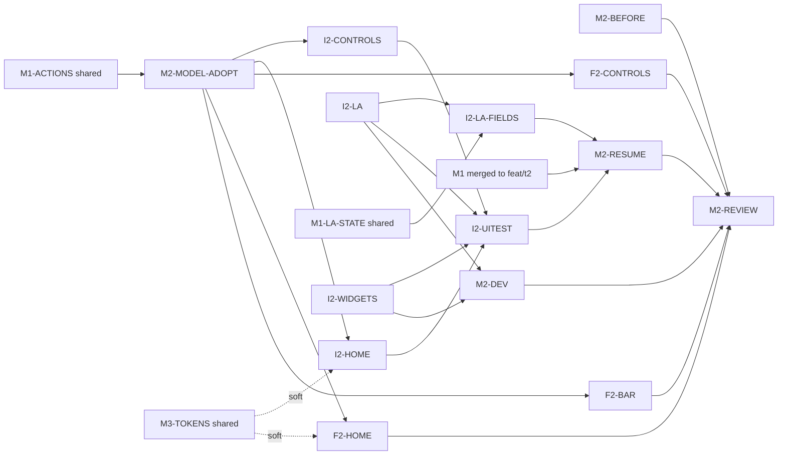

# Plan: M2 · active surfaces

**Status:** revision 4 (2026-11-25, M2 lead's plan check: M2-BEFORE added, I2-LA
split into I2-LA + I2-LA-FIELDS, I2-WIDGETS and I2-LA no longer wait on
M2-MODEL-ADOPT, the typed-Auto Control test moved to M2-RESUME). **Spec:**
[active-surfaces.md](../specs/active-surfaces.md). **Programme plan:**
[t2-plan.md](../specs/t2-plan.md); its scope guard, out-of-scope list, merge
ritual, seams and ownership table, simulator budget, effort legend and open
questions apply here unchanged. **Branch:** `t2/m2` off `feat/t2`; WP branches
`t2/m2-<wp>`, one worktree each under `/Users/richie/code/quickr-worktrees/`.
**Lead:** M2 lead. **Evidence:** `docs/t2/evidence/M2.md` and
`docs/t2/evidence/M2/` (below).

## Definition of done (every WP)

A WP is done when its **Acceptance** holds, the tests its **DoD** names pass,
and the evidence is in the PR description (team rules, "Definition of done and
proof"):

- the commands run, with pass/fail counts copied from the output;
- for iOS, the xcresult path and the test count (a plan with 0 tests run is a
  failure); for host runs, the `swift test` summary line;
- the Codex review file (`codex -o` output committed under the WP's worktree and
  attached to the PR) and how each finding was resolved;
- the CI run link; `make check` (and `make check-ios` when `ios/` changed)
  green, no skipped or disabled tests;
- for UI WPs, screenshots under `docs/t2/evidence/M2/` (iOS light and dark, a
  large Dynamic Type check, the Live Activity/widget states where relevant, PWA
  mobile width) and a short GIF/MP4 for interaction flows;
- anything found outside scope filed as a `t2-followup` issue and linked.

Friction is logged as it happens to
`/Users/richie/code/quickr-worktrees/_friction/<agent-name>.jsonl` (format in
`_friction/README.md`); never edit another agent's file.

**Brief.** Big chunky run controls with Lap primary, separated from the lap
table without duplication; an "Active now" home section with a tinted active
card carrying inline Lap/Next + Stop; Live Activity, widget and Control layouts
that mirror the primary rule; PWA equivalents. Layout only: the model is M1's
`RunAction` (active-surfaces.md §1). The brief's "M2-TILE" is I2-HOME/F2-HOME;
"M2-LA" is I2-LA.

### M2-BEFORE · "before" screenshots · sim · S · first

- **Scope:** the evidence baseline the user asked for (before/after pairs): from
  `t2/m2` at its base commit (`feat/t2`, before any WP merges) capture the iOS
  home screen with one running timed topic, one due topic and idle topics, and
  the run screen on a lap topic (the state of the user's screenshot), each in
  light, dark and XXXL, via the UI-test fake server (`UITestRuns`) on the
  worktree's clone; the PWA topics page and run panel at mobile width (390 px),
  light and dark. Store under `docs/t2/evidence/M2/before/`, PNG, kept small. No
  code changes beyond a throwaway screenshot test that is not committed.
- **Depends on:** nothing. Runs now, while the simulator slots are free; one
  clone, shut down at the end.
- **Acceptance:** the files exist and show today's layout (Stop as the tile's
  block, Lap in the table row, no "Active now" section).
- **DoD:** the files on `t2/m2`; the xcresult path or script used; the clone
  shut down (`xcrun simctl shutdown <udid>`); no review needed (docs only).

### M2-MODEL-ADOPT · layout model over `RunAction` · host + fe · S · first

- **Scope:** iOS `QuickrCore/Surfaces/RunControlsLayout.swift` (new):
  `RunControlsLayout(actions:) -> {primary, secondaries, overflow}` plus
  `tile(actions:)` (primary + stop + optional pause/resume); unknown roles go to
  overflow. The Live Activity and the widgets do **not** go through it: they
  read `RunActivityDisplay.buttons` from the content state (active-surfaces.md
  §4.1, §5.1), so I2-LA and I2-WIDGETS do not depend on this WP. PWA
  `src/components/runs/controlsLayout.ts` (new), same shape. The shared sizes
  `QuickrButtonSize.hero` (`QuickrUI/Components/Buttons.swift`) and PWA
  `Button size="hero"` (active-surfaces.md §8.1).
- **Areas:** the two new files and their tests; `Buttons.swift`, `Button.tsx`.
- **Depends on:** M1-ACTIONS (shared branch). The `hero` sizes have no
  dependency and are the WP's first commit.
- **Acceptance:** for each of the 14 rows of active-surfaces.md §1.2 the
  primary, secondaries and overflow match the table; `reopen`/`revert` in the
  input land in their role's slot without code changes (`reopen` secondary,
  `revert` destructive; active-surfaces.md §1.2).
- **Tests:** `RunControlsLayoutTests` (host), `controlsLayout.test.ts`.
- **Review round 1 (A9, D8):** the primary rule is cited from timers2.md §10
  verbatim, never restated; the layout model consumes M1's
  `actions(_ state:status:timer:now:)`.
- **Review round 2 (A13, B1):** the signatures are active-surfaces.md §1.1 (=
  timers2.md §10) and the state table of §1.2 is the fixture for the layout
  tests; neither is restated here.
- **DoD:** the Acceptance above holds, proven by `RunControlsLayoutTests`
  (host), `controlsLayout.test.ts`. Evidence in the PR:
  `pnpm exec vitest run <the tests above>` pass counts and a green
  `make check-frontend`;
  `cd ios/QuickrKit && swift test --filter <the suites above>` summary lines
  with counts (plus `make ios-core-test` once); the Codex review file with each
  finding resolved or justified; the CI run link.

### I2-CONTROLS · run screen restructure · host · M

- **Scope:** new `App/Runs/RunControls.swift` (primary ≥ 72 pt tall full width,
  secondaries 56 pt, destructive in the overflow menu; accessibility ids per
  active-surfaces.md §2.2); `RunScreen.swift` restructured as header (clock,
  segment, headline, alert line from `RunPresentation.alertLine` shown 10 s) →
  controls → lap/step table (a `qrCard` with lap types, no controls in it);
  `RunViews.swift` shared pieces (`RunStatusLine` with lap counter); the stop
  toast offers Resume when `resumable` (renders nothing until M1 lands it).
- **Areas:** `App/Runs/`.
- **Depends on:** M2-MODEL-ADOPT.
- **Acceptance:** no control appears twice on the screen; Dynamic Type XXXL
  stacks the secondaries; reduce-motion path has no bare `withAnimation`
  (`lint-motion.sh`); verified by I2-UITEST.
- **Tests:** `RunControlsLayoutTests` cover the model; the views in I2-UITEST.
- **Review round 1 (A7, D9):** the stop toast's Resume sends `reopen` with
  `entry.timing.terminal_id`; a run in the "resuming" projection renders the
  header and "Resuming…" with no controls until the ack. Overflow menu id is
  `run.menu`.
- **DoD:** the Acceptance above holds, proven by `RunControlsLayoutTests` cover
  the model; the views in I2-UITEST. Evidence in the PR:
  `cd ios/QuickrKit && swift test --filter <the suites above>` summary lines
  with counts (plus `make ios-core-test` once); the Codex review file with each
  finding resolved or justified; the CI run link. UI WP: run-screen screenshots
  (light/dark + XXXL) and the lap → stop GIF are captured in I2-UITEST and
  cross-referenced here.

### I2-HOME · Active now section and active card · host · M

- **Scope:** `HomeView.swift` "Active now" section above "Due now"
  (`home.section.active`); `HomeModel.swift` partition by `openRuns` (UI-level,
  no `TopicListing.sections` change, no vector change: **decided here**); new
  `App/Home/Tiles/ActiveTopicCard.swift` (larger, tinted by `TopicTheme` or the
  accent default, clock, segment, inline primary + Stop, Pause/Resume secondary,
  accessibility ids per active-surfaces.md §3.2); `TileView.swift` is unchanged
  (it already has a `quick:` slot; the active card is its own `qrCard`, spec
  §3.2); `TopicTile.swift` idle tiles keep the start block; a Resume text button
  in the idle tile's `meta` within the OQ-1 window.
- **Areas:** `App/Home/`, `QuickrData/Home/HomeModel.swift`.
- **Depends on:** M2-MODEL-ADOPT for the card's controls row only; the
  partition, the section and the card's header/clock/headline rows start before
  it lands; soft M3-TOKENS.
- **Acceptance:** a topic with an open run appears once, in "Active now", and
  not in "Due now"; `dueCount` unchanged (timers.md R11 still green); the
  section disappears when no run is open.
- **Tests:** `HomeModelTests.activePartition`, `HomeVectorTests` unchanged;
  `HomeTests`/`TileUITests` in I2-UITEST.
- **Review round 1 (A7, D9):** the idle tile's Resume uses
  `entry.timing.terminal_id` (accessibility id per active-surfaces.md §3.2); a
  "resuming" run shows the active card without controls until the ack.
- **DoD:** the Acceptance above holds, proven by
  `HomeModelTests.activePartition`, `HomeVectorTests` unchanged;
  `HomeTests`/`TileUITests` in I2-UITEST. Evidence in the PR:
  `cd ios/QuickrKit && swift test --filter <the suites above>` summary lines
  with counts (plus `make ios-core-test` once); the Codex review file with each
  finding resolved or justified; the CI run link. UI WP: home and active-card
  screenshots (light/dark + XXXL) captured in I2-UITEST.

### I2-LA · Live Activity layouts · host · M

- **Scope:** `Widgets/RunActivityWidget.swift` lock-screen layout (primary
  dominant, Stop secondary, segment timer + alert countdown
  `Text(timerInterval:countsDown: true)` to `alert_at`, alert label), Dynamic
  Island compact shows the lap counter;
  `QuickrCore/Runs/RunActivityDisplay.swift` `buttons` with lap primary,
  `alertAt`, `lapCount`; `QuickrData/Intents/RunActivityIntents.swift` unchanged
  button set; `RunActivityCenter.swift` snapshot carries the new fields (M1's
  `startFor`-on-reopen lives in `RunActivityCenter+Reopen.swift`, not here).
- **Areas:** `Widgets/RunActivityWidget.swift`,
  `QuickrCore/Runs/RunActivityDisplay.swift`, `QuickrData/LiveActivity/` except
  `RunActivityCenter+Reopen.swift`.
- **Depends on:** nothing hard. This WP is the **layout and the §4.1 primary
  rule** over today's content state: `headline` falls back to `label`,
  `lapCounter` and `alert` are nil, exactly the "before it lands" column of
  active-surfaces.md §8.2. The M1-LA-STATE fields are **I2-LA-FIELDS** (below),
  which keeps review E5's hard edge on the fields without holding the layout and
  the simulator wave behind M1-FOLD.
- **Acceptance:** `RunActivityDisplayTests` over every existing vector case: a
  lap open with a step remaining is now `.lap` (§4.1 replaces the v1
  `nextLabel != nil` test), last step `.lap`, no steps `.lap`, steps unknown
  `.next`, `buttons` = `[primary, pause|resume, stop]`; `primary == buttons[0]`;
  no vector shape change; `LiveActivityReconcileTests` unchanged.
- **Tests:** as listed (host); rendering on the device checklist.
- **DoD:** the Acceptance above holds, proven by as listed (host); rendering on
  the device checklist. Evidence in the PR:
  `cd ios/QuickrKit && swift test --filter <the suites above>` summary lines
  with counts (plus `make ios-core-test` once); the Codex review file with each
  finding resolved or justified; the CI run link. UI WP: Live Activity states
  are rendered via the widget gallery in I2-UITEST; real Lock Screen rendering
  is device-only.

### I2-LA-FIELDS · Live Activity state fields · host · S · after M1-LA-STATE

- **Scope:** once `t2/m1-la-state` is merged into `t2/m2` (shared WP branch,
  merge ritual run): `RunActivityDisplay` reads `lap_type`, `lap_count`,
  `next_label` during laps, `alert_at` and `alert_label` into `headline`,
  `lapCounter` and `alert` (nil while paused); the `.lap` title "Lap →
  {next_label}"; `RunActivityWidget` shows the alert countdown and the compact
  "L4"; `RunActivityCenter` snapshot carries the new fields.
- **Areas:** as I2-LA.
- **Depends on:** I2-LA; **M1-LA-STATE (hard, review E5)**.
- **Acceptance:** `RunActivityDisplayTests` over the five new vector cases
  (`update_tiktok_lap`, `update_alert_pending`, `update_alert_paused`,
  `start_renamed_laps`, `update_reopened`): headline, lap counter, alert nil
  while paused, primary per §4.1.
- **Tests:** as listed (host).
- **DoD:** the Acceptance above holds, proven by the tests named above. Evidence
  in the PR: `cd ios/QuickrKit && swift test --filter <the suites above>`
  summary lines with counts; the Codex review file with each finding resolved or
  justified; the CI run link. The sim re-run of `LiveActivityTapTests` is
  M2-RESUME's.

### I2-WIDGETS · widgets and Control text · host · M

- **Scope:** `QuickrUI/Widgets/WidgetViews.swift` timed layouts mirror the
  primary rule; `QuickrCore/Widgets/WidgetTopic.swift` `runButtons` lap-primary
  with the next type label; `Widgets/TopicControl.swift` `TimerControl` detail
  "Lap → Rest" when applicable; `App/Debug/WidgetGalleryView.swift` new states.
  No second Control kind. The **conditional Auto rule** (active-surfaces.md
  §5.3, timers2.md §10: `timer.laps` non-empty → Auto = the on-screen primary;
  laps empty → the v1 Auto ending in Stop) is implemented in I1-WRITES
  (`RunWrites.auto`); this WP renders it and tests both branches through the
  Control (review C9).
- **Areas:** as listed.
- **Depends on:** nothing (the widgets read `RunActivityDisplay`, not
  `RunAction`); the typed-lap `next_label` arrives with I2-LA-FIELDS and needs
  no layout change here.
- **Acceptance:** `TimedWidgetTests` cover idle, step, typed lap, paused,
  compact Auto; `WidgetControlTests` (sim, in I2-UITEST) show the new detail
  text and drive Auto through the Control for an untyped timer (v1 sequence
  ending in Stop); the typed-timer branch (Auto = lap) needs I1-WRITES and is
  run in M2-RESUME; the app still has ≤ 10 App Shortcuts.
- **Tests:** `TimedWidgetTests` (host); `WidgetControlTests`,
  `RunIntentHandlerTests` in I2-UITEST.
- **DoD:** the Acceptance above holds, proven by `TimedWidgetTests` (host);
  `WidgetControlTests`, `RunIntentHandlerTests` in I2-UITEST. Evidence in the
  PR: `cd ios/QuickrKit && swift test --filter <the suites above>` summary lines
  with counts (plus `make ios-core-test` once); the Codex review file with each
  finding resolved or justified; the CI run link. UI WP: widget gallery
  screenshots light/dark/tinted/a11y in I2-UITEST.

### I2-UITEST · simulator: run screen, home, widget gallery · sim · L · last

- **Scope:** `RunUITests.testLapIsPrimaryWithChunkyControls` (Lap primary on a
  lap topic, frame height ≥ 72 pt, Stop secondary, no duplicate Lap in the
  table), `RunUITests.testStartNextNextSkipPauseResumeStopAnswerSave` updated
  for the new ids (R9 still holds),
  `HomeTests.testActiveNowSectionShowsOpenRun`,
  `TileUITests.testActiveCardInlineLapAndStop`, `WidgetViewsUITests` gallery
  screenshots light/dark/tinted/a11y, the Unit plan on the clone
  (`WidgetControlTests`, `RunIntentHandlerTests`, `LiveActivityTapTests`).
  Fake-server needs go to M1 as patches to `UITestRuns.swift`.
- **Areas:** `UITests/`, `AppTests/`.
- **Depends on:** I2-CONTROLS, I2-HOME, I2-LA, I2-WIDGETS.
- **Acceptance:** all listed tests pass once on the worktree clone; screenshots
  stored under `docs/t2/evidence/M2/`.
- **DoD:** the Acceptance above holds, proven by the tests named in Acceptance.
  Evidence in the PR: the xcresult path
  (`ios/build/results/<plan>-<date>-<time>-<rand>/<plan>.xcresult`) and its
  non-zero test count; screenshots iOS light/dark + XXXL (and LA/widget states
  where the scope names them) under `docs/t2/evidence/M2/`; a GIF/MP4 per
  interaction flow; the clone shut down (`xcrun simctl shutdown <udid>`) at the
  end of the run; the Codex review file with each finding resolved or justified;
  the CI run link.

### M2-RESUME · simulator: Resume from toast and tile · sim · S · after M1 merged

- **Scope:** after M1 has merged to `feat/t2` and `feat/t2` is merged into
  `t2/m2`: `RunUITests.testStopToastOffersResume` (stop, tap Resume, the run is
  Running with a gap pause row),
  `TileUITests.testIdleTileOffersResumeWithin15Min`; the Unit plan re-run on the
  clone (`WidgetControlTests` typed-timer Auto = lap branch,
  `LiveActivityTapTests` after I2-LA-FIELDS, `RunIntentHandlerTests`); the lap →
  stop → Resume GIF.
- **Depends on:** I2-UITEST, I2-LA-FIELDS, M1 merged.
- **Acceptance:** both pass once; the Resume control disappears after the window
  (fake clock); the Unit plan's named suites pass with a non-zero count.
  Simulator-only because both are XCUITest flows through the app and the
  `UITestRuns` fake server (timers2.md R21 lives here).
- **DoD:** the Acceptance above holds, proven by the tests named in Acceptance.
  Evidence in the PR: the xcresult path
  (`ios/build/results/<plan>-<date>-<time>-<rand>/<plan>.xcresult`) and its
  non-zero test count; screenshots iOS light/dark + XXXL (and LA/widget states
  where the scope names them) under `docs/t2/evidence/M2/`; a GIF/MP4 per
  interaction flow; the clone shut down (`xcrun simctl shutdown <udid>`) at the
  end of the run; the Codex review file with each finding resolved or justified;
  the CI run link.

### F2-CONTROLS · PWA run controls · fe · M

- **Scope:** new `src/components/runs/RunControls.tsx` over `controlsLayout.ts`;
  `RunPanel.tsx` restructured (header with alert line → controls → table, no
  duplication); `RecordPage.tsx` timed branch; the stop toast offers Resume when
  `resumable`.
- **Areas:** `src/components/runs/`, `src/pages/topic/RecordPage.tsx`.
- **Depends on:** M2-MODEL-ADOPT.
- **Acceptance:** `RunFlow.test.tsx` still drives start → Next → Skip → Pause →
  Resume → Stop → answers → Save through the new controls; Lap is the primary on
  a lap topic; a mobile-width screenshot in the evidence.
- **Tests:** `RunControls.test.tsx` (new), `RunFlow.test.tsx`.
- **Review round 1 (A7, D9):** toast Resume uses `entry.timing.terminal_id`; the
  "resuming" projection renders without controls.
- **DoD:** the Acceptance above holds, proven by `RunControls.test.tsx` (new),
  `RunFlow.test.tsx`. Evidence in the PR:
  `pnpm exec vitest run <the tests above>` pass counts and a green
  `make check-frontend`; the Codex review file with each finding resolved or
  justified; the CI run link. UI WP: PWA run panel at mobile width, light/dark,
  plus a GIF of the lap flow.

### F2-HOME · PWA Active now and active card · fe · M

- **Scope:** `TopicsPage.tsx` "Active now" section; new `ActiveTopicCard.tsx`
  (uses `topicStyle` if present, accent default); `TopicTile.tsx` idle state
  unchanged apart from the Resume action within the window.
- **Areas:** `src/pages/TopicsPage.tsx`, `src/components/topics/`.
- **Depends on:** M2-MODEL-ADOPT; soft M3-TOKENS.
- **Acceptance:** an open run's topic renders once, in the active section;
  `home-due-vectors.json` unchanged.
- **Tests:** `TopicsPage.test.tsx` (new), `ActiveTopicCard.test.tsx`,
  `TopicTile.test.tsx`.
- **Review round 1 (A7, D9):** tile Resume uses `entry.timing.terminal_id`;
  "Resuming…" card without controls until the ack.
- **DoD:** the Acceptance above holds, proven by `TopicsPage.test.tsx` (new),
  `ActiveTopicCard.test.tsx`, `TopicTile.test.tsx`. Evidence in the PR:
  `pnpm exec vitest run <the tests above>` pass counts and a green
  `make check-frontend`; the Codex review file with each finding resolved or
  justified; the CI run link. UI WP: PWA topics page with an active card at
  mobile width, light/dark.

### F2-BAR · running bar and run tile · fe · S

- **Scope:** `RunTile.tsx`, `RunningBar.tsx` consume the layout model's primary
  (Lap with the next type label); remove `useRunPrimary`.
- **Depends on:** M2-MODEL-ADOPT.
- **Acceptance:** the bar's button matches the run screen's primary in every
  state.
- **Tests:** `RunTile.test.tsx`.
- **DoD:** the Acceptance above holds, proven by `RunTile.test.tsx`. Evidence in
  the PR: `pnpm exec vitest run <the tests above>` pass counts and a green
  `make check-frontend`; the Codex review file with each finding resolved or
  justified; the CI run link. UI WP: running bar screenshot at mobile width.

### M2-DEV · device checklist entries · docs · S

- **Scope:** M0 already seeded six items under "M2 · active surfaces" in
  `docs/t2/device-checklist.md` (Lock Screen activity, Dynamic Island, Timer
  control, Action button Auto, active card, Resume within 15 minutes). This WP
  checks each against what shipped (ids, labels, the §5.3 Auto carve-out on an
  untyped topic), fixes drift, and appends what is missing: a Lap tap from the
  Lock Screen with the app killed, the Control on an untyped topic reading
  "Stop", Smart Stack / StandBy (observe only).
- **Acceptance:** the entries exist in `docs/t2/device-checklist.md` under "M2",
  each with steps and the expected result.
- **Depends on:** I2-LA, I2-WIDGETS.
- **DoD:** the Acceptance above holds, proven by the tests named in Acceptance.
  Evidence in the PR: the named file exists on the milestone branch and is
  linked from the milestone PR; the Codex review file with each finding resolved
  or justified; the CI run link.

### M2-REVIEW · milestone review · docs · S

- As M1-REVIEW, against active-surfaces.md; evidence in `docs/t2/evidence/M2.md`
  with light/dark/XXXL screenshots of the run screen, home and the widget
  gallery, PWA mobile width, and a recording of a lap/stop/resume flow.
- **Acceptance:** no open finding inside scope; every other finding has a
  `t2-followup` issue; `docs/t2/evidence/M2.md` is complete; the milestone PR to
  `feat/t2` is ready with the five checks green.
- **Depends on:** every other M2 WP (M2-RESUME included).
- **DoD:** the Acceptance above holds, proven by the tests named in Acceptance.
  Evidence in the PR: the named file exists on the milestone branch and is
  linked from the milestone PR; the Codex review file with each finding resolved
  or justified; the CI run link.

### M2 DAG

| WP             | Depends on                                         | Class     | Effort |
| -------------- | -------------------------------------------------- | --------- | ------ |
| M2-BEFORE      | —                                                  | sim       | S      |
| M2-MODEL-ADOPT | M1-ACTIONS (shared)                                | host + fe | S      |
| I2-CONTROLS    | M2-MODEL-ADOPT (controls view only)                | host      | M      |
| I2-HOME        | M2-MODEL-ADOPT (controls row only); M3-TOKENS soft | host      | M      |
| I2-LA          | —                                                  | host      | M      |
| I2-LA-FIELDS   | I2-LA, M1-LA-STATE (shared, hard)                  | host      | S      |
| I2-WIDGETS     | —                                                  | host      | M      |
| I2-UITEST      | I2-CONTROLS, I2-HOME, I2-LA, I2-WIDGETS            | sim       | L      |
| M2-RESUME      | I2-UITEST, I2-LA-FIELDS, M1 merged to `feat/t2`    | sim       | S      |
| F2-CONTROLS    | M2-MODEL-ADOPT (controls view only)                | fe        | M      |
| F2-HOME        | M2-MODEL-ADOPT (controls row only); M3-TOKENS soft | fe        | M      |
| F2-BAR         | M2-MODEL-ADOPT                                     | fe        | S      |
| M2-DEV         | I2-LA, I2-WIDGETS                                  | docs      | S      |
| M2-REVIEW      | all                                                | docs      | S      |

"Controls view/row only": the WP starts on its model, section, header and table
work before M2-MODEL-ADOPT merges, and takes `t2/m2` into its branch for the
`RunControlsLayout`-driven part last.

**Critical path:** M1-ACTIONS → M2-MODEL-ADOPT → I2-CONTROLS / I2-HOME →
I2-UITEST → M2-RESUME (waits for M1 merged and I2-LA-FIELDS) → M2-REVIEW. PWA
work runs beside it. The M1 merge wait dominates: everything but M2-RESUME and
M2-REVIEW is expected to be in `t2/m2` well before it.

**Waves:** W0 (now) M2-BEFORE, I2-WIDGETS, I2-LA; W1 (M1-ACTIONS in `t2/m2`)
M2-MODEL-ADOPT, then F2-BAR, F2-CONTROLS, F2-HOME, I2-CONTROLS, I2-HOME (at most
four implementers at once); W2 I2-UITEST (sim); W3 M2-DEV, I2-LA-FIELDS (when
M1-LA-STATE is in `t2/m2`), M2-RESUME (sim, after M1 merged), one
`make check-ios`, M2-REVIEW.

## Milestone evidence

`docs/t2/evidence/M2.md` on `t2/m2`: criteria → proof; screenshots under
`docs/t2/evidence/M2/` (run screen, "Active now" section and active card, iOS
light/dark + XXXL; widget gallery light/dark/tinted/a11y; PWA run panel and
topics page at mobile width), each paired with its M2-BEFORE baseline from
`docs/t2/evidence/M2/before/` (the user judges this milestone by the
before/after pairs of the home screen and the run screen); GIFs of lap → stop →
Resume on iOS and in the PWA; review reports; the `make check-ios` run.

### Device-only (the simulator cannot prove)

- The Live Activity on the real Lock Screen and in the Dynamic Island with the
  lap-primary button, the alert countdown reaching 0:00, compact lap counter.
- A Lap tap from the Lock Screen with the app killed.
- The Control Center Timer control's "Lap → Rest" text and its tap.
- The Action button's Auto on a lap topic.
- Smart Stack / StandBy derivations (observe only).
