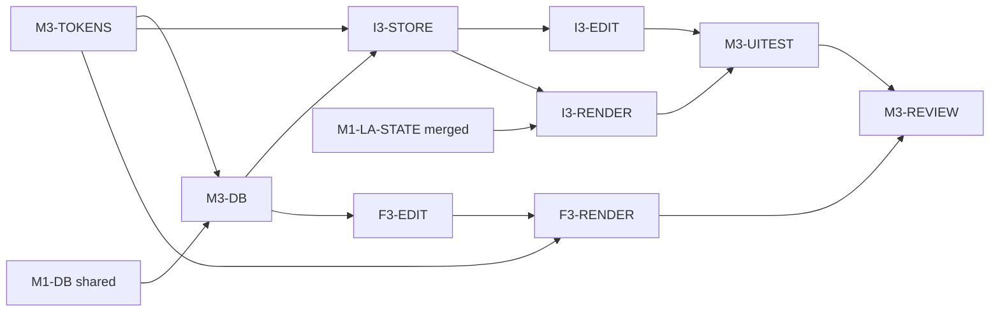

# Plan: M3a · appearance phase A

**Status:** draft (revision 3, 2026-11-25, after review round 2). **Spec:**
[appearance.md](../specs/appearance.md). **Programme plan:**
[t2-plan.md](../specs/t2-plan.md); its scope guard, out-of-scope list, merge
ritual, seams and ownership table, simulator budget, effort legend and open
questions apply here unchanged. **Branch:** `t2/m3a` off `feat/t2`; WP branches
`t2/m3a-<wp>`, one worktree each under `/Users/richie/code/quickr-worktrees/`.
**Lead:** M3 lead. **Evidence:** `docs/t2/evidence/M3a.md` and
`docs/t2/evidence/M3a/` (below).

## Definition of done (every WP)

A WP is done when its **Acceptance** holds, the tests its **DoD** names pass,
and the evidence is in the PR description (team rules, "Definition of done and
proof"):

- the commands run, with pass/fail counts copied from the output;
- for iOS, the xcresult path and the test count (a plan with 0 tests run is a
  failure); for host runs, the `swift test` summary line;
- the Codex review file (`codex -o` output committed under the WP's worktree and
  attached to the PR) and how each finding was resolved;
- the CI run link; `make check` (and `make check-ios` when `ios/` changed)
  green, no skipped or disabled tests;
- for UI WPs, screenshots under `docs/t2/evidence/M3a/` (iOS light and dark, a
  large Dynamic Type check, the Live Activity/widget states where relevant, PWA
  mobile width) and a short GIF/MP4 for interaction flows;
- anything found outside scope filed as a `t2-followup` issue and linked.

Friction is logged as it happens to
`/Users/richie/code/quickr-worktrees/_friction/<agent-name>.jsonl` (format in
`_friction/README.md`); never edit another agent's file.

**Brief.** Topic-level colour, emoji icon and tags (appearance.md §1–§7), a
12-colour palette pinned by `appearance-vectors.json`, a theme API on both
clients (`TopicTheme`, `topicStyle`), the appearance editor in both builders,
the topic header and the reminder title prefix. Rendering in M2-owned surfaces
(tiles, run screen header, LA/widget tint, home tag filter) is wired in T2-WIRE
unless M2 took M3-TOKENS early.

### M3-TOKENS · theme API on both clients · host + fe · M · first (shared with M2)

- **Scope:** iOS `QuickrCore/Models/TopicAppearance.swift` (value type:
  `color: ColorName?`, `icon: TopicIcon?` (`.emoji(String)`), `tags: [String]`),
  `QuickrUI/Tokens/TopicTheme.swift` (`tint`, `tintSoft`, `onTint`, `glyph`;
  `TopicTheme(appearance:)` default = accent tokens, no glyph; environment key
  `\.topicTheme`; `.topicTheme(for:)`), `QuickrUI/Icons/TopicGlyph.swift` +
  `TopicGlyphView` (emoji or fallback initial),
  `QuickrUI/Resources/TopicColors.xcassets` (12 colours ×
  `tint`/`tintSoft`/`onTint`, light/dark; outside `TokenDriftTests`' scope), a
  `DesignCatalogView` section. PWA `src/lib/appearance.ts`
  (`topicStyle(appearance) -> CSSProperties` setting `--topic-tint`,
  `--topic-tint-soft`, `--topic-on-tint`; palette table light and dark),
  `index.css` utilities `bg-topic`, `bg-topic-soft`, `text-topic`,
  `text-on-topic`, `border-topic`, `src/components/ui/TopicGlyph.tsx`.
- **Depends on:** nothing (values from appearance.md's palette table; the vector
  drift test is switched on in M3-DB).
- **Acceptance:** `TopicThemeTests`: nil appearance gives the accent theme and
  no glyph; each of the 12 colours resolves in light and dark; the glyph falls
  back to the topic's initial. `appearance.test.ts`: the same, plus the CSS
  variables emitted.
- **Tests:** as listed (QuickrDesignTests on the host; vitest).
- **DoD:** the Acceptance above holds, proven by as listed (QuickrDesignTests on
  the host; vitest). Evidence in the PR:
  `pnpm exec vitest run <the tests above>` pass counts and a green
  `make check-frontend`;
  `cd ios/QuickrKit && swift test --filter <the suites above>` summary lines
  with counts (plus `make ios-core-test` once); the Codex review file with each
  finding resolved or justified; the CI run link.

### M3-DB · migration, schemas, limits, vectors, reminder prefix, MCP · be · M

- **Scope:** `20261127_f7a4b0c5d326_topic_appearance.py`:
  `topics.color VARCHAR(16)`, `topics.icon VARCHAR(16)`,
  `topics.tags JSONB NOT NULL DEFAULT '[]'`; `models.py`; `schemas/api.py`
  `TopicAppearance` on `TopicCreate`/`TopicUpdate`/`TopicSummary`/`TopicDetail`
  and the `topic` feed item; new `services/appearance.py` (the reference
  validation of appearance.md §1.3 and §2: named colour, one emoji grapheme
  after normalisation, tags stripped and whitespace-collapsed, 1..24 code
  points, ≤ 10, unique casefolded) with dotted 422 paths; `services/topics.py`
  PATCH bumps `revision` and `_log_topic` re-sends the topic; `listTopics`
  `?tag=` filter (appearance.md §15); `limits.py` + `Limits`: `max_tags 10`,
  `max_tag_length 24`, `max_icon_length 16`, `color_names` (the 12, in palette
  order); mirrors (`FALLBACK_LIMITS`, `Limits.serverDefaults`,
  `getLimits.json`); generator `tests/test_appearance_vectors.py` →
  `shared/fixtures/appearance-vectors.json` (`palette[]` with light/dark
  `tint`/`tintSoft`/`onTint` and a contrast assertion, `icons[]`, `tags[]`,
  `reminder_titles[]`, appearance.md §3.2) and the drift tests on both clients
  switched to it; reminder title prefix `"{emoji} {topic name}"` in
  `push/apns.py` and the Web Push payload with new cases in
  `apns-payload-vectors.json`/`notification-vectors.json` as appearance.md §6
  and §16 name them; MCP `create_topic`/`update_topic` params `color`, `icon`,
  `tags`, `clear_icon`; API fixtures (`getTopic`, `updateTopic`, `listTopics`
  with appearance); `openapi.json`, `make client`; minimal Swift:
  `TopicDTO`/`TopicSummaryDTO` optional `appearance` (M3's own file).
- **Areas:** `backend/alembic/versions/`, `backend/app/models.py`,
  `schemas/{api,limits}.py`, `services/topics.py`, `push/apns.py`,
  `services/notification.py`, `mcp_server.py`, `backend/tests/`,
  `shared/fixtures/`, the limits mirrors, `QuickrData/Contracts/TopicDTO.swift`.
- **Depends on:** M1-DB (shared branch, for the Alembic chain), M3-TOKENS.
- **Acceptance:** migration round trip; 422 paths `appearance.tags.3`,
  `appearance.icon.value`, `appearance.color`, `appearance.tags`;
  `appearance: null` → 422, `tags: []` accepted; a PATCH of appearance alone
  bumps `revision` and emits a `topic` feed item; `?tag=` matches the stored
  spelling exactly (JSONB `?`; uniqueness is casefolded on write, B4); the
  reminder title carries the emoji and stays ≤ 120 chars;
  `DueReminderVectorTests` and `NotificationVectorTests` pass on iOS; both
  clients' palette tests read the vector file.
- **Tests:** `test_api_topics.py` additions (appearance.md §16), vector drift,
  `test_mcp.py` appearance params, the feed re-send case.
- **Review round 1 (D7):** the server emoji predicate is exact: `regex` `^\X$`
  (one extended grapheme cluster) whose first scalar is
  `\p{Extended_Pictographic}`, or a regional-indicator pair, or a keycap
  sequence; digits with VS16 are refused. `appearance-vectors.json` `icons[]`
  lists accept/reject cases incl. a flag pair, a keycap, a multi-person ZWJ
  emoji, a skin-tone modifier, `1️⃣`-style keycaps, a digit + VS16 (rejected),
  and marks the cases where iOS is stricter or looser. `?tag=` on `listTopics`
  (appearance.md §15).
- **DoD:** the Acceptance above holds, proven by `test_api_topics.py` additions
  (appearance.md §16), vector drift, `test_mcp.py` appearance params, the feed
  re-send case. Evidence in the PR:
  `cd backend && uv run pytest -q <the files above>` pass counts; when
  generators or fixtures change, the `make vectors` diff is in the PR; migration
  WPs paste the `alembic upgrade head` and `downgrade` output; the Codex review
  file with each finding resolved or justified; the CI run link.

### I3-STORE · store migration, DTOs, writes · host · M

- **Scope:** `StoreSchema+T2M3.swift` with `t2m3_topic_appearance`
  (`ALTER TABLE topic ADD COLUMN color, icon, tags_json` on `topic` and
  `stage_topic`; **resets the feed cursor** (topic re-pull) as `v2` did; review
  D3 reversed the earlier "no re-pull" claim, appearance.md §8 updated);
  `TopicDTO`, `TopicSummaryDTO` `@RequiredKey appearance`, `TopicRequestDTO`;
  `StoreView` mapping; `Topic`/`ViewTopic.appearance`;
  `TopicWrites.updateAppearance` (PATCH with `expected_revision`); `TopicWriter`
  `TopicDetailsChange.appearance`; request golden `updateTopic.appearance`.
- **Depends on:** M3-DB, M3-TOKENS.
- **Acceptance:** `api/getTopic.json` decodes with and without appearance;
  `MappingTests` carry the fields to `ViewTopic`; after the migration the next
  sync re-pulls topics, so a topic themed on another device shows its theme
  (upgrade test with an unchanged pre-existing topic); the golden validates in
  pytest.
- **Tests:** store migration test, `TopicDTOTests`, `MappingTests`,
  `TopicWritesTests`, `RequestGoldenTests`.
- **Review round 1 (E4):** the `StoreSchema.swift` registration line is added at
  merge time by the merger, not here; if M1's `t2m1_*` migration is already on
  `feat/t2` when this merges, this WP adds `StoreMigrationOrderTests` (upgrade a
  fresh store with `t2m1` then `t2m3` and the reverse; same schema).
- **DoD:** the Acceptance above holds, proven by store migration test,
  `TopicDTOTests`, `MappingTests`, `TopicWritesTests`, `RequestGoldenTests`.
  Evidence in the PR:
  `cd ios/QuickrKit && swift test --filter <the suites above>` summary lines
  with counts (plus `make ios-core-test` once); the Codex review file with each
  finding resolved or justified; the CI run link.

### I3-EDIT · appearance editor · host · M

- **Scope:** new `App/Topics/Builder/AppearanceEditorView.swift` (12 swatches,
  an emoji text field using the system keyboard, tags input with chips;
  accessibility ids per appearance.md §7); an Appearance row in
  `NewTopicScreen.topicSection` and `TopicSettingsView.detailsSection`;
  `NewTopicModel`/`TopicSettingsModel` fields and client-side validation (tag
  rules, grapheme count); must not touch `TimerSections`.
- **Depends on:** I3-STORE.
- **Acceptance:** `NewTopicModelTests`/`TopicSettingsModelTests`: a duplicate
  tag (casefolded) is refused, an 11th tag is refused, clearing the icon sends
  `icon: null`; save goes through `TopicWrites.updateAppearance` with the
  revision.
- **Tests:** QuickrDesignTests as listed.
- **Review round 1 (D7):** iOS `checkIcon` predicate: one `Character` whose
  first scalar `isEmojiPresentation`, or (`isEmoji && !isASCII` followed by
  U+FE0F), or two regional indicators, or a keycap sequence; `!isASCII` is what
  refuses a digit + VS16. `TopicThemeTests` runs the `icons[]` vectors and
  asserts the documented stricter/looser cases.
- **DoD:** the Acceptance above holds, proven by QuickrDesignTests as listed.
  Evidence in the PR:
  `cd ios/QuickrKit && swift test --filter <the suites above>` summary lines
  with counts (plus `make ios-core-test` once); the Codex review file with each
  finding resolved or justified; the CI run link. UI WP: editor screenshots
  (light/dark + XXXL) captured in M3-UITEST.

### I3-RENDER · topic header and LA attributes · host · S

- **Scope:** `App/Entries/TopicTabsView.swift` header: glyph, tint bar, tag
  chips (ids per appearance.md §7). The coordinated patch to M1:
  `push/live_activity.py attributes()` gains `appearance` (optional) with the
  vector case appearance.md §15 names, and `RunActivity.swift`
  `RunActivityAttributes.appearance: TopicAppearance?`; the M3 lead sends the
  diff to the M1 lead after M1-LA-STATE has merged, the M1 lead approves, it
  lands on `t2/m3a`. Rendering the tint in `RunActivityWidget` and widgets is
  M2's (T2-WIRE).
- **Depends on:** I3-STORE; M1-LA-STATE merged (for the patch).
- **Acceptance:** `LiveActivityVectorTests` round-trips the new case; the header
  shows the default when appearance is nil.
- **Tests:** `LiveActivityVectorTests`; the header in M3-UITEST.
- **Review round 1 (C4):** after the attributes patch, re-run the live-activity
  budget vector of timers2.md §8.2 with `attributes.appearance` set (the case
  appearance.md §15 names); the encoded body stays ≤ 4096 bytes under the
  truncation order of §8.
- **DoD:** the Acceptance above holds, proven by `LiveActivityVectorTests`; the
  header in M3-UITEST. Evidence in the PR:
  `cd ios/QuickrKit && swift test --filter <the suites above>` summary lines
  with counts (plus `make ios-core-test` once); the Codex review file with each
  finding resolved or justified; the CI run link. UI WP: topic header
  screenshots captured in M3-UITEST.

### F3-EDIT · PWA appearance fields and patch · fe · M

- **Scope:** `TopicMetaFields.tsx` Appearance row (swatches, a small curated
  emoji grid plus free input, tags input), `SettingsPage.tsx` `MetaForm`,
  `builder.ts` meta zod schemas with `limits`, `serverErrors.ts` paths,
  `src/api/mutations.ts`/`cache.ts` optimistic appearance patch.
- **Depends on:** M3-DB.
- **Acceptance:** a PATCH sends only changed appearance fields with
  `expected_revision`; server 422 paths map to the right field; the tile cache
  updates optimistically.
- **Tests:** `TopicMetaFields.test.tsx` (new), `builder.test.ts`,
  `mutations.test.ts`.
- **Review round 1 (D7, E3):** PWA predicate = `Intl.Segmenter` one grapheme +
  `\p{Extended_Pictographic}` on the first scalar (same as the server), run
  against `icons[]`. Edits to `src/lib/builder.ts` and `serverErrors.ts` are
  limited to the meta-schema block, delimited `// T2-M3` (M1 owns the files).
- **DoD:** the Acceptance above holds, proven by `TopicMetaFields.test.tsx`
  (new), `builder.test.ts`, `mutations.test.ts`. Evidence in the PR:
  `pnpm exec vitest run <the tests above>` pass counts and a green
  `make check-frontend`; the Codex review file with each finding resolved or
  justified; the CI run link. UI WP: PWA meta fields with the swatches, emoji
  grid and tags at mobile width, light/dark.

### F3-RENDER · PWA topic header · fe · S

- **Scope:** `TopicLayout.tsx` header: `TopicGlyph`, tint, tag chips.
- **Depends on:** M3-TOKENS, F3-EDIT.
- **Acceptance:** default rendering with no appearance; mobile-width screenshot.
- **Tests:** `TopicLayout.test.tsx`.
- **DoD:** the Acceptance above holds, proven by `TopicLayout.test.tsx`.
  Evidence in the PR: `pnpm exec vitest run <the tests above>` pass counts and a
  green `make check-frontend`; the Codex review file with each finding resolved
  or justified; the CI run link. UI WP: PWA topic header at mobile width,
  light/dark.

### M3-UITEST · simulator: set appearance, see header · sim · S · last

- **Scope:** `BuilderUITests.testNewTopicWithAppearance` (pick a colour and an
  emoji in New topic, add two tags; the topic header shows them; the tile's
  glyph and tinted bar are checked here only if M2 wired the theme, else in
  T2-WIRE-I; appearance.md §16); light/dark screenshots; `UITestLaunch.swift`
  `// T2-M3` block for the PATCH. The themed widget gallery case belongs to M2's
  `WidgetViewsUITests`: M3 sends it as a patch, or T2-WIRE-I adds it.
- **Depends on:** I3-EDIT, I3-RENDER.
- **Acceptance:** passes once on the clone; screenshots in
  `docs/t2/evidence/M3a/`. Simulator-only because it is an XCUITest flow (the
  emoji keyboard and the SwiftUI header render only in the app); the models are
  host-tested in I3-EDIT.
- **DoD:** the Acceptance above holds, proven by the tests named in Acceptance.
  Evidence in the PR: the xcresult path
  (`ios/build/results/<plan>-<date>-<time>-<rand>/<plan>.xcresult`) and its
  non-zero test count; screenshots iOS light/dark + XXXL (and LA/widget states
  where the scope names them) under `docs/t2/evidence/M3a/`; a GIF/MP4 per
  interaction flow; the clone shut down (`xcrun simctl shutdown <udid>`) at the
  end of the run; the Codex review file with each finding resolved or justified;
  the CI run link.

### M3-REVIEW · milestone review · docs · S

- As M1-REVIEW, against appearance.md phase A; adds the LA tint and reminder
  emoji to the device checklist. Files the `t2-followup` issues "free hex topic
  colours" (OQ-8) and "SF Symbol topic icons" (OQ-7) and links them from the
  milestone PR.
- **Acceptance:** no open finding inside scope; every other finding has a
  `t2-followup` issue (incl. the two above); `docs/t2/evidence/M3a.md` is
  complete; the milestone PR is ready with the five checks green.
- **Depends on:** every other M3a WP.
- **DoD:** the Acceptance above holds, proven by the tests named in Acceptance.
  Evidence in the PR: the named file exists on the milestone branch and is
  linked from the milestone PR; the Codex review file with each finding resolved
  or justified; the CI run link.

### M3a DAG

| WP        | Depends on                   | Class     | Effort |
| --------- | ---------------------------- | --------- | ------ |
| M3-TOKENS | —                            | host + fe | M      |
| M3-DB     | M1-DB (shared), M3-TOKENS    | be        | M      |
| I3-STORE  | M3-DB, M3-TOKENS             | host      | M      |
| I3-EDIT   | I3-STORE                     | host      | M      |
| I3-RENDER | I3-STORE, M1-LA-STATE merged | host      | S      |
| F3-EDIT   | M3-DB                        | fe        | M      |
| F3-RENDER | M3-TOKENS, F3-EDIT           | fe        | S      |
| M3-UITEST | I3-EDIT, I3-RENDER           | sim       | S      |
| M3-REVIEW | all                          | docs      | S      |

**Critical path:** M3-TOKENS → M3-DB (waits for `t2/m1-db`) → I3-STORE → I3-EDIT
→ M3-UITEST → M3-REVIEW.

**First wave:** M3-TOKENS (then F3-EDIT and I3-STORE as soon as M3-DB lands).

## Milestone evidence

`docs/t2/evidence/M3a.md` on `t2/m3a`: criteria → proof; screenshots under
`docs/t2/evidence/M3a/` (appearance editor and topic header for three colours,
iOS light/dark + XXXL; PWA meta fields and header at mobile width); review
reports; `make check-ios`.

### Device-only (the simulator cannot prove)

- The Live Activity's tinted background and glyph (attributes are set at start).
- Widget tint with a topic colour and emoji in full-colour, tinted and accented
  rendering modes on a real Home Screen.
- A reminder notification whose title carries the emoji prefix.
