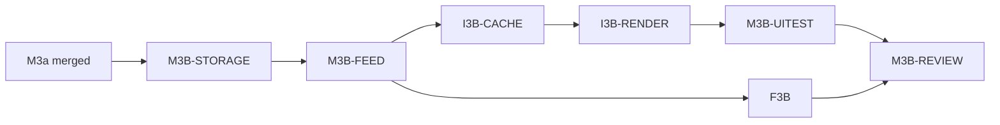

# Plan: M3b · photos (appearance phase B)

**Status:** draft (revision 1, 2026-11-25). **Spec:**
[appearance.md](../specs/appearance.md). **Programme plan:**
[t2-plan.md](../specs/t2-plan.md); its scope guard, out-of-scope list, merge
ritual, seams and ownership table, simulator budget, effort legend and open
questions apply here unchanged. **Branch:** `t2/m3b` off `feat/t2`; WP branches
`t2/m3b-<wp>`, one worktree each under `/Users/richie/code/quickr-worktrees/`.
**Lead:** M3 lead. **Evidence:** `docs/t2/evidence/M3b.md` and
`docs/t2/evidence/M3b/` (below).

## Definition of done (every WP)

A WP is done when its **Acceptance** holds, the tests its **DoD** names pass,
and the evidence is in the PR description (team rules, "Definition of done and
proof"):

- the commands run, with pass/fail counts copied from the output;
- for iOS, the xcresult path and the test count (a plan with 0 tests run is a
  failure); for host runs, the `swift test` summary line;
- the Codex review file (`codex -o` output committed under the WP's worktree and
  attached to the PR) and how each finding was resolved;
- the CI run link; `make check` (and `make check-ios` when `ios/` changed)
  green, no skipped or disabled tests;
- for UI WPs, screenshots under `docs/t2/evidence/M3b/` (iOS light and dark, a
  large Dynamic Type check, the Live Activity/widget states where relevant, PWA
  mobile width) and a short GIF/MP4 for interaction flows;
- anything found outside scope filed as a `t2-followup` issue and linked.

Friction is logged as it happens to
`/Users/richie/code/quickr-worktrees/_friction/<agent-name>.jsonl` (format in
`_friction/README.md`); never edit another agent's file.

**Brief.** A photo per topic: upload, thumbnails, ETag serving, delete,
`Topic.photo` on the wire and in the feed, cleanup on topic delete, an App-Group
cache on iOS so widgets and the Live Activity can render it, a service-worker
cache in the PWA. Local volume + Pillow (OQ-10); Cloudflare Access protects the
URLs; iOS fetches through `APIClient`, never `AsyncImage`. Starts after M3a has
merged to `feat/t2`.

### M3B-STORAGE · upload, serve, delete · be · L

- **Scope:** `20261201_a8b5c1d6e437_topic_photo.py`:
  `topics.photo_etag VARCHAR(64)`, `topics.photo_updated_at TIMESTAMPTZ`; new
  `services/media.py` (`QUICKR_MEDIA_DIR`, decode JPEG/PNG/HEIC with Pillow +
  `pillow-heif`, re-encode JPEG, thumbnails 128/512 px, atomic writes, ETag =
  content hash); routes `POST /topics/{ref}/photo` (multipart, ≤ 5 MB → 413,
  unsupported type → 415), `GET /topics/{ref}/photo?size=thumb|full` (`ETag`,
  304 on `If-None-Match`, `Cache-Control: private, max-age=86400`),
  `DELETE /topics/{ref}/photo`; `limits.py` `max_photo_bytes`; compose volume
  `media` and the hosting nginx `client_max_body_size 5m`; cleanup of files on
  topic delete outside the writer (`area-B-feed-invariants.md` §4); API fixtures
  for the upload and delete responses and a documented exemption for the binary
  GET in `test_api_fixtures.py`; `openapi.json`, `make client`; minimal Swift:
  endpoint-table rows (`endpointTableMatchesOpenAPI`).
- **Also:** updates `docs/hosting/backend.md` backup/restore for the `media`
  volume (OQ-10 rider).
- **Depends on:** M3a merged.
- **Acceptance:** upload → GET thumb and full with matching ETag → 304 → delete
  → 404; HEIC converts; a 6 MB file is 413 and nothing is written; topic delete
  removes the files after commit; the writer transaction never touches the
  filesystem.
- **Tests:** `test_photos.py` (new, appearance.md §16: HEIC/PNG/JPEG, EXIF
  rotation, sizes, etag stability, 413/415, ETag/304, delete cleanup) with a
  temp media dir; `test_identity.py` `_mutations` gains the upload and delete
  preconditions; migration round trip.
- **DoD:** the Acceptance above holds, proven by `test_photos.py` (new,
  appearance.md §16: HEIC/PNG/JPEG, EXIF rotation, sizes, etag stability,
  413/415, ETag/304, delete cleanup) with a temp media dir; `test_identity.py`
  `_mutations` gains the upload and delete preconditions; migration round trip.
  Evidence in the PR: `cd backend && uv run pytest -q <the files above>` pass
  counts; when generators or fixtures change, the `make vectors` diff is in the
  PR; migration WPs paste the `alembic upgrade head` and `downgrade` output; the
  Codex review file with each finding resolved or justified; the CI run link.

### M3B-FEED · `Topic.photo` on the wire · be · M

- **Scope:** `Topic.photo: {etag, updated_at} | null` on `TopicSummary`,
  `TopicDetail` and the `topic` feed item; upload/delete bump `revision` and
  `_log_topic`; fixtures regenerated.
- **Depends on:** M3B-STORAGE.
- **Acceptance:** an upload produces a `topic` feed item with the new etag; a
  delete produces one with `photo: null`.
- **Tests:** feed tests; fixture drift.
- **DoD:** the Acceptance above holds, proven by feed tests; fixture drift.
  Evidence in the PR: `cd backend && uv run pytest -q <the files above>` pass
  counts; when generators or fixtures change, the `make vectors` diff is in the
  PR; migration WPs paste the `alembic upgrade head` and `downgrade` output; the
  Codex review file with each finding resolved or justified; the CI run link.

### I3B-CACHE · App-Group photo cache · host · M

- **Scope:** `StoreSchema+T2M3B.swift` with `t2m3b_photo_cache` (table
  `photo_cache(server_id, topic_id, etag, size, path, fetched_at)`);
  `QuickrData/Media/PhotoCache.swift` (fetch via `APIClient` with
  `If-None-Match`, files under the App Group `Library/Caches/quickr-photos/`,
  evict on topic delete and on etag change); `TopicDTO.photo`; `ServerLayer`
  apply.
- **Depends on:** M3B-FEED.
- **Acceptance:** hit/miss/304/etag-change/evict with a fake transport; a widget
  process can read a cached thumb by `(server_id, topic_id)`.
- **Tests:** `PhotoCacheTests` (new).
- **DoD:** the Acceptance above holds, proven by `PhotoCacheTests` (new).
  Evidence in the PR:
  `cd ios/QuickrKit && swift test --filter <the suites above>` summary lines
  with counts (plus `make ios-core-test` once); the Codex review file with each
  finding resolved or justified; the CI run link.

### I3B-RENDER · picker, upload, header, glyph · host · M

- **Scope:** `AppearanceEditorView` gains a `PhotosPicker` row;
  `TopicWrites.uploadPhoto` / `deletePhoto`; `TopicGlyphView` photo variant
  (thumb from the cache, emoji fallback); `TopicTabsView` header shows the 512
  px image. Widgets and LA pick it up through `TopicGlyphView` without M2
  changes.
- **Depends on:** I3B-CACHE.
- **Acceptance:** model tests for the upload path (request shape, revision); the
  glyph falls back when the cache is cold.
- **Tests:** `TopicWritesTests`, `TopicThemeTests` photo cases.
- **DoD:** the Acceptance above holds, proven by `TopicWritesTests`,
  `TopicThemeTests` photo cases. Evidence in the PR:
  `cd ios/QuickrKit && swift test --filter <the suites above>` summary lines
  with counts (plus `make ios-core-test` once); the Codex review file with each
  finding resolved or justified; the CI run link. UI WP: header and glyph with a
  photo captured in M3B-UITEST.

### F3B · PWA photo upload, glyph, SW cache · fe · M

- **Scope:** `TopicMetaFields.tsx` file input with client-side downscale to ≤ 5
  MB; `TopicGlyph.tsx` photo variant; `src/sw.ts` cache route for
  `/photo?size=thumb` (stale-while-revalidate keyed by URL + ETag);
  `TopicLayout.tsx` header.
- **Depends on:** M3B-FEED.
- **Acceptance:** upload → the tile glyph shows the thumb; delete → emoji
  fallback; the SW serves the cached thumb offline.
- **Tests:** `TopicGlyph.test.tsx`, `sw.photo.test.ts` (new, in the style of the
  existing SW tests).
- **DoD:** the Acceptance above holds, proven by `TopicGlyph.test.tsx`,
  `sw.photo.test.ts` (new, in the style of the existing SW tests). Evidence in
  the PR: `pnpm exec vitest run <the tests above>` pass counts and a green
  `make check-frontend`; the Codex review file with each finding resolved or
  justified; the CI run link. UI WP: PWA tile glyph and header with a photo at
  mobile width.

### M3B-UITEST · simulator: thumb from the fake server · sim · S · last

- **Scope:** `TopicLifecycleUITests.testPhotoThumbRenders` (the fake server
  serves a PNG for the photo route; the header and the glyph show it);
  `UITestLaunch.swift` `// T2-M3B` block. Simulator-only because it is an
  XCUITest flow proving the App-Group cache feeds a rendered image; the cache
  logic is host-tested in I3B-CACHE.
- **Depends on:** I3B-RENDER.
- **DoD:** the Acceptance above holds, proven by the tests named in Acceptance.
  Evidence in the PR: the xcresult path
  (`ios/build/results/<plan>-<date>-<time>-<rand>/<plan>.xcresult`) and its
  non-zero test count; screenshots iOS light/dark + XXXL (and LA/widget states
  where the scope names them) under `docs/t2/evidence/M3b/`; a GIF/MP4 per
  interaction flow; the clone shut down (`xcrun simctl shutdown <udid>`) at the
  end of the run; the Codex review file with each finding resolved or justified;
  the CI run link.

### M3B-REVIEW · milestone review · docs · S

- **DoD:** the Acceptance above holds, proven by the tests named in Acceptance.
  Evidence in the PR: the named file exists on the milestone branch and is
  linked from the milestone PR; the Codex review file with each finding resolved
  or justified; the CI run link.

- As M1-REVIEW, against appearance.md phase B; adds "photo in a widget and the
  Live Activity" to the device checklist.

### M3b DAG

| WP          | Depends on  | Class | Effort |
| ----------- | ----------- | ----- | ------ |
| M3B-STORAGE | M3a merged  | be    | L      |
| M3B-FEED    | M3B-STORAGE | be    | M      |
| I3B-CACHE   | M3B-FEED    | host  | M      |
| I3B-RENDER  | I3B-CACHE   | host  | M      |
| F3B         | M3B-FEED    | fe    | M      |
| M3B-UITEST  | I3B-RENDER  | sim   | S      |
| M3B-REVIEW  | all         | docs  | S      |

**Critical path:** M3B-STORAGE → M3B-FEED → I3B-CACHE → I3B-RENDER → M3B-UITEST
→ M3B-REVIEW. **First wave:** M3B-STORAGE.

## Milestone evidence

`docs/t2/evidence/M3b.md` on `t2/m3b`: criteria → proof; screenshots under
`docs/t2/evidence/M3b/` (photo in the header and tile glyph, iOS light/dark; PWA
at mobile width); the upload/304/delete request log from `test_photos.py`;
review reports.

### Device-only (the simulator cannot prove)

- Photo upload from the camera roll (HEIC) and its thumbnail in a widget and the
  Live Activity.
- Upload over a slow cellular link (5 MB ceiling, progress, failure notice).
