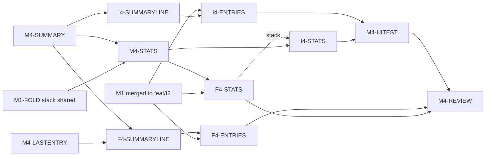

# Plan: M4 · content display

**Status:** draft (revision 2, 2026-11-25, after review round 1). **Spec:**
[content-display.md](../specs/content-display.md). **Programme plan:**
[t2-plan.md](../specs/t2-plan.md); its scope guard, out-of-scope list, merge
ritual, seams and ownership table, simulator budget, effort legend and open
questions apply here unchanged. **Branch:** `t2/m4` off `feat/t2`; WP branches
`t2/m4-<wp>`, one worktree each under `/Users/richie/code/quickr-worktrees/`.
**Lead:** M4 lead. **Evidence:** `docs/t2/evidence/M4.md` and
`docs/t2/evidence/M4/` (below).

## Definition of done (every WP)

A WP is done when its **Acceptance** holds, the tests its **DoD** names pass,
and the evidence is in the PR description (team rules, "Definition of done and
proof"):

- the commands run, with pass/fail counts copied from the output;
- for iOS, the xcresult path and the test count (a plan with 0 tests run is a
  failure); for host runs, the `swift test` summary line;
- the Codex review file (`codex -o` output committed under the WP's worktree and
  attached to the PR) and how each finding was resolved;
- the CI run link; `make check` (and `make check-ios` when `ios/` changed)
  green, no skipped or disabled tests;
- for UI WPs, screenshots under `docs/t2/evidence/M4/` (iOS light and dark, a
  large Dynamic Type check, the Live Activity/widget states where relevant, PWA
  mobile width) and a short GIF/MP4 for interaction flows;
- anything found outside scope filed as a `t2-followup` issue and linked.

Friction is logged as it happens to
`/Users/richie/code/quickr-worktrees/_friction/<agent-name>.jsonl` (format in
`_friction/README.md`); never edit another agent's file.

**Brief.** An entry summary line shared by vectors, `TopicSummary.last_entry`,
richer entry rows and detail (segments with lap types, pauses, one-tap Remove,
Resume run), richer stats (per-lap-type cards and stacked bars, an activity
strip, numeric sparklines) with chart models pinned in
`stats-chart-vectors.json`, and the `TopicSummaryLine` interface M2 consumes
(content-display.md §1–§5). The brief's "M4-STATS-LAPS" is M4-STATS + F4-STATS +
I4-STATS; "M4-ENTRY-ACTIONS" is the Remove/Resume part of F4-ENTRIES and
I4-ENTRIES.

### M4-SUMMARY · entry summary reference and vectors · be · M · first

- **Scope:** `services/summary.py` `entry_summary(entry, timer) -> str` (≤ 80
  chars; timing first as `"12:40 · 3 laps"` or `"12:40 · Run 3 · Rest 3"`; then
  `label: value` joined by `·`; enum lists joined by `, `; truncated with `…`);
  generator `tests/test_entry_summary_vectors.py` →
  `shared/fixtures/entry-summary-vectors.json` (cases: answers only, enum list,
  numeric with unit, boolean, notes ignored, timing only, timing + answers,
  untyped laps, truncation at a word boundary, unicode width, no answers and no
  timing → empty, long labels); README row. Typed-lap cases are added in
  M4-STATS once fold v4 is available.
- **Depends on:** nothing.
- **Acceptance:** every rule in content-display.md has a named case; the output
  never exceeds 80 code points.
- **Tests:** unit tests per rule; vector drift.
- **Review round 1 (D6):** truncation is on **extended grapheme clusters**
  (Python `regex` `\X`; ports: Swift `Character`, JS `Intl.Segmenter`), cap 80
  clusters; vectors add a flag pair, a keycap and a multi-person ZWJ emoji at
  the boundary.
- **DoD:** the Acceptance above holds, proven by unit tests per rule; vector
  drift. Evidence in the PR: `cd backend && uv run pytest -q <the files above>`
  pass counts; when generators or fixtures change, the `make vectors` diff is in
  the PR; migration WPs paste the `alembic upgrade head` and `downgrade` output;
  the Codex review file with each finding resolved or justified; the CI run
  link.

### M4-LASTENTRY · `TopicSummary.last_entry` · be · M · first

- **Scope:** `services/topics.py` `_base_select` lateral join (latest by
  `captured_at`, then `id`; excludes deleted);
  `TopicSummary.last_entry: EntryOut | null`; fixtures `listTopics`, `getTopic`,
  `listChanges` bootstrap; `openapi.json`, `make client`; no Swift change (iOS
  keeps the local `latestEntry`; Codable ignores the field;
  `FixtureCoverageTests` still decodes).
- **Depends on:** nothing.
- **Acceptance:** `listTopics` issues one SQL statement for N topics (statement
  count asserted); `last_entry` is null for a topic without entries and follows
  a delete; `home-vectors.json` unchanged.
- **Tests:** `test_topics_last_entry.py` (new); fixture drift.
- **Review round 1 (D8):** iOS ignores `last_entry` (no `@RequiredKey`, no DTO
  field); `home-vectors.json` unchanged.
- **DoD:** the Acceptance above holds, proven by `test_topics_last_entry.py`
  (new); fixture drift. Evidence in the PR:
  `cd backend && uv run pytest -q <the files above>` pass counts; when
  generators or fixtures change, the `make vectors` diff is in the PR; migration
  WPs paste the `alembic upgrade head` and `downgrade` output; the Codex review
  file with each finding resolved or justified; the CI run link.

### M4-STATS · typed summary cases and stats inputs · be · S

- **Scope:** typed-lap cases in `entry-summary-vectors.json` (needs fold v4's
  `lap_type` on `TimingSegment`); `stats-vectors.json` regenerated with a
  typed-timing topic as input for the chart generator. **No new endpoint**: the
  activity strip is computed client-side from entries (content-display.md §4.2)
  and the lap-type figures come from `getTopicTiming.lap_types` (M1-MCP).
- **Depends on:** M4-SUMMARY; M1-FOLD stack (shared branch).
- **Acceptance:** the summary says `"Run 3 · Rest 3"` for a tiktok entry; the
  stats input fixture carries a typed series.
- **Tests:** vector drift.
- **DoD:** the Acceptance above holds, proven by vector drift. Evidence in the
  PR: `cd backend && uv run pytest -q <the files above>` pass counts; when
  generators or fixtures change, the `make vectors` diff is in the PR; migration
  WPs paste the `alembic upgrade head` and `downgrade` output; the Codex review
  file with each finding resolved or justified; the CI run link.

### F4-SUMMARYLINE · PWA summary port and component · fe · S

- **Scope:** `src/lib/entrySummary.ts` + `entrySummary.vectors.test.ts`;
  `src/components/topics/TopicSummaryLine.tsx`
  (`<TopicSummaryLine entry timer/>`). Dropping the per-tile
  `listEntries`/`listTopicVersions` queries in `TopicTile.tsx` is M2's file →
  T2-WIRE-F.
- **Depends on:** M4-SUMMARY, M4-LASTENTRY.
- **Acceptance:** the vector suite passes; the component renders an empty string
  as nothing.
- **Tests:** vector suite; `TopicSummaryLine.test.tsx`.
- **Review round 1 (D4):** staleness bound ≤ 60 s: `listTopics` refetches every
  60 s and on window focus; entry create/update/delete mutations and outbox acks
  invalidate the topic's `listTopics` pages. Test: a remote entry change shows
  within one refetch; a local ack updates at once.
- **DoD:** the Acceptance above holds, proven by vector suite;
  `TopicSummaryLine.test.tsx`. Evidence in the PR:
  `pnpm exec vitest run <the tests above>` pass counts and a green
  `make check-frontend`; the Codex review file with each finding resolved or
  justified; the CI run link. UI WP: one PWA tile screenshot with the summary
  line (after T2-WIRE-F) or a component story screenshot.

### F4-ENTRIES · PWA entry list and detail · fe · L

- **Scope:** `EntriesPage.tsx` rows (summary line + full `AnswerGrid` + timing
  chip with total and lap/type counts; hides an entry whose id is a locally open
  or finishing run, OQ-14); `EntryEditPage.tsx` detail: segments with lap types,
  pauses, a one-tap **Remove** on a pause or lap (sends `remove` with the event
  id through `actions.ts`), **Resume run** (sends `reopen` with `terminal_id`)
  when `resumable`; `TimingSection.tsx`, `TimingEditor.tsx` show lap types.
- **Depends on:** F4-SUMMARYLINE; M1 merged to `feat/t2` (F1-OUTBOX, M1-RUNS).
- **Acceptance:** Remove enqueues one `remove` with the right `target` and the
  row updates optimistically; Resume enqueues `reopen` and navigates to the run
  panel; neither button shows on an edited entry; an entry whose run is open is
  absent from the list.
- **Tests:** `EntriesPage.test.tsx` (new), `EntryEditPage.test.tsx`.
- **Review round 1 (A7, D8):** Resume sends `reopen` with
  `entry.timing.terminal_id`; Remove on a pause uses `TimingPause.id`, on a lap
  `TimingSegment.event_id`; Remove is **disabled on a lap row opened by a
  `next`** (a step boundary, edited with the timing editor); the row shows
  "Resuming…" until the ack.
- **DoD:** the Acceptance above holds, proven by `EntriesPage.test.tsx` (new),
  `EntryEditPage.test.tsx`. Evidence in the PR:
  `pnpm exec vitest run <the tests above>` pass counts and a green
  `make check-frontend`; the Codex review file with each finding resolved or
  justified; the CI run link. UI WP: PWA entries list and detail at mobile
  width, light/dark; a GIF of Remove and Resume.

### F4-STATS · PWA stats and chart vectors · fe · M · stack base

- **Scope:** `TimingOverview.tsx` per-lap-type cards and a stacked lap-type bars
  chart; `OverviewPage.tsx` activity strip (12 × 7 cells from
  `listEntries(captured_from = now − 84 d, limit 500)`, content-display.md §4.2)
  and numeric sparklines from `getQuestionSeries`; `charts/timingModels.ts` new
  models (`lapTypesByBucket`, `activityStrip`, `sparkline`) and
  `stats.vectors.test.ts` → `stats-chart-vectors.json` sections `lap_types[]`,
  `activity[]` (incl. a DST week and an empty list), `sparklines[]`.
- **Depends on:** M4-STATS, F1-CORE (stats v3 port, via M1 merged). Stack:
  I4-STATS branches from `t2/m4-stats-fe`.
- **Acceptance:** the Overview renders the three new charts from a fixture; the
  vector file gains the three models and iOS (I4-STATS) consumes them.
- **Tests:** `timingModels.test.ts`, `OverviewPage.test.tsx`, vector generation.
- **Review round 1 (D5):** the strip's cells are local calendar days from the
  Monday 11 weeks before this week's Monday to today; `listEntries` queries from
  that day's local midnight (calendar arithmetic, DST-safe); vectors cover a
  week transition and a DST week.
- **DoD:** the Acceptance above holds, proven by `timingModels.test.ts`,
  `OverviewPage.test.tsx`, vector generation. Evidence in the PR:
  `pnpm exec vitest run <the tests above>` pass counts and a green
  `make check-frontend`; the Codex review file with each finding resolved or
  justified; the CI run link. UI WP: PWA overview with the three new charts at
  mobile width, light/dark.

### I4-SUMMARYLINE · Swift summary port and view · host · S

- **Scope:** `QuickrCore/Entries/EntrySummary.swift` +
  `EntrySummaryVectorTests`; `QuickrUI/Components/TopicSummaryLine.swift`
  (`TopicSummaryLine(entry:timer:)`).
- **Depends on:** M4-SUMMARY.
- **Acceptance:** the vector suite passes; grapheme-aware truncation matches
  Python's code-point rule on every case.
- **Tests:** as listed.
- **DoD:** the Acceptance above holds, proven by as listed. Evidence in the PR:
  `cd ios/QuickrKit && swift test --filter <the suites above>` summary lines
  with counts (plus `make ios-core-test` once); the Codex review file with each
  finding resolved or justified; the CI run link.

### I4-ENTRIES · iOS entry list and detail · host · L

- **Scope:** `App/Entries/List/EntriesView.swift` rows (summary line,
  `AnswerGrid`, timing chip); `EntriesModel.swift` hides an entry whose id is a
  local open or finishing run (OQ-14); `App/Entries/EntryTimingSection.swift`
  segments with lap types, pauses, a Remove button per pause/lap (ids
  `entry.timing.pause.<i>.remove`, `entry.timing.segment.<i>.remove`), a Resume
  run button (`entry.timing.resume`) when `resumable`; `TimingEditorSheet` /
  `QuickrUI/Edit/TimingEditModel.swift` show lap types; `EditScreen.swift`.
- **Depends on:** I4-SUMMARYLINE; M1 merged to `feat/t2` (I1-WRITES).
- **Acceptance:** `EntriesModelTests`: the hidden rule, the row summary; a model
  test that Remove calls `RunWrites.remove(target:)` once and Resume calls
  `reopen` with the entry's `terminal_id`; neither on an edited entry.
- **Tests:** `EntriesModelTests`, `EntryTimingModelTests` (new),
  `TimingEditTests`.
- **Review round 1 (A7, D8):** as F4-ENTRIES: targets from the `Timing` ids,
  Remove disabled on a `next`-opened lap row, "Resuming…" state until the ack.
- **DoD:** the Acceptance above holds, proven by `EntriesModelTests`,
  `EntryTimingModelTests` (new), `TimingEditTests`. Evidence in the PR:
  `cd ios/QuickrKit && swift test --filter <the suites above>` summary lines
  with counts (plus `make ios-core-test` once); the Codex review file with each
  finding resolved or justified; the CI run link. UI WP: entry row and detail
  screenshots (light/dark + XXXL) and the Remove/Resume GIF captured in
  M4-UITEST.

### I4-STATS · iOS stats · host · M · stacked on F4-STATS

- **Scope:** `App/Stats/TimingOverview.swift` per-type cards and
  `LapTypeStackChart`; `OverviewView.swift` activity strip from
  `store.entries(topicId, from: now − 84 days)` (`OverviewModel`), drawn in
  `StatsCharts.swift` with `ChartAccessibility` labels; `OverviewCards.swift`
  sparklines; `QuickrData/Stats/TimingOverviewText.swift`, `StatsLoader.swift`;
  `QuickrCore/Charts/ChartModels.swift` `ActivityStrip`, `Sparkline`,
  `LapTypesByBucket` and `StatsChartVectorTests` reading the new sections.
- **Depends on:** F4-STATS (stack), M4-STATS, I1-CORE (via M1 merged).
- **Acceptance:** chart vector tests pass; `TimingOverviewText` strings for a
  typed topic match content-display.md's examples.
- **Tests:** `QuickrDataTests/Stats/*`, `StatsChartVectorTests`.
- **Review round 1 (D5):** same cell definition as F4-STATS via the shared
  `activity[]` vectors; `store.entries(from:)` uses the first cell's local
  midnight.
- **DoD:** the Acceptance above holds, proven by `QuickrDataTests/Stats/*`,
  `StatsChartVectorTests`. Evidence in the PR:
  `cd ios/QuickrKit && swift test --filter <the suites above>` summary lines
  with counts (plus `make ios-core-test` once); the Codex review file with each
  finding resolved or justified; the CI run link. UI WP: stats screenshots
  captured in M4-UITEST.

### M4-UITEST · simulator: entries and stats · sim · M · last

- **Scope:** `EntriesTests.testRowShowsSummaryAndTiming`,
  `EntriesTests.testRemovePauseFromEntryDetail` (fake server applies the remove;
  the pause row disappears, the total grows),
  `EntriesTests.testResumeRunFromEntryDetail` (reopen → run screen Running),
  `StatsUITests.testLapTypeCards`, `TimingUITests` R10 still green;
  light/dark/XXXL screenshots.
- **Depends on:** I4-ENTRIES, I4-STATS.
- **Acceptance:** all pass once on the clone; screenshots in
  `docs/t2/evidence/M4/`. Simulator-only because they are XCUITest flows
  (`EntriesTests`, `StatsUITests`) through the app and the `UITestRuns` fake
  server; the row and chart models are host-tested in I4-ENTRIES/I4-STATS.
- **DoD:** the Acceptance above holds, proven by the tests named in Acceptance.
  Evidence in the PR: the xcresult path
  (`ios/build/results/<plan>-<date>-<time>-<rand>/<plan>.xcresult`) and its
  non-zero test count; screenshots iOS light/dark + XXXL (and LA/widget states
  where the scope names them) under `docs/t2/evidence/M4/`; a GIF/MP4 per
  interaction flow; the clone shut down (`xcrun simctl shutdown <udid>`) at the
  end of the run; the Codex review file with each finding resolved or justified;
  the CI run link.

### M4-REVIEW · milestone review · docs · S

- **DoD:** the Acceptance above holds, proven by the tests named in Acceptance.
  Evidence in the PR: the named file exists on the milestone branch and is
  linked from the milestone PR; the Codex review file with each finding resolved
  or justified; the CI run link.

- As M1-REVIEW, against content-display.md.

### M4 DAG

| WP             | Depends on                              | Class | Effort |
| -------------- | --------------------------------------- | ----- | ------ |
| M4-SUMMARY     | —                                       | be    | M      |
| M4-LASTENTRY   | —                                       | be    | M      |
| M4-STATS       | M4-SUMMARY, M1-FOLD stack (shared)      | be    | S      |
| F4-SUMMARYLINE | M4-SUMMARY, M4-LASTENTRY                | fe    | S      |
| F4-ENTRIES     | F4-SUMMARYLINE, M1 merged               | fe    | L      |
| F4-STATS       | M4-STATS, M1 merged (stack base)        | fe    | M      |
| I4-SUMMARYLINE | M4-SUMMARY                              | host  | S      |
| I4-ENTRIES     | I4-SUMMARYLINE, M1 merged               | host  | L      |
| I4-STATS       | F4-STATS (stacked), M4-STATS, M1 merged | host  | M      |
| M4-UITEST      | I4-ENTRIES, I4-STATS                    | sim   | M      |
| M4-REVIEW      | all                                     | docs  | S      |

**Critical path:** M4-SUMMARY → I4-SUMMARYLINE → (wait for M1 on `feat/t2`) →
I4-ENTRIES → M4-UITEST → M4-REVIEW. The summary, `last_entry`, list layout and
the activity strip are done before M1 lands; the entry actions and lap-type
stats are the tail.

**First wave:** M4-SUMMARY, M4-LASTENTRY.

## Milestone evidence

`docs/t2/evidence/M4.md` on `t2/m4`: criteria → proof; screenshots under
`docs/t2/evidence/M4/` (entry rows and detail with lap types, stats cards,
activity strip, sparklines; iOS light/dark + XXXL; PWA at mobile width); a GIF
of Remove on a pause and of Resume run from the detail; review reports;
`make check-ios`.

### Device-only (the simulator cannot prove)

- Resume run from the entry detail re-creating the Live Activity on the device
  and by push-to-start on a second device.
- VoiceOver reading of the activity strip and lap-type charts on a device (the
  simulator's accessibility inspector is a weaker proxy).
