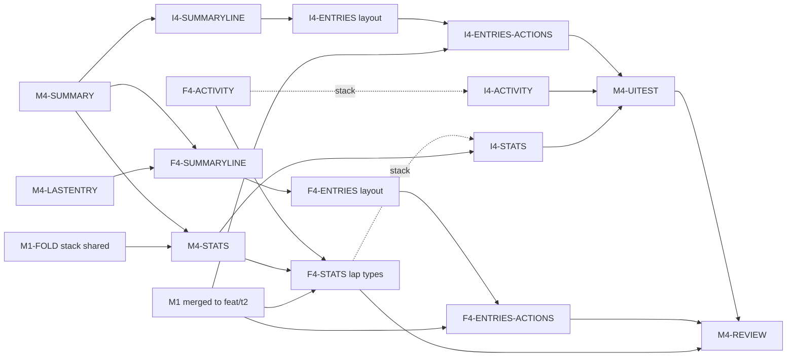

# Plan: M4 · content display

**Status:** draft (revision 4, 2026-11-25, after the M4 lead's plan check; log
at the end). **Spec:** [content-display.md](../specs/content-display.md).
**Programme plan:** [t2-plan.md](../specs/t2-plan.md); its scope guard,
out-of-scope list, merge ritual, seams and ownership table, simulator budget,
effort legend and open questions apply here unchanged. **Branch:** `t2/m4` off
`feat/t2`; WP branches `t2/m4-<wp>`, one worktree each under
`/Users/richie/code/quickr-worktrees/`. **Lead:** M4 lead. **Evidence:**
`docs/t2/evidence/M4.md` and `docs/t2/evidence/M4/` (below).

## Definition of done (every WP)

A WP is done when its **Acceptance** holds, the tests its **DoD** names pass,
and the evidence is in the PR description (team rules, "Definition of done and
proof"):

- the commands run, with pass/fail counts copied from the output;
- for iOS, the xcresult path and the test count (a plan with 0 tests run is a
  failure); for host runs, the `swift test` summary line;
- the Codex review file (`codex -o` output committed under the WP's worktree and
  attached to the PR) and how each finding was resolved;
- the CI run link; `make check` (and `make check-ios` when `ios/` changed)
  green, no skipped or disabled tests;
- for UI WPs, screenshots under `docs/t2/evidence/M4/` (iOS light and dark, a
  large Dynamic Type check, the Live Activity/widget states where relevant, PWA
  mobile width) and a short GIF/MP4 for interaction flows;
- anything found outside scope filed as a `t2-followup` issue and linked.

Friction is logged as it happens to
`/Users/richie/code/quickr-worktrees/_friction/<agent-name>.jsonl` (format in
`_friction/README.md`); never edit another agent's file.

**Brief.** An entry summary line shared by vectors, `TopicSummary.last_entry`,
richer entry rows and detail (segments with lap types, pauses, one-tap Remove,
Resume run), richer stats (per-lap-type cards and stacked bars, an activity
strip, numeric sparklines) with chart models pinned in
`stats-chart-vectors.json`, and the `TopicSummaryLine` interface M2 consumes
(content-display.md §1–§5). The brief's "M4-STATS-LAPS" is M4-STATS + F4-STATS +
I4-STATS; "M4-ENTRY-ACTIONS" is F4-ENTRIES-ACTIONS + I4-ENTRIES-ACTIONS. The
plan check split the M1-dependent tail (entry actions, lap-type stats) from the
parts that need nothing from M1 (list and detail layout, activity strip,
sparklines), so those start at once: 14 WPs, same scope.

### M4-SUMMARY · entry summary reference and vectors · be · M · first

- **Scope:** content-display.md §1 as the contract: `services/summary.py`
  `entry_summary(answers, timing, questions, timer) -> str` (§1.1), the
  algorithm of §1.2 (timing first, then `label: value` joined by `·`, enum lists
  by `, `; truncation to **79 extended grapheme clusters + `…`**, no word
  boundary, no boolean); generator `tests/test_entry_summary_vectors.py` →
  `shared/fixtures/entry-summary-vectors.json` with the cases §1.3 lists
  (including the flag pair, keycap and multi-person ZWJ emoji at the boundary;
  the typed-lap cases are added in M4-STATS); README row. `fmt_duration` is
  imported from `services/run_fold.py:614` (M1's file: import only, no edit).
  Grapheme clusters need the `regex` package, which is not in
  `backend/pyproject.toml` yet (appearance.md §2 has M3a add it too): this WP
  adds it with `uv add regex`; whichever of M3a/M4 merges second keeps the one
  line.
- **Areas:** `backend/app/services/summary.py` (new), `backend/tests/`,
  `shared/fixtures/`, `backend/pyproject.toml` + `uv.lock` (the dependency).
- **Depends on:** nothing.
- **Acceptance:** every case §1.3 names exists and the coverage test proves it;
  no output exceeds 80 clusters; a cluster is never split.
- **Tests:** unit tests per rule of §1.2; vector drift and coverage.
- **DoD:** the Acceptance above holds, proven by the tests named above. Evidence
  in the PR: `cd backend && uv run pytest -q <files>` pass counts; the
  `make vectors` diff when generators or fixtures change; the Codex review file
  with each finding resolved or justified; the CI run link.

### M4-LASTENTRY · `TopicSummary.last_entry` · be · M · first

- **Scope:** content-display.md §2: `services/topics.py` `_base_select` lateral
  join (latest by `captured_at`, then `id`; excludes deleted) in a delimited
  `# T2-M4` block; `TopicSummary.last_entry: EntryOut | null`; fixtures
  `listTopics`, `getTopic`, `listChanges` bootstrap; `openapi.json`,
  `make client`. **iOS has no DTO field**: Codable ignores `last_entry` and the
  app keeps its local `latestEntry`; `home-vectors.json` is unchanged. Plan
  check: `test_home_vectors.py:412` dumps whole `TopicDetail`s
  (`model_dump(mode="json")`), so the generator **excludes `last_entry`** from
  that dump (one `exclude=`, with a comment naming this WP) to keep the file
  unchanged; the API fixtures `test_api_fixtures.py` writes (`listTopics`,
  `getTopic*`, `listChanges.*` with a topic item) do regenerate. Deleted entries
  are deleted rows (`entries.py:363`, tombstoned in `deleted_ids`), so the
  lateral join needs no filter.
- **Areas:** `backend/app/services/topics.py`, `schemas/api.py`,
  `backend/tests/` (incl. the one-line `exclude` in `test_home_vectors.py`),
  `shared/fixtures/api/`.
- **Depends on:** nothing.
- **Acceptance:** `listTopics` issues **one extra statement per page**, not per
  topic (statement count asserted); `last_entry` is null for a topic without
  entries and follows a delete; `home-vectors.json` unchanged; the regenerated
  API fixtures decode on iOS without a Swift change
  (`swift test --filter FixtureCoverageTests` in `ios/QuickrKit`, count in the
  PR).
- **Tests:** `test_api_topics.py` additions, `test_home_vectors.py` unchanged
  output; fixture drift; iOS `FixtureCoverageTests`.
- **DoD:** the Acceptance above holds, proven by the tests named above. Evidence
  in the PR: `cd backend && uv run pytest -q <files>` pass counts; the
  `make vectors` diff when generators or fixtures change; the Codex review file
  with each finding resolved or justified; the CI run link.

### M4-STATS · typed summary cases and stats inputs · be · S

- **Scope:** typed-lap cases in `entry-summary-vectors.json` (needs fold v4's
  `lap_type` on `TimingSegment`) and the three summary ports switched from
  stand-ins to M1's fields. The chart generator's typed input is
  `timing-stats-vectors.json` v3 (content-display.md §4.1, from M1-FOLD);
  `stats-vectors.json` stays unchanged (amended 2026-11-26: it records API
  responses, and `getTopicTiming` exposes no `lap_types` until M1-MCP). **No new endpoint**: the
  activity strip is computed client-side from entries (content-display.md §4.2)
  and the lap-type figures come from `getTopicTiming.lap_types` (M1-MCP).
- **Depends on:** M4-SUMMARY; M1-FOLD stack (shared branch).
- **Acceptance:** the summary says `"Run 3 · Rest 3"` for a tiktok entry; the
  chart generator's typed input is `timing-stats-vectors.json` v3.
- **Tests:** vector drift.
- **DoD:** the Acceptance above holds, proven by vector drift. Evidence in the
  PR: `cd backend && uv run pytest -q <the files above>` pass counts; when
  generators or fixtures change, the `make vectors` diff is in the PR; migration
  WPs paste the `alembic upgrade head` and `downgrade` output; the Codex review
  file with each finding resolved or justified; the CI run link.

### F4-SUMMARYLINE · PWA summary port and component · fe · S

- **Scope:** `src/lib/entrySummary.ts` + `entrySummary.vectors.test.ts`;
  `src/components/topics/TopicSummaryLine.tsx` with props
  `{entry, questions, timer, fallback}` (content-display.md §5). Dropping the
  per-tile `listEntries`/`listTopicVersions` queries in `TopicTile.tsx` is M2's
  file → T2-WIRE-F.
- **Depends on:** M4-SUMMARY, M4-LASTENTRY.
- **Acceptance:** the vector suite passes; the component renders an empty string
  as nothing.
- **Tests:** vector suite; `TopicSummaryLine.test.tsx`.
- **Review round 1 (D4):** staleness bound ≤ 60 s: `listTopics` refetches every
  60 s and on window focus; entry create/update/delete mutations and outbox acks
  invalidate the topic's `listTopics` pages. Test: a remote entry change shows
  within one refetch; a local ack updates at once. Plan check: the invalidations
  already exist (`api/outboxEffects.ts:98-102` entry acks, `:149-153` run acks,
  `TopicsPage.tsx:83` `refetchInterval`), so this WP adds the test only, in its
  own file (`outboxEffects.ts` is touched by F1-OUTBOX); no M1/M2-owned file
  changes.
- **DoD:** the Acceptance above holds, proven by vector suite;
  `TopicSummaryLine.test.tsx`. Evidence in the PR:
  `pnpm exec vitest run <the tests above>` pass counts and a green
  `make check-frontend`; the Codex review file with each finding resolved or
  justified; the CI run link. UI WP: one PWA tile screenshot with the summary
  line (after T2-WIRE-F) or a component story screenshot.

### F4-ENTRIES · PWA entry list and detail layout · fe · M

- **Scope:** content-display.md §3.1 and the M1-free part of §3.2:
  `EntriesPage.tsx` rows (summary line `data-testid="entry-summary"` + full
  `AnswerGrid` + timing chip `entry-timing` with the total and the lap count,
  the segment count in its accessibility label; the desktop table gains a
  "Timing" column after Captured; pending timed entries use the same chip;
  untimed entries of a timed topic have no chip); `EntryEditPage.tsx` /
  `TimingSection.tsx`: pauses become rows between the segments they fall in
  ("Paused · 0:20", `entry.timing.pause.<i>`), segment rows keep
  `entry.timing.segment.<i>`. No lap types, no Remove/Resume, no OQ-14 filter:
  those need M1 and are F4-ENTRIES-ACTIONS.
- **Areas:** `src/pages/topic/EntriesPage.tsx`, `EntryEditPage.tsx`,
  `src/components/runs/TimingSection.tsx`.
- **Depends on:** F4-SUMMARYLINE.
- **Acceptance:** every row shows the summary line; a timed entry shows the chip
  ("12:40 · 3 laps") with its accessibility label, a pending timed entry the
  same chip, an untimed entry of a timed topic none; the detail lists pauses as
  rows in time order between the segments.
- **Tests:** `EntriesPage.test.tsx` (new), `EntryEditPage.test.tsx`.
- **DoD:** the Acceptance above holds, proven by `EntriesPage.test.tsx` (new),
  `EntryEditPage.test.tsx`. Evidence in the PR:
  `pnpm exec vitest run <the tests above>` pass counts and a green
  `make check-frontend`; the Codex review file with each finding resolved or
  justified; the CI run link. UI WP: PWA entries list and detail at mobile
  width, light/dark, **before** (from `feat/t2`) and after.

### F4-ENTRIES-ACTIONS · PWA entry actions and lap types · fe · M

- **Scope:** the rest of content-display.md §3.2: segment rows show M1's label
  ("Run 2") with a neutral lap-type badge on typed laps; a one-tap **Remove** on
  lap and pause rows (sends `remove` with `segments[i].event_id` / `pauses[j].id`
  through `actions.ts`; never on a step or the first segment; disabled on a
  `next`-opened lap; absent on a null-id row); **Resume run** (`reopen` with
  `timing.terminal_id`, `null` on a pre-v2 timing) when `resumable`, hidden
  when edited, pending, or while the topic has a locally open or finishing run
  (A15); the A14 queued projection; `TimingEditor.tsx` lap-type picker; OQ-14:
  an entry whose id is a locally open or finishing run is hidden from the list
  and its detail route redirects to the run.
- **Areas:** `EntryEditPage.tsx`, `TimingSection.tsx`, `TimingEditor.tsx`,
  `EntriesPage.tsx` (the OQ-14 filter only).
- **Depends on:** F4-ENTRIES; M1 merged to `feat/t2` (F1-OUTBOX, M1-RUNS).
- **Acceptance:** Remove enqueues one `remove` with the right `target` and the
  row updates optimistically; Resume enqueues `reopen` and navigates to the run
  panel; neither button shows on an edited entry; an entry whose run is open is
  absent from the list.
- **Tests:** `EntriesPage.test.tsx`, `EntryEditPage.test.tsx`.
- **Review round 1 (A7, D8):** Resume sends `reopen` with
  `entry.timing.terminal_id`; Remove on a pause uses `TimingPause.id`, on a lap
  `TimingSegment.event_id`; Remove is **disabled on a lap row opened by a
  `next`** (a step boundary, edited with the timing editor); the row shows
  "Resuming…" until the ack.
- **Review round 2 (A14, A15):** Resume is hidden while the topic has a locally
  open run; a queued Remove from the detail projects no run: the entry stays
  with its timing re-projected and a pending mark until the ack
  (content-display.md §3.2); ids per §3.2, not repeated here.
- **DoD:** the Acceptance above holds, proven by `EntriesPage.test.tsx`,
  `EntryEditPage.test.tsx`. Evidence in the PR:
  `pnpm exec vitest run <the tests above>` pass counts and a green
  `make check-frontend`; the Codex review file with each finding resolved or
  justified; the CI run link. UI WP: PWA detail with lap types at mobile width,
  light/dark; a GIF of Remove and Resume.

### F4-ACTIVITY · PWA activity strip, sparklines, chart vectors v2 · fe · M · stack base

- **Scope:** content-display.md §4.2 and §4.3: `OverviewPage.tsx` activity strip
  (Monday-aligned local calendar days from the Monday 11 weeks before this
  week's Monday to today, queried with `listEntries(captured_from = <that day's
local midnight>, limit = 500, order = -captured_at)`, never `now − 84 d`;
  caption "N entries in the last 12 weeks", "last 500 entries" when
  `total > 500`) and numeric sparklines from `getQuestionSeries`
  (`IntersectionObserver`, `staleTime` 5 min); `charts/timingModels.ts`
  `activityStrip`, `sparkline`; `stats.vectors.test.ts` `GENERATOR_VERSION`
  1 → 2 with the new sections `activity[]` (cases per §4.2: empty, both cell
  edges, the 23:30 UTC Auckland/Los Angeles day shift, a London spring-forward
  and fall-back week, `today` on a Monday and on a Sunday) and `sparklines[]`,
  and `timing_models[]` pinning `stepsByBucket` (F4-STATS adds
  `lapTypesByBucket` to it); README row.
- **Areas:** `src/pages/topic/OverviewPage.tsx`,
  `src/components/charts/timingModels.ts`, `stats.vectors.test.ts`,
  `shared/fixtures/stats-chart-vectors.json`, `shared/fixtures/README.md`.
- **Depends on:** nothing (existing endpoints and fields only). Stack:
  I4-ACTIVITY branches from `t2/m4-activity-fe` and merges into it; the base
  merges into `t2/m4` once its CI, iOS gate included, is green.
- **Acceptance:** the Overview renders the strip and one sparkline per numeric
  card from a fixture, with the captions above; the vector file gains
  `activity[]`, `sparklines[]` and `timing_models[]` and iOS (I4-ACTIVITY)
  consumes them.
- **Tests:** `timingModels.test.ts`, `OverviewPage.test.tsx`, vector generation.
- **Review round 1 (D5):** the strip's cells are local calendar days from the
  Monday 11 weeks before this week's Monday to today; `listEntries` queries from
  that day's local midnight (calendar arithmetic, DST-safe); vectors cover a
  week transition and a DST week.
- **DoD:** the Acceptance above holds, proven by `timingModels.test.ts`,
  `OverviewPage.test.tsx`, vector generation. Evidence in the PR:
  `pnpm exec vitest run <the tests above>` pass counts and a green
  `make check-frontend`; the Codex review file with each finding resolved or
  justified; the CI run link. UI WP: PWA overview with the strip and sparklines
  at mobile width, light/dark, before (from `feat/t2`) and after.

### F4-STATS · PWA lap-type stats · fe · S · stack base

- **Scope:** content-display.md §4.1: `TimingOverview.tsx` one card per lap type
  (label, `laps`, median big, best, mean; `data-testid="laptype-{key}"`;
  `optionColors(lapTypeKeys)`) and the stacked "Time per lap type, per
  {bucket}" chart under them; `lapTypesByBucket(series, bucket)` in
  `charts/timingModels.ts` beside `stepsByBucket`; `stats.vectors.test.ts`
  gains `lap_types[]` (input: a typed `TopicTiming` from
  `timing-stats-vectors.json` v3; expected: the stacked model and card strings)
  and `lapTypesByBucket` in `timing_models[]`; the v1 "Runs with laps / Lap time
  (median)" tiles remain for untyped laps.
- **Areas:** `src/components/runs/TimingOverview.tsx`, `charts/timingModels.ts`,
  `stats.vectors.test.ts`, `shared/fixtures/stats-chart-vectors.json`.
- **Depends on:** F4-ACTIVITY merged into `t2/m4` (one writer for the
  generator), M4-STATS, M1 merged to `feat/t2` (F1-CORE's stats v3 port).
  Stack: I4-STATS branches from `t2/m4-stats-fe` and merges into it.
- **Acceptance:** the tiktok fixture renders one card per lap type with the five
  figures and the stacked chart; `lap_types` absent ⇒ the v1 tiles and nothing
  else; the vector file gains `lap_types[]` and iOS (I4-STATS) consumes it.
- **Tests:** `timingModels.test.ts`, `OverviewPage.test.tsx`, vector generation.
- **DoD:** the Acceptance above holds, proven by `timingModels.test.ts`,
  `OverviewPage.test.tsx`, vector generation. Evidence in the PR:
  `pnpm exec vitest run <the tests above>` pass counts and a green
  `make check-frontend`; the Codex review file with each finding resolved or
  justified; the CI run link. UI WP: PWA overview with the lap-type cards and
  the stacked chart at mobile width, light/dark.

### I4-SUMMARYLINE · Swift summary port and view · host · S

- **Scope:** `QuickrCore/Entries/EntrySummary.swift` +
  `EntrySummaryVectorTests`; `QuickrUI/Components/TopicSummaryLine.swift`
  (`TopicSummaryLine(entry:questions:timer:fallback:)`, content-display.md §5).
- **Depends on:** M4-SUMMARY.
- **Acceptance:** the vector suite passes; grapheme-aware truncation matches
  Python's code-point rule on every case.
- **Tests:** as listed.
- **DoD:** the Acceptance above holds, proven by as listed. Evidence in the PR:
  `cd ios/QuickrKit && swift test --filter <the suites above>` summary lines
  with counts (plus `make ios-core-test` once); the Codex review file with each
  finding resolved or justified; the CI run link.

### I4-ENTRIES · iOS entry list and detail layout · host · M

- **Scope:** content-display.md §3.1 and the M1-free part of §3.2:
  `App/Entries/List/EntriesView.swift` rows (summary line `entry.<id>.summary`
  in `.qr(.callout)`, one line, tail-truncated; timing chip
  `QuickrBadge(timingLine, icon: .timer)` `entry.<id>.timing` with the segment
  count in its accessibility label, before the `AnswerGrid`; pending timed
  entries the same chip; untimed entries of a timed topic none);
  `QuickrData/Entries/EntriesModel.swift` row models carry the summary;
  `App/Entries/EntryTimingSection.swift` pauses as rows
  (`entry.timing.pause.<i>`) between the segments they fall in. No lap types,
  no Remove/Resume, no OQ-14 filter: those are I4-ENTRIES-ACTIONS.
- **Areas:** `App/Entries/List/EntriesView.swift`,
  `QuickrData/Entries/EntriesModel.swift`, `App/Entries/EntryTimingSection.swift`
  (+ a host-testable row model for it).
- **Depends on:** I4-SUMMARYLINE.
- **Acceptance:** `EntriesModelTests`: the row summary and the chip text for a
  timed, a pending and an untimed entry; `EntryTimingModelTests` (new): pause
  rows interleaved with segments in time order.
- **Tests:** `EntriesModelTests`, `EntryTimingModelTests` (new).
- **DoD:** the Acceptance above holds, proven by `EntriesModelTests`,
  `EntryTimingModelTests` (new). Evidence in the PR:
  `cd ios/QuickrKit && swift test --filter <the suites above>` summary lines
  with counts (plus `make ios-core-test` once); the Codex review file with each
  finding resolved or justified; the CI run link. UI WP: entry row and detail
  screenshots (light/dark + XXXL) captured in M4-UITEST.

### I4-ENTRIES-ACTIONS · iOS entry actions and lap types · host · M

- **Scope:** the rest of content-display.md §3.2: a neutral lap-type badge on
  typed segment rows; **Remove** on lap and pause rows
  (`RunWrites.tap(.remove(target), …)` from `segments[i].eventId` /
  `pauses[j].id`; never a step or the first segment; disabled when
  `openedBy == .next`; absent on a nil id) behind its confirmation; **Resume
  run** (`.reopen(target: timing.terminalId)`, nil on a pre-v2 timing) when
  `resumable`, hidden when edited, pending, or while the topic has a locally
  open or finishing run (A15); the A14 projection; `TimingEditorSheet` /
  `QuickrUI/Edit/TimingEditModel.swift` lap-type picker; `EditScreen.swift`;
  OQ-14: `EntriesModel.swift` hides an entry whose id is a local open or
  finishing run and the detail route redirects to the run. Accessibility ids
  per content-display.md §3.2.
- **Areas:** `App/Entries/EntryTimingSection.swift`,
  `QuickrData/Entries/EntriesModel.swift`, `TimingEditorSheet`,
  `QuickrUI/Edit/TimingEditModel.swift`, `App/Entries/EditScreen.swift`.
- **Depends on:** I4-ENTRIES; M1 merged to `feat/t2` (I1-WRITES).
- **Acceptance:** `EntriesModelTests`: the hidden rule; a model test that
  Remove calls `RunWrites.remove(target:)` once with the row's id and Resume
  calls `reopen` with the entry's `terminal_id`; neither on an edited entry;
  Remove disabled on a `next`-opened lap.
- **Tests:** `EntriesModelTests`, `EntryTimingModelTests`, `TimingEditTests`.
- **Review round 1 (A7, D8):** as F4-ENTRIES-ACTIONS: targets from the `Timing`
  ids, Remove disabled on a `next`-opened lap row, "Resuming…" state until the
  ack.
- **Review round 2 (A14, A15):** as F4-ENTRIES-ACTIONS (Resume hidden with an
  open run; remove-from-entry keeps the entry visible with a re-projected
  timing).
- **DoD:** the Acceptance above holds, proven by `EntriesModelTests`,
  `EntryTimingModelTests`, `TimingEditTests`. Evidence in the PR:
  `cd ios/QuickrKit && swift test --filter <the suites above>` summary lines
  with counts (plus `make ios-core-test` once); the Codex review file with each
  finding resolved or justified; the CI run link. UI WP: detail with lap types
  (light/dark + XXXL) and the Remove/Resume GIF captured in M4-UITEST.

### I4-ACTIVITY · iOS activity strip and sparklines · host · M · stacked on F4-ACTIVITY

- **Scope:** `QuickrCore/Charts/ChartModels.swift` `ActivityStrip` and
  `Sparkline`, and `StatsChartVectorTests` reading `activity[]`,
  `sparklines[]` and `timing_models[]` (`stepsByBucket`); `OverviewModel` strip
  from `store.entries(topicId, from:)` at the first cell's local midnight
  (content-display.md §4.2); `App/Stats/StatsCharts.swift` strip view with
  `ChartAccessibility` labels ("Week of 3 Nov: 5 entries");
  `OverviewCards.swift` sparklines; `QuickrData/Stats/StatsLoader.swift` loads
  the series after the stats.
- **Areas:** `QuickrCore/Charts/ChartModels.swift`, `App/Stats/OverviewView.swift`,
  `StatsCharts.swift`, `OverviewCards.swift`, `QuickrData/Stats/StatsLoader.swift`
  and the overview model.
- **Depends on:** F4-ACTIVITY (stack: branch from `t2/m4-activity-fe`, merge
  into it).
- **Acceptance:** the chart vector tests pass for the three new sections;
  `OverviewModelTests`: `activityStrip` from store entries queried from the
  first cell's local midnight.
- **Tests:** `StatsChartVectorTests`, `QuickrDataTests/Stats/*`.
- **Review round 1 (D5):** same cell definition as F4-ACTIVITY via the shared
  `activity[]` vectors; `store.entries(from:)` uses the first cell's local
  midnight.
- **DoD:** the Acceptance above holds, proven by `StatsChartVectorTests`,
  `QuickrDataTests/Stats/*`. Evidence in the PR:
  `cd ios/QuickrKit && swift test --filter <the suites above>` summary lines
  with counts (plus `make ios-core-test` once); the Codex review file with each
  finding resolved or justified; the CI run link. UI WP: stats screenshots
  captured in M4-UITEST.

### I4-STATS · iOS lap-type stats · host · S · stacked on F4-STATS

- **Scope:** `App/Stats/TimingOverview.swift` per-type cards
  (`overview.timing.laptype.<key>`) and `LapTypeStackChart`;
  `QuickrData/Stats/TimingOverviewText.swift` `LapTypeBucket`/`LapTypeMean`
  mirroring `StepBucket`/`StepMean` and `lapTypes: [LapType]` for the cards;
  `QuickrCore/Charts/ChartModels.swift` `LapTypesByBucket`;
  `StatsChartVectorTests` reads `lap_types[]`.
- **Depends on:** F4-STATS (stack: branch from `t2/m4-stats-fe`, merge into
  it), M4-STATS, M1 merged to `feat/t2` (I1-CORE).
- **Acceptance:** chart vector tests pass; `TimingOverviewText` strings for a
  typed topic match content-display.md's examples.
- **Tests:** `QuickrDataTests/Stats/*`, `StatsChartVectorTests`.
- **DoD:** the Acceptance above holds, proven by `QuickrDataTests/Stats/*`,
  `StatsChartVectorTests`. Evidence in the PR:
  `cd ios/QuickrKit && swift test --filter <the suites above>` summary lines
  with counts (plus `make ios-core-test` once); the Codex review file with each
  finding resolved or justified; the CI run link. UI WP: stats screenshots
  captured in M4-UITEST.

### M4-UITEST · simulator: entries and stats · sim · M · last

- **Scope:** `EntriesTests.testRowShowsSummaryAndTiming`,
  `EntriesTests.testRemovePauseFromEntryDetail` (fake server applies the remove;
  the pause row disappears, the total grows),
  `EntriesTests.testResumeRunFromEntryDetail` (reopen → run screen Running),
  `StatsUITests.testLapTypeCards`, `StatsUITests.testActivityStripLabels`
  (the strip's accessibility labels, content-display.md §7), `TimingUITests`
  R10 still green; light/dark/XXXL screenshots of the entry list, the entry
  detail and the stats screen.
- **Depends on:** I4-ENTRIES-ACTIONS, I4-ACTIVITY, I4-STATS.
- **Acceptance:** all pass once on the clone; screenshots in
  `docs/t2/evidence/M4/`. Simulator-only because they are XCUITest flows
  (`EntriesTests`, `StatsUITests`) through the app and the `UITestRuns` fake
  server; the row and chart models are host-tested in I4-ENTRIES*,
  I4-ACTIVITY and I4-STATS.
- **DoD:** the Acceptance above holds, proven by the tests named in Acceptance.
  Evidence in the PR: the xcresult path
  (`ios/build/results/<plan>-<date>-<time>-<rand>/<plan>.xcresult`) and its
  non-zero test count; screenshots iOS light/dark + XXXL (and LA/widget states
  where the scope names them) under `docs/t2/evidence/M4/`; a GIF/MP4 per
  interaction flow; the clone shut down (`xcrun simctl shutdown <udid>`) at the
  end of the run; the Codex review file with each finding resolved or justified;
  the CI run link.

### M4-REVIEW · milestone review · docs · S

- **Scope:** as M1-REVIEW, against content-display.md.
- **Depends on:** every other M4 WP.
- **Acceptance:** no open finding inside scope; every other finding has a
  `t2-followup` issue; `docs/t2/evidence/M4.md` is complete; the milestone PR is
  ready with the five checks green.
- **DoD:** the Acceptance above holds, proven by the tests named in Acceptance.
  Evidence in the PR: the named file exists on the milestone branch and is
  linked from the milestone PR; the Codex review file with each finding resolved
  or justified; the CI run link.

### M4 DAG

| WP                 | Depends on                                    | Class | Effort |
| ------------------ | --------------------------------------------- | ----- | ------ |
| M4-SUMMARY         | —                                             | be    | M      |
| M4-LASTENTRY       | —                                             | be    | M      |
| M4-STATS           | M4-SUMMARY, M1-FOLD stack (shared)            | be    | S      |
| F4-SUMMARYLINE     | M4-SUMMARY, M4-LASTENTRY                      | fe    | S      |
| F4-ENTRIES         | F4-SUMMARYLINE                                | fe    | M      |
| F4-ENTRIES-ACTIONS | F4-ENTRIES, M1 merged                         | fe    | M      |
| F4-ACTIVITY        | — (stack base)                                | fe    | M      |
| F4-STATS           | F4-ACTIVITY, M4-STATS, M1 merged (stack base) | fe    | S      |
| I4-SUMMARYLINE     | M4-SUMMARY                                    | host  | S      |
| I4-ENTRIES         | I4-SUMMARYLINE                                | host  | M      |
| I4-ENTRIES-ACTIONS | I4-ENTRIES, M1 merged                         | host  | M      |
| I4-ACTIVITY        | F4-ACTIVITY (stacked)                         | host  | M      |
| I4-STATS           | F4-STATS (stacked), M4-STATS, M1 merged       | host  | S      |
| M4-UITEST          | I4-ENTRIES-ACTIONS, I4-ACTIVITY, I4-STATS     | sim   | M      |
| M4-REVIEW          | all                                           | docs  | S      |

**Waves.** 1: M4-SUMMARY, M4-LASTENTRY, F4-ACTIVITY. 2: F4-SUMMARYLINE,
I4-SUMMARYLINE, I4-ACTIVITY (stacked). 3: F4-ENTRIES, I4-ENTRIES; M4-STATS once
`t2/m1-fold` is in `t2/m4`. 4 (after M1 merged to `feat/t2`):
F4-ENTRIES-ACTIONS, I4-ENTRIES-ACTIONS, F4-STATS + I4-STATS (stacked). 5:
M4-UITEST (the one sim WP). 6: M4-REVIEW.

**Critical path:** M1 merged to `feat/t2` → I4-ENTRIES-ACTIONS → M4-UITEST →
M4-REVIEW. Before M1 lands: M4-SUMMARY → I4-SUMMARYLINE → I4-ENTRIES, and
F4-ACTIVITY → I4-ACTIVITY, both done by the time M1 merges so that only the
tail remains.

**First wave:** M4-SUMMARY, M4-LASTENTRY, F4-ACTIVITY.

## Milestone evidence

`docs/t2/evidence/M4.md` on `t2/m4`: criteria → proof; screenshots under
`docs/t2/evidence/M4/` (entry rows and detail with lap types, stats cards,
activity strip, sparklines; iOS light/dark + XXXL; PWA at mobile width); a GIF
of Remove on a pause and of Resume run from the detail; review reports;
`make check-ios`. **Before/after:** the user's complaint is about what the
screens show today, so each surface has a "before" shot from `feat/t2` next to
its "after": the PWA ones are taken by F4-ENTRIES and F4-ACTIVITY (a browser at
mobile width, no simulator); the iOS ones by one short early sim pass on
`t2/m4` before the first iOS UI WP merges (queued with `--wait`, shut down
after, under the M4 slot), or by M4-UITEST from a `feat/t2` build if that slot
is refused.

## Plan check log (M4 lead, 2026-11-25)

| Finding                                                                                                                                                              | Fix                                                                                                                                                                                                           |
| -------------------------------------------------------------------------------------------------------------------------------------------------------------------- | ------------------------------------------------------------------------------------------------------------------------------------------------------------------------------------------------------------- |
| The list/detail layout, the activity strip and the sparklines need nothing from M1, but sat in WPs gated on "M1 merged" (F4-ENTRIES, I4-ENTRIES, F4-STATS, I4-STATS) | Split each into an M1-free WP and an M1-dependent one: F4-/I4-ENTRIES (layout) + F4-/I4-ENTRIES-ACTIONS; F4-/I4-ACTIVITY (strip, sparklines, chart vectors v2) + F4-/I4-STATS (lap types). 14 WPs, same scope |
| `test_home_vectors.py:412` dumps whole `TopicDetail`s, so `last_entry` would change `home-vectors.json`, which the spec says is unchanged                            | M4-LASTENTRY excludes `last_entry` from that dump (one line)                                                                                                                                                  |
| `regex` (grapheme clusters) is not in `backend/pyproject.toml`; the spec assumed M3a adds it first                                                                   | M4-SUMMARY adds it; the second of M3a/M4 to merge keeps the one line                                                                                                                                          |
| `stats-chart-vectors.json` is one generator with one writer; two WPs now add sections                                                                                | F4-STATS depends on F4-ACTIVITY merged, so the generator changes are serial                                                                                                                                   |
| F4-SUMMARYLINE's D4 test implied edits to `api/outboxEffects.ts` (an F1-OUTBOX file)                                                                                 | The invalidations already exist (`:98-102`, `:149-153`); the WP adds a test in its own file                                                                                                                   |
| The regenerated API fixtures (`listTopics`, `getTopic*`, `listChanges.*`) reach iOS `FixtureCoverageTests`                                                           | M4-LASTENTRY's acceptance includes that suite's pass count (no Swift change expected)                                                                                                                         |
| `StatsUITests` had no activity-strip case although content-display.md §7 lists one                                                                                   | M4-UITEST gains `testActivityStripLabels`                                                                                                                                                                     |
| Duplicate trailing line under M4-REVIEW                                                                                                                              | Removed                                                                                                                                                                                                       |

### Device-only (the simulator cannot prove)

- Resume run from the entry detail re-creating the Live Activity on the device
  and by push-to-start on a second device.
- VoiceOver reading of the activity strip and lap-type charts on a device (the
  simulator's accessibility inspector is a weaker proxy).
