# M2 evidence · active surfaces

This file maps every acceptance criterion in
[`docs/t2/M2-plan.md`](../M2-plan.md) (revision 4), and every user requirement
M2 covers ([active-surfaces.md](../../specs/active-surfaces.md) §12), to its proof.

**Base.** `t2/m2` at `da040d5f` (every M2 WP merged, #295 the last, plus the
final `feat/t2` main sync `2fb11f81`), and the M2-REVIEW PR
[#300](https://github.com/Richard-Lynch/quickr/pull/300) on top. The one
placeholder left (⏳) is the lead's `--machine` cleanup audit.

**The user judges M2 by the before/after pairs of the home screen and the run
screen**: [Before and after](#before-and-after) is the section to look at first.

**Sources**

- Merge SHAs are copied from
  `git log --first-parent origin/feat/t2..origin/t2/m2`. The repo disallows
  merge commits, so each WP landed as one squash commit. The two shared-branch
  merges (#207, #275) landed by fast-forward push.
- Test names, counts and CI links come from each PR's body. Each WP's own
  evidence (commands, counts, Codex file, mutation checks) lives in its PR; this
  file indexes it and does not repeat it.
- xcresult counts are read from the JSON exports in
  [`M2/xcresults/`](M2/xcresults/). The I2-UITEST runs predate the
  durable-evidence rule, so
  [`i2-uitest-recorded.json`](M2/xcresults/i2-uitest-recorded.json) transcribes
  them from #210.

Criteria without full proof are marked **GAP** and are collected in
[Criteria without full proof](#criteria-without-full-proof).

## WP index

| WP                      | PR                                                       | Commit on `t2/m2`             | CI (from the PR)                                                                                                                                                                                                              |
| ----------------------- | -------------------------------------------------------- | ----------------------------- | ----------------------------------------------------------------------------------------------------------------------------------------------------------------------------------------------------------------------------- |
| M2-BEFORE               | [#140](https://github.com/Richard-Lynch/quickr/pull/140) | `ff349d4b`                    | docs only; no CI link in the body                                                                                                                                                                                             |
| I2-WIDGETS              | [#136](https://github.com/Richard-Lynch/quickr/pull/136) | `fc5c47a7`                    | [run](https://github.com/Richard-Lynch/quickr/actions/runs/45710052369)                                                                                                                                                       |
| I2-LA                   | [#138](https://github.com/Richard-Lynch/quickr/pull/138) | `76cc555f`                    | [1](https://github.com/Richard-Lynch/quickr/actions/runs/45710024734) · [2](https://github.com/Richard-Lynch/quickr/actions/runs/45710024878) · [3](https://github.com/Richard-Lynch/quickr/actions/runs/45710025006)         |
| M2-DEV                  | [#144](https://github.com/Richard-Lynch/quickr/pull/144) | `58bcbf19`                    | [1](https://github.com/Richard-Lynch/quickr/actions/runs/45718456126) · [2](https://github.com/Richard-Lynch/quickr/actions/runs/45718456176) · [3](https://github.com/Richard-Lynch/quickr/actions/runs/45718456253)         |
| M2-MODEL-ADOPT          | [#154](https://github.com/Richard-Lynch/quickr/pull/154) | `0d888de2`                    | [ios](https://github.com/Richard-Lynch/quickr/actions/runs/45725160003) · [2](https://github.com/Richard-Lynch/quickr/actions/runs/45725160153) · [ci](https://github.com/Richard-Lynch/quickr/actions/runs/45725160161)      |
| F2-CONTROLS             | [#168](https://github.com/Richard-Lynch/quickr/pull/168) | `b44a9092`                    | [1](https://github.com/Richard-Lynch/quickr/actions/runs/45732037917) · [2](https://github.com/Richard-Lynch/quickr/actions/runs/45732037960) · [3](https://github.com/Richard-Lynch/quickr/actions/runs/45732038284)         |
| F2-HOME                 | [#165](https://github.com/Richard-Lynch/quickr/pull/165) | `0b905491`                    | [1](https://github.com/Richard-Lynch/quickr/actions/runs/45735653640) · [2](https://github.com/Richard-Lynch/quickr/actions/runs/45735653643) · [3](https://github.com/Richard-Lynch/quickr/actions/runs/45735653735)         |
| F2-BAR                  | [#174](https://github.com/Richard-Lynch/quickr/pull/174) | `e0f9bfe8`                    | [1](https://github.com/Richard-Lynch/quickr/actions/runs/45736889328) · [2](https://github.com/Richard-Lynch/quickr/actions/runs/45736889354) · [3](https://github.com/Richard-Lynch/quickr/actions/runs/45736889377)         |
| I2-CONTROLS             | [#162](https://github.com/Richard-Lynch/quickr/pull/162) | `57dc23e7`                    | [ios](https://github.com/Richard-Lynch/quickr/actions/runs/45742902685) · [2](https://github.com/Richard-Lynch/quickr/actions/runs/45742902754) · [3](https://github.com/Richard-Lynch/quickr/actions/runs/45742902983)       |
| I2-HOME                 | [#163](https://github.com/Richard-Lynch/quickr/pull/163) | `49aa8f57`                    | [ci](https://github.com/Richard-Lynch/quickr/actions/runs/45749951864) · [2](https://github.com/Richard-Lynch/quickr/actions/runs/45749951883) · [ios](https://github.com/Richard-Lynch/quickr/actions/runs/45749951884)      |
| #188 fix (cooldown)     | [#195](https://github.com/Richard-Lynch/quickr/pull/195) | `5bdc34f9`                    | [1](https://github.com/Richard-Lynch/quickr/actions/runs/45753763017) · [2](https://github.com/Richard-Lynch/quickr/actions/runs/45753763023) · [3](https://github.com/Richard-Lynch/quickr/actions/runs/45753763053)         |
| M1-LA-STATE integration | [#207](https://github.com/Richard-Lynch/quickr/pull/207) | `0ef5535d` (merge `1388e8a4`) | [ci](https://github.com/Richard-Lynch/quickr/actions/runs/45758323844) · [ios](https://github.com/Richard-Lynch/quickr/actions/runs/45758323842) · [compat](https://github.com/Richard-Lynch/quickr/actions/runs/45758323832) |
| I2-LA-FIELDS            | [#212](https://github.com/Richard-Lynch/quickr/pull/212) | `7776dca7`                    | [ios](https://github.com/Richard-Lynch/quickr/actions/runs/45760502274) · [2](https://github.com/Richard-Lynch/quickr/actions/runs/45760502310) · [3](https://github.com/Richard-Lynch/quickr/actions/runs/45760502429)       |
| #209 widget fields      | [#223](https://github.com/Richard-Lynch/quickr/pull/223) | `062ded78`                    | [ios](https://github.com/Richard-Lynch/quickr/actions/runs/45769086625) · [compat](https://github.com/Richard-Lynch/quickr/actions/runs/45769086603)                                                                          |
| I2-UITEST               | [#210](https://github.com/Richard-Lynch/quickr/pull/210) | `01f43a49`                    | [run](https://github.com/Richard-Lynch/quickr/actions/runs/45786196205)                                                                                                                                                       |
| #239 start race         | [#244](https://github.com/Richard-Lynch/quickr/pull/244) | `b768a4fb`                    | [run](https://github.com/Richard-Lynch/quickr/actions/runs/45802133214)                                                                                                                                                       |
| M2-RESUME (iOS)         | [#275](https://github.com/Richard-Lynch/quickr/pull/275) | `bc7bbed8` (fast-forward)     | [ios](https://github.com/Richard-Lynch/quickr/actions/runs/45866382726) · [ci](https://github.com/Richard-Lynch/quickr/actions/runs/45866382592) · [compat](https://github.com/Richard-Lynch/quickr/actions/runs/45866382511) |
| M2-RESUME (PWA) | [#295](https://github.com/Richard-Lynch/quickr/pull/295) | `e8fb11b1` | [ci](https://github.com/Richard-Lynch/quickr/actions/runs/45887505182) · [compat](https://github.com/Richard-Lynch/quickr/actions/runs/45887505236) · [ios](https://github.com/Richard-Lynch/quickr/actions/runs/45887505220) |
| M2-REVIEW               | ⏳ (branch `t2/m2-review`)                               | ⏳                            | ⏳                                                                                                                                                                                                                            |

Shared branches taken into `t2/m2`: `t2/m1-actions` (`3cb87bb3`, merge
`e00dee43`), `t2/m3a-tokens` (`eb9607b3`, merge `52c5fd25`), `t2/m1-la-state`
(`8427dfb7`, merge `1388e8a4`). `feat/t2` syncs: `df99cf59` (#187, #129),
`9763f3fc` (#249, the CI budget), `538e99d5` (#232), and M1 at `f8d8a8ef` via
`f0660615` in #275.

## Acceptance criteria → proof

### M2-BEFORE (#140)

| Criterion                                                                                                 | Proof                                                                                                                                                                                                                                                                                                                                                   |
| --------------------------------------------------------------------------------------------------------- | ------------------------------------------------------------------------------------------------------------------------------------------------------------------------------------------------------------------------------------------------------------------------------------------------------------------------------------------------------- |
| The files exist and show today's layout (Stop as the tile's block, Lap in the table row, no "Active now") | [`M2/before/`](M2/before/): 10 PNGs, iOS home and run in light, dark and XXXL, and the PWA topics page and run panel in light and dark. They were taken at `ced539af`, the base before any WP. The [README](M2/before/README.md) describes each one. The throwaway shot test was not committed; its xcresults (2 runs, 1 + 1 passed) are named in #140. |

### M2-MODEL-ADOPT (#154)

| Criterion                                                                | Proof                                                                                                                                                                                                                                                                                                                                                                                                         |
| ------------------------------------------------------------------------ | ------------------------------------------------------------------------------------------------------------------------------------------------------------------------------------------------------------------------------------------------------------------------------------------------------------------------------------------------------------------------------------------------------------- |
| For each of the 14 rows of §1.2: primary, secondaries and overflow match | `RunControlsLayoutTests.table` / `.noDuplication` (iOS, 15 parameterised cases), `controlsLayout.test.ts` (PWA, 32 tests). In #154 rows 1–3, 10, 11, 13 and 14 were hand-built lists (#153). At M2-REVIEW `d76a85a9` iOS rows 2, 3, 10 and 13 fold through M1's `actions`. Rows 11 and 14 are the caller's (`RunActions.actions(for:)`, pinned by `RunActionsReopenTests`). PWA rows 2, 3 and 10 fold since `41b24471`. |
| `reopen`/`revert` land in their role's slot without code changes         | `RunControlsLayoutTests.byRole`; `controlsLayout.test.ts` "placement reads the role only"                                                                                                                                                                                                                                                                                                                     |
| `hero` sizes (72 pt / 72 px) on both design systems                      | `QuickrButtonSize.hero` (`Buttons.swift`), `Button size="hero"` (`Button.tsx`); 72 pt measured on the simulator in `RunUITests.testLapIsPrimaryWithChunkyControls` (I2-UITEST)                                                                                                                                                                                                                                |

### I2-CONTROLS (#162)

| Criterion                                                           | Proof                                                                                                                                                                                                            |
| ------------------------------------------------------------------- | ---------------------------------------------------------------------------------------------------------------------------------------------------------------------------------------------------------------- |
| No control appears twice on the screen                              | `RunUITests.testLapIsPrimaryWithChunkyControls`: Lap shows once, no button overlaps a table row, and there is no `run.lap`. `RunControlsLayoutTests.noDuplication`. See the [UI table](#ui-tests-not-run-by-ci). |
| Dynamic Type XXXL stacks the secondaries                            | `RunUITests.testRunControlsStackAtAnAccessibilitySize`; [ios-run-xxxl.png](M2/after/ios-run-xxxl.png)                                                                                                            |
| Reduce-motion path has no bare `withAnimation`                      | `ios/scripts/lint-motion.sh` exit 0, in #162 and again at M2-REVIEW                                                                                                                                              |
| Review round 1: stop toast Resume sends `reopen` with `terminal_id` | #275: `RunUITests.testStopToastOffersResume` (gap pause row asserted); target from `ResumableRun.latest` (`entry.timing.terminalId`), host `ResumableRunTests`, `ResumeOfferWatchTests` (6)                      |
| Review round 1: "Resuming…" renders the header and no controls      | #275: `TileUITests.testResumingCardHasNoControlsUntilTheAck`; [ios-resume-resuming-run-light.png](M2/after/ios-resume-resuming-run-light.png)                                                                    |
| Overflow menu id `run.menu`                                         | R9 `RunUITests.testStartNextNextSkipPauseResumeStopAnswerSave` opens Skip from `run.menu`                                                                                                                        |

### I2-HOME (#163)

| Criterion                                                                          | Proof                                                                                                                                                                                                                   |
| ---------------------------------------------------------------------------------- | ----------------------------------------------------------------------------------------------------------------------------------------------------------------------------------------------------------------------- |
| A topic with an open run appears once, in "Active now", and not in "Due now"       | `HomeModelTests.activePartition()` (host); `HomeTests.testActiveNowSectionShowsOpenRun` (sim: "Active now, 1", Morning's card once above every other tile)                                                              |
| `dueCount` unchanged (timers.md R11)                                               | `RunDueCountTests` (7 tests), `HomeVectorTests` unchanged (3), in #163                                                                                                                                                  |
| The section disappears when no run is open                                         | `HomeTests.testActiveNowSectionShowsOpenRun`: Stop + Save removes the section                                                                                                                                           |
| Review round 1: idle tile Resume uses `terminal_id`; "Resuming…" card, no controls | #275: `TileUITests.testIdleTileOffersResumeWithin15Min`, `testResumingCardHasNoControlsUntilTheAck`; [idle tile](M2/after/ios-resume-idle-tile-light.png), [resuming card](M2/after/ios-resume-resuming-card-light.png) |
| Home race (#239 investigation)                                                     | #244: `HomeModelTests.theListWaitsForTheRuns` (mutation-checked); 17/17 on R9 + HomeTests + TileUITests three times (`race-r9-home-tile*.json`); the iteration test 10/10                                               |

### I2-LA (#138)

| Criterion                                                                                                                                             | Proof                                                                                                                                                                                     |
| ----------------------------------------------------------------------------------------------------------------------------------------------------- | ----------------------------------------------------------------------------------------------------------------------------------------------------------------------------------------- |
| `RunActivityDisplayTests` over every existing vector case: lap with a step remaining `.lap`, last step `.lap`, no steps `.lap`, steps unknown `.next` | `RunActivityDisplayTests` 14 tests in #138: `primaryRuleHoldsOverEveryVector` (7 open + 4 ended), `lapWithAStepPendingIsLap`, `stepsUnknownOffersAPlainNext`; 24 tests after I2-LA-FIELDS |
| `buttons = [primary, pause\|resume, stop]`; `primary == buttons[0]`                                                                                   | `primaryRuleHoldsOverEveryVector`                                                                                                                                                         |
| No vector shape change; `LiveActivityReconcileTests` unchanged                                                                                        | `LiveActivityVectorTests` 6, `LiveActivityReconcileTests` 30, unchanged in #138                                                                                                           |
| Rendering                                                                                                                                             | **Device-only** ([checklist](../device-checklist.md), "M2 · active surfaces"); the gallery can't render `ActivityViewContext` (#202)                                                      |

### I2-LA-FIELDS (#212)

| Criterion                                                                                  | Proof                                                                                                                                                                                                       |
| ------------------------------------------------------------------------------------------ | ----------------------------------------------------------------------------------------------------------------------------------------------------------------------------------------------------------- |
| The five new vector cases: headline, lap counter, alert nil while paused, primary per §4.1 | `RunActivityDisplayTests` (24): `tiktokLap`, `alertPending`, `alertPaused`, `startRenamedLaps`, `reopened`; `LiveActivityReconcileTests` (34) incl. `lapTypesAndAlertFromThePinnedTimer` (mutation-checked) |
| #143 "Stop {topic}"                                                                        | `spokenTitle(.stop)` in #212                                                                                                                                                                                |
| A local tap's update keeps the lap and alert fields (R20, M1-REVIEW P3-6)                  | #275: `LiveActivityReconcileTests.aLocalTapsUpdateKeepsTheLapAndAlertFields` (fails on the v1 overload, mutation-checked)                                                                                   |

### I2-WIDGETS (#136) and #209 (#223)

| Criterion                                                                                              | Proof                                                                                                                                                                                                                                                                                                                                                       |
| ------------------------------------------------------------------------------------------------------ | ----------------------------------------------------------------------------------------------------------------------------------------------------------------------------------------------------------------------------------------------------------------------------------------------------------------------------------------------------------- |
| `TimedWidgetTests` cover idle, step, typed lap, paused, compact Auto                                   | `TimedWidgetTests` (11 tests in #136; headline and alert cases in #223; #222's lap-typed Auto in #275). Since M2-REVIEW `bd0476d1`/`237f6797` the Auto comes from `RunWrites.autoTap` (`runAuto`), with `aLapBeforeAPendingStepAutoIsNextAsThePressIs`, which fails without the fix. **41 tests in 2 suites** (`TimedWidgetTests`, `WidgetDataTests`) pass. |
| `WidgetControlTests` detail text, and Auto through the Control on an untyped timer (v1 ending in Stop) | `WidgetControlTests`, Unit plan on the simulator: 11 passed in `M2-RESUME-pr-unit` ([json](M2/xcresults/M2-RESUME-pr-unit.summary.json)); the new `theTimerControlOfALapBeforeAPendingStepSaysNext` ⏳ (phase 2, `make check-ios`)                                                                                                                          |
| Typed-timer branch (Auto = lap)                                                                        | `WidgetControlTests.theTimerControlOfALapTypedTimerLaps` (#275, 17/17 run); host `TimedWidgetTests.aLapTypedTimerLapsFromTheSmallSize`                                                                                                                                                                                                                      |
| ≤ 10 App Shortcuts                                                                                     | 6 (`IntentMetadataTests`, #136)                                                                                                                                                                                                                                                                                                                             |
| Gallery screenshots light/dark/tinted/a11y                                                             | 24 files in [`M2/after/widgets/`](M2/after/widgets/) (#210). **GAP until phase 2**: the typed-lap and alert states show a plain "Lap", because the gallery topic had no lap types. Fixed in `6d979db9`, and the UI test now asserts "Lap, then Rest" / "Lap, then Run" (`b76d810b`). Reshoot ⏳.                                                            |

### I2-UITEST (#210)

| Criterion                                        | Proof                                                                                                                                                                                                                                                                                                                                                                                                                 |
| ------------------------------------------------ | --------------------------------------------------------------------------------------------------------------------------------------------------------------------------------------------------------------------------------------------------------------------------------------------------------------------------------------------------------------------------------------------------------------------- |
| All listed tests pass once on the worktree clone | The full UI plan on `d7e2c02b` was 127 tests: 104 passed, 3 failed, 20 skipped. The failures were 2 Save Password (#60/#89, known, fixed later by #232) and R9 under load ~200; R9 passed on the rerun (5/5 on `7ae1b01e`) and was investigated in #244. The Unit plan was 1503 tests: 1475 passed, 0 failed, 28 skipped. Source: [`i2-uitest-recorded.json`](M2/xcresults/i2-uitest-recorded.json), a transcription. |
| Screenshots under `docs/t2/evidence/M2/`         | [Before and after](#before-and-after), [widget gallery](#widget-gallery), [`ios-lap-flow.gif`](M2/after/ios-lap-flow.gif)                                                                                                                                                                                                                                                                                             |

### M2-RESUME (iOS #275, PWA #295)

| Criterion                                                                                           | Proof                                                                                                                                                                                                    |
| --------------------------------------------------------------------------------------------------- | -------------------------------------------------------------------------------------------------------------------------------------------------------------------------------------------------------- |
| `RunUITests.testStopToastOffersResume`, `TileUITests.testIdleTileOffersResumeWithin15Min` pass once | `M2-RESUME-pr-ui`: **26/26 passed** (HomeTests 9, RunUITests 9, TileUITests 8), load 90 → 11 ([json](M2/xcresults/M2-RESUME-pr-ui.summary.json))                                                         |
| The Resume control disappears after the window (fake clock)                                         | `testIdleTileOffersResumeWithin15Min` ("+16 min" on `UITestClockControl`)                                                                                                                                |
| The Unit plan's named suites pass with a non-zero count                                             | `M2-RESUME-pr-unit`: **17/17** (WidgetControlTests 11, LiveActivityTapTests 3, RunIntentHandlerTests 3). Full Unit plan on the pin: 1653 tests, 1625 passed, 0 failed, 28 skipped (`M2-RESUME-s1-unit`). |
| The lap → stop → Resume GIF                                                                         | iOS: [ios-resume-flow.gif](M2/after/ios-resume-flow.gif). PWA: [pwa-stop-resume.gif](M2/after/pwa-stop-resume.gif) (#295)                                                                                             |
| PWA: Resume on the record page, idle tile and toasts; "Resuming…"; Undo resume                      | #295: `Resume.test.tsx` (13), `TopicTile.test.tsx` (12), `ActiveTopicCard.test.tsx` (16), `RunControls.test.tsx` (27), `controlsLayout.test.ts` (34); `make check` 1428 backend / 79 files, 2028 vitest. M2-REVIEW: the toast keeps its usual lifetime (`b42d32aa`); two load-sensitive tests made deterministic (`49fc1357`, 20/20 under load). |

### F2-CONTROLS (#168)

| Criterion                                                                              | Proof                                                                                                                                                                              |
| -------------------------------------------------------------------------------------- | ---------------------------------------------------------------------------------------------------------------------------------------------------------------------------------- |
| `RunFlow.test.tsx` drives start → Next → Skip → Pause → Resume → Stop → answers → Save | `RunFlow.test.tsx` + `RunControls.test.tsx`: 42 passed in #168; `make check-frontend` 1440 then                                                                                    |
| Lap is the primary on a lap topic                                                      | `RunFlow.test.tsx` (Lap as the last-step primary), `RunControls.test.tsx`                                                                                                          |
| Mobile-width screenshot                                                                | [pwa-run-light.png](M2/after/pwa-run-light.png) · [dark](M2/after/pwa-run-dark.png) · [More sheet](M2/after/pwa-run-more-light.png); [pwa-lap-flow.gif](M2/after/pwa-lap-flow.gif) |
| Review round 1: toast Resume uses `terminal_id`; "resuming" renders without controls   | #295: `Resume.test.tsx` "within the window … reopens the entry’s terminal stop", "the stop toast offers Resume, which reopens the stop just made (its entry’s terminal_id)", "a reopen not yet acked: \"Resuming…\" and no controls, then the controls on the ack" |

### F2-HOME (#165)

| Criterion                                               | Proof                                                                                                                                                                                                     |
| ------------------------------------------------------- | --------------------------------------------------------------------------------------------------------------------------------------------------------------------------------------------------------- |
| An open run's topic renders once, in the active section | `TopicsPage.test.tsx` (10), `ActiveTopicCard.test.tsx` (14), `TopicTile.test.tsx` (6) in #165                                                                                                             |
| `home-due-vectors.json` unchanged                       | not in M2's diff (`git diff c938cae9 origin/t2/m2 -- shared/` lists no due-vector file)                                                                                                                   |
| Screenshots                                             | [pwa-topics-light.png](M2/after/pwa-topics-light.png) · [dark](M2/after/pwa-topics-dark.png) (reshot after F2-BAR in #210), [pwa-active-card-200pct-light.png](M2/after/pwa-active-card-200pct-light.png) |
| Review round 1: tile Resume, "Resuming…" card           | #295: `TopicTile.test.tsx` "an idle timed tile’s Resume" (within 15 minutes, past the window, the optimistic entry); `ActiveTopicCard.test.tsx` "resuming … no controls until the ack"; [tile](M2/after/pwa-tile-resume-light.png), [Resuming card](M2/after/pwa-resuming-card-light.png) |

### F2-BAR (#174)

| Criterion                                                        | Proof                                                                                                                                                                                                                                                                                                   |
| ---------------------------------------------------------------- | ------------------------------------------------------------------------------------------------------------------------------------------------------------------------------------------------------------------------------------------------------------------------------------------------------- |
| The bar's button matches the run screen's primary in every state | `RunTile.test.tsx` "the running bar's primary is the run panel's": rows 4–9 compare title, icon and enabled state, then tap. Row 14 is the cooldown test. M2-REVIEW (`41b24471`) adds the typed lap ("Lap → Rest", #173) to that table, and "the running bar while a reopen waits for its ack (§1.2 row 11)": the bar lists the run with no primary until the ack (the fix `4d5d076b`; red without it). |
| Screenshot                                                       | [lap](M2/after/pwa-running-bar-lap-light.png) · [dark](M2/after/pwa-running-bar-lap-dark.png) · [next](M2/after/pwa-running-bar-next-light.png) · [long label](M2/after/pwa-running-bar-long-light.png) · [absent on topics](M2/after/pwa-running-bar-topics-absent-light.png)                          |

### #188 cooldown fix (#195)

Loaded loop: 20/20 runs with `Tests 63 passed (63)`. `make check-frontend` gave
1478 passed. #188 stays open until the fix reaches main.

### M2-DEV (#144)

| Criterion                                                             | Proof                                                                                                                                                                                                                                                                                                       |
| --------------------------------------------------------------------- | ----------------------------------------------------------------------------------------------------------------------------------------------------------------------------------------------------------------------------------------------------------------------------------------------------------- |
| The entries exist under "M2", each with steps and the expected result | [`device-checklist.md`](../device-checklist.md), "M2 · active surfaces": 11 items. Re-checked at M2-REVIEW (`cdb15760`) against what shipped after #275. No item is still pending (I2-LA-FIELDS, I2-HOME, I1-WRITES, #222 and Resume are all in), and the Lock Screen Stop reads "Stop {topic}" since #212. |

### M2-REVIEW

| Criterion                                                      | Proof                                                                                                    |
| -------------------------------------------------------------- | -------------------------------------------------------------------------------------------------------- |
| No open finding inside scope; every other finding has an issue | [Reviews](#reviews): every finding is fixed, covered by the PWA RESUME branch, filed (#286) or justified |
| `docs/t2/evidence/M2.md` complete                              | this file; ⏳ placeholders filled in phase 2                                                             |
| Milestone PR ready with the five checks green                  | ⏳                                                                                                       |

## User requirements → proof

active-surfaces.md §12, with the user's item numbers from `requirements.md`.

| User item                                      | Tests                                                                                                                                                                                                              | Visual                                                                                                                         |
| ---------------------------------------------- | ------------------------------------------------------------------------------------------------------------------------------------------------------------------------------------------------------------------ | ------------------------------------------------------------------------------------------------------------------------------ |
| 3 Lap primary, big chunky controls             | `RunUITests.testLapIsPrimaryWithChunkyControls` (hero ≥ 72 pt, full width; 56 pt secondaries); `RunControlsLayoutTests`; `controlsLayout.test.ts`; `RunControls.test.tsx`; `RunFlow.test.tsx`                      | [iOS run](#run-screen), [PWA run](#pwa-run-panel)                                                                              |
| 3 separated from the lap table, no duplication | `testLapIsPrimaryWithChunkyControls` (no button over a table row, no `run.lap`); `RunControlsLayoutTests.noDuplication`; `RunFlow.test.tsx` no-duplication tests                                                   | the same pairs: before, Lap/Skip/Pause sat inside the table card and Stop in a bottom bar                                      |
| 3 "the same for the live activities etc."      | `RunActivityDisplayTests` (24); `TimedWidgetTests`; `WidgetControlTests`; `WidgetViewsUITests.testTimedWidgetsShowTheLapPrimary`                                                                                   | [widget gallery](#widget-gallery); the Lock Screen and Dynamic Island are device-only                                          |
| 6 active topics obvious on the home page       | `HomeTests.testActiveNowSectionShowsOpenRun`; `HomeModelTests.activePartition`; `TopicsPage.test.tsx`                                                                                                              | [iOS home](#home), [PWA topics](#pwa-topics)                                                                                   |
| 7 lap functionality from the home view         | `TileUITests.testActiveCardInlineLapAndStop` (Lap recorded on home, no run screen opened), `testActiveCardStacksAtAnAccessibilitySize`; `ActiveTopicCard.test.tsx`; `RunTile.test.tsx` (bar)                       | [ios-lap-flow.gif](M2/after/ios-lap-flow.gif), [pwa-lap-flow.gif](M2/after/pwa-lap-flow.gif)                                   |
| 2 resume a session (surface)                   | iOS: `RunUITests.testStopToastOffersResume`, `testUndoResumeKeepsTheStop`, `TileUITests.testIdleTileOffersResumeWithin15Min`, `testResumingCardHasNoControlsUntilTheAck`. PWA (#295): `Resume.test.tsx`, `TopicTile.test.tsx` Resume cases                                   | [ios-resume-flow.gif](M2/after/ios-resume-flow.gif) (stop → Resume → gap pause on the entry); [Resume stills](#resume); [pwa-stop-resume.gif](M2/after/pwa-stop-resume.gif) |
| 5 alerts visible while running                 | `RunHeaderTextTests` (the 10 s fired label then the countdown, #185); `RunActivityDisplayTests.alertPending`/`alertPaused`; `TimedWidgetTests.aTypedLapShowsItsHeadlineAndPendingAlert`, `aPausedLapHidesTheAlert` | [alert widget](M2/after/widgets/widgets-timed-light-alert.png); the Lock Screen countdown reaching 0:00 is device-only         |
| 9 colour on active surfaces                    | the active card is tinted by `TopicTheme` (iOS) and `topicStyle` (PWA). The primary buttons still use the accent (#286, T2-WIRE)                                                                                   | [ios-resume-resuming-card-light.png](M2/after/ios-resume-resuming-card-light.png)                                              |

## Before and after

Each pair is from the fake server or a mocked API, so the topics differ in name
but not in state: one running lap topic, one due topic, and idle topics. Before
is `ced539af`; after is I2-UITEST (#210) on `d7e2c02b`, plus F2's PWA shots.
Every after file was checked to exist.

### Home

| Mode  | Before                                               | After                                               |
| ----- | ---------------------------------------------------- | --------------------------------------------------- |
| Light | 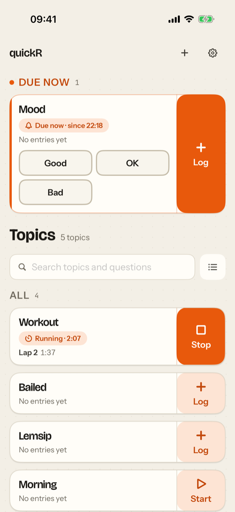 | 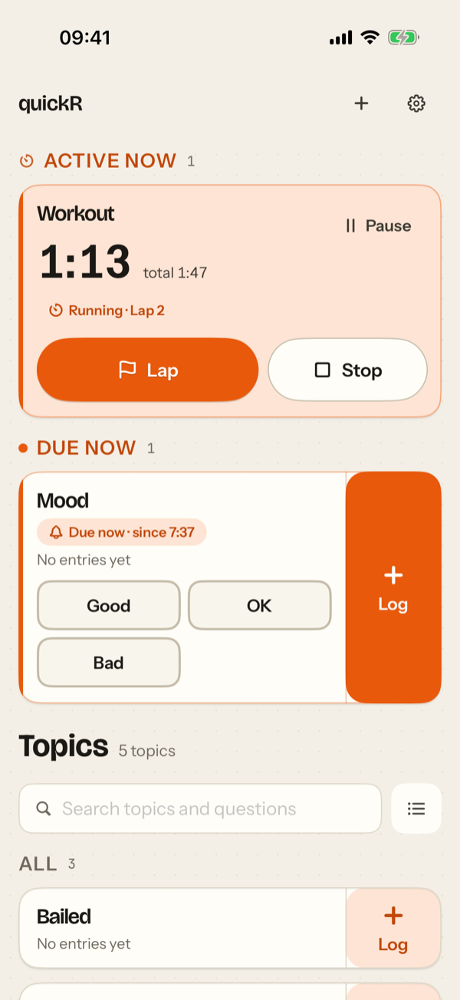 |
| Dark  | 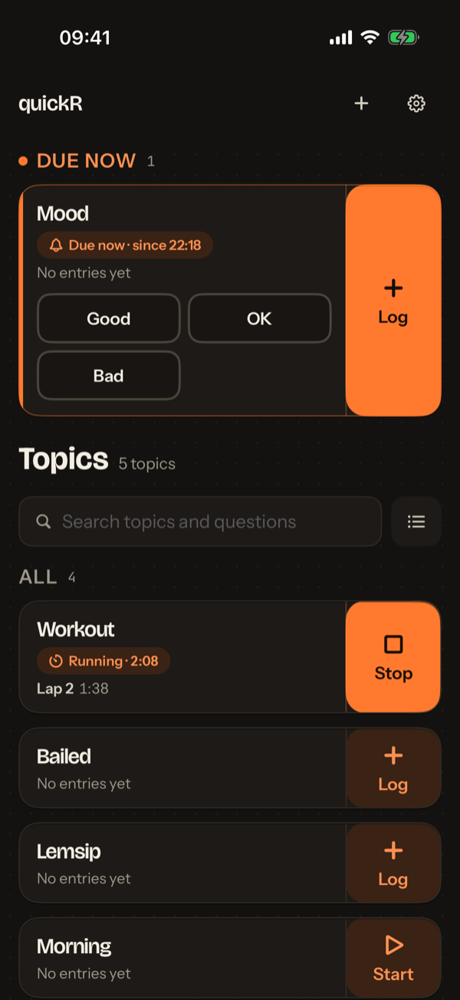  | 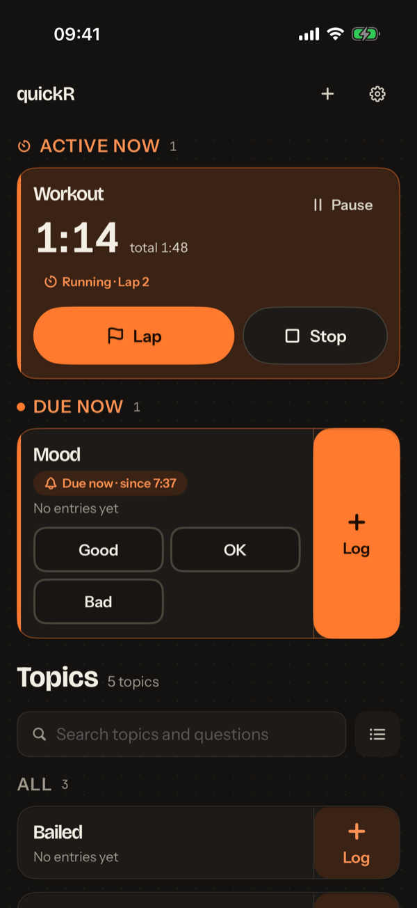  |
| XXXL  | 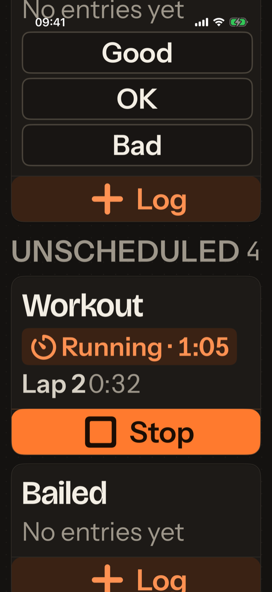  | 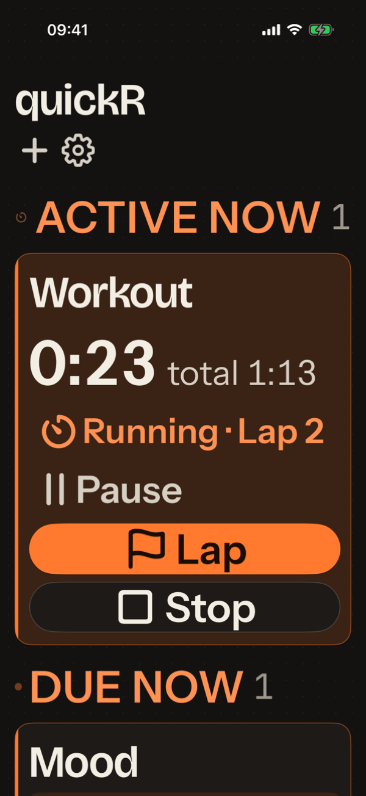  |

Before: the running tile looked like an idle one, with Stop as its block and no
Lap. After: "Active now" sits on top with a tinted card. The segment clock is
large, and the primary (Lap) sits beside Stop, with Pause in the title row.

### Run screen

| Mode  | Before                                              | After                                              |
| ----- | --------------------------------------------------- | -------------------------------------------------- |
| Light | 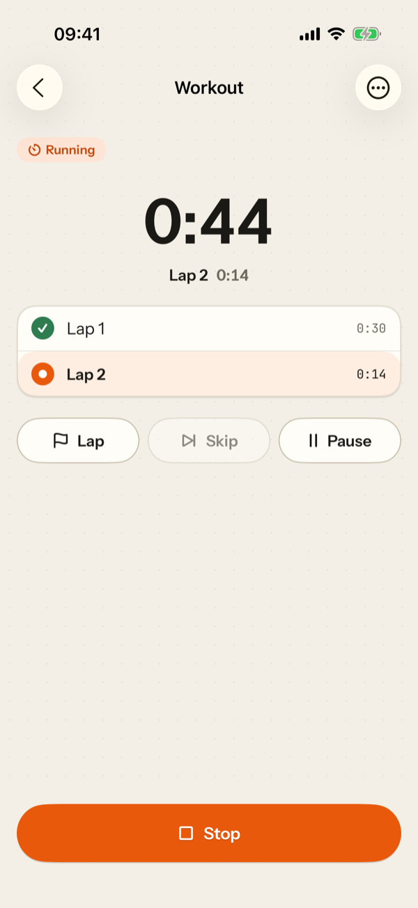 | 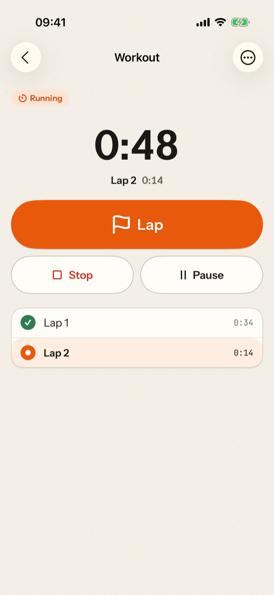 |
| Dark  | 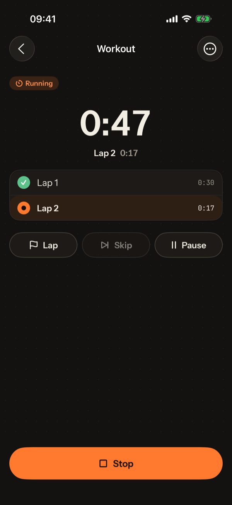  | 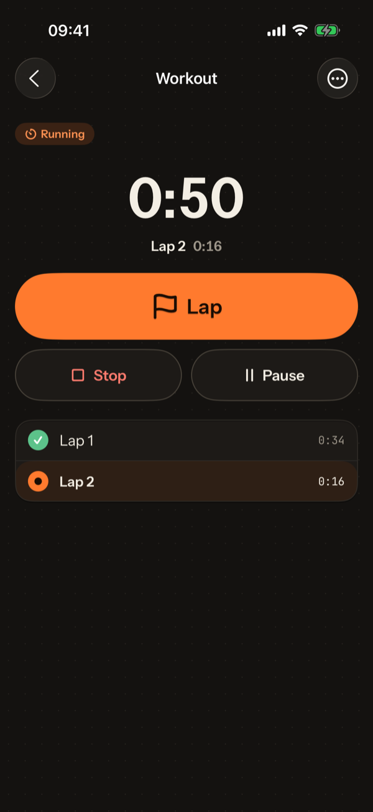  |
| XXXL  | 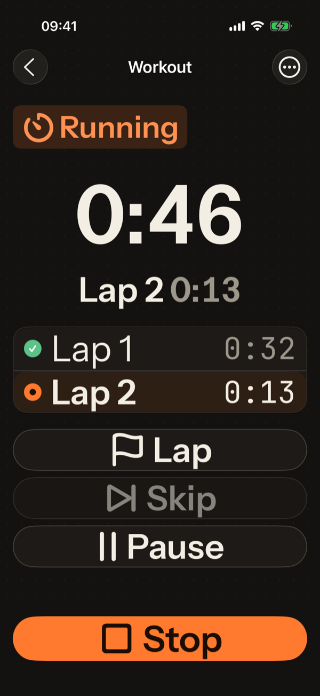  | 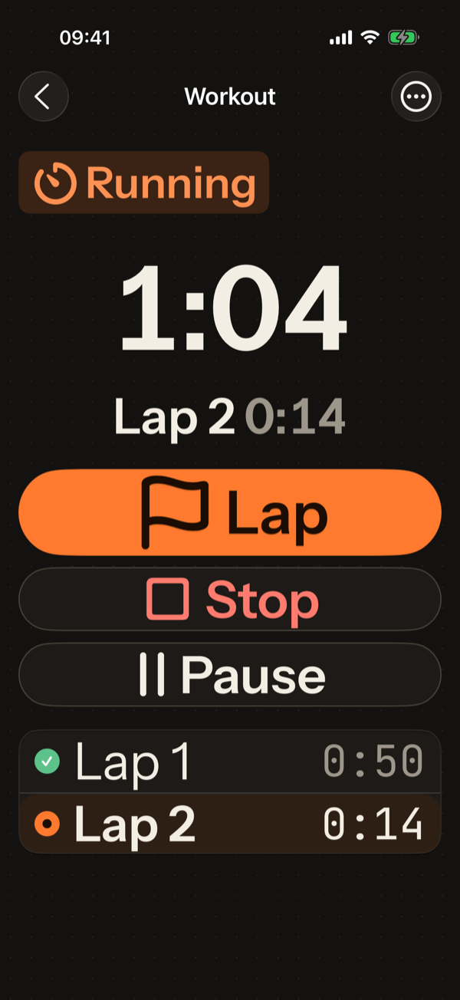  |

Before: Lap, Skip and Pause sat inside the table card, and Stop was in a bottom
bar. After: a 72 pt Lap hero under the header, Stop and Pause at 56 pt, the
table with no buttons, and Skip and Discard in `run.menu`.

### PWA run panel

| Mode  | Before                                              | After                                              |
| ----- | --------------------------------------------------- | -------------------------------------------------- |
| Light | 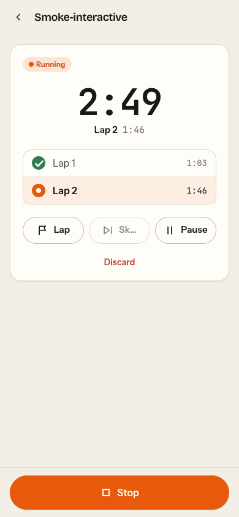 | 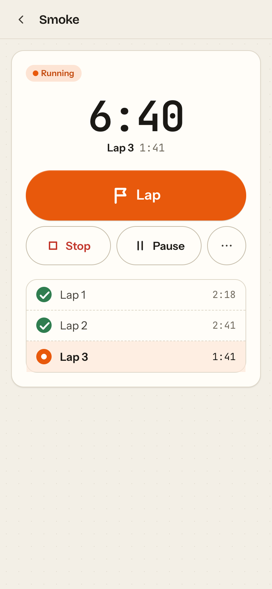 |
| Dark  | 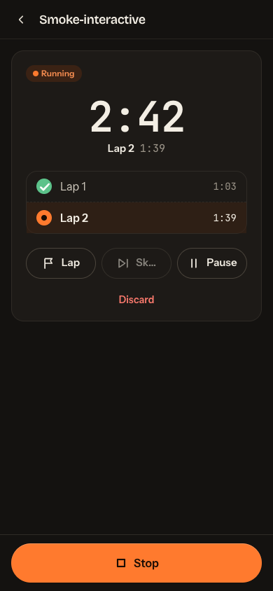  | 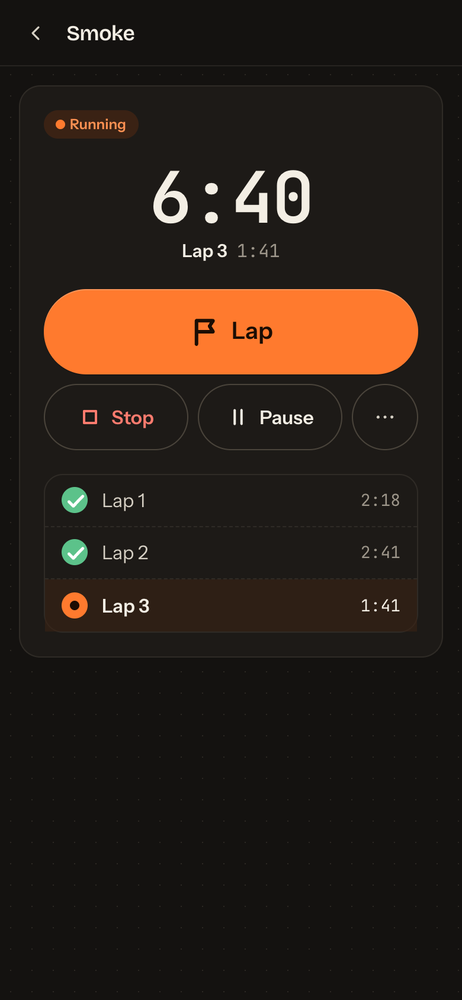  |

### PWA topics

| Mode  | Before                                                 | After                                                 |
| ----- | ------------------------------------------------------ | ----------------------------------------------------- |
| Light | 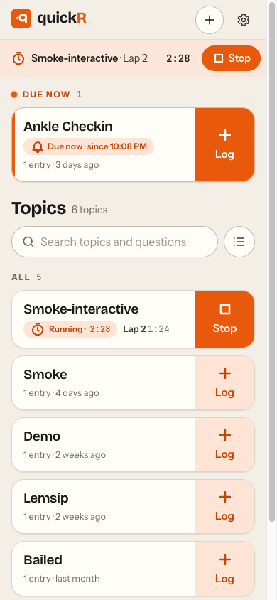 | 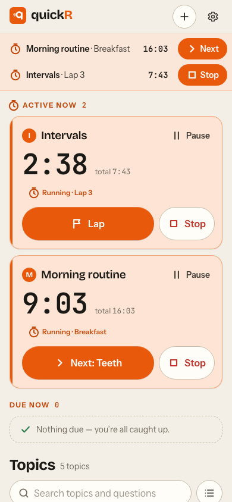 |
| Dark  | 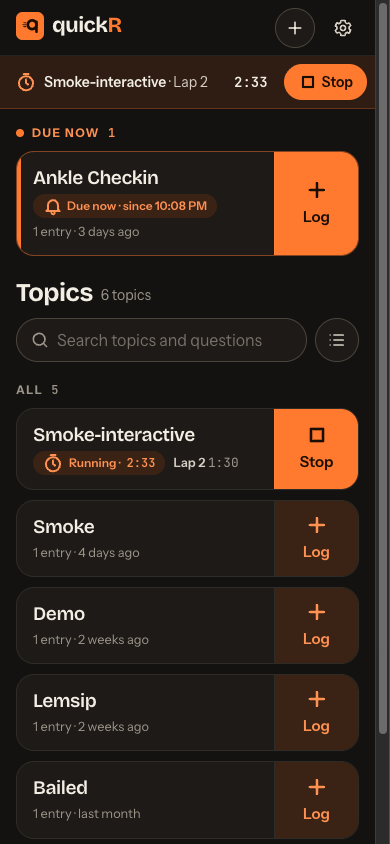  | 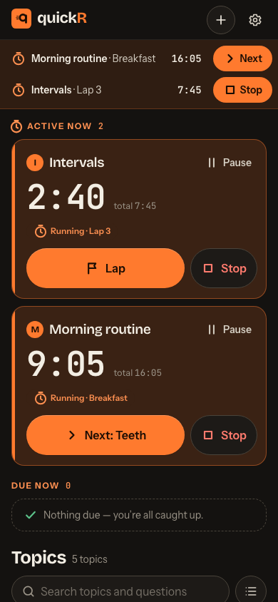  |

### Resume

iOS (#275): the stop toast's Resume
([light](M2/after/ios-resume-stop-toast-light.png) ·
[dark](M2/after/ios-resume-stop-toast-dark.png) ·
[XXXL](M2/after/ios-resume-stop-toast-xxxl.png)); the idle tile's "Resume ·
0:09" ([light](M2/after/ios-resume-idle-tile-light.png) ·
[dark](M2/after/ios-resume-idle-tile-dark.png) ·
[XXXL](M2/after/ios-resume-idle-tile-xxxl.png)); "Resuming…" with no controls
([card](M2/after/ios-resume-resuming-card-light.png) ·
[dark](M2/after/ios-resume-resuming-card-dark.png);
[run screen](M2/after/ios-resume-resuming-run-light.png) ·
[dark](M2/after/ios-resume-resuming-run-dark.png)). The XXXL toast breaks
"Resu/me" mid-word (#259).

PWA (#295): the idle tile's Resume ([light](M2/after/pwa-tile-resume-light.png) · [dark](M2/after/pwa-tile-resume-dark.png)), the stop toast's ([light](M2/after/pwa-stop-toast-resume-light.png) · [dark](M2/after/pwa-stop-toast-resume-dark.png); since M2-REVIEW it lasts 6 s, not 15 minutes), Resume under Start ([light](M2/after/pwa-run-resume-light.png) · [dark](M2/after/pwa-run-resume-dark.png)), and the Resuming card ([light](M2/after/pwa-resuming-card-light.png) · [dark](M2/after/pwa-resuming-card-dark.png)).

## Widget gallery

[`M2/after/widgets/`](M2/after/widgets/): 6 states × 4 modes (light, dark,
tinted, AccessibilityXXXL), from
`WidgetViewsUITests.testTimedWidgetsShowTheLapPrimary` (#210).

| State                        | Light                                                  | Dark                                                  | Tinted                                                  | XXXL                                                |
| ---------------------------- | ------------------------------------------------------ | ----------------------------------------------------- | ------------------------------------------------------- | --------------------------------------------------- |
| Lap (stopwatch)              | [▣](M2/after/widgets/widgets-timed-light-lap.png)      | [▣](M2/after/widgets/widgets-timed-dark-lap.png)      | [▣](M2/after/widgets/widgets-timed-tinted-lap.png)      | [▣](M2/after/widgets/widgets-timed-ax-lap.png)      |
| Typed lap ⏳ reshoot         | [▣](M2/after/widgets/widgets-timed-light-typedlap.png) | [▣](M2/after/widgets/widgets-timed-dark-typedlap.png) | [▣](M2/after/widgets/widgets-timed-tinted-typedlap.png) | [▣](M2/after/widgets/widgets-timed-ax-typedlap.png) |
| Small Auto (Stop carve-out)  | [▣](M2/after/widgets/widgets-timed-light-auto.png)     | [▣](M2/after/widgets/widgets-timed-dark-auto.png)     | [▣](M2/after/widgets/widgets-timed-tinted-auto.png)     | [▣](M2/after/widgets/widgets-timed-ax-auto.png)     |
| Small step (Next: Breakfast) | [▣](M2/after/widgets/widgets-timed-light-step.png)     | [▣](M2/after/widgets/widgets-timed-dark-step.png)     | [▣](M2/after/widgets/widgets-timed-tinted-step.png)     | [▣](M2/after/widgets/widgets-timed-ax-step.png)     |
| Paused                       | [▣](M2/after/widgets/widgets-timed-light-paused.png)   | [▣](M2/after/widgets/widgets-timed-dark-paused.png)   | [▣](M2/after/widgets/widgets-timed-tinted-paused.png)   | [▣](M2/after/widgets/widgets-timed-ax-paused.png)   |
| Alert (typed lap) ⏳ reshoot | [▣](M2/after/widgets/widgets-timed-light-alert.png)    | [▣](M2/after/widgets/widgets-timed-dark-alert.png)    | [▣](M2/after/widgets/widgets-timed-tinted-alert.png)    | [▣](M2/after/widgets/widgets-timed-ax-alert.png)    |

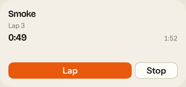
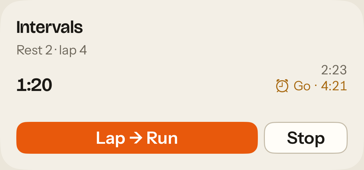

Live Activity states can't be rendered in the gallery (#202). They are on the
device checklist.

## Recordings

| Flow                                | File                                                                                      | Source                                                 |
| ----------------------------------- | ----------------------------------------------------------------------------------------- | ------------------------------------------------------ |
| iOS lap → stop                      | [ios-lap-flow.gif](M2/after/ios-lap-flow.gif) · [mp4](M2/after/ios-lap-flow.mp4)          | #210, `RunUITests` lap test recorded                   |
| iOS lap → stop → Resume → gap pause | [ios-resume-flow.gif](M2/after/ios-resume-flow.gif) · [mp4](M2/after/ios-resume-flow.mp4) | #275, `testStopToastOffersResume` (`M2-RESUME-s1-gif`) |
| PWA lap flow                        | [pwa-lap-flow.gif](M2/after/pwa-lap-flow.gif)                                             | #168                                                   |
| PWA stop → Resume                   | [pwa-stop-resume.gif](M2/after/pwa-stop-resume.gif) | M2-RESUME (PWA)                                        |

## UI tests not run by CI

CI's iOS job runs the Unit plan only. These are every local simulator run cited
by M2, with counts from the JSON exports (or the #210 transcription).

| Run                                         | Head                          | Evidence                                                                                                                                                        |             Total | Passed | Failed |                          Skipped |
| ------------------------------------------- | ----------------------------- | --------------------------------------------------------------------------------------------------------------------------------------------------------------- | ----------------: | -----: | -----: | -------------------------------: |
| I2-CONTROLS RunUITests r1                   | #162                          | [json](M2/xcresults/i2-controls-RunUITests-r1.summary.json)                                                                                                     |                 1 |      1 |      0 |                                0 |
| I2-CONTROLS RunUITests post-sync            | #162                          | [json](M2/xcresults/i2-controls-RunUITests-post-sync.summary.json)                                                                                              |                 1 |      1 |      0 |                                0 |
| I2-HOME: every class touching `tile.*`      | #163                          | [json](M2/xcresults/i2-home-ui.summary.json)                                                                                                                    |                54 |     41 |      0 | 13 (e2e classes without a stack) |
| I2-UITEST lap test, recorded                | `d7e2c02b`                    | [transcribed](M2/xcresults/i2-uitest-recorded.json)                                                                                                             |                 1 |      1 |      0 |                                0 |
| I2-UITEST after-shots                       | `d7e2c02b`                    | transcribed                                                                                                                                                     |                 2 |      2 |      0 |                                0 |
| **I2-UITEST full UI plan**                  | `d7e2c02b`                    | transcribed                                                                                                                                                     |               127 |    104 |      3 |                               20 |
| **I2-UITEST Unit plan**                     | `d7e2c02b`                    | transcribed                                                                                                                                                     |              1503 |   1475 |      0 |                               28 |
| I2-UITEST R9 + WidgetViewsUITests           | `7ae1b01e`                    | transcribed                                                                                                                                                     |                 5 |      5 |      0 |                                0 |
| #244 start race, `-test-iterations 10` (×3) | #244 heads                    | [r1](M2/xcresults/race-start-iter10.summary.json) · [r2](M2/xcresults/race-start-iter10-r2.summary.json) · [r3](M2/xcresults/race-start-iter10-r3.summary.json) | 1 (10 iterations) |      1 |      0 |                                0 |
| #244 R9 + HomeTests + TileUITests (×3)      | #244 heads                    | [r1](M2/xcresults/race-r9-home-tile.summary.json) · [r2](M2/xcresults/race-r9-home-tile-r2.summary.json) · [r3](M2/xcresults/race-r9-home-tile-r3.summary.json) |                17 |     17 |      0 |                                0 |
| M2-RESUME s1 UI batch (pin)                 | #275 pin                      | [json](M2/xcresults/M2-RESUME-s1-ui-batch.summary.json)                                                                                                         |                26 |     24 |      2 |                                0 |
| M2-RESUME s1 Unit plan (pin)                | #275 pin                      | [json](M2/xcresults/M2-RESUME-s1-unit.summary.json)                                                                                                             |              1653 |   1625 |      0 |                               28 |
| M2-RESUME s1 GIF                            | #275 pin                      | [json](M2/xcresults/M2-RESUME-s1-gif.summary.json)                                                                                                              |                 1 |      1 |      0 |                                0 |
| M2-RESUME s2 UI batch                       | #275 pin                      | [json](M2/xcresults/M2-RESUME-s2-ui-batch.summary.json)                                                                                                         |                26 |     24 |      2 |                                0 |
| M2-RESUME s3 UI batch                       | #275 pin                      | [json](M2/xcresults/M2-RESUME-s3-ui-batch.summary.json)                                                                                                         |                26 |     25 |      1 |                                0 |
| M2-RESUME s4 TileUITests                    | #275 pin                      | [json](M2/xcresults/M2-RESUME-s4-tile.summary.json)                                                                                                             |                 8 |      8 |      0 |                                0 |
| M2-RESUME shot runs (s1–s6, throwaway test) | #275 pin                      | `M2-RESUME-s*-shots-*.summary.json`                                                                                                                             |               1–2 |      1 |    0–1 |                                0 |
| **M2-RESUME final UI** (Home, Run, Tile)    | `bc7bbed8` lineage, merged M1 | [json](M2/xcresults/M2-RESUME-pr-ui.summary.json)                                                                                                               |                26 |     26 |      0 |                                0 |
| **M2-RESUME final Unit suites**             | same                          | [json](M2/xcresults/M2-RESUME-pr-unit.summary.json)                                                                                                             |                17 |     17 |      0 |                                0 |
| M2-REVIEW: WidgetViewsUITests reshoot       | ⏳                            | ⏳                                                                                                                                                              |                ⏳ |     ⏳ |     ⏳ |                               ⏳ |
| **`make check-ios`** (Unit and UI plans)    | ⏳                            | ⏳                                                                                                                                                              |                ⏳ |     ⏳ |     ⏳ |                               ⏳ |

The failures, all explained:

- **I2-UITEST full plan.** Two were `SettingsUITests` Save Password failures
  (#60/#89; fixed by #232). The third was R9 under load ~200; it passed on the
  rerun, and #244 found no app race.
- **M2-RESUME s1–s3 batches and the shot runs.** These were test bugs fixed in
  #275: the ack race, `app.open` relaunching onto a fresh store, and the toast
  over the debug controls. One app bug was also fixed there: an idle-screen
  `TimelineView` that never showed Resume. The failing shot runs were the
  throwaway XXXL scroll.

## E2E

| Run                                                                      | Head       | Total |                            Executed and passed | Skipped                             |
| ------------------------------------------------------------------------ | ---------- | ----: | ---------------------------------------------: | ----------------------------------- |
| `uitest-e2e.sh`, own stack, then `ios-integration-down` (#210)           | `7ae1b01e` |    17 | 14 (EndToEnd 4, EntriesEndToEnd 4, TapCount 6) | 3: demo screenshots only, by design |
| ⏳ at the gate, if the lead requires it after #244 and #275 touched home | ⏳         |    ⏳ |                                             ⏳ | ⏳                                  |

## Host and gate runs

| Run                                                       | Head                   | Result                                                                               |
| --------------------------------------------------------- | ---------------------- | ------------------------------------------------------------------------------------ |
| `make ios-core-test` (heavy.sh)                           | `cdb15760` (M2-REVIEW) | exit 0: 1216 tests in 124 suites, 371 in 47, 247 in 30, 30 in 11, 3 in 1, all passed |
| `swift test --filter "TimedWidgetTests\|WidgetDataTests"` | `b76d810b`             | 41 tests in 2 suites passed                                                          |
| `swift test --filter RunControlsLayoutTests`              | `b76d810b`             | 4 tests in 1 suite passed (2 parameterised over 15 rows)                             |
| `make check-frontend` (heavy.sh)                          | `b76d810b`             | exit 0: Test Files 78 passed (78), Tests 2001 passed (2001), build OK                |
| `make ios-lint`, `ios/scripts/lint-motion.sh`             | `b76d810b`             | exit 0, exit 0                                                                       |
| `make ios-gen` + App `build-for-testing`                  | `b76d810b`             | Test Build Succeeded                                                                 |
| `make check` (heavy.sh)                                              | `670a4ebb` | exit 0: ruff/mypy "All checks passed!", pytest `1429 passed`, vitest `Test Files 79 passed (79)`, `Tests 2028 passed (2028)`, build OK |
| **`make check-ios`**                                      | ⏳                     | ⏳ (xcresult JSON under `M2/xcresults/M2-REVIEW-check-ios-*`)                        |
| Final merge ritual on the milestone PR                    | ⏳                     | ⏳                                                                                   |

## Reviews

| Review                                         | File                                                              | Outcome                                                                                                                                                                                                                                     |
| ---------------------------------------------- | ----------------------------------------------------------------- | ------------------------------------------------------------------------------------------------------------------------------------------------------------------------------------------------------------------------------------------- |
| Codex, milestone round 1                       | [`M2-milestone-codex.md`](../reviews/M2-milestone-codex.md)       | 2 high, 2 medium. Findings 1–3 (PWA Resume, Resuming, Undo resume) are covered by the open PWA RESUME branch; its running-bar part is fixed here (`4d5d076b`). Finding 4's bar cases come in phase 2.                                       |
| Claude (Opus), fresh reviewer                  | [`M2-milestone-claude.md`](../reviews/M2-milestone-claude.md)     | 3 high, 2 medium, 7 low. The Auto/Control mismatch (#4), the stale widget tests (#6), the card's duplicated rows (#7) and reduced motion (#10) are fixed. #8 is filed as #286, #9 is spec text for the lead, and #11 and #12 are justified. |
| Codex, round 2 on the review's fixes           | [`M2-milestone-codex-r2.md`](../reviews/M2-milestone-codex-r2.md) | 2 P2 and 1 P3, all fixed (`6787c4c0`, `237f6797`)                                                                                                                                                                                           |
| Codex round 3 and Claude on the PWA RESUME delta (#295) | [`M2-milestone-codex-r3-pwa-resume.md`](../reviews/M2-milestone-codex-r3-pwa-resume.md), [`M2-milestone-claude-pwa-resume.md`](../reviews/M2-milestone-claude-pwa-resume.md) | No high. The 15-minute toast over Start and its stale offer: fixed (`b42d32aa`). The stale-offer retarget, the tile's missing re-check, the offline-after-ack fallback: #297. The tick perf: #298. The finishing-run Resume: spec question #299. A queued reopen on a local row: by design. |

Per-WP Codex reviews are in [`docs/t2/reviews/`](../reviews/), files
`M2-<wp>-codex*.md`, and each PR body names its own.

## Decisions and spec corrections

Each item comes from the lead's notes and the spec's review log (§13, "M2
implementation corrections").

| Decision or correction                                                                                                                                                                                                                      | Where                                                                    |
| ------------------------------------------------------------------------------------------------------------------------------------------------------------------------------------------------------------------------------------------- | ------------------------------------------------------------------------ |
| The Lock Screen activity has two text rows and one button row (primary ½, Pause/Resume ¼, Stop ¼). Dynamic Type is capped at xxLarge, because iOS truncates an activity above 160 pt.                                                       | §4.2; `1d575583`, `18c94d13` (I2-LA)                                     |
| Stop is ≥ 84 pt wide (natural width), not exactly 84 pt; the card reads `RunTicker` itself, with no `now` parameter                                                                                                                         | §3.2; `ba46bba7`                                                         |
| PWA card status badge `card-status` ("Running · {headline}"), not `<RunStatus/>`; Pause/Resume `card-pause`/`card-resume`                                                                                                                   | §6.2; `ba46bba7`                                                         |
| The running bar leaves out a run whose controls are already on screen: the run panel's, and an "Active now" card's                                                                                                                          | §6.3; `ba46bba7`                                                         |
| Placement by role; the tile picks Stop and Pause/Resume out of the secondaries by kind (different rows)                                                                                                                                     | §1.2 "Placement"; `ba46bba7`                                             |
| The iOS card's title, headline and clock are one combined VoiceOver element; the Resume slot sits in the idle tile's quick slot under the meta line                                                                                         | §3.2, §3.3, §7; `ba46bba7`                                               |
| §1.2 rows 1–3 and 13: idle surfaces call `actions` on the latest run. That gives `start`, plus `reopen` (secondary) within OQ-1; a topic with no run shows `start` alone. Accepted by the orchestrator, overriding the earlier `[]` ruling. | §1.2; `ba46bba7`, `096916fa`; M1 #203                                    |
| Row 9: the steps-unknown fallback is `next("")`, rendered as a plain "Next"                                                                                                                                                                 | §1.2, §1.3; `773c4f61`; #275 (`RunActionLabel`)                          |
| Row 13: reopen is secondary (timers2 §10 one-word fix)                                                                                                                                                                                      | §1.2; `096916fa`; M1 #203                                                |
| The 10 s fired-alert label is run-screen state owned by I1-ALERTS (`runAlerts.label(runId:)`); `alertLine` stays the persistent line                                                                                                        | §2.1; `ba46bba7`; rendered in #275 (#185)                                |
| "Active now" is a UI-level partition: no `TopicListing` or vector change                                                                                                                                                                    | §3.1, D-4 (I2-HOME, F2-HOME)                                             |
| Shared-branch merges land by fast-forward push, never squash (the repo disallows merge commits, and a squash drops the shared ancestry)                                                                                                     | lead notes; #207, #275                                                   |
| #175: the typed Lap's accessible name stays "Lap, then Rest" (§1.3 wording kept)                                                                                                                                                            | #175 closed                                                              |
| #228: the reverted notice via the feed path is accepted as a mitigation for T2, out of the release                                                                                                                                          | orchestrator; #228 open (`t2-followup`)                                  |
| M2-REVIEW: one-button surfaces render `RunWrites.autoTap` (`WidgetTopic.runAuto`), not a re-derivation from the content state                                                                                                               | §5.3, §8.2 ("M2 only renders what `RunWrites.auto` decides"); `bd0476d1` |
| M2-REVIEW proposed spec text (not committed; sent to the lead): §2.2's overflow list drops "Resume run (`run.reopen`, idle screen only)", which §2.4 places as the secondary under Start                                                    | §2.2 vs §2.4                                                             |

## Follow-up issues

State as of 2026-11-26. "Fixed on `t2/m2`" issues close when the fix reaches
main.

| Issue                                                      | State  | From                            | What                                                             | Status in M2                                                                   |
| ---------------------------------------------------------- | ------ | ------------------------------- | ---------------------------------------------------------------- | ------------------------------------------------------------------------------ |
| [#132](https://github.com/Richard-Lynch/quickr/issues/132) | open   | I2-WIDGETS                      | Timer Control "Add details" should open the app                  | deferred (needs a foreground intent)                                           |
| [#143](https://github.com/Richard-Lynch/quickr/issues/143) | open   | M2-DEV                          | Live Activity Stop spoken "Stop", spec "Stop {topic}"            | fixed on `t2/m2` (#212)                                                        |
| [#153](https://github.com/Richard-Lynch/quickr/issues/153) | open   | M2-MODEL-ADOPT                  | layout table rows hand-built                                     | fixed in #300: iOS `d76a85a9`, PWA rows 2, 3, 10 `41b24471`; rows 11 and 14 by design |
| [#161](https://github.com/Richard-Lynch/quickr/issues/161) | open   | I2-CONTROLS                     | toast/idle Resume, Resuming, lap-type badge                      | fixed on `t2/m2` (#275)                                                        |
| [#164](https://github.com/Richard-Lynch/quickr/issues/164) | open   | F2-HOME                         | PWA idle tile Resume and Resuming card                           | fixed on `t2/m2` (#295)                                                             |
| [#167](https://github.com/Richard-Lynch/quickr/issues/167) | open   | F2-CONTROLS                     | PWA `Sheet` dialogs have no accessible name                      | deferred (shared UI)                                                           |
| [#173](https://github.com/Richard-Lynch/quickr/issues/173) | open   | F2-BAR                          | typed-lap case for the bar vs panel test                         | fixed in #300 (`41b24471`)                                     |
| [#175](https://github.com/Richard-Lynch/quickr/issues/175) | closed | F2-BAR                          | typed Lap accessible name vs visible label                       | kept §1.3                                                                      |
| [#185](https://github.com/Richard-Lynch/quickr/issues/185) | open   | M1 I1-ALERTS                    | render the 10 s inline alert label                               | fixed on `t2/m2` for iOS (#275)                     |
| [#188](https://github.com/Richard-Lynch/quickr/issues/188) | open   | CI flake                        | `RunFlow` "Pause twice" wall-clock cooldown                      | fixed on `t2/m2` (#195)                                                        |
| [#202](https://github.com/Richard-Lynch/quickr/issues/202) | open   | I2-UITEST                       | Live Activity states in the gallery                              | deferred; device checklist                                                     |
| [#206](https://github.com/Richard-Lynch/quickr/issues/206) | closed | #207                            | `LocalRun` drops lap types                                       | fixed by M1 (#234)                                                             |
| [#208](https://github.com/Richard-Lynch/quickr/issues/208) | closed | I2-LA-FIELDS                    | `next_label` in a lap                                            | fixed by M1 (#234)                                                             |
| [#209](https://github.com/Richard-Lynch/quickr/issues/209) | open   | I2-LA-FIELDS                    | timed widget headline, alert, lap title                          | fixed on `t2/m2` (#223)                                                        |
| [#222](https://github.com/Richard-Lynch/quickr/issues/222) | open   | #223                            | widget "Lap → Rest" waits on `isLapTyped`                        | fixed on `t2/m2` (#275); the gallery shows it after the phase-2 reshoot        |
| [#228](https://github.com/Richard-Lynch/quickr/issues/228) | open   | M1 I1-WRITES                    | reverted notice on the feed path                                 | accepted mitigation, out of the release                                        |
| [#230](https://github.com/Richard-Lynch/quickr/issues/230) | closed | CI                              | 15-min Unit plan step budget                                     | raised to 22 min by #249                                                       |
| [#235](https://github.com/Richard-Lynch/quickr/issues/235) | open   | I2-UITEST                       | `TopicUITests.testCreateATopicOpensItsRecordScreen` flake        | known; not M2 code                                                             |
| [#239](https://github.com/Richard-Lynch/quickr/issues/239) | closed | I2-UITEST                       | R9 Start tap dropped under load                                  | #244: no launch race; a related home race fixed                                |
| [#243](https://github.com/Richard-Lynch/quickr/issues/243) | open   | #244                            | a run tap that fails to write is silent                          | M1-owned `RunActions`                                                          |
| [#247](https://github.com/Richard-Lynch/quickr/issues/247) | open   | #244 CI                         | `sim-cap-test` caller trap flake                                 | tooling                                                                        |
| [#259](https://github.com/Richard-Lynch/quickr/issues/259) | open   | #275                            | `ToastView` breaks "Resu/me" at accessibility sizes              | deferred (shared layout)                                                       |
| [#286](https://github.com/Richard-Lynch/quickr/issues/286) | open   | M2-REVIEW                       | run-screen and card primaries use the accent, not the topic tint | T2-WIRE item 3                                                                 |
| [#297](https://github.com/Richard-Lynch/quickr/issues/297) | open | M2-REVIEW (#295) | PWA Resume re-check, retarget, offline-after-ack | deferred (edge cases, no data loss) |
| [#298](https://github.com/Richard-Lynch/quickr/issues/298) | open | M2-REVIEW (#295) | idle timed tiles tick every second | deferred (performance) |
| [#299](https://github.com/Richard-Lynch/quickr/issues/299) | open | M2-REVIEW (#295) | spec: Resume from the answers form | spec question |

## Device-only items

[`docs/t2/device-checklist.md`](../device-checklist.md), section "M2 · active
surfaces", has 11 items. They were re-checked at M2-REVIEW against what shipped
after #275, and none is pending any more.

- The Live Activity on the real Lock Screen:
  - the layout within 160 pt;
  - the button row at the capped text size;
  - VoiceOver "Stop {topic}".
- The Live Activity lap fields: the headline, "L1", "Lap → Rest", and the alert
  countdown reaching 0:00 (hidden while paused).
- The Dynamic Island: compact step number or lap counter, and the expanded
  primary ⅔ / Stop ⅓.
- A Lap tap from the Lock Screen and from the Island with the app killed.
- The Timer control:
  - an untyped timer reads "Stop" (the §5.3 carve-out);
  - a lap-typed one reads "Lap → Rest" and never stops.
- The Action button's Auto on both kinds of timer.
- The active card on the home screen, including XXXL stacking.
- Resume within 15 minutes:
  - the toast and the idle tile;
  - the offline "Resuming…" state;
  - the window closing;
  - no Resume offered from an ended activity.
- Smart Stack and StandBy (observe only).

## Criteria without full proof

1. **PWA Resume edge cases** (#297, #298, #299): filed from the review of #295; none loses data.
2. **The bar's "every state"** is proven for rows 4–9, the typed lap, 11 and 14; rows 1–3, 12 and 13 have no open run, so no bar.
3. **The PWA stop toast** lasts 6 s, not §6.3's "for 15 minutes" (`b42d32aa`, as on iOS): the lasting offer is the Resume under Start and on the tile. Spec text went to the lead.
4. **Widget gallery typed-lap and alert images.** They show a plain "Lap" (fixed
   in `6d979db9`). They are reshot in phase 2, and `WidgetViewsUITests` now
   asserts the typed names.
5. **I2-UITEST xcresults** are a transcription
   ([`i2-uitest-recorded.json`](M2/xcresults/i2-uitest-recorded.json)), not
   exports. They predate the durable-evidence rule.
6. **E2E** last ran at `7ae1b01e` (I2-UITEST), before #244 and #275 changed home
   and the run screen. The lead had it repeated at the gate: see [E2E](#e2e).
7. **Live Activity rendering** (layout, button heights ≥ 56/≥ 44 pt, Dynamic
   Island) is device-only (#202).
8. **No iOS still of the run screen's alert line.** It is host-tested
   (`RunHeaderTextTests`), and the alert widget shows it; the Lock Screen
   countdown is device-only.
9. **Colour of the primaries** (user item 9): #286, T2-WIRE.

## Cleanup

⏳ The lead runs
`python3 -I /Users/richie/code/quickr-worktrees/_tools/t2-cleanup.py --machine`
and pastes the output here. It must show no orphan clones, DBs or images from
M2, and free disk ≥ 40 GB.
