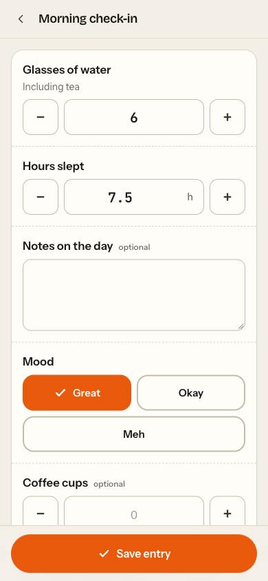

# quicker — frontend

React 19 + Vite 8 + TypeScript SPA (Tailwind v4, TanStack Query, React Router, react-hook-form + zod).
Mobile-first; light/dark follows the OS.

## Scripts

| Script                              | What it does                                                       |
| ----------------------------------- | ------------------------------------------------------------------ |
| `pnpm dev`                          | Dev server on :5180, proxies `/api` + `/mcp` to `localhost:8100`\* |
| `pnpm build`                        | Typecheck (`tsc -b`) + production build into `dist/`               |
| `pnpm typecheck`                    | `tsc -b` only                                                      |
| `pnpm lint`                         | ESLint (typescript-eslint strict + stylistic type-checked)         |
| `pnpm test`                         | Vitest (jsdom)                                                     |
| `pnpm gen:api`                      | Regenerate `src/client/` from `../openapi.json`                    |
| `pnpm format` / `pnpm format:check` | Prettier                                                           |

\* override with `QUICKER_BACKEND_URL=http://host:port pnpm dev`.

## API client codegen

`src/client/` is generated by `@hey-api/openapi-ts` (config: `openapi-ts.config.ts`) and committed:
types, zod schemas (requests + responses), an SDK that validates with them, and TanStack Query
option factories. Never edit it by hand and never hand-write API types — import from `src/client`.

Flow when the backend API changes: regenerate `openapi.json` at the repo root (backend), then
`pnpm gen:api`, commit the diff. CI runs `pnpm gen:api && git diff --exit-code -- src/client`.

Runtime config (same-origin `baseUrl`, `X-Quicker-Channel: ui` header) lives in
`src/api/clientConfig.ts`. The generated fetch-client runtime (`src/client/{client,core}`) is not
`exactOptionalPropertyTypes`-clean, so it is type-checked as its own project
(`tsconfig.client-runtime.json`); everything else, generated or not, uses the strict app config.

## Docker

`Dockerfile` builds with Node 24 + pnpm and serves `dist/` from nginx (SPA fallback, gzip, immutable
caching for hashed assets) while proxying `/api/` and `/mcp` (unbuffered, for streamable HTTP/SSE)
to `BACKEND_ORIGIN` (default `http://backend:8000`).

