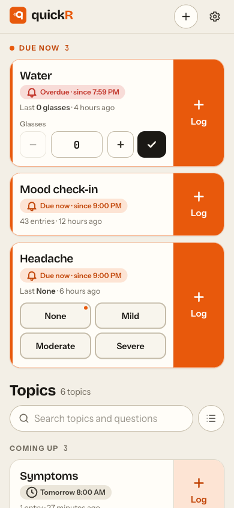
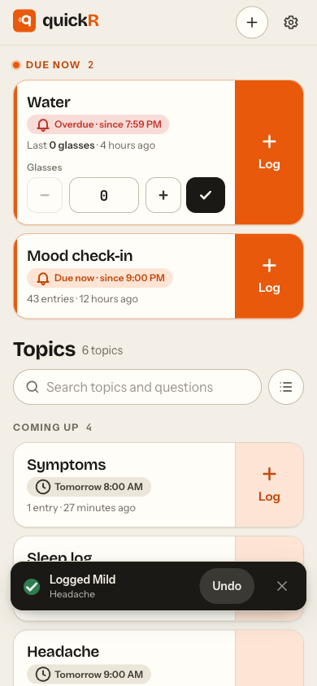
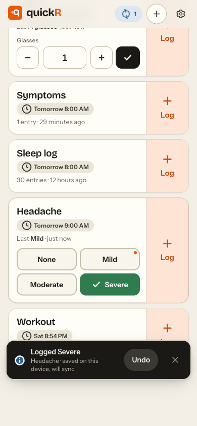
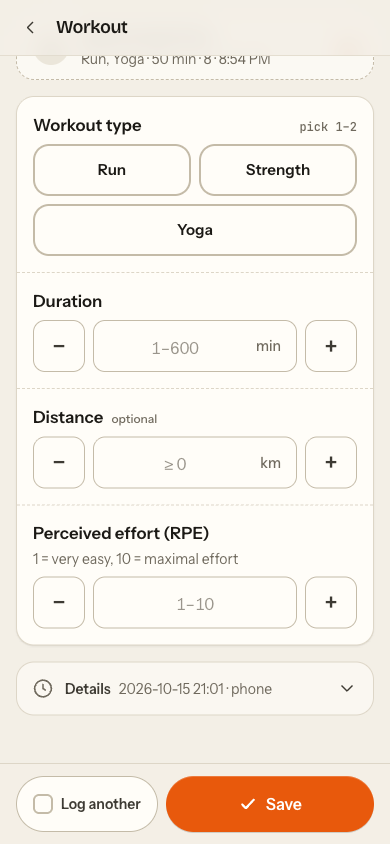
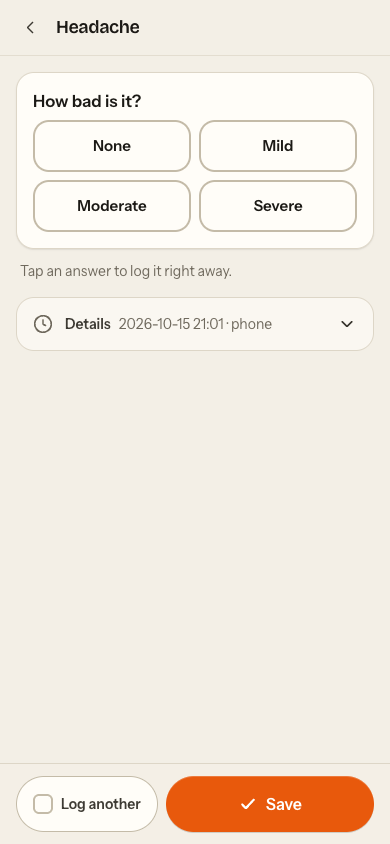
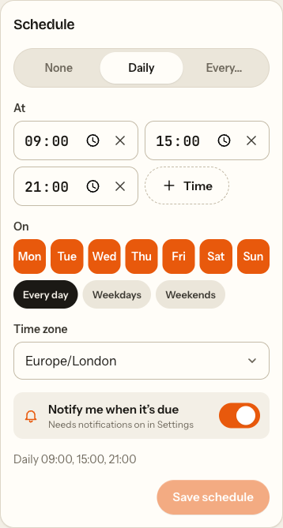
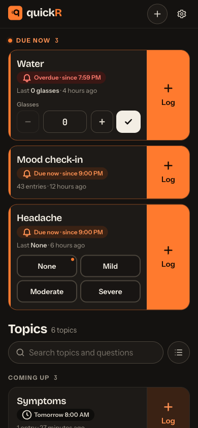
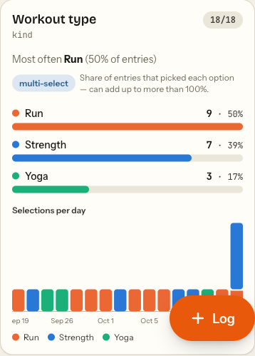
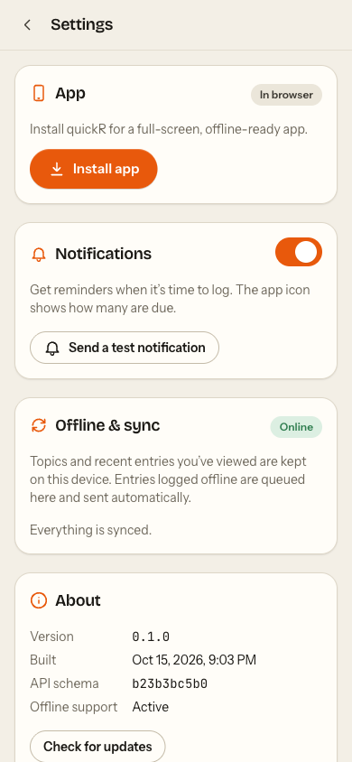

# Design loop: fewer taps to log

Goal: logging should be nearly frictionless on the primary device, an iPhone with
quickR installed to the Home Screen. Everything was measured in Chromium (Playwright)
at 390×844 against a local v2 backend with seeded data. Each count starts at a cold
app open (Home Screen icon) and ends when the entry is saved. Typing a value counts as
typing, not as taps. Screenshots are in [`screenshots/v2/`](screenshots/v2/).

Test topics: **Headache** (one required single-select, 4 options, daily 09/15/21),
**Water** (one required int, every 3 h), **Workout** (4 questions: type enum, duration
int, distance double (optional), RPE int), plus the seeded Sleep log / Mood check-in.

"Before" is the v2 branch UI with the API changes only (commit `a13fbf3`), so it shows
the old UX running against the new backend.

## Tap counts

| Scenario                                     | Before                                                    | Iteration 1                     | Iteration 2               | Final (iteration 3)                |
| -------------------------------------------- | --------------------------------------------------------- | ------------------------------- | ------------------------- | ---------------------------------- |
| (a) 1-question enum (Headache)               | **3** Log → chip → Save (then Back)                       | **1** chip on the tile          | 1                         | **1**                              |
| (b) 1-question number (Water)                | **3** + type: Log → field → type → Save                   | **1** ✓ (last value) · 2 with ± | 1 · 2                     | **1** · 2 with ±                   |
| (c) 4-question mixed (Workout)               | **5** + 2 values + scroll                                 | 5 + 2 values                    | **4** + 2 values          | **4** + 2 values                   |
| (d) 4-question, same answers as last time    | **5** + 2 values                                          | **3** Log → Same as last → Save | 3                         | **3**                              |
| (e) due topic from a notification (Headache) | **3** notification → chip → Save                          | 3                               | **2** notification → chip | **2** (Water: notification → Save) |
| (f) undo a mistaken quick-log                | n/a: no quick-log. Delete = **3** (Data → entry → Delete) | **1** Undo in the toast         | 1                         | **1**                              |
| (g) log while offline (Headache)             | **3** (queued, syncs later)                               | **1** (queued, syncs later)     | 1                         | **1**                              |

All seven were run end to end in the browser. Offline (g) was also run as a cold start
with the production build: the service worker served the shell, the persisted cache had
the topics, and the outbox synced the entry when the connection came back.

## Iteration 1: due-first home, big Log, quick-log tiles

What was built:

- **Due-first home.** The list sorts by `due` on the server. A **Due now** section comes
  first ("Overdue · since 08:00" in danger, "Due now · since 9:00 PM" in accent), then
  **Coming up** (scheduled, soonest first, "Due in 25 min" / "Next 9:00 PM" /
  "Tomorrow 8:00 AM"), then the rest. When nothing is due it says so in one line.
  Search, status and sort sit behind one toggle, so due tiles start at the top of the
  screen.
- **Bigger record button.** Every tile has a full-height Log block on the right (thumb
  side). It is solid accent when the topic is due and accent-soft otherwise, so due
  topics stand out.
- **Inline quick-log.** A topic whose only _required_ question is a single-select with
  ≤ 6 options gets its options as chips on the tile, and one tap logs. A single
  required number gets − value + ✓, prefilled with the last value. Quick-logs go
  through the outbox, are optimistic, and show an **Undo** toast instead of asking for
  confirmation.
- **Record screen.** "Same as last time" (one tap fills, tap again to undo), Details
  (time/source/notes) collapsed, sticky Save, back to the list after saving unless
  **Log another** is on (remembered).

Critique ([before](screenshots/v2/before-home.png) vs
[iteration 1](screenshots/v2/it1-home.png)):

- **Mis-tap risk:** the New-topic FAB sat on top of the bottom tile's Log block. →
  Moved New topic to the top bar. Now nothing floats over the tiles.
- **Unreadable:** the non-due Log block's label vanished (the primary variant's white
  text on accent-soft). → Custom classes: accent-strong on accent-soft (≈ 4.8:1).
- The unit overlay ran into the value in the narrow tile input ("0glasses"). → Unit
  moved into a small label above the stepper ("Glasses", or "Glasses (kg)").
- "Next tomorrow 08:00 AM" read badly. → "Tomorrow 8:00 AM", and "Next 9:00 PM" today.
- **Thumb reach:** the Undo toast was at the top of the screen, the hardest place to
  reach. → Toasts sit at the bottom on phones (above the sticky bar), with 44 px Undo
  and dismiss targets.

Re-measured after the fixes: (a) 1, (b) 1, (d) 3, (f) 1. See
[home after the fixes](screenshots/v2/it1b-home.png).

## Iteration 2: the record screen does more per tap

Critique of iteration 1:

- **Clarity:** on a 1-question topic opened from a notification, the first chip had a
  focus ring and looked selected ([screenshot](screenshots/v2/it2-record-focus-ring.png)).
  Also, "Same as last time" made no sense there, because a chip already is one tap.
- **Taps:** in (c), each number field needed its own tap after the chip, and Enter
  (shown as "next" on the keyboard) submitted the form early.
- **Feedback:** after a chip tap, the tile itself didn't change. Only the toast said
  something had happened.

Changes:

- A topic with **only** a single-select question saves when you tap a chip. The record
  screen says "Tap an answer to log it right away", and the Undo toast covers mis-taps.
  (e) goes from 3 to 2.
- After a single-select pick, the next unanswered number/text field gets focus inside
  the same tap handler, so iOS opens the keyboard. Enter/"next" moves to the next empty
  answer instead of saving. (c) goes from 5 to 4.
- Chips are never focused when the screen opens. They are only scrolled into view.
- Quick tiles show the last answer ("Last **Mild** · 5 min ago", plus a dot on that
  chip). The tapped chip turns green with a ✓ for 1.6 s.

## Iteration 3: notification → Save

Critique of iteration 2: for a number topic, opening the record screen from a reminder
still meant tapping "Same as last time" or typing. The tile was already prefilled, so
the record screen was the odd one out.

- A single-number topic's record screen also starts from the last value.
  Notification → Save is 2 taps
  ([screenshot](screenshots/v2/after-record-number-prefilled.png)).
- "Same as last time" hides itself when it would change nothing.
- The topic header shows its schedule and due status.

## Decisions and things left out

- **One rule for the tile's two actions.** The Log block always opens the form. Inline
  controls (chips, ✓) always log right away. The ✓ is an icon, not a second "Log"
  label, so the two can't be confused.
- **Quick-log eligibility** is "exactly one _required_ question that is a single-select
  (≤ 6 active options) or a number" (`src/lib/quickLog.ts`, unit-tested). Optional extra
  questions don't block it: they stay unanswered and the form is one tap away.
  Multi-select, text and several required questions use the form.
- **No confirmation dialogs anywhere in logging.** Every quick-log and every save from
  the record screen gets an Undo toast. Undo works before and after sync, because the
  outbox item id _is_ the entry id: a queued item is discarded, a sent entry is deleted
  by id.
- **No unsaved-changes prompt for the tile stepper.** A typed but unlogged value is kept
  in memory when you navigate away and back (it is shown again), instead of interrupting
  you with a dialog. Real forms (record, edit, builder, schedule) keep the guard.
- **Not added:** long-press menus, a separate Log tab/sheet, and recently-used ordering.
  Due-first ordering with inline quick-log already puts the next thing to log at the top
  of the home screen, and each of these would add a second way to do the same thing.
- **Accessibility.** Chips use radio semantics (single-select) or checkbox semantics
  (multi-select, with count and limits announced). The selection limit dims the
  remaining chips with `aria-disabled`. Every tap target is ≥ 44 px. Tile actions have
  explicit labels ("Log Headache", "Log Mild (same as last time)"). The due pulse is
  hidden under `prefers-reduced-motion` (and all motion is reduced globally there).
  Dark mode keeps the same hierarchy ([dark](screenshots/v2/after-home-dark.png)).

## Final screenshots

| Home, due first                                   | Quick-log + Undo                                 | Offline quick-log                                    |
| ------------------------------------------------- | ------------------------------------------------ | ---------------------------------------------------- |
|             |      |            |
| **Same as last time**                             | **Single-pick record (from a notification)**     | **Schedule editor**                                  |
|  |  |         |
| **Dark**                                          | **Multi-select stats**                           | **Notifications (real push via FCM)**                |
|            |               |  |
