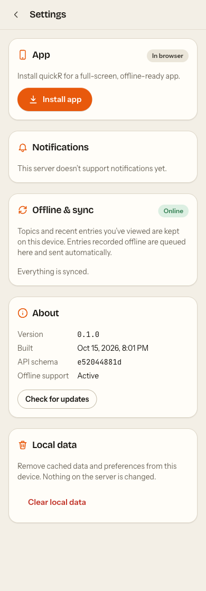
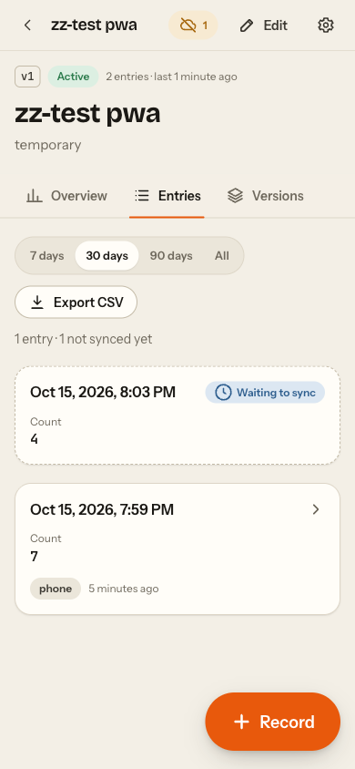
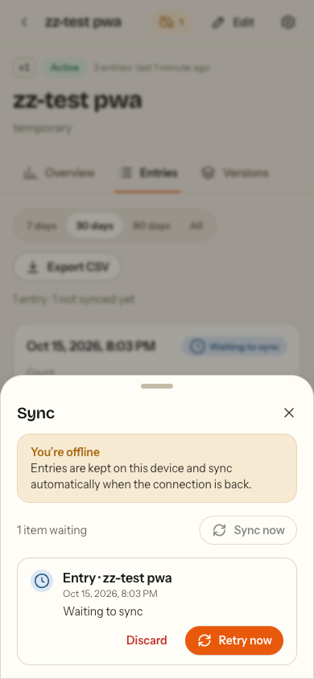
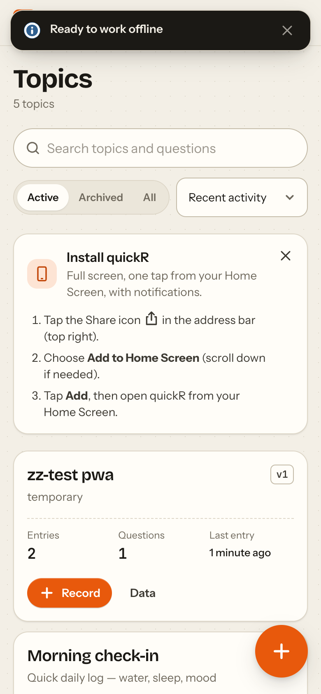

# quickR as a PWA

How the installable/offline layer is put together, and the seams the feature work
(entries, schedules, push) plugs into. Primary target: **Chrome on iOS, added to the Home
Screen** — which is WebKit underneath, so everything that applies to iOS Safari applies.

| Concern                  | Where                                                                  |
| ------------------------ | ---------------------------------------------------------------------- |
| Manifest, SW build       | `vite.config.ts` (`vite-plugin-pwa`, `injectManifest`)                 |
| Service worker           | `src/sw.ts` (typechecked by `tsconfig.sw.json`, WebWorker lib)         |
| SW registration + update | `src/components/pwa/UpdatePrompt.tsx`                                  |
| Persisted query cache    | `src/api/persist.ts`, `src/api/queryClient.ts`                         |
| Mutation outbox          | `src/lib/outbox/*`, `src/api/outboxEffects.ts`, `src/api/entries.ts`   |
| Optimistic mutations     | `src/api/cache.ts`, `src/api/mutations.ts`, `src/lib/undo.ts`          |
| Push                     | `src/lib/push.ts`, `src/lib/pushPayload.ts`, `src/sw.ts`               |
| Badge                    | `src/lib/badge.ts`                                                     |
| Install UX               | `src/lib/install.ts`, `src/lib/platform.ts`, `components/pwa/Install*` |
| Unsaved-changes guard    | `src/lib/unsavedChanges.tsx`                                           |
| Settings screen          | `src/pages/AppSettingsPage.tsx` (`/settings`)                          |
| Transport constants      | `src/api/constants.ts` (API prefix, channel header, SW cache name)     |

 
 

## Icons and branding

`public/favicon.svg` is the source (a "q" with speed lines inside the maskable safe zone).
`pnpm gen:icons` regenerates `pwa-{64,192,512}`, `maskable-icon-512x512`,
`apple-touch-icon-180x180`, `favicon.ico` (`pwa-assets.config.ts`) and the monochrome
notification badge (`scripts/gen-badge.js`). Outputs are committed; builds don't need sharp.

## Service worker (`src/sw.ts`)

- Precaches the app shell (JS/CSS/HTML/icons + the latin font subsets) and serves
  `index.html` for navigations (denylist: `/api/`, `/mcp`, `/docs`, `/openapi.json`).
- `GET /api/v1/*` → **NetworkFirst**, 4 s timeout, cache `quickr-api`, 300 entries / 7 days.
  It's a fallback layer under the persisted query cache. Never cached: non-GET, `/mcp`,
  `*.csv`, `/api/v1/push/*`, `/api/v1/health`.
- Updates: `registerType: 'prompt'`. A new SW waits; the page shows "Update available —
  Reload" (asks first if any unsaved-changes guard is dirty). Checks for updates hourly and
  on resume. First install claims clients immediately so the first visit works offline.
- Background Sync tag `quickr-outbox` → flushes the outbox (Chromium only).
- `push` / `notificationclick` — see Push below.
- `nginx.conf` serves `/sw.js` and `/manifest.webmanifest` with `Cache-Control: no-cache` and
  the right MIME types. Service workers need HTTPS (or localhost).
- `PWA_DEV=1 pnpm dev` enables the SW in dev.

## Offline data

The TanStack Query cache is persisted to IndexedDB (`quickr-cache` DB) through an
`idb-keyval` persister (throttled 1 s, flushed on `pagehide`/hidden). Only successful queries
are stored (CSV export excluded). `maxAge` = `gcTime` = 7 days. **Buster** =
`<package version>+<hash of src/client/types.gen.ts>`, so regenerating the API client after a
backend change automatically drops cached data of the old shape.

Queries use `networkMode: 'offlineFirst'`: they still try the network (the SW may answer from
its cache); if that fails they pause and keep showing cached data. Mutations use
`networkMode: 'always'` — they fail fast offline with "Could not reach the server" instead
of hanging. Durable writes go through the outbox.

## Mutation outbox

A generic, durable queue in IndexedDB (`quickr-outbox` DB, `items` store). Item:

```ts
{ id /* client uuid */, kind, payload, created_at, updated_at,
  attempts, status: 'pending' | 'failed', next_attempt_at, last_error }
```

State machine (`src/lib/outbox/outbox.ts`, classification in `classify.ts`):

| Response                                      | Result                                                              |
| --------------------------------------------- | ------------------------------------------------------------------- |
| 2xx with JSON (or empty)                      | removed, `sent` event with the response body                        |
| network error / timeout (15 s) / 5xx          | stays `pending`, `attempts++`, backoff 2 s·2ⁿ ±20% (cap 5 min)      |
| 401, 403, 408, 425, 429, redirects, HTML 200s | retryable (auth proxy / captive portal / rate limit)                |
| other 4xx (400, 404, 409, 422 …)              | **terminal** → `failed`, needs the user (fix / retry as is/discard) |

A network error stops the current pass (the rest would fail the same way). Flushes are
coalesced in-page and serialised across tabs and the SW with a Web Lock
(`navigator.locks`, `quickr-outbox`). Post-send bookkeeping is compare-and-set on
`updated_at`, so a user's edit/discard during an in-flight send wins. Events
(`enqueued/updated/sent/retrying/failed/discarded/cleared`) are mirrored to other tabs and
from the SW via `BroadcastChannel('quickr-outbox')`.

Flush triggers (`src/lib/outbox/client.ts`). **WebKit has no Background Sync**, so the
in-page triggers are the primary mechanism:

- app start (after the persisted cache is restored), `online`, `visibilitychange → visible`,
  `pageshow` from bfcache — these ignore backoff (iOS freezes timers in the background);
- a timer armed for the next item's backoff deadline (≤ 60 s) while anything is pending;
- `registration.sync.register('quickr-outbox')` when an item is queued offline or a send
  fails retryably (Android/desktop Chrome: the SW flushes even with the app closed).

### Using it (`useOutbox()`)

```ts
const {
  items,
  pending,
  failed,
  pendingCount,
  failedCount,
  online,
  enqueue,
  sendNow,
  update,
  retry,
  discard,
  syncNow,
} = useOutbox();
```

No provider needed. UI already wired: header pill (`SyncIndicator`: "Offline",
"2 waiting to sync", "1 failed") → sync sheet (`OutboxPanel`: retry / fix / discard per item),
offline banner on the record screen, pending/failed cards at the top of a topic's entries,
the Settings screen.

### Adding a kind (seam for the feature agent)

1. **`src/lib/outbox/kinds.ts`** — payload type + `toRequest(item)` (+ `classify` if, say,
   404 on delete means done). Pure: it is bundled into the SW. Requests are built at _send_
   time, so changing `toRequest` also fixes items already queued.
2. **`src/api/outboxEffects.ts`** — `onEnqueue` (optimistic patch), `onSent` (reconcile with
   the server response + invalidate), `onFailed` / `onDiscard` (roll back).
3. **`src/components/pwa/Sync.tsx` → `describeOutboxItem`** — title / time / fix URL.
4. Enqueue: `const item = await outbox.enqueue(kind, payload)` then `outbox.sendNow(item.id)`
   (see `useRecordEntry` in `src/api/entries.ts` for the online-wait / offline-return flow).

### Entry creation today → tomorrow

`entry.create` currently posts to the existing `POST /api/v1/topics/{topic id}/sessions`
(`SessionCreate` is `extra=forbid`, so the client id is **not** sent yet; a lost response +
retry can therefore duplicate in the meantime). Once the backend ships entries:

- `kinds.ts` → `url: /api/v1/topics/{ref}/entries`, `body: { id: item.id, ...body,
captured_at }` (marked `TODO(api-v2)`). Creation becomes idempotent; retries are safe.
- `outboxEffects.ts` → parse the new `EntryOut` instead of `zSessionOut`, update the
  entries list caches (`prependSession` / `patchSessions` in `src/api/cache.ts` are keyed on
  operation ids — add the new ones to `OperationId` in `queryClient.ts`).
- `RecordPage` / `SessionsPage` pending cards read `payload.body`; adapt to the new body.

## Optimistic updates

`src/api/cache.ts` has typed helpers on the generated query keys
(`cancelOperations`, `snapshotOperations`, `restoreSnapshot`, `patchTopics`,
`patchSessions`, `prependSession`). `src/api/mutations.ts` uses them:

- `useUpdateSession` — patch list + detail, rollback on error, reconcile with the response.
- `useDeleteSessionWithUndo` — removes immediately, **Undo** toast (6 s); the DELETE is only
  sent when the window closes (or the page is hidden — `src/lib/undo.ts`). Failure restores.
- `useSetTopicArchived` — archive/unarchive flip instantly; archive has an Undo toast instead
  of a confirm. Deleting a topic keeps the typed confirm.
- `useUpdateTopicMeta` — name/description shown at once (slug changes aren't optimistic).
- Recording → topic counts / last activity bumped on enqueue, entry shown as "Waiting to
  sync" until confirmed, then the server's row replaces it without flicker.

## Push (client side; backend contract pending)

`src/lib/push.ts` (raw `fetch` until the client is regenerated — `TODO(api-v2)`):

- `pushSupport()` / `evaluatePushSupport(env)` → `available | denied | needs-install | unsupported`.
- `fetchPushConfig()` → `GET /api/v1/push/config` `{public_key}`; 404/405/501 → `null`.
- `enablePush(publicKey?)` — **call synchronously from the tap handler**: it calls
  `Notification.requestPermission()` first, then `pushManager.subscribe({userVisibleOnly:
true, applicationServerKey})` (re-subscribes if the VAPID key rotated) and
  `POST /api/v1/push/subscriptions {endpoint, keys:{p256dh, auth}, user_agent}`.
- `disablePush()` → unsubscribe + `POST /api/v1/push/subscriptions/delete {endpoint}`.
- `sendTestPush()` → `POST /api/v1/push/test`.

SW: `push` parses `{title, body, url, tag, topic_slug}` (`parsePushPayload`, tolerant: a
malformed push still shows a notification, as `userVisibleOnly` requires), shows it with
icon/badge and `tag` for de-dupe. `notificationclick` focuses an existing window and posts
`{type:'quickr:navigate', url}` so the SPA routes in place (state kept, unsaved guard
respected), or opens a new window at `url`. Only same-origin paths are honoured.

Settings → Notifications shows a toggle + "Send a test notification" when available,
Home-Screen instructions on iOS in a browser tab, and "This server doesn't support
notifications yet" while the endpoints 404.

**Badge:** `setAppBadge(n)` / `clearAppBadge()` in `src/lib/badge.ts` (no-ops when
unsupported). Feed it the due count from schedules; on iOS it needs notification permission.

## Install UX

`captureInstallPrompt()` (called in `main.tsx` before render) keeps `beforeinstallprompt` for
an "Install app" button (Android/desktop Chrome). On iOS a one-time dismissible card explains
_Chrome on iOS: Share icon in the address bar → Add to Home Screen_ / _Safari: Share → Add to
Home Screen_. Dismissal is remembered (`quickr.installHintDismissed`); never shown when
installed. Settings always shows install status.

## Unsaved-changes guard

```ts
const guard = useUnsavedChangesGuard(form.formState.isDirty, { message? });
// after a successful save, before navigating:
guard.allowNavigation();
// render once:
{guard.dialog}
```

`useBlocker` for in-app navigation (search/hash-only changes pass) with a confirm sheet, plus
`beforeunload`. Applied to: new topic, edit questions, topic details, record (only once
something is entered), entry edit (`SessionForm` has it built in; `onSubmit` and a function
`secondaryAction` receive `{ allowNavigation }`). `hasUnsavedChanges()` is used by the update
prompt.

## Standalone polish

- `viewport-fit=cover`; top bar height = 3.5 rem + `safe-area-inset-top`; page bottom padding,
  sticky actions, FABs and the update card respect `safe-area-inset-bottom`; left/right
  insets on the shell.
- `overscroll-behavior: none` (no pull-to-refresh / rubber-band), `touch-action:
manipulation` on controls, no text selection / callout on buttons, inputs ≥ 16 px.
- Every screen has an in-app back: `TopBar back` everywhere but the topic list; `back={true}`
  falls back to `/` when there's no history (deep link from a notification).
- `apple-mobile-web-app-status-bar-style` is `default` (legible in light and dark). Layout
  already pads for `black-translucent` if you prefer content under the status bar.

## iOS caveats

- All iOS browsers are WebKit: no Background Sync, no `beforeinstallprompt`, no
  `beforeunload` prompt. In-page flush triggers do the work; the outbox survives app kills.
- Web Push needs iOS/iPadOS 16.4+ and the app opened from the Home Screen; permission must be
  requested from a tap. Chrome on iOS can add to the Home Screen since iOS 16.4 — the
  installed app is the same WebKit web app either way.
- iOS may evict IndexedDB/Cache Storage for sites not used for a while (~7 days) **unless
  installed to the Home Screen** — installing matters for the offline queue.
- Timers stop in the background; anything pending is flushed on resume (`visibilitychange`).
- A Home Screen app has its own storage, separate from the browser tab's.

## Channel header

`X-Quicker-Channel: ui` is defined once in `src/api/constants.ts` (used by the SDK client
config, the outbox and push calls). The backend renames it to `X-QuickR-Channel` — change it
there only (`TODO(api-v2)`).
